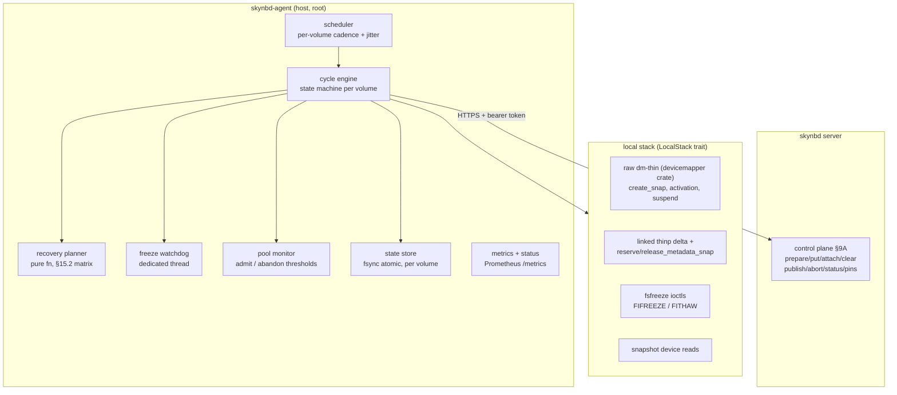
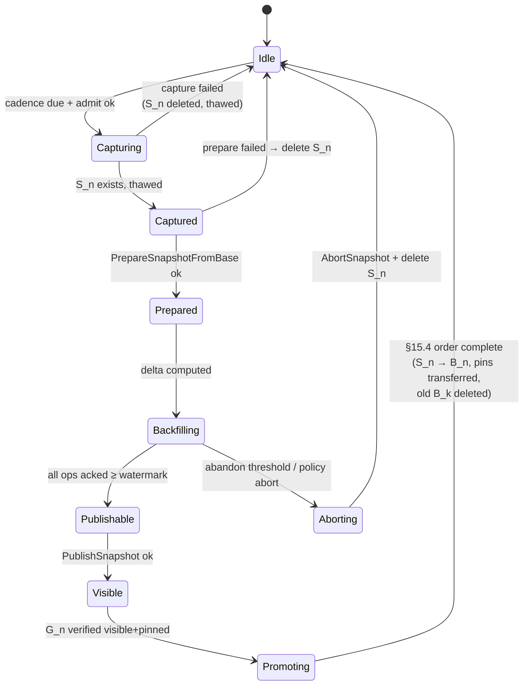
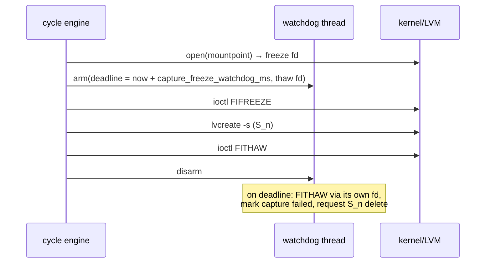

# skynbd-agent: Production Snapshot Agent Design

**Version:** 1.0
**Date:** July 2026
**Status:** Draft
**Implements:** client side of `skynbd-snapshot-design-v3_2.md` (the V3.2 spec)[^v32]
**Companions:** `skynbd_design.md` (server, v3)[^srv]; reference coordinator `tests/coordinator/coordinator_v32.py`

---

## 1. Context and Motivation

M7 delivered a *reference* V3.2 coordinator: a Python script that exercises the
happy path of the snapshot loop (fsfreeze → thin snapshot → `thin_delta` →
objectize → publish → verify → baseline promotion) well enough to gate the MVP
in CI. It is deliberately not production software: its state file is
best-effort, it has no freeze watchdog, no recovery-matrix startup logic, no
pool-health admission control, no metrics, no auth, and it dies where a real
agent must converge.

V3.2 already specifies what production requires — §15.1 durable state, the
§15.2 recovery matrix, the §7.11 freeze-liveness invariant, §8.5 pool
thresholds, the §10.8 baseline audit. This document is the *implementation*
design for that specification as a Rust crate in this workspace,
`skynbd-agent`, plus the milestone/task breakdown (M8, M9) that gets it built
TDD-style like every other crate here.

What this document adds beyond V3.2 (which stays authoritative for protocol
and invariants): the process/privilege model, the crate and module layout, the
on-disk state format, the *pure* recovery planner that makes the §15.2 matrix
unit-testable without root, the local-stack abstraction that lets the whole
state machine run in CI, and the concrete test plan mapped to V3.2 §21.

## 2. Goals and Non-Goals

### Goals

1. A deployable agent (`skynbd-agent` binary) that runs the V3.2 Phase A loop
   continuously for one or more lineage volumes on a host, unattended.
2. **Convergence over completion**: after a crash at *any* point, the agent
   restarts, observes local (LVM) and remote (control plane) state, and
   converges per the §15.2 recovery matrix with no manual repair.
3. **Freeze safety**: every freeze bounded by a watchdog that cannot itself
   block on the frozen filesystem; placement preflight enforced before the
   first capture on a host (§7.11, §9.3).
4. **Pool safety**: admission thresholds before capture, abandon thresholds
   during backfill, metadata-snap reservation hygiene (§8.5, §10.4).
5. Every state transition, decision, and failure observable: structured logs,
   Prometheus metrics, a status subcommand.
6. The full state machine testable **without root** — kernel/LVM interactions
   behind a trait with a deterministic fake; real implementation exercised in
   Tier B only.

### Non-Goals

- Replacing the Python reference coordinator (it remains the smallest
  executable statement of the contract, and S14 keeps running it).
- Workflow-barrier mode (V3.2 §9.10) — config surface reserved, not built.
- Pool rejuvenation / ping-pong migration (V3.2 §14) — post-M9.
- Restore orchestration and DR runbooks (V3.2 §15.7) — the server already
  exports any `G_n` read-only; tooling is separate work.
- Multi-agent HA per volume. MVP is one agent per lineage volume, enforced by
  deployment + a server-side lease (see §10; the API addition is small and
  listed as a dependency).
- LVM support. Decision (2026-07-22, after M8 core merged): `LvmStack` is
  **not built**. The deployment target is LVM-free minimal images, so
  `DmStack` (raw dm-thin via the `devicemapper` crate) is the first and
  only real `LocalStack`; the Tier B rig moves to raw `dmsetup`. An
  LVM-backed stack can return later behind the same seam if a deployment
  needs it.

## 3. Architecture

### 3.1 Process model

One binary, three run modes:

- `skynbd-agent run <config.toml>` — the daemon: scheduler + one state-machine
  task per configured volume + watchdog thread + pool monitor + metrics
  endpoint.
- `skynbd-agent once <config.toml> --volume <v>` — exactly one cycle
  (bootstrap or incremental), then exit. This is what the Tier B rig calls, so
  the agent is testable with the same scenario shape as the Python
  coordinator.
- `skynbd-agent status|state-dump|abort|preflight` — operator surface.

The daemon runs as **root in a hardened systemd unit** for M8 (fsfreeze
ioctls, `lvcreate`, `thin_delta`, and reading snapshot block devices all need
it), with `ProtectHome`, `ProtectSystem=strict` + explicit `ReadWritePaths`,
`NoNewPrivileges`, and a locked-down network (control plane endpoints only).
Splitting a minimal privileged helper from an unprivileged network process is
M9 hardening (§13), not M8 — the split is mechanical once the `LocalStack`
trait boundary (§3.3) exists, because that trait *is* the privilege boundary.

### 3.2 Component layout



Everything left of the `LocalStack` boundary is deterministic, synchronous-ish
Rust with no privileges required; everything inside `local` is the only code
that touches the kernel.

### 3.3 The `LocalStack` trait — the testing keystone

```rust
pub trait LocalStack {
    fn freeze(&self, mount: &Path) -> Result<FreezeGuard>;   // FIFREEZE on pre-opened fd
    fn thaw_fd(&self) -> ThawHandle;                          // usable by the watchdog thread
    fn snap_create(&self, origin: &LvRef, name: &str) -> Result<ThinSnap>; // records dev id + pool tx id
    fn snap_activate_ro(&self, snap: &ThinSnap) -> Result<()>;             // lvchange -ay -K -pr
    fn snap_delete(&self, snap: &ThinSnap) -> Result<()>;
    fn snap_list(&self, vg: &str) -> Result<Vec<ThinSnap>>;
    fn thin_delta(&self, b: &ThinSnap, s: &ThinSnap) -> Result<Delta>;     // reserve → run → release
    fn release_stale_metadata_snap(&self, pool: &PoolRef) -> Result<bool>; // startup hygiene
    fn pool_health(&self, pool: &PoolRef) -> Result<PoolHealth>;           // data/meta free bytes
    fn read_ranges(&self, snap: &ThinSnap, ranges: &[Range]) -> Result<ChunkReader>;
}
```

Two implementations:

- `DmStack` (M10b) — drives dm-thin directly through the `devicemapper`
  crate (no lvm2; see the M10b design notes in §14) and computes deltas
  **in-process by linking `thinp`**
  (the Rust thin-provisioning-tools library, git-pinned to a release tag):
  reserve the metadata snap via native DM ioctls (MPL-2.0 crate; no
  `dmsetup` fork, so reservation release is not at the mercy of a child
  process), open tmeta through `thinp`'s `io_engine` with
  `use_metadata_snap`, `thin::delta::get_mappings` for both device roots,
  then diff the two sorted run vectors ourselves (~50 lines, mirroring
  upstream's own `dump_diff` semantics) into typed `DeltaRange`s — no XML,
  no subprocess, no parser to maintain. Verified in Tier B against the
  `thin_delta` binary's output on the same pool (S14a cross-check).
  Freeze uses direct `FIFREEZE`/`FITHAW` ioctls (not the `fsfreeze`
  binary), so the watchdog owns a thaw fd no child can hold hostage.

### 3.4 Licensing

The repository is licensed under FSL-1.1-ALv2 (root `LICENSE`): the
Functional Source License 1.1, with each version becoming Apache-2.0 two
years after its release.

**Open issue: `thinp`.** The `dm` feature links `thinp` (the
thin-provisioning-tools library), which is GPL-3.0-only. It was adopted
while this repository was AGPL-3.0, where the combination was
uncomplicated: AGPLv3 and GPLv3 each carry an explicit clause (§13 of both)
permitting combination with the other. FSL has no such clause and is not
GPL-compatible, so a binary built with `dm` (the agent CLI and the CSI
driver) combines code under both licenses, and anyone redistributing such a
binary has GPL-3.0's terms for the combined work to consider. The plan is
to stop linking it: §15's first alternative, running the tool as a separate
program, restores the license boundary behind the unchanged `thin_delta()`
trait seam. Until that lands this is unresolved.

`thinp` is not on crates.io, so it enters as a git dependency pinned to a
release tag (v1.3.3 at time of writing); its internal API has no semver
contract, so bumps are deliberate, tested events (the S14a cross-check is
the regression gate).
- `FakeStack` — an in-memory thin pool model: an origin byte image, snapshots
  as instant copies, `thin_delta` computed from recorded chunk writes,
  injectable faults (fail at op N, hang freeze, pool-full at threshold). This
  is what lets V3.2 §21.1's crash matrix run as ordinary `cargo test`.

The control plane client gets the same treatment: an `AgentControlPlane` trait
with an HTTP implementation (reqwest, against the §9A/§11.1 API) and an
in-process fake wired directly to `skynbd-engine`'s `PreparedSession` — the
fake is *the real server logic*, so agent-vs-server integration tests run in
one process with no network.

## 4. Durable State (V3.2 §15.1)

### 4.1 Contents

One state record per managed volume, exactly the §15.1 field list:

```rust
pub struct AgentVolumeState {
    pub version: u32,                       // record schema version
    pub volume: String,                     // lineage volume name (server-side)
    pub phase: Phase,                       // §4.2 below
    pub baseline: Option<BaselinePair>,     // B_k: lv name, thin dev id, pool tx id
                                            // + G_k: snap id, pin holder
    pub candidate: Option<Candidate>,       // S_n: lv name, thin dev id, pool tx id, created_at
    pub prepared: Option<PreparedRef>,      // P_n: snap_id, target ref name G_n
    pub cursor: Option<OpCursor>,           // next op_id + completed-range watermark hint
    pub deadlines: Deadlines,               // candidate age, prepared age
    pub last_pool_health: Option<PoolHealth>,
    pub updated_at_ms: u64,
}
```

### 4.2 Phase machine



Transitions are the only writers of the state file; each transition is
`persist(state') → act` or `act → persist(state')` chosen per the §15.4
ordering rules — the invariant is that a crash between the two leaves a state
from which the planner (§5) can tell what happened by *observation*, which is
exactly what the V3.2 matrix guarantees is possible (§15.3 recomputability).

### 4.3 On-disk format

Framed postcard with magic `SAGT`, version 1 — the same 8-byte
`magic|version|flags` frame every other skynbd format uses[^fmt] — one file
per volume: `{state_dir}/{volume}.state`. Writes are atomic and durable:
write `{volume}.state.tmp`, `fsync(file)`, `rename`, `fsync(dir)`. A corrupt
or torn state file is **not fatal**: the planner treats "no trustworthy local
record" as its own observation row and reconstructs from LVM tags + remote
status (snapshot LVs are created with `--addtag` skynbd metadata so they are
self-describing). `skynbd-agent state-dump` prints the record as JSON.

The state directory placement is validated by preflight (§6.3): it must not
be on a freezable filesystem.

## 5. The Recovery Planner (V3.2 §15.2)

The planner is a **pure function** — no I/O, no clock reads:

```rust
pub fn plan(
    state: Option<&AgentVolumeState>,   // None ⇒ torn/absent state file
    local: &LocalObservation,           // which S_n / B_k LVs exist, tags, pool tx ids
    remote: &RemoteObservation,         // GetSnapshotStatus + baseline pin presence
) -> RecoveryAction
```

`RecoveryAction` is a small vocabulary: `Continue(Phase)`, `ResumeBackfill
{ from_watermark }`, `RepublishThenPromote`, `PromoteOnly`, `RebaselineFrom
{ remote_base }`, `Abort { delete_candidate }`, `Bootstrap`, and
`Quarantine(reason)` (refuse to act; page an operator — reserved for
genuinely contradictory observations, e.g. two candidate LVs).

Every row of the §15.2 matrix becomes a unit test asserting the planner's
output; a property test then drives the `FakeStack` through randomized crash
injection (kill after every persist/act boundary) and asserts the replayed
plan always converges to `Idle` with exactly one valid baseline pair and no
leaked pins/LVs/metadata-snap reservations — V3.2 §21.1 verbatim, as
`cargo test`.

Key planner rules beyond the matrix rows themselves:

- **Publish ambiguity resolves by status, never by retry-blind.** Crash during
  publish → `GetSnapshotStatus`; `Visible` ⇒ `PromoteOnly`, still prepared ⇒
  `RepublishThenPromote` (publish is idempotent server-side, I8).
- **`S_n` missing after publish** (matrix row 8): keep old `B_k` and
  `RebaselineFrom { G_n }` — pin `G_n` as the new remote base and schedule a
  fresh capture as the new local baseline; contents re-verified by sampled
  audit (§10.8) rather than re-upload.
- **Recompute over resume when cheap.** If the op cursor is unknown but `B_k`
  and `S_n` both exist, recomputing `thin_delta` (§15.3) plus idempotent
  replay above the server watermark is always correct; the planner prefers it
  whenever the cursor is stale.

## 6. Freeze Safety (V3.2 §7.11, §9.3)

### 6.1 Capture sequence



The watchdog is a dedicated OS thread armed *before* the freeze, holding its
**own** pre-opened fd; it performs no allocation, no logging to disk, and no
locking shared with the cycle engine while armed. On expiry it force-thaws,
records `freeze_watchdog_fired_total`, and the cycle engine (which observes
the disarm race via an atomic) deletes the partial `S_n` and fails the
capture cleanly. Both the happy path and the fired path publish the measured
freeze duration as a histogram metric; exceeding a *soft* budget (default
1 s, per the S14 gate) warns, the *hard* watchdog cap aborts.

### 6.2 Frozen-window discipline

While armed: no state-file writes, no disk logging (ring buffer flushed after
thaw), no control-plane calls (V3.2: none are needed in the window).
Enforced structurally — the freeze guard object is required by `snap_create`
and its type does not expose the state store.

### 6.3 Placement preflight

`skynbd-agent preflight` (also run automatically before the first capture on
each mount, results cached per boot):

1. `lvm.conf` archive/backup dirs and the lock dir resolve to non-freezable
   filesystems (or archiving is disabled).
2. Agent state dir, log destination, and metrics runtime dir have
   `st_dev` different from every managed mountpoint's device.
3. A udev settle probe: create+delete a throwaway thin snapshot and confirm no
   udev rule touched a managed mountpoint (best-effort warning, not fatal).
4. `lvm` version, tmeta metadata version compatible with the linked
   `thinp`, and thin-pool chunk size == configured `object_chunk_size`
   divisor checks.

Failures block capture (hard) with a specific error naming the offending path
— V3.2 requires preflight *before* the first capture, not during one.

## 7. Pool Health (V3.2 §8.5, §13)

The pool monitor polls `pool_health()` (data/metadata free bytes) on an
interval and at every phase boundary:

- **Admission** (before `Capturing`): both free-space figures must clear
  `thin_pool_admit_{data,metadata}_free_bytes`; otherwise the cycle is skipped
  with a metric + log, and retried next cadence tick.
- **Abandon** (during `Backfilling`/`Publishable`): dropping below
  `thin_pool_abandon_{data,metadata}_free_bytes` triggers `Aborting` —
  delete `S_n`, `AbortSnapshot(P_n)`, keep `B_k` — *before* the pool reaches
  error state. This is the V3.2 §13.4 rule: the baseline must survive; the
  candidate is always sacrificial.
- **Age policy**: `max_candidate_snapshot_age_s` bounds in-flight captures
  (policy abort); `max_baseline_age_s` and server-side `max_prepared_age`
  raise alerts only — abandon is a client decision (V3.2 §15.6), and
  the agent never auto-aborts someone else's prepared root.

Startup hygiene: `release_stale_metadata_snap` unconditionally releases a
leaked `reserve_metadata_snap` reservation (a crash between reserve and
release otherwise blocks every future `thin_delta` on the pool) — safe
because the agent is the only reserver on its pools (§7.9 single in-flight).

## 8. Objectize, Publish, Promote

Unchanged in substance from the reference coordinator, restated as
engineering requirements:

- Reads come from the **snapshot device only**, never the origin (V3.2
  §12.1); enforced by `read_ranges` taking a `ThinSnap`.
- Chunking at `object_chunk_size` (default 64 KiB == thin chunk); per-chunk
  `EnsureObject` → conditional `PutObject` → `AttachRange` with
  monotonically-assigned `op_id`s from the durable cursor; `left_only` delta
  ranges become `ClearRange`. Uploads run with bounded concurrency
  (`backfill_parallelism`, default 4) and a token-bucket bandwidth cap so
  backfill cannot starve the workload's own NBD traffic.
  *As built (issue #97):* the concurrency dial is `publish_pipeline_depth`
  (`publishPipelineDepth` under `[mounts]` and per volume,
  `SKYNBD_PUBLISH_PIPELINE_DEPTH` / `node.cache.publishPipelineDepth` on
  the CSI surface), default **1** (one op at a time). A batch of up to that
  many ops (closed early at 64 MiB of data) is read and hashed, checked
  with one `EnsureObject`, and its missing objects are uploaded
  concurrently, at most 64 at a time. It then attaches **in op order**, in
  one call under the batch's last `op_id`: `AttachRange` or `ClearRange`
  when every op is one kind, the mixed `ApplyRanges`
  (`POST …/prepared/{id}/apply`) when writes and discards interleave.
  The server lists `prepared-apply` in an `x-skynbd-features` header on
  every response; a server that lacks the header has no such route, and
  the agent then splits the batch into one call per contiguous same-kind
  run, each under that run's last `op_id`. Nothing is inferred from a
  404 or 403 that a proxy or an OIDC policy might also produce. A mixed
  batch is sent to `/apply` while the latest response advertised it; a
  refusal *without* the header (an old replica mid-upgrade, or a proxy's
  own 5xx) splits that batch and the rest of the cycle's, and the next
  cycle asks again — so a server upgraded or rolled back under a running
  agent is followed without a restart, at most one refused round trip
  per cycle. Such a refusal is not known to be unapplied (a proxy 504 can
  follow a server that staged the batch); the split re-applies the same
  ops in order, which is idempotent. Each switch to splitting is logged
  with the refusal's status. `mixedApply` (`[mounts]` and per volume;
  `SKYNBD_MIXED_APPLY` / `node.cache.mixedApply` on the CSI surface)
  overrides the header: `always` for a proxy that strips it in front of a
  server that has the call, `never` to split every mixed batch. `always`
  only skips the check before sending; a refusal without the header still
  splits the rest of the cycle, so it can't turn an old server into
  failed cycles.
  An `/apply` call is atomic — all of its ops are validated before any is
  staged — so against a server with it a mixed batch is all-or-nothing.
  Split, the runs are separate calls, and an older server's per-range
  `AttachRange`/`ClearRange` may stage part of a run before refusing a
  bad range; a crash, or a checkpoint, can land between runs. The
  op-order rule below makes both harmless. Above depth 1, consecutive
  batches overlap: batch k+1 is read, hashed, ensured and uploaded while
  batch k attaches, hiding a round trip per batch. Batch k+1 attaches
  only after batch k's attach returns, and memory stays one batch's data
  (an attach needs only the hashes). If batch k's attach fails, batch
  k+1's staging is cancelled where it stands (it is content-addressed and
  attaches nothing, so a resume just re-ensures it). If batch k+1's
  staging fails, batch k's attach still completes and the cycle fails
  after it. The every-64-ops progress report is sent by a reporter
  running beside the whole backfill (latest count only, one request at a
  time), so a slow status endpoint never holds up an attach or the
  publish. `publishOverlap = false` (`[mounts]` and
  per volume; `SKYNBD_PUBLISH_OVERLAP` / `node.cache.publishOverlap` on
  the CSI surface) keeps the batching but stages each batch only after
  the previous one attached. The data path may run ahead; the
  op path may not. A checkpoint at op N means every op ≤ N is
  durable and a resume skips them all, so attaching out of order could
  silently drop an op. The server's `EnsureObject` checks a batch's
  hashes concurrently. The bandwidth cap is not implemented.
- All control-plane calls retry idempotently with exponential backoff +
  jitter on transport errors; only `GetSnapshotStatus`-verified state advances
  the phase machine.
- Publish → verify visible+pinned → **§15.4 promotion order exactly**:
  persist S_n↔G_n mapping, mark `S_n` as `B_n` (LVM tag flip + state write),
  transfer the pin to the baseline holder, unpin old `G_k`, delete old `B_k`
  LV last.
- Per-cycle verification is **sampled, not full-device** (that is S14's job):
  `baseline_audit_sample_bytes` random ranges compared
  `blake3(S_n) == blake3(read of G_n export)` per V3.2 §10.8, plus the
  continuous baseline-pair audit on `baseline_audit_interval_s`. A full
  scrub subcommand exists for operators (`skynbd-agent scrub`).

## 9. Security

- Control plane over HTTPS with a bearer token read from a root-only file
  (`token_path`), sent as `Authorization: Bearer`. **Server dependency**: the
  API (`skynbd-api`) currently has no authn; M8 adds optional static-token
  middleware server-side (config `api.auth_token_path`) — deliberately
  minimal, mTLS is M9+.
- The agent never logs tokens, object payloads, or device contents.
- systemd hardening as in §3.1; the M9 privilege split moves `LvmStack`
  behind a `socketpair` into a helper that retains only the capabilities it
  needs (`CAP_SYS_ADMIN` for freeze ioctls and dm control).

## 10. Concurrency and Exclusivity (V3.2 §7.9)

Within the agent, one in-flight cycle per volume is structural (one task per
volume, phases are sequential). Across agents, the server enforces one
prepared root per lineage volume (server design §9A.7), which already
prevents concurrent *ingestion* — but a second misconfigured agent could
still fight over baseline pins. M8 adds a light **lease**: the agent writes
`meta` key `lease/{volume}` = `{host, expiry}` through a small API addition
(CAS on the existing meta machinery — no new server concepts), renews it at
half-TTL, and refuses to run a cycle without holding it. Losing the lease
mid-cycle → finish the current idempotent op, then abort per policy.

## 11. Observability

Prometheus `/metrics` (bind `metrics_listen`): freeze duration histogram +
watchdog fires, cycle duration by phase, delta bytes vs uploaded bytes
(dedupe ratio), op retries, pool free-space gauges, RPO age
(`now - last_visible_snapshot`), baseline/candidate/prepared ages, audit
compare failures (a nonzero value is a page), lease state. Structured JSON
logs (tracing) with `volume` and `cycle_id` on every span. `skynbd-agent
status` renders the state record + live gauges human-readably.

## 12. Configuration

```toml
# /etc/skynbd/agent.toml
server = "https://skynbd.example:8443"
token_path = "/etc/skynbd/agent.token"
state_dir = "/var/lib/skynbd-agent"        # preflight: non-freezable
metrics_listen = "127.0.0.1:9464"

[[volume]]
name = "vlin"                               # lineage volume (server)
vg = "skv"                                  # local VG
origin_lv = "A"                             # thin origin
mountpoint = "/srv/data"
pool_lv = "tp"
interval_s = 900
jitter_s = 60

[limits]                                    # V3.2 §8.5 knob names verbatim
capture_freeze_watchdog_ms = 5000
freeze_soft_budget_ms = 1000
thin_pool_admit_data_free_bytes = 1073741824
thin_pool_admit_metadata_free_bytes = 268435456
thin_pool_abandon_data_free_bytes = 268435456
thin_pool_abandon_metadata_free_bytes = 67108864
max_candidate_snapshot_age_s = 3600
max_baseline_age_s = 172800
baseline_audit_interval_s = 21600
baseline_audit_sample_bytes = 16777216
backfill_parallelism = 4
backfill_bandwidth_bytes_per_s = 0          # 0 = uncapped
```

## 13. Testing Plan (V3.2 §21) and Scenarios

| Layer | What | Runs where |
|---|---|---|
| Unit | planner decision table — one test per §15.2 row; state codec round-trip + torn-file recovery; watchdog arm/disarm/fire logic with a mock clock | every `cargo test` |
| Property | randomized crash injection over `FakeStack` + in-process control plane: kill after every persist/act boundary, restart, assert convergence, single baseline pair, zero leaked pins/LVs/reservations (§21.1) | every `cargo test` |
| Property | random write/discard workloads on `FakeStack`; post-publish `hash(S_n) == hash(G_n)` incl. `object_chunk = N × thin_chunk`, N > 1 (§21.4) | every `cargo test` |
| Integration | agent HTTP client vs real `skynbd-api` router (in-process axum), incl. auth token, retry/backoff on injected 5xx | every `cargo test` |
| **S15** (A) | agent crash matrix *through the real API over HTTP*: `once` mode with `SKYNBD_AGENT_CRASH_AT=<point>` env, restart, converge; FakeStack for the local side | PR CI |
| **S16** (B) | freeze liveness: LVM archive dir deliberately placed on the frozen fs in the rig → watchdog force-thaws within budget, capture fails cleanly; preflight rejects the placement (§21.2) | nightly |
| **S17** (B) | pool exhaustion drill: origin writes during backfill until admit, then abandon thresholds trip; assert abandon fires before pool error state, `B_k` survives, next capture succeeds; discard-heavy variant (§21.3) | nightly |
| **S14a** (B) | S14 parity: the nightly rig runs `skynbd-agent once` through bootstrap + 2 cycles on the same thin stack, same bit-for-bit gates as S14 | nightly |

`SKYNBD_AGENT_CRASH_AT` is compiled in unconditionally (it is a test seam,
checked once per phase boundary; zero cost when unset).

## 14. Milestones and Task Breakdown

### M8 — agent core (gate: S15 green in PR CI; S14a green in nightly)

- [ ] `crates/skynbd-agent`: types + `Phase` machine + `AgentVolumeState`
      codec (`SAGT` frame) + atomic fsync state store, with torn-write tests
- [ ] `LocalStack` trait + `FakeStack` (thin-pool model, fault injection)
- [ ] `AgentControlPlane` trait + in-process fake over `PreparedSession`
- [ ] Recovery planner + full §15.2 decision-table tests
- [ ] Crash-injection property suite (§21.1 as `cargo test`)
- [ ] Cycle engine: capture/prepare/backfill/publish/promote over the traits;
      op-cursor durability; retry/backoff
- [ ] Freeze watchdog thread + `FreezeGuard`; frozen-window discipline
- [x] ~~`LvmStack`~~ — dropped (see Non-Goals); `DmStack` in M10b is the
      real implementation (deltas still via linked `thinp` + §3.4 licensing)
- [ ] HTTP `AgentControlPlane` (reqwest) + static bearer-token middleware in
      `skynbd-api` (`api.auth_token_path`)
- [ ] Placement preflight (checks 1–2, 4; udev probe best-effort)
- [ ] `run`/`once`/`status`/`state-dump`/`preflight`/`abort` CLI; config
- [ ] S15 in `tests/e2e/run.sh` (Tier A) + CI wiring
- [ ] S14a in the nightly rig
- [ ] Sampled verify + `scrub` subcommand

### M9 — hardening (gate: S16 + S17 green in nightly; 24 h soak with
continuous baseline audit clean)

- [x] **`DmOps` seam**: `DmStack` split into rootless orchestration
      (`dm.rs`, generic over the `DmOps` kernel trait) and kernel glue
      (`dm_linux.rs`, feature `dm`). `MockDmOps` models a COW thin pool
      and *enforces* the campaign's kernel contracts (suspend-before-
      `create_snap`, activation-before-read, reservation pairing,
      EEXIST/EBUSY); the §21.1 crash matrix and the full pipeline now run
      with the production stack in PR CI (`crash_matrix_dm.rs`,
      `cycle_dm_mock.rs`). First catch: a no-op untag broke the §15.4
      "never two visible baselines" invariant mid-promotion → roles are
      now `sky-{vol}-{b|c|u}-{logical}` with untag a real rename to `u-`
      (invisible to the planner, findable for deletion).
- [ ] Pool monitor: admission + abandon thresholds + age policies wired to
      the phase machine; startup metadata-snap release
- [ ] S16 freeze-liveness scenario; S17 pool-exhaustion drill
- [ ] Lease (`meta` CAS API addition + agent renew/refuse logic)
- [ ] Prometheus metrics + tracing spans per §11; RPO-age alert docs
- [ ] Baseline-pair continuous audit (§10.8) in the daemon + soak harness
- [ ] systemd unit + packaging (static musl build), install docs
- [ ] Privilege split: `LinuxDmOps` behind a socketpair helper, capability
      drop — the `DmOps` trait *is* the RPC surface now that the seam
      exists
- [ ] Operator runbook: quarantine states, rebaseline procedure, DR pointers

### M10 (active, pulled ahead of M9) — real stack + local attach

Ordering revised after the M8-core merge: M10 lands **before** M9, because
building `LvmStack` only to replace it with `DmStack` would be waste, and
M9's hardening (pool monitor, lease, metrics, audit, packaging) belongs on
top of the real stack. Two slices:

**M10a — verifiable without a kernel** (Tier A): NBD over Unix domain
sockets (server side, below); static bearer-token auth in `skynbd-api`
plus the two read endpoints the agent needs (pins list, snapshot range
read); `HttpControlPlane` (reqwest); **S15** — the §21.1 crash matrix run
through the real REST API over real HTTP (FakeStack local side) in PR CI.

**M10b — kernel work** (Tier B nightly): `DmStack`, freeze watchdog +
`FreezeGuard`, placement preflight, the CLI
(`run`/`once`/`status`/`state-dump`/`preflight`/`abort`), the raw-dmsetup
thin-pool rig, and **S14a** agent parity.

### M10b design notes — `DmStack`: LVM-free operation

M10 also carries a server-side companion (server design §15, M10 row):
NBD over **Unix domain sockets**. Today `skynbdd` binds TCP only; UDS is a
listener/stream-generic refactor with the protocol untouched, and every
client in the rig already speaks it (`nbd-client -unix`,
`nbd+unix:///vol/head?socket=…` for qemu-io/qemu-img/nbdinfo). For the
same-host pool-volume attach the agent depends on, that removes the TCP
stack from the data path and replaces port-based exposure with socket
file permissions — the right default for the Alpine-class single-host
deployment this milestone targets.

Motivation: minimal-image deployments. On a ~5 MB Alpine base, `lvm2` costs
~2.3 MB installed (plus libdevmapper glue and udev expectations); dropping
`thin-provisioning-tools` already saved ~1.8 MB. End state: one static musl
binary whose host requirements are a dm-thin-capable kernel,
`/dev/mapper/control`, and the pool device — zero storage tools installed.

A second `LocalStack` implementation driving dm-thin directly through the
`devicemapper` crate (already linked for the metadata-snap ioctls). The
agent takes over what lvm2 does today:

- **Device-ID allocation**: `create_snap`/`create_thin` messages to the
  tpool; IDs recorded in durable state (the `thin_dev_id` field exists for
  exactly this) and recoverable by listing dm devices.
- **Activation**: load `thin` target tables directly; snapshots activated
  read-only (the §12.1 immutability enforcement moves from `-pr` to the
  table flags).
- **Role tagging**: LVM tags disappear — roles are encoded in dm device
  UUIDs/names, so observation remains reconstructible from the device list
  alone. Same planner, different observer.
- **Capture serialization**: raw dm-thin requires the origin quiesced
  around `create_snap` (LVM did this for us); a dm suspend/resume of the
  origin inside the existing fsfreeze window covers it without widening
  the freeze budget. The watchdog must also force-resume on expiry.
- **Preflight** changes shape: pool/dev-id consistency checks replace the
  lvm.conf placement checks (no LVM archive dir to police — one hazard
  class disappears outright).

Sequenced after M9 deliberately: the crash matrix, S14a, S16, and S17 must
be guarding the semantics before we swap the implementation under them —
which is also the payoff of the trait seam: `DmStack` lands by passing the
same suites, and `LvmStack` remains for hosts already managed by LVM.

## 15. Alternatives Considered

- **Exec `thin_delta` as a subprocess instead of linking `thinp`.** This was
  rejected while the repository was AGPL-3.0, which composes with GPLv3
  directly: the subprocess's only virtue was the license boundary, and its
  costs, while modest, were pure waste. Those costs: ~100 B of XML per delta
  run each side (≈6 MB / tens of ms for a typical 4 GiB churn cycle;
  ≈160 MB / 1–3 s for a pathological fully-fragmented 100 GiB delta — 1–3 %
  of that cycle's upload time), plus external tool version skew and stderr
  scraping. The btree-walk cost is identical either way. **The relicense to
  FSL-1.1-ALv2 reverses that judgment** (§3.4): the license boundary is now
  the point, so this is the planned replacement for the linkage. The
  `thin_delta()` trait seam is unchanged, so it slots in as another
  implementation. One thing it must handle: thin-provisioning-tools 1.x
  writes shared mapping subtrees as `<def>`/`<ref>` in `thin_dump` output,
  where 0.9.x writes every mapping inline.
- **Harden the Python coordinator.** Rejected: no shared types with the
  workspace (frame/codec drift risk), packaging and privilege hardening are
  weaker, and the crash-injection property suite needs the planner as a pure
  function — natural in Rust, awkward bolted onto the script. The script's
  value is being *small*; hardening would destroy that.
- **Embed the agent in `skynbdd`.** Rejected: the agent must run on the
  *client* host (freeze + LVM locality); the server may be elsewhere. Also
  opposite privilege profiles (server needs none of root; agent needs it).
- **One-shot cron binary instead of a daemon.** Rejected as the primary mode:
  the watchdog, pool monitor, lease renewal, and audit are continuous
  concerns. But the `once` mode *is* kept, both for the Tier B rig and as the
  composable escape hatch.
- **JSON state file.** Rejected for the record itself (framed postcard keeps
  one codec discipline repo-wide, and the frame gives magic+version for free);
  JSON is kept as the `state-dump` *view*.

## 16. Open Questions

1. **Auth beyond static token** — mTLS or OIDC for fleets; M9+.
2. **Lease API shape** — reuse `meta` CAS vs a first-class `AcquireLease`
   op with server-enforced fencing of ingestion calls. M8 ships the former;
   revisit before multi-gateway (server §16.1).
3. **XFS**: `fsfreeze` semantics match ext4; the rig only proves ext4. Add an
   XFS leg to S14a when it matters.
4. **`ObjectizeFromHead`** (V3.2 §17.10) would remove most of the agent's
   device-read bandwidth; agent code should keep objectization behind a trait
   so the server-side variant slots in.

## References

[^v32]: `docs/skynbd-snapshot-design-v3_2.md` — client-side V3.2 spec. Key
    sections used here: §6.5 placement, §7.9/§7.11 invariants, §8.5 knobs,
    §9.3 capture, §10.8 audit, §13 space pressure, §15 recovery, §21 test
    requirements.
[^srv]: `docs/skynbd_design.md` — server design v3; §9A ingestion control
    plane (the API this agent speaks), §14.4 scenario table, §15 milestones.
[^fmt]: Server design §5.1: 8-byte frame `magic | version u16 LE | flags
    u16 LE` + postcard body; agent state reuses it with magic `SAGT`.
