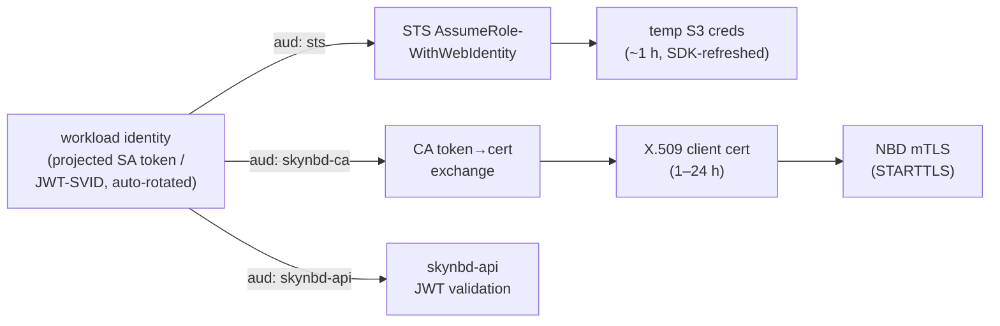
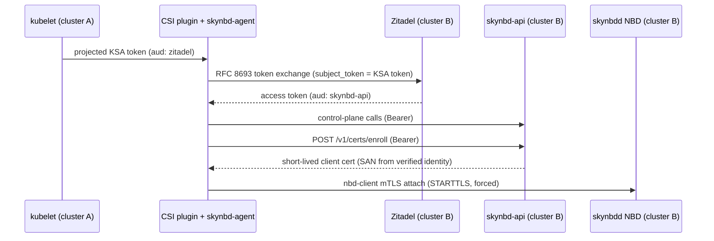

# SkyNBD Authentication Design — Zero Long-Lived Secrets via OIDC Workload Identity

Status: draft for review · Extends `skynbd_design.md` §8.1/§12.2 and
`skynbd-agent-design.md` §9/§16.1 (the "mTLS or OIDC for fleets; M9+" open
question). No gateway, tunnel, or sidecar proxy in the trust path: every
plane authenticates in-process.

## 1. Goals and non-goals

Goals:

1. **Zero long-lived secrets.** No static bearer tokens, no static S3 keys,
   no year-lived client certificates. Every credential a workload holds is
   short-lived (minutes–hours) and automatically renewed. The only durable
   trust anchors are an OIDC issuer's signing keys and a CA root — both held
   by infrastructure, not by SkyNBD workloads.
2. **Automatic mTLS on the NBD data plane** (`NBD_OPT_STARTTLS`), with
   client certificates obtained by exchanging the workload's OIDC ID token —
   no operator-managed cert distribution.
3. **Ambient credentials for the S3 backend**: the daemon picks up
   `AWS_WEB_IDENTITY_TOKEN_FILE`, `AWS_ROLE_ARN`, `AWS_ENDPOINT_URL_STS`
   (and the rest of the SDK env/profile surface) with no keys in
   `skynbd.toml`.
4. **OIDC bearer auth on the REST control plane**, replacing the static
   token as the production mode (static stays for dev).

Non-goals: multi-tenant isolation beyond per-identity export/volume ACLs;
online revocation infrastructure (short TTLs are the revocation story);
encrypting the S3 data at rest (orthogonal, store-layer concern).

## 2. Identity foundation: one workload token, three audiences

Every SkyNBD participant (the daemon, `skynbd-agent`, NBD-mounting hosts)
runs somewhere that can mint OIDC ID tokens for it: Kubernetes projected
ServiceAccount tokens, SPIRE JWT-SVIDs, or a cloud instance identity
bridged through an IdP. That single ambient identity is exchanged three
ways — never presented raw to more than one relying party:



**Audience separation is load-bearing.** Each exchange uses a token minted
for a distinct audience (Kubernetes projects per-audience tokens natively),
so a token stolen from one plane cannot be replayed at another. A raw
identity token is never sent to the NBD port at all — only the certificate
derived from it.

## 3. NBD data plane: STARTTLS + mTLS

### 3.1 Protocol and server changes (`skynbd-nbd`)

- Implement `NBD_OPT_STARTTLS` with `tokio-rustls` (already on the
  dependency shortlist, design §12.4). Config-gated modes:
  - `off` — today's behavior (dev, UDS deployments).
  - `forced` — production. Per the spec's FORCEDTLS policy, every option
    except `STARTTLS`/`ABORT` before the handshake is answered with
    `NBD_REP_ERR_TLS_REQD` (2³¹+5), so export names never cross the wire in
    cleartext. (`selective` is deliberately omitted: nothing in our export
    model wants per-export TLS optionality, and FORCEDTLS is the only mode
    that doesn't leak `OPT_LIST`.)
- Negotiation restructure: `negotiate()` currently owns one `&mut St` for
  its whole loop. It splits into a pre-TLS phase (plain stream; only
  `STARTTLS`/`ABORT` productive under `forced`) that returns
  `Upgrade(stream)`, a `TlsAcceptor::accept` step, and the existing option
  loop resumed over `TlsStream<St>`. The `NbdStream` trait already
  abstracts the transport, so `transmission()` is untouched; the connection
  handler carries an `enum MaybeTls<St> { Plain(St), Tls(TlsStream<St>) }`
  or boxes the stream.
- Client verification: rustls `WebPkiClientVerifier` against a configured
  trust bundle (the workload CA). Handshake completes only with a valid,
  in-window client cert chaining to the bundle.
- Identity extraction: from the verified leaf cert, prefer a **URI SAN**
  (SPIFFE ID, e.g. `spiffe://prod/ns/db/sa/pg-host`), fall back to DNS SAN.
  rustls verifies the chain but does not surface SANs, so the leaf is
  parsed with `x509-parser` post-handshake. The identity string lands in
  `ConnState` and in the connection-accept log line (which moves from
  `debug` on teardown to `info` on attach — the audit trail requirement).
- Server certificate: also short-lived, obtained by the same issuance flow
  (§3.2). Served through a `ResolvesServerCert` impl holding
  `ArcSwap<CertifiedKey>`; a file-watcher (or mtime poll, 30 s) swaps in
  renewed cert/key and reloads the client-CA bundle. In-flight connections
  are unaffected; new handshakes use the new material. **Hot-reload is
  mandatory**, not nice-to-have: with 24 h certs, a restart-to-rotate
  design would mean daily remounts.

### 3.2 Client cert issuance: does ID-token → cert exchange work?

**Yes — this is a well-trodden pattern with at least three off-the-shelf
implementations**, and it is the right mechanism for goal 1. The CA
validates the workload's OIDC ID token (issuer JWKS, audience
`skynbd-ca`, expiry) and issues a short-lived X.509 cert whose SANs are
templated from the token's claims:

| Issuer option | Exchange mechanism | Fit |
|---|---|---|
| **step-ca** (smallstep), OIDC/JWK provisioner | `POST /1.0/sign` with the ID token; SANs templated from `sub`/claims; `step ca renew --daemon` handles rotation | Lightest self-hosted option; literal "ID token in, cert out" |
| **SPIRE** | Workload attestation (k8s SA, cloud instance identity) → X.509-SVID over the Workload API; `spiffe-helper` writes rotating PEM files | Best for fleets; gives the SPIFFE URI SAN scheme the ACLs below assume; strictly speaking attestation-based rather than token-exchange, same trust shape |
| **Vault** PKI + JWT auth | JWT login → Vault token → `pki/issue/<role>` | Fits shops already running Vault |
| cert-manager `csi-driver-spiffe` | k8s-native, cert mounted as a volume | Kubernetes-only clusters |

SkyNBD itself stays out of the CA-client business: **skynbdd and skynbd
clients consume PEM files from disk and hot-reload them**; issuance and
renewal are delegated to the chosen tool's agent (`step ca renew`,
`spiffe-helper`, cert-manager). This keeps the daemon dependency-light and
makes the CA choice swappable. The one hard requirement we impose on the
CA config is the **claim→SAN template**: the SAN must be a stable,
ACL-matchable encoding of the workload identity (recommended:
`spiffe://<trust-domain>/<component>/<instance>`), because the server
authorizes on nothing else.

**Amendment (§9): control-plane cert enrollment for skynbd-native
clients.** The external-CA stance above assumes the client certs have
relying parties beyond SkyNBD. For skynbd-native consumers (the CSI
driver, `skynbd-agent`), the *only* verifier of an NBD client cert is
skynbdd itself — when issuer and verifier are the same system, an
external CA adds a deployment dependency without adding trust. So the
control plane additionally offers `POST /v1/certs/enroll`: authorized by
the caller's API bearer token (§4), it returns a short-lived client cert
signed by skynbd's own root, with the SAN derived from the token's
verified identity — the same claim→SAN discipline, enforced by the
issuer that will do the verifying. The NBD trust bundle is configured as
a list, so skynbd's own root and an external CA (SPIRE/step-ca shops)
can coexist; external issuance remains fully supported.

Concretely (implemented): `[api.enroll]` (`ca_cert_path`, `ca_key_path`,
`trust_domain`, `ttl_s`) enables the endpoint; the caller POSTs a CSR
(proof of possession — only its public key is used) and needs a binding
granting the `enroll` op; the SAN is
`spiffe://{trust_domain}/{sub with ':' as '/'}`; the trust bundle list is
`[nbd.tls] client_ca_paths`. CA material is re-read per issuance, so root
rotation needs no restart.

Design consequences to accept deliberately:

- **Authorization happens at handshake time.** NBD connections are
  long-lived (a mounted filesystem); certs expire in hours. Standard TLS
  practice — and ours — is that cert validity is checked at handshake, and
  an established connection survives its cert's expiry. A stolen *cert*
  therefore has value only until its TTL; a hijacked *connection* lives
  until closed. Optional mitigation, off by default:
  `max_connection_age` that closes transmission after N hours, leaning on
  kernel-client reconnect (`nbd-client -persist`) to force a fresh
  handshake with fresh credentials.
- **The CA is in the mount path, not the IO path.** CA downtime blocks new
  connects/renewals but never in-flight IO. Acceptable; document it.
- **Short TTL replaces revocation.** No CRL/OCSP. Compromise response =
  stop issuing to that identity + optionally bounce connections.

### 3.3 Authorization: per-identity export ACLs

With identities on every connection, the all-or-nothing gap closes:

```toml
[[nbd.acl]]
identity = "spiffe://prod/agent/*"        # glob on the SAN
exports  = ["*/head", "*/snap/*"]
write    = true

[[nbd.acl]]
identity = "spiffe://prod/restore-worker/*"
exports  = ["*/snap/*"]                    # snapshots only, read-only
write    = false
```

- Evaluated at `OPT_GO`, `OPT_EXPORT_NAME` (the legacy path gets the same
  gate), and `OPT_LIST` (list is filtered to the visible set).
- Deny → `NBD_REP_ERR_UNKNOWN`, indistinguishable from "no such export" —
  no existence oracle. (`EXPORT_NAME` already closes on unknown; same
  behavior.)
- `write = false` forces the export's read-only transmission flags for that
  connection even on `*/head`, reusing the existing `Export.read_only`
  mechanism per-connection.
- No matching rule → deny. Empty ACL table under `forced` TLS → deny all
  (fail closed); a `default_allow = true` escape hatch exists for
  "mTLS for encryption only" migrations.

### 3.4 Client compatibility

| Client | Works? | Notes |
|---|---|---|
| `nbd-client` (kernel mounts) | ✔ ≥3.10, GnuTLS build | Reads cert/key files at connect; stays resident as userspace TLS relay (kernel can't TLS). Rotation picked up on reconnect. |
| qemu / qemu-nbd / qemu-io | ✔ | `tls-creds-x509` dir; long-running VMs re-read on reconnect. |
| libnbd / nbdinfo | ✔ | `nbd_set_tls(NBD_TLS_REQUIRE)` + cert opts. |
| E2E suite | Extend the promised TLS smoke (design §14, nightly) to: FORCEDTLS spec compliance (`TLS_REQD` pre-TLS), ACL allow/deny matrix, rotation-under-load, plaintext-client rejection. |

rustls constraints are compatible: TLS 1.2/1.3 (GnuTLS-fine), SANs
required (CN-only certs unsupported — a non-issue for a fresh CA profile).

## 4. Control plane (`skynbd-api`): OIDC bearer

Replace the static token as the production mode with direct ID-token
validation — the API is itself a relying party, no cert needed:

```toml
[api.auth]
mode = "oidc"                           # "disabled" | "static" | "oidc"

# Workload issuer: the cluster's ServiceAccount OIDC issuer (the same
# trust root the S3 WIF path uses; may be HSM-backed). Bindings match sub.
[[api.auth.issuers]]
issuer   = "https://oidc.eks.example.amazonaws.com/id/ABC"
audience = "skynbd-api"
# jwks_url = "..."                      # override for private issuers

[[api.auth.issuers.bindings]]
sub     = "system:serviceaccount:prod:skynbd-agent"
volumes = ["db-*"]
ops     = ["ingest", "snapshot", "diff", "rpo"]   # op groups, not routes

# Human/CI issuer: the org IdP (e.g. Zitadel). Bindings match a roles
# claim so grants are managed centrally in the IdP, not in this file.
[[api.auth.issuers]]
issuer      = "https://auth.example.com"
audience    = "skynbd-api"
roles_claim = "urn:zitadel:iam:org:project:roles"

[[api.auth.issuers.bindings]]
role    = "skynbd-operator"
volumes = ["*"]
ops     = ["snapshot", "diff", "rollback", "gc"]
```

- Validation is **offline**: JWKS fetched from OIDC discovery, cached with
  refresh (respecting HTTP cache headers; forced refresh on unknown `kid`),
  then per-request signature + `iss`/`aud`/`exp`/`nbf` checks. No
  introspection round-trip in the hot path. Crate: `jsonwebtoken` plus a
  small JWKS cache (or `openidconnect` if we want discovery handled).
- **Multiple trusted issuers**, dispatched on the token's `iss` claim
  before JWKS lookup. Bindings match either `sub` (workload SAs) or a
  role from a per-issuer `roles_claim`, mapping to volume globs and
  operation groups — closing the "one token can rollback anything" gap.
  `/healthz` stays open; `/metrics` gains an `ops = ["metrics"]` group.
- `mode = "static"` keeps today's `api_auth_token_path` behavior for dev
  and as a break-glass path; the comparison moves to `subtle::ConstantTimeEq`.

### 4.1 Division of labor: cluster issuer vs org IdP (Zitadel)

An IdP like Zitadel is an **issuer, not an attestor**: it cannot observe
pods or hosts, and its service users authenticate with a client secret or
private key — a long-lived credential that would undo goal 1 if used for
workloads. The split that keeps the zero-secret property and still earns
the IdP its keep:

- **Workloads stay on the cluster issuer, directly.** Projected SA tokens
  are ambient, kubelet-rotated, and (in hardened clusters) HSM-rooted; the
  agent's path to the API needs no extra hop or availability dependency.
- **Humans and CI go through the IdP.** The cluster issuer has no story
  for an operator's laptop; the IdP gives `skynbdctl login` via
  device/PKCE flow (SSO, MFA, short-lived tokens, per-person audit),
  central *deactivation* (cluster tokens can only expire, never be
  revoked), and grant management in the IdP's admin surface instead of
  per-daemon TOML — the `roles_claim` binding above.

Zitadel specifics: set the application's access-token type to **JWT**
(the default opaque tokens would force online introspection, which the
hot path excludes); roles arrive in `urn:zitadel:iam:org:project:roles`.
If the deployment later spans many clusters, Zitadel's RFC 8693 token
exchange can federate cluster issuers behind one trusted issuer so
daemons stop accumulating `[[api.auth.issuers]]` entries — an option, not
a day-one requirement. The same split applies to the CA (§3.2): workload
certs chain to cluster/SPIRE attestation; an OIDC-provisioner CA can
additionally trust the IdP for operator-issued certs if humans ever need
direct NBD access (rare; prefer the API).
- Agent side (`HttpControlPlane`): `token_path` now points at the
  **projected token file** (audience `skynbd-api`) and is re-read per
  request (mtime-cached) instead of once at startup — kubelet rotates it
  hourly. Retry-once-on-401 covers rotation races.

## 5. S3 backend: ambient credentials (`skynbd-store`)

`S3Store::new` pins static keys and never consults the environment
(`s3.rs:27` — "no ambient config"), and `StoreConfig::S3` makes
`access_key`/`secret_key` mandatory. Changes:

- Add `S3Store::from_env(endpoint: Option<&str>, bucket, region: Option<&str>)`
  built on `aws_config::defaults(BehaviorVersion::latest()).load()` +
  `aws_sdk_s3::config::Builder::from(&shared)`. The default chain gives us,
  with zero further code:
  - **Web identity**: `AWS_WEB_IDENTITY_TOKEN_FILE` + `AWS_ROLE_ARN` →
    `AssumeRoleWithWebIdentity`, auto-refreshed by the SDK before expiry
    (the goal-1 path: kubelet rotates the token file, SDK re-reads it on
    each refresh);
  - **`AWS_ENDPOINT_URL_STS` and friends**: service-specific endpoint env
    vars are honored by `aws-config` 1.x, so the web-identity STS call can
    target MinIO's STS shim (`AssumeRoleWithWebIdentity` with an OIDC
    provider configured, audience `sts-minio`) or any AWS-compatible STS —
    plus `AWS_ENDPOINT_URL_S3`, profiles, IMDS/ECS roles for free;
  - env-var static keys for CI (`AWS_ACCESS_KEY_ID`/`SECRET`), keeping the
    MinIO conformance suite unchanged.
- `StoreConfig::S3` keys become `Option<String>`; both present → static
  path (unchanged dev/MinIO ergonomics), both absent → `from_env`, exactly
  one → config error. TOML `endpoint`/`region` become optional too, so an
  env-only deployment needs nothing but `kind = "s3"` and `bucket`.
- `ensure_bucket()` becomes opt-in (`create_bucket = true`, default true
  for memory-of-old-behavior in dev; recommended `false` in prod): a
  least-privilege WIF role should not carry `s3:CreateBucket`, and today's
  unconditional call would fail the daemon at startup under such a role.
- `force_path_style` becomes config (default `true` today; must be
  settable `false` for AWS virtual-hosted buckets).

## 6. Credential inventory after this design

| Credential | Holder | Lifetime | Rotated by | On compromise |
|---|---|---|---|---|
| OIDC issuer signing keys | platform (k8s/IdP) | platform-managed | platform | platform incident |
| CA root/intermediate | step-ca / SPIRE / Vault | months / days | CA tooling | reissue bundle; hot-reloaded by skynbdd |
| NBD client & server certs | each workload | 1–24 h | CA agent (`step ca renew`, `spiffe-helper`) | expires on its own; stop issuance |
| Projected ID tokens (3 audiences) | each workload | ~1 h | kubelet / SPIRE | expires on its own |
| S3 session credentials | skynbdd process memory | ~1 h | AWS SDK chain | expires on its own |
| ~~`api_auth_token_path` static token~~ | dev only | — | — | dev-only blast radius |

Nothing durable ever sits on a SkyNBD host's disk except auto-rotated
short-lived material. `skynbd.toml` contains no secrets.

## 7. Rollout

1. **S3 ambient auth** (smallest, independent): `from_env`, optional config
   keys, `create_bucket` gate. Unblocks IRSA/WIF deployments immediately.
2. **API OIDC**: middleware + bindings; agent token re-read. Static mode
   retained.
3. **NBD STARTTLS `forced` + mTLS + ACLs**: the §3 work — protocol phase
   split, rustls, identity extraction, ACL table, hot-reload, E2E matrix.
   This is the M9+ item from agent-design §16.1; 1–2 milestones on its own.
4. **Hardening riders** (with 3): handshake/negotiation timeout,
   `max_connection_age` option, attach-time `info` logging with identity,
   auth-failure counters in `/metrics`.
5. **Cert enrollment endpoint** (§3.2 amendment, after 2 and 3):
   `POST /v1/certs/enroll`, skynbd root key handling, bundle-list config.
6. **skynbd-csi-driver** (§9, after 5): controller/node plugins, Zitadel
   token-exchange spike first (§9.4), lease/fencing dependency.
   Sub-steps: (a) dynamic volume lifecycle API — `POST/DELETE
   /v1/volumes`, refs-store catalog, `volume` op group (implemented);
   (b) the driver itself + container images (ghcr, amd64+arm64) + Helm
   chart (implemented: `bins/skynbd-csi-driver`, `Dockerfile` targets
   csi-driver/skynbdd, `deploy/charts/skynbd-csi-driver`);
   (c..i) the remainder — k3s CI smoke (+ issuer `tls_ca`), CSI
   snapshots, RO snapshot mounts vs server-side fast clones, the
   V3.2 thin-stack node mode (dm-thin over dm-cache writeback over
   NBD), and the workstation mount CLI — are broken down with their
   design decisions in `docs/skynbd-csi-design.md`.

## 8. Rejected alternatives

- **TLS-PSK** (qemu supports it): a PSK is definitionally a shared
  long-lived secret — fails goal 1 unless we invent short-lived PSK
  distribution, which just rebuilds the CA poorly. `nbd-client` support is
  also spotty.
- **Bearer token inside the NBD stream**: no such option exists in the NBD
  spec; a private extension would break qemu/libnbd/nbd-client interop —
  the whole value of speaking standard NBD.
- **Implicit TLS (TLS-from-byte-zero) listener**: no mainstream NBD client
  can dial it (the spec only defines STARTTLS); would force tunnels back
  onto every client — the thing this design exists to avoid.
- **Gateway/sidecar mTLS**: workable (and remains a valid interim), but
  per-export authorization is impossible from outside the stream, identity
  never reaches the server's audit log, and the plaintext last hop must be
  policed. Superseded by in-process mTLS.
- **skynbdd calling the CA itself** (built-in ACME/step client): couples
  the daemon to one CA's API and adds a renewal state machine we'd have to
  crash-test; file-watch + external renewal agents is the same guarantee
  with none of the surface. (Distinct from the §3.2 amendment: that makes
  the control plane an *issuer* for certs only it verifies, not a *client*
  of someone else's CA — the coupling objection doesn't apply.)

## 9. Cross-cluster consumption: skynbd-csi-driver (WIF end to end)

The scenario that exercises every plane at once: workload **cluster A**
runs a `skynbd-csi-driver` providing PersistentVolumes; **cluster B**
runs the SkyNBD control plane, the NBD service, and the org's Zitadel.
No secrets are provisioned into cluster A — its only identity source is
its own ServiceAccount issuer, federated into Zitadel.

### 9.1 Why the hub is mandatory here (not optional, as in §4.1)

Cross-cluster breaks the "workloads talk to their own cluster issuer"
assumption: skynbd in cluster B would otherwise need a trust entry — and
JWKS reachability — for every workload cluster, and private clusters
often don't expose their issuer at all. Federating each workload cluster
into Zitadel once (JWT IdP: issuer + JWKS endpoint) keeps skynbd's
config at one trusted issuer, and disabling that IdP entry revokes an
entire compromised cluster at once.

### 9.2 Flow



The KSA token is minted per-pod with `aud` = the Zitadel client; the
exchanged token carries `aud=skynbd-api`; the cert is scoped by its SAN.
Audience separation (§2) holds at every hop — no token is replayable at
a plane it wasn't minted for, and no bearer token ever touches the NBD
port.

### 9.3 CSI specifics

- **Two identities, not one.** The *controller* plugin (CreateVolume /
  DeleteVolume / snapshots via the API) and the *node* plugin (NodeStage:
  enroll cert, `nbd-client`, mkfs/mount) run under different
  ServiceAccounts, get different Zitadel roles, and — for nodes —
  per-node cert SANs, so NBD ACLs (§3.3) can scope which node may attach
  which volume and node revocation is a TTL away.
- **The agent becomes a node-resident credential daemon.** Token
  exchange, cert renewal ahead of expiry, and nbd-client lifecycle are
  continuous duties, not a one-shot mount hook; this is a new mode (or
  sibling binary) reusing `HttpControlPlane`, not the dm-thin snapshot
  loop.
- **Fencing is load-bearing.** RWO semantics require the control plane
  to enforce exclusive attach, or CSI will double-mount on node
  failover — the lease open question (agent design §16.2) must land
  with, not after, the CSI driver.

### 9.4 Prerequisites and failure domains

- Cluster A's SA issuer discovery/JWKS must be reachable **by Zitadel**
  (managed clusters publish it; on-prem must expose or mirror it).
  Nothing in cluster B beyond Zitadel needs it.
- Zitadel needs token exchange enabled (v2.49+) with the JWT IdP
  configured for cluster A. **Spike before committing**: validate the
  exact external-JWT-as-`subject_token` configuration — the JWT IdP docs
  target session creation, and the token-exchange combination has
  community-reported nuances. Fallbacks if rough: skynbd-api trusts
  cluster A's issuer directly (§4 multi-issuer — loses the hub benefits),
  or one Zitadel machine user per cluster (one scoped long-lived key per
  cluster; honest compromise, documented as such).
- Zitadel and the enrollment endpoint sit in the **provision/attach/renew
  path only** — an outage blocks new mounts and renewals, never in-flight
  IO. Size cert TTLs to ride out realistic outages; note that a node
  rebooting during an outage cannot re-attach until it clears.
- Cluster A nodes reach cluster B's NBD endpoint directly over
  forced-TLS mTLS — no tunnels, which is the point of §3.
