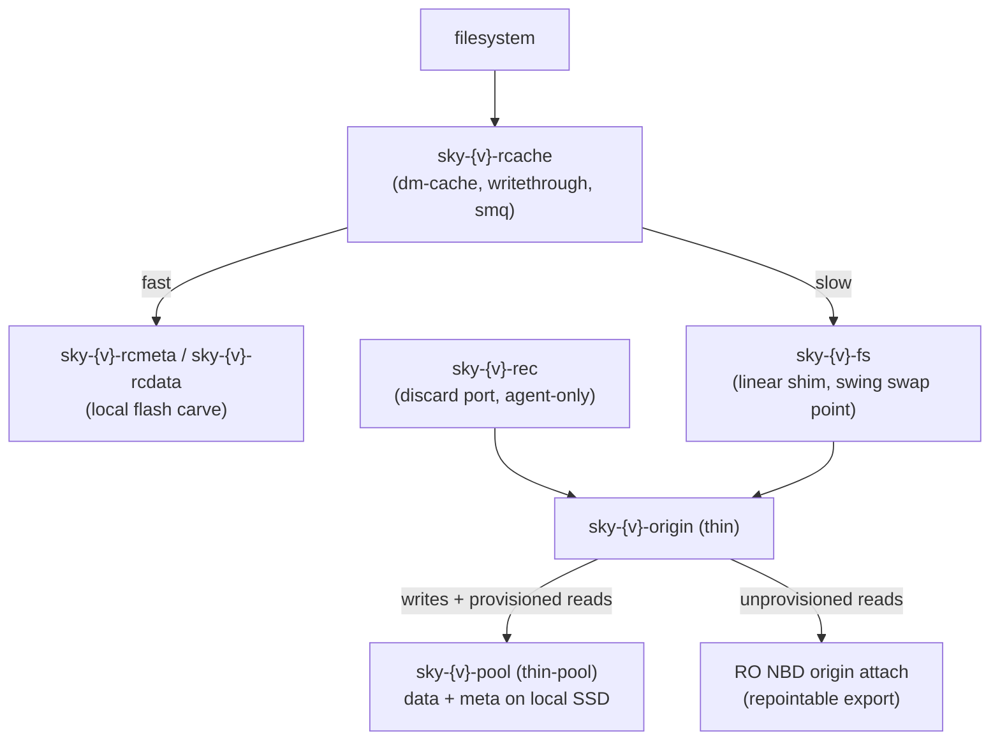
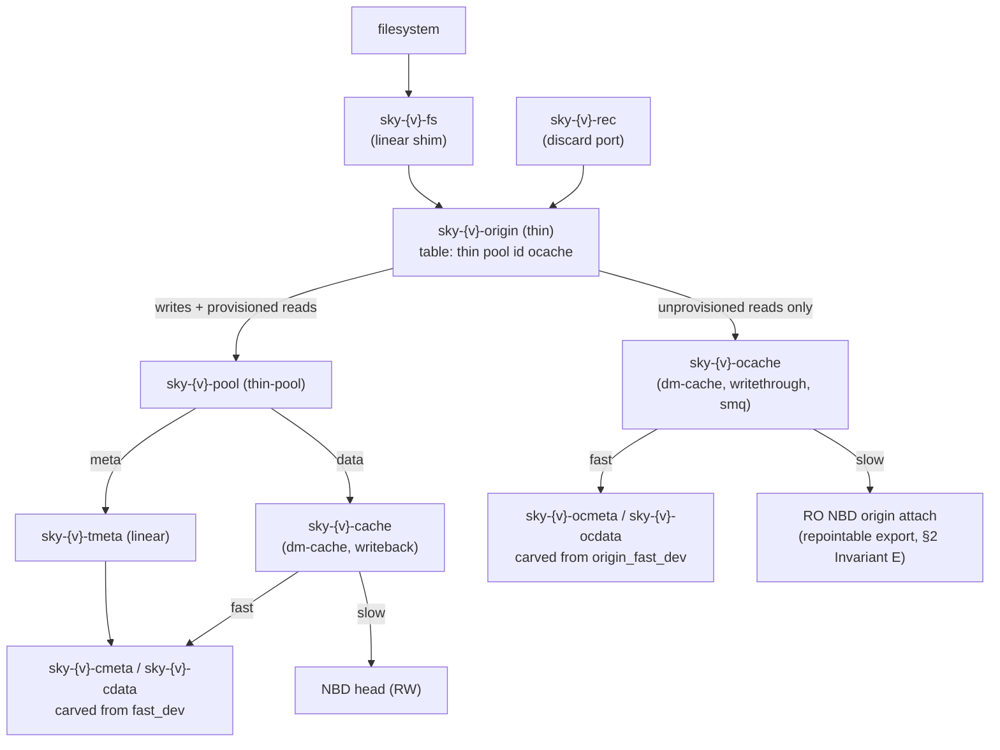

# SkyNBD Origin Advance: The Immutable Base Moves With the Generation Chain

**Status**: design accepted, not yet implemented. Extends
`skynbd-multinode-design.md` (D-M11, D-M13) — this is D-M15, split into
its own document. Task breakdown at the end; the multi-node doc's task
table points here.

---

## 1. The problem this solves

D-M11 gave a rescheduled thin volume an O(1) stage: dm-thin's external
origin points at a server-side clone of the newest published generation,
so unprovisioned blocks read through and writes provision locally. But
the origin chosen at stage time is **static**, and that leaves three
costs growing without bound:

1. **The pool accumulates every write since stage.** A provisioned block
   is never reclaimed, even after its content is published — the pool's
   size trends toward the volume's whole working history on this node.
2. **The stage-time clone pins its source generation forever.** Segments
   referenced only by that old generation cannot be GC'd while the clone
   lives (until volume deletion or the next fresh-cache restage).
3. **The pool-physical writeback head stays load-bearing**, with its
   V3.2 §15.7 fragility: the cache file is the head's only interpreter,
   and losing it makes the head untrustworthy anyway — so the head's
   continuous durability only actually pays off on same-node recovery.

The model this document adopts: **each published generation is a new
immutable head, and the origin follows it**. The origin is not a device
the node re-plumbs but an **indirection skynbdd owns**: a read-only
export whose backing generation the server repoints atomically. After a
repoint, locally provisioned blocks whose content the origin now serves
identically are discarded, so the pool shrinks back to just the
still-unpublished writes and never holds more than one advance
interval's delta. Durability is carried by the
generation chain — the one channel that never depended on restage-time
flushing — and the pool becomes a bounded delta buffer over an advancing
immutable base.

Publishing and advancing run on **decoupled cadences** (§4): every
cycle publishes a generation (that is the RPO), but only cycles landing
on a configured snapshot advance the origin to it. Intermediate
generations stay cheap — no flat emap, no repoint, no reclaim — which is
what makes minute-level publish cadence affordable.

Server-side, almost everything already exists: a published generation is
fully durable at publish (delta uploaded, durable checkpoint, then
ref+manifest+pin in one atomic transaction — I8, I1), immutable
generations are served from shared `Arc`'d committed state (D-M10), and
the registry already serves snapshots read-only. What is new is one
repointable export and the node/agent choreography around it.

## 2. Correctness invariants

### Invariant A — the repoint is invisible to reads

At the moment the origin export's backing switches from gₙ to gₙ₊ₖ
(k ≥ 1 — the advance may skip over intermediate published generations,
§4): for every LBA X **unprovisioned** in the pool, gₙ[X] == gₙ₊ₖ[X].

Argument, k = 1: gₙ₊₁ was captured at snapshot S. Any X unprovisioned
at repoint time was unprovisioned at capture time (writes only
provision, never unprovision — filesystem discards are not enabled on
these mounts, and reclaim discards happen only after a repoint). At
capture, X read through the origin at gₙ, and the publish preserved
read-through content at unprovisioned LBAs (the uploaded delta covers
provisioned blocks only; the prepared base gₙ supplies the rest). So
the two generations agree everywhere the origin is consulted, and the
repoint changes no observable byte. The property is per-LBA and
monotone, so it holds regardless of how the repoint interleaves with
concurrent provisioning writes.

k > 1 follows by induction: between gₙ and gₙ₊ₖ the origin stayed at
gₙ (no advance ran), so every intermediate capture read unprovisioned
LBAs through gₙ and every intermediate publish preserved that content —
gₙ[X] == gₙ₊₁[X] == … == gₙ₊ₖ[X] for any X unprovisioned throughout,
and an X unprovisioned at repoint time was unprovisioned throughout
(same monotonicity). Skipping cycles adds no proof obligation.

**Why nothing kernel-side needs to change.** The thin table references
the origin by *device node*, and that node — one NBD attach of the
origin export — never changes. skynbdd repoints what the export serves
by swapping the `Arc` over the immutable committed state (D-M10) that
backs it: in-flight NBD requests complete against the old view, new
requests resolve the new one, and the swap is a pointer store under
the registry's existing synchronization. No dm table reload, no
suspend window, no interaction with the freeze watchdog, no latency
blip at all. Caching cannot resurrect old content: dm-thin passes
origin reads through as bios with no origin-side cache of its own, and
the filesystem's page cache is keyed on the *thin* device — whose
content at every origin-consulted LBA is identical across the switch
(that is exactly what this invariant establishes).

**Alternative considered — dm table reload.** dm-thin's external
origin is a positional target parameter, changeable only by loading a
new table and suspend/resume-swapping it in. That works (the kernel
promotes the inactive table atomically) but drags in real costs the
server-side repoint simply doesn't have: a per-advance second NBD
attach and detach, a suspend window whose default behavior includes an
implicit filesystem freeze (`lock_fs` — which would nest under the
cycle's freeze watchdog and its pre-opened fd, V3.2 §7.11), and a
per-cycle IO stall bounded by in-flight drain. Rejected: the
indirection belongs in skynbdd, where a generation switch is what the
engine already does on every commit.

### Invariant B — reclaim only what the origin now serves identically

A provisioned block P may be discarded (unmapped) only when:

1. the repoint to gₙ₊ₖ is durable (Invariant D's pointer row), and
2. P was mapped in capture snapshot S — the **advance cycle's** capture,
   the one gₙ₊ₖ was published from — **and not rewritten since**: then
   P's live content equals gₙ₊ₖ[P] byte-for-byte (blocks mapped in S
   carry content published by gₙ₊ₖ or by an earlier generation and
   unchanged since).

The reclaim set is therefore `mapped(S) − dirtied-since(S)`, both sides
answerable from dm-thin metadata (the same delta machinery the agent
already drives). Blocks written after capture stay provisioned and are
published by the next cycle — nothing is ever lost to the reclaim.

These discards are **agent-issued dm-level operations, not filesystem
trims**: the filesystem still considers the blocks allocated, and reads
them through the origin with identical content. The pool must run with
`no_discard_passdown` so a reclaim never propagates to the device
below. Filesystem-initiated discard (`-o discard`, fstrim) remains
unsupported on origin-backed volumes — an fs discard would unmap a
block whose origin content is *not* zeros, silently resurrecting old
data; masking that is a precondition this design keeps, not a new
requirement.

*Status of that masking — an interim guard as built (15i), completed
in 15j.* The stage mounts with no discard option, so `-o discard` is
off, but that alone stops nothing: an explicit `fstrim` (or a
distro's default `fstrim.timer`) reaches the thin regardless — the
pool's `no_discard_passdown` blocks only the passdown to the data
device, while the unmap in thin metadata still happens. Two
consequences, both real on an origin-backed volume: the unmapped
block reads the origin's published content instead of zeros, and
`thin_delta` reports the range removed, so the next publish writes a
hole — the served image and the published generation disagree in
opposite directions at once.

The masking cannot be a pool-level `ignore_discard`: that would
disable the agent's own reclaim, which is the whole licence this
invariant grants. It has to leave the port usable while the *shim*
refuses guest discards — so the guard as built writes `0` to the
shim's `queue/discard_max_bytes` (resolved through the kernel name
under `/sys/dev/block/<maj>:<min>`, not the `/dev/mapper` name),
making the queue advertise no discard support so a guest `fstrim`
gets `EOPNOTSUPP`. It is applied at thin-stack build time and
re-applied by the swing's retarget, since a table reload recomputes
the queue's limits.

As of 15j the guard is **verified, not assumed**: the write is
followed by a readback of the same knob, because a limit that was
clamped — or recomputed by a reload racing the call — leaves a shim
that passes guest discards while every log line says it is guarded.
The verdict then splits by call site. At the stage `provision::build`
**fails**: nothing is mounted yet, so refusing costs a failed stage
instead of a diverged image. At the swing's retarget and the sweep's
repair it logs loudly and continues: the swap is already
irreversible, and unwinding a completed swing over a queue knob would
be the worse failure. A kernel that has no such knob is still
tolerated (logged once per shim) — a capability the kernel never had
cannot make a volume unstageable. That toleration is a property of the
**write**, though, and only of the write: a readback answering ENOENT
*after a write that succeeded* means the knob existed one syscall ago,
so the name now resolves to a different device — the reload race the
readback exists to catch. That combination is an error, never a
masked verdict.

Three things then make the guard **monitored** rather than
event-driven, because the hazard it closes is a live, thawed, mounted
volume and the failure that produces one has no other observer:

- The engine re-derives the mask at the head of **every cycle**
  (`LocalStack::assert_guest_discard_mask`, keyed on the new
  `DmConfig.shim_name` so it is live on Shape B, which is `slot: None`
  until 15e). On a volume that HAS a shim, a lapse therefore cannot
  outlive one cadence interval unnoticed, where before it survived
  until the next swing or a cold re-stage.
- The re-assert answers three ways, because "no shim configured" is
  not "masked". `shim_name` is `#[serde(default)]` and `slot` is
  optional, so every config-file deployment written before either
  field existed carries neither — and answering `Ok(())` there made
  an unguarded volume indistinguishable from a verified one, which
  is precisely the claim above being false for the deployments that
  never opted in. Such a stack now answers
  `StackError::Unsupported` naming the missing knob, and the engine
  reports it **once per volume per process**: it is a configuration
  gap, not a lapse (nothing was asserted, so there is nothing to
  retry), and a volume that will never be masked must not print the
  same line every interval — but it must print it somewhere.
- A lapse is **not** durable, deliberately. It lives in the engine
  and dies with the process, because the condition is re-derived from
  the kernel at the head of every cycle: a fresh process learns the
  same fact within one interval, so persisting it would buy nothing
  a restart does not, at the price of a record-format bump — and
  every bump makes each surviving record decode `Corrupt`, which
  quarantines that volume's pool and abandons its unpublished delta.
  SAGT therefore stays at **v4**. The engine-local flag exists only
  so the recovery message fires on the transition rather than every
  cycle. Failing the cycle over an unmasked shim was rejected too:
  withholding the delta loses the delta *as well as* the mask.
- Every path that puts a shim table back re-asserts. `provision::build`
  already did so unconditionally on cold builds; 15j adds the
  **driver-restart replay** (`NodeMechanics::stage` returns early on a
  live attachment, before `build` runs — so without this the
  "re-masked from observation rather than trusted" claim held only for
  cold builds) and `sweep_flipped_inner` (reached only because a
  swing's flip is durable, i.e. because a reload this process never
  performed recomputed the queue's limits).

Alongside it, a StorageClass `mountOptions: [discard]` is now
**refused** at CreateVolume and at NodeStageVolume rather than
silently dropped. The node never forwarded `mount_flags`, so the
option was already inert — which is the reason to error: an operator
who sets it believes trim is on. An *entry* is not an option:
`mountOptions: ["noatime,discard"]` is legal YAML and the form a
hand-written class most often takes (it is what `mount -o` accepts),
so the match splits on commas as well as on `=`.

The NodeStage half means an **existing PV carrying `discard` becomes
unstageable after upgrading to 15j**, and that is intended rather
than incidental. The option never did anything, so nothing that
worked stops working; what changes is that the volume says so instead
of mounting as though trim were on. The remedy is to drop `discard`
from the PV's `spec.mountOptions` — and from the StorageClass, or the
next PVC provisions another PV with it. CreateVolume catches the new
ones; NodeStage is the only place the old ones ever surface.

What the guard still is **not**: it covers exactly one queue. A
discard entering by any other route (an operator's `dmsetup` reload
between stages, a direct `BLKDISCARD` on the origin or the port) is
unaffected, and a host whose kernel lacks the knob is outside the
supported envelope for guest `fstrim` rather than protected by it.

*Implementation note (kernel claims — the discard port).* A
`BLKDISCARD` on the origin's own node is refused once the device is
claimed, and freezing does not lift claims. Two distinct layers refuse
it, and they must not be conflated: util-linux `blkdiscard` opens the
node `O_EXCL` (since 2.36) and fails at *open* on any claimed device —
a tool behavior — while production's path (`discard_dev`: plain
`O_RDWR` open + raw ioctl, no `O_EXCL`) is refused by the *kernel*
only on **fs-claimed** nodes (the shimless mounted origin — the k3s
smoke's EBUSY). A merely **dm-claimed** node — the origin once the
shim holds the fs claim — *accepts* the raw ioctl on current CI
kernels (measured by the `discard-port-poc` workflow), so with the
shim in place the port is portability insurance rather than a hard
requirement: kernels with restricted-writes semantics refuse or block
the `O_RDWR` open of any claimed node, and the port is the one shape
that works everywhere. The tests pin accordingly: S15b's negative
probes the fs-claimed shim with production's exact open flags — if
that cell ever opens up, the whole shim+port apparatus can be
retired — and the PoC reports the kernel-dependent dm-claimed cell.
The sanctioned shape is a **dm-linear pair**: the fs mounts a linear
*shim* over the origin (the fs claim lands on the shim; device-mapper
claims the origin under its single shared holder), and a sibling
linear *discard port* over the same origin — legal, because dm
components share one claim holder — gives userspace an unclaimed node.
Discard **bios**, unlike the ioctl entry, don't re-check claims, so
the port's discards flow through dm-linear into dm-thin and unmap the
origin's blocks. `DmConfig.discard_name` names the port; `None` falls
back to discarding the origin directly, valid only on unmounted rigs —
**15d must fail closed**: refuse to stage a mounted volume with
`discard_name: None` rather than let every advance die at its first
reclaim discard. S15b pins both halves of the contract on a real
kernel (raw-ioctl discard on the claimed origin refused, port discard
unmaps under a live mount). 15d builds shim + port into the stack and
returns the shim as the staged device.

*Implementation note (the two-pool swing alternative).* The
`discard-port-poc` workflow measures a second reclaim shape against
the port: a two-pool ping-pong swing (fresh pool + empty thin over the
advanced origin, copy dirty-since-S, retarget the shim via
load+suspend+resume, tear the old pool down wholesale). Measured on
the same harness: the swing's frozen cost is one ~80 ms window
regardless of volume size vs the port's ~44 µs of frozen metadata work
per shared block across repeated windows, and the wholesale teardown
resets pool fragmentation and metadata aging that discard reclaim
accumulates. Its correctness rule (PoC-proven — the first run shipped
a corruption without it): incremental copy rounds must diff against a
**snapshot barrier**, never head-vs-head mappings, because in-place
rewrites of already-unshared blocks change no mapping. The two shapes
likely map onto the durability modes rather than competing: port +
freeze-windows for writeback-head volumes (a second pool would mean a
second head attach), swing for publish-only volumes (pool devices are
node-local; teardown is remove + delete the slot file). A swing-only stack needs
no port at all — read-opens never check claims, so coherent copy reads
can use `O_DIRECT` on the claimed origin node — which makes the
*shim* the load-bearing piece of the pair: it is what keeps the stack
under the fs hot-swappable either way.

*Implementation note (task 15b).* The discard must not race live
writes: a write to a shared block COWs the origin's mapping to a fresh
data block, and a discard processed after it unmaps the *new* data —
a silently lost write. So the reclaim set is computed **and** discarded
under an fs freeze (watchdog-armed, exactly like capture), in bounded
batches: each freeze window re-reads the mappings under its own
metadata-snapshot reservation, discards at most a batch of ranges, and
thaws. The shared set only ever shrinks (writes and discards both
remove members), so bounded windows compose into an arbitrarily large
reclaim without an unbounded write stall. dm-thin discards are
metadata-only unmaps (no data IO, nothing passed down), so a window is
short. The set itself is `shared_mappings(S, origin)` — blocks mapped
in both with the same data block, which by COW is exactly
"mapped in S and not rewritten since".

### Invariant C — every *advance* cycle ends in the rebaselined-pair shape

After repoint + reclaim, the local baseline snapshot is deleted and the
agent persists the **rebaselined pair** — remote gₙ₊ₖ, no local member —
exactly the shape D-M11's seeded restage starts from. This is what
keeps the delta math sound across a reclaim: a `thin_delta(baseline,
next)` spanning a reclaim would misreport reclaimed ranges as changes
(unmapped vs mapped), but the rebaselined pair makes the first
post-advance delta `full_mapped(S′)` — precisely the post-reclaim
provisioned set plus subsequent writes, which *is* the unpublished
delta. **Every advance boundary is memoryless: the state after an
advance cycle is identical to the state after a fresh restage.**
(Memorylessness is the *eager*-timing shape. §7.1's lazy timing
deliberately keeps the established pair at an advance instead, and
its dual-discard eviction rule is what keeps the retained pair's
delta math sound — an evicted range leaves S and the live thin
together, so it can never be misreported.)

Cycles *between* advances (§4) publish without reclaiming, so they keep
a local baseline and run the established-pair shape task 12 already
gives the planner: capture Sₙₑw, publish `thin_delta(Sₚᵣₑᵥ, Sₙₑw)`,
delete Sₚᵣₑᵥ, retain Sₙₑw. Eager timing never reclaims under a
retained baseline; lazy timing's evictions do, and stay sound by the
dual-discard rule (§7.1) — either way no thin_delta ever misreports a
reclaimed range. The planner therefore holds
exactly two shapes — established pair between advances, rebaselined
pair at them — and both already exist in the machinery; the advance is
the only transition from the first to the second.

### Invariant D — the pointer is durable and pin-ordered

The origin export must serve the same generation across skynbdd
restarts and `nbd-client -persist` reconnects, so its target is a
**meta row in the volume's refs object** (`origin = gₜ`), written
with the D-M1 transaction machinery. And the generation it names must
be pinned for as long as it names it: the repoint lands **between**
promote's pin-new and unpin-old steps (§15.4 gains one step), so at no
instant does the export serve a generation GC is free to collect.

*Implementation note (task 15a):* the server enforces this directly —
the repoint transaction atomically writes the row, pins the new target
under a dedicated `origin` holder, and unpins the old one, so "the
pointer pins whatever it names" holds even if the calling agent crashes
between its own pin steps. The agent's §3 ordering remains the belt on
top.

The pointer is also the **single source of truth for restage**: a
fresh-cache stage reads it (initializing it to the newest generation
if absent) and seeds the agent's baseline from the same read — which
retires the merged D-M11 requirement that a separately-created clone
and a separately-seeded baseline happen to name the same generation.

### Invariant E — the origin never moves backwards, and reclaim is served-origin fenced

Invariant A makes gₒ and gₜ indistinguishable only **until reclaim
runs**. After step 6 a reclaimed LBA is unprovisioned, and if any path
then serves the origin from a view older than the pointer row — a
restart trusting warm registry state, a failover replica that skipped
the refs read, a `-persist` reconnect racing either — reads of
reclaimed LBAs return pre-gₜ content. That is silent corruption, not
an error, and it is the sharpest edge in this design. Two mechanisms
close the class structurally rather than leaving it to test coverage:

1. **Monotone repoint.** The pointer write refuses to move
   backwards: a repoint must name a descendant (along the generation
   chain) of the generation the row currently holds, or it no-ops —
   a replayed, reordered, or duplicated repoint call cannot regress
   the export. Implemented (15g) as `RefOp::MetaCas` — a guarded
   meta-row write, conformance-tested across every refs backend — so
   the compare and the write are one atomic step:
   `origin::repoint_forward` decides against the row the attempt read,
   and the CAS expects exactly that row. "Descendant" is decided by
   generation number, which restricts pointer targets to generation
   refs (`snap/g<N>`) — aliases share commits with generations, so
   nothing is lost (a legacy alias row imposes no ordering; moving off
   it is a one-way door into the ordered namespace).
2. **Served-origin fence.** Immediately before the executor's first
   irreversible act (step 6) — the first discard window for the port,
   the shim retarget for the swing (§7) — the agent asserts the
   **served** generation against the
   live export — what the serving path actually resolves end-to-end
   (a `served` field in `GET /origin`, read from the export's engine),
   not a re-read of the refs row, which could itself be the stale view
   — and requires gₜ or a descendant. On mismatch the advance aborts
   into the crash table's safe-abandonment row.

The proof has two branches, separated by attachment authority:

- **The attachment still owns the lineage lease.** The served fence
  alone has a TOCTOU window (fence read → discard), and monotonicity
  closes it: once `served ≥ gₜ` has been observed it cannot become
  false. Accepting a descendant is safe in this branch because the
  reclaim window rechecks that each block is still shared with the
  advance snapshot. A write by this owner either leaves the byte
  unchanged or COWs the live mapping and removes the block from the
  reclaim set; every descendant this owner can publish therefore
  serves the same byte for every block that remains reclaimable.
- **The attachment has been superseded.** A descendant may now contain
  a new owner's write at an LBA that is still unchanged in the old
  node's local pool. If the old node subsequently reclaims that LBA,
  its stale mount can switch from the old local byte to the newer
  origin byte and become a hybrid view. That is **not canonical-volume
  corruption**: the discard, snapshot operation, table retarget, or
  slot teardown mutates only the old node's private pool; the new
  stage starts from the epoch-fenced published tip and never adopts
  the superseded pool. Invariant F's terminal quarantine rule applies.

The second branch is deliberate. Preserving a coherent read view for a
superseded mount would require revoking or pinning its NBD data-plane
session, not merely lease-checking local dm ioctls: unprovisioned LBAs
already follow the shared repointable origin even if reclaim never
runs. On authenticated `LeaseLost`, the agent stops scheduling new
local work on a best-effort basis, but an already-issued discard or
retarget need not be rolled back. The durable `.fenced` marker and the
non-adoption rule are the safety boundary.

For an authoritative attachment, the 15g conformance matrix verifies
that every stale-origin-view bug degrades from corruption to a stalled
advance — each §3 crash window × {same-server restart, failover to a
fresh replica, `-persist` reconnect}, plus in-flight reads across the
`Arc` swap. It does not promise coherent reads from an attachment after
ownership handoff; that attachment is outside the single-writer
consistency contract.

### Invariant F — the generation chain is single-writer: agent transactions carry the stage-time epoch

Failover has two authoritative layers. At the server layer,
D-M3/D-M5 work as designed: a new site steals
the volume lease, the epoch bumps, the fenced site's next head CAS
fails (I2 — drop the overlay, `NBD_ESHUTDOWN`), the D-M4 recovery scan
adopts only current-epoch commits, and GC treats other epochs' commits
as garbage by construction. The old site's in-flight IO is never
adopted — and what it acked but never landed surfaces as the
filesystem going read-only at flush, the standard storage failure
mode. Nothing needs an explicit discard.

Before task 15h, the node layer had no equivalent. The publish
transaction (I8) is
atomic but not node-scoped: it CAS-creates the next generation ref,
moves pins, writes the meta row — and every one of those checks passes
for a zombie. Concretely: a partitioned node's pod is force-
rescheduled; the new node restages from the newest published
generation. The zombie's agent still holds a valid bearer token and a
live path to the still-owning server — authentication says who may
write, not who currently owns the volume's history. And the fork
needs no conflict at all: if the zombie's cycle fires first, it
publishes gₙ₊₁ from its stale baseline *before* the restaged node's
first publish, and every CAS succeeds — a well-formed, fs-consistent,
but **stale** generation at the head of the chain, silently adopted
as the new node's base. (A zombie that loses the race sees a CAS
conflict and a failed cycle — but nothing stops a later retry from
landing on a later free number either.) The chain forks content-wise.
Invariant E does not cover this: it fences the *read* side (the
pointer cannot regress); this is the same stale-view family on the
*write* side.

*Implementation notes (the seams around the fence — #75 review).*
Four rules proved load-bearing in review, each a place where a fenced
or foreign write could land through a seam *around* a correct fence:

1. **A fence refusal poisons every cache above the authority.** Any
   caching tier (the D-M4 cadence cache today; anything similar
   later) must drop its hydration on `LeaseLost` — a transaction
   applied locally and then refused at the authority must never
   survive into a later export, and a re-acquirer must re-hydrate
   before exporting or it erases the interim owner's history. The
   sibling rule: release-by-non-owner performs **no** export.
2. **Fencedness is a fact about the volume, not the process.** It
   must be durable (the `.fenced` marker) until quarantine completes,
   so a crashed or retried unstage re-enters the quarantine branch
   instead of resurrecting the superseded pool under a fresh epoch.
3. **No fence token, no stage.** A lineage stage that cannot obtain
   the epoch (lease `Held`, serve failure) fails; and the server
   refuses epoch-less mutations on node-held volumes. Degrading to
   the unfenced path re-opens exactly the split-brain the fence
   closes.
4. **Renewal tracks the holder's liveness, never the server's.** The
   server renews only its own leases; a node-held lease stays alive
   through the node's own fenced writes, so TTL failover (D-M6's
   backstop for ungraceful node death) keeps working.

The fence is the server fence applied one layer up:

1. **NodeStage acquires the lineage's lease under the node's
   identity** (the D-M6/task-7 serve/release plumbing already
   exists); the acquired epoch is the stage's fence token.
2. **Every agent-driven refs transaction carries it and fails
   closed** — publish, repoint, pin transfer, and (should the agent
   ever drive them) 15f's thinning and promotion. Not just publishes:
   a zombie that reaches its own advance would otherwise still move
   pins, and its `unpin gₒ` can release a generation the new node is
   staging from — a GC hazard Invariant E's monotonicity does not
   touch (it only blocks pointer *regression*). The server validates
   the epoch in the same fenced-transact path that already refuses
   superseded server writes with `LeaseLost`; a stale epoch fails the
   whole transaction — nothing lands, nothing needs cleaning up.
3. **A fenced node abandons, not retries.** The recovered old node's
   `NodeUnstage` runs the D-M13 final cycle, which would publish
   exactly the stale delta — and today refuses teardown on failure.
   Fencing adds the missing branch: skip the final cycle, mark and
   quarantine the local state, and tear down the active stack. The pool
   is non-authoritative but may still be useful for explicit salvage;
   deletion happens only after quarantine policy permits it. Retrying a
   fenced publish forever is the
   one outcome worse than losing an already-lost delta. Two
   precision rules keep the branch from destroying a *recoverable*
   delta: it triggers **only** on the authenticated, epoch-specific
   refusal — `LeaseLost` carrying a holder/epoch that supersedes the
   stage's own, matched by equality — never on a transport error, a
   5xx, or a timeout (a partition during unstage classifies as retry,
   not fenced); and the discard is staged — quarantine the cache file
   (rename; delete later) rather than unlink immediately, so a
   misclassification stays survivable until soak proves the trigger.

**Authority boundary — canonical refs are fenced; local pool state is
quarantined.** The stage epoch guards every operation that can become
part of the authoritative volume: generation publication, origin
repoint, pin movement, aliases, promotion, and any future refs
mutation. It deliberately does **not** wrap every local dm-thin ioctl
or pool-file operation in a lease round trip. Port discards, thin
snapshots, swing copies, shim retargets, slot deletion, and backing-file
hole punches can mutate only the node-local pool that issued them.

That split is safe only with three structural rules:

1. A normal stage first acquires current authority, then adopts a
   persisted pool only when its recorded stage epoch **equals** the
   fresh grant. Same-holder re-acquire preserves the epoch and any
   foreign hold bumps it, so equality is exactly "no foreign writer
   has held the lineage since this pool was seeded" — and it subsumes
   an origin-base check: pointer movement under an unbroken hold is
   safe, because every generation between the pool's baseline and the
   pointer was published *from this very pool*, whose overlay still
   provisions every block that changed (the Invariant A induction
   again). Anything else — epoch mismatch, a surviving fenced marker,
   no trustworthy agent record — quarantines the pool and fresh-seeds
   from the pointer. It never adopts an unvalidated pool found on
   disk. The stage check is deliberately stricter than publish-time
   tip-unchanged leniency: a foreign hold that never published
   quarantines a still-coherent pool, costing a cold restage (the
   rename keeps it salvageable), never a stale mount. Two deliberate
   consequences (#76 review): records predating the epoch field
   (SAGT v2) and corrupt records both read as "no trustworthy
   record", so the first post-upgrade stage quarantines every
   surviving pool — a one-time fleet-wide cold restage under the
   nothing-in-production posture, parking the old files as
   `-eunknown` until a quarantine sweeper lands (tracked from the
   #75 review). And a quarantine never overwrites an earlier one —
   the earlier file may be the only copy of that pool, so a name
   collision fails the stage loudly for the operator instead.
2. `LeaseLost` makes the old stage terminal for authoritative writes;
   its `.fenced` marker survives restart, and the pool remains
   quarantined until explicit salvage or deletion. The stage-time
   epoch check also catches a handoff the old process never stayed
   alive long enough to observe.
3. No automatic recovery path can promote quarantined local state into
   the lineage. Salvage is the explicit, separately named fork path in
   §8.2 and executes under current authority.

Consequently, a lease handoff that races a local reclaim or swing can
harm only the already-superseded attachment: its mount may observe a
hybrid of its unpublished mappings and the new owner's origin. The
same hybrid is possible without local mutation because every already-
unprovisioned LBA follows the shared origin. It cannot alter the
published chain, the pointer, the pin set, or the new node's pool.
`LeaseLost` therefore means **cancel best-effort, quarantine
mandatorily** — stop scheduling new windows or copy rounds, allow an
in-flight local operation to finish or fail, and never roll it back as
though it were a distributed transaction.

**Holder identity.** The lease state machine keeps the epoch only
when the holder string matches on re-acquire ("the holder never
fences itself"). Task 15h therefore threads the **node identity
end-to-end** through `serve`; the serving skynbdd's identity is not a
valid substitute. Two principals alternating on one lease would
mutually fence on every stage, and phase 1 keeps the head engine and
the ingestion plane both live on the same volume. Rollout takes a
one-time epoch bump per volume when the holder string changes; that is
safe (it fences nobody who should still be writing). Renewal duty
moves with the holder: publishes renew for free (D-M3), idle volumes
need an agent-side renewal timer, and `publishIntervalSeconds` plus
that timer must sit comfortably inside the lease TTL, or steady-state
publishing self-fences.

Failover then reads uniformly at both layers: the new site stages
from the latest published generation (the pointer row, Invariant D —
no clone after 15d), the epoch bumps at the lease steal, and the old
site's in-flight *publishes* are refused by epoch exactly as its
in-flight *commits* are at the server layer. RPO remains the
unpublished delta, lost once and never resurrected into the chain.
After 15e (publish-only) this invariant is the entire canonical
node-level write-safety story: the ingestion API is the node's only
path into the published lineage.

## 3. The advance sequence

Per **advance cycle** (§4 says which cycles those are), folded into the
existing publish + promote of the advance target gₜ (the §15.4
promotion order gains the repoint between its pin transfer and its
unpin). gₜ is the generation this cycle published; the previous origin
gₒ may be one or many generations behind it (Invariant A covers the
jump):

```
 1. publish gₜ; pin it (publish-implies-pin)            — existing
 2. persist Phase::Advancing { target: gₜ }             (durable intent)
 3. pin gₜ for the baseline holder                      — existing §15.4
 4. server: repoint — transact { meta origin = gₜ }     (Invariant D)
    and swap the export's backing Arc
 5. unpin gₒ (baseline holder)                          — existing §15.4
 6. node: served-origin fence — assert the export serves gₜ or a
    descendant (Invariant E), then run the reclaim
    executor (§7): port discards in freeze windows,
    or the swing's copy → retarget → teardown           (Invariant B)
 7. delete local snapshot S; persist rebaselined
    pair on gₜ                                          (Invariant C)
```

No clones, no second attach, no dm reload: the node's single origin
attach (`<lineage>/origin`) is untouched through the whole sequence.

Crash windows (all resolved by comparing the persisted `Advancing`
record, the pointer row, and the pin set):

| crashed after | recovery |
|---|---|
| step 2 | pins unchanged, pointer still gₒ — re-run from 3 |
| step 3 | both gens pinned — re-issue the repoint (transact is CAS-idempotent) |
| step 4 | pointer says gₜ — finish the unpin, continue |
| step 5 | executor-specific (§7): port discards are idempotent — recompute the set (it only shrank) and continue; a crashed swing sweeps its garbage slot per the slot state and re-decides |
| step 6 | pair persist is the last step — only it remains |
| any, giving up | abandoning is always safe: the pointer names a pinned generation either way; retry the advance on a later advance cycle. §4's scheduled skipping is this same abandonment, made deliberate |
| any step, epoch superseded | the Invariant F abandon branch: authoritative work is terminal, not retryable — no refs retry and no final cycle. Stop scheduling new local work best-effort; already-issued dm operations need no rollback because they affect only quarantined node-local state. Persist `.fenced`, never adopt the pool in a normal stage, then salvage explicitly or delete it |

Interaction with D-M13: the final unstage cycle is **always an advance
cycle regardless of the §4 schedule** and runs the same sequence, so a
graceful unstage leaves the pointer at the final generation — the next
node's fresh-cache stage reads it and starts exactly there. The
pointer row dies with the refs object.

**No migration from the merged D-M11** (decided: nothing is in
production, previous formats are unsupported). 15d is a straight
replacement — the clone-staging path (`<vol>-org` create, second
attach of the clone head, `DeleteVolume`'s clone sweep) is deleted,
not deprecated: stage always attaches `<lineage>/origin`, initializing
the pointer row when absent, and there is exactly one staging shape
and one deletion shape.

## 4. Cadence: every cycle publishes, only configured snapshots advance

Publish and advance are different jobs and get different cadences.
Publishing carries durability — RPO is the publish interval, full stop.
Advancing only bounds the pool and moves the base; running it on every
publish cycle buys no RPO and multiplies three per-advance costs by the
publish rate:

1. **Flat emap materialization.** D-M7 writes the flat map "on the
   snapshot cadence, never per commit" (~6–8 MB per materialization on
   the reference volume). An origin generation wants one — a restage
   cold-opens through it — so per-cycle advance at minute cadence means
   either ~10 GB/day/volume of map objects or origins served by lazy
   tree walks. Configured snapshots were getting an emap anyway; an
   advance that lands on one materializes nothing extra.
2. **The reclaim batch**: a discard pass and its pool-metadata churn on
   the IO latency path, per advance.
3. **The bookkeeping**: a refs transaction, a pin transfer, and a
   traversal of §3's crash matrix — 1,440×/day at minute cadence
   versus once per configured snapshot.

So the cycle engine runs **two cycle kinds**:

- **Publish cycle** — every `publishIntervalSeconds` (the RPO knob).
  Freeze → capture → thaw → publish the delta → promote per §15.4,
  *without* the repoint step. The delta is `thin_delta(Sₚᵣₑᵥ, Sₙₑw)`
  under the retained baseline, or `full_mapped` on the first cycle
  after an advance (Invariant C). No emap, no reclaim, no repoint, no
  pin movement beyond the existing baseline-holder transfer.
- **Advance cycle** — a publish cycle whose generation is a
  **configured snapshot** (a snapshot-schedule boundary: the
  retention-bearing, emap-carrying generations). It additionally runs
  the §3 sequence, ending in the rebaselined pair.

**Watermark backstop.** If pool usage crosses
`advancePoolWatermark` (`SKYNBD_ADVANCE_POOL_WATERMARK` on the CSI
surface, `advance_watermark` under `[[volume]]` on the config-file one)
between configured snapshots (a write burst),
the next publish cycle is promoted to an advance cycle: one
off-schedule emap and reclaim instead of an unbounded pool. Policy in
one line: *advance at configured snapshots or at the watermark,
whichever comes first.*

Consequences, stated so the implementation doesn't rediscover them:

- **Pool sizing follows the advance interval, not the publish
  interval**: unpublished delta plus the CoW copies accumulated under
  the retained baseline since the last advance. That is exactly
  V3.2's established-pair behavior — a non-regression — just now with
  a scheduled reclaim point.
- **Origin pinning aligns with retention — in steady state.** On
  schedule, the pointer names configured-snapshot generations, which
  retention keeps and pins anyway, so intermediate publish-cycle
  generations are never structurally referenced: uniformly thin,
  emap-less delta records that retention thinning (§6.2) can sweep on
  its own schedule. Two exceptions can point it at an intermediate
  generation: a watermark advance, and restage after ungraceful node
  loss — the pointer, when absent or stale, **must** initialize to the
  *newest* published generation, whatever kind it is, because that is
  the volume's current content (seeding from an older configured
  snapshot would resurrect old data). Both are safe: the pointer pins
  whatever it names (Invariant D), an emap-less origin is served
  through D-M8's lazy shard walk (the emap is an optimization, never a
  correctness requirement), and the next scheduled advance moves the
  pointer back onto a configured snapshot, releasing the intermediate
  generation to thinning.
- **The two knobs are independent.** `publishIntervalSeconds` is RPO;
  the configured-snapshot schedule (plus the watermark) is the pool
  bound and the emap/materialization cost. Tightening one does not
  touch the other.

## 5. Retiring the writeback head (phase 2, separate decision)

With the pool reduced to a bounded delta buffer, the dm-cache(writeback)
over the NBD head stops being structurally necessary: pool data can live
entirely on the node-local fast device, and the volume's durable
identity becomes the generation chain alone.

**Status: SHIPPED, folded with §7.1's read cache as one layout change
(task 15e+15k).** The cache-less stack below is what `provision::build`
builds and what the CSI stage stages: no head attach at all (the thin
stage's only NBD client is the RO origin attach), no volume-level
lease (the lineage lease is the fence), and pool-file loss re-stages a
fresh pool from the origin with a loud warning instead of refusing —
the §15.7 refusal died with the head. As built there is no `durability`
StorageClass choice: publish-only is the only thin mode, and no
Shape-B migration exists (nothing is in production; previous formats
are unsupported). The workstation CLI's `--thin` DELEGATES to the
resident agent rather than staging in-process — a publish-only stack's
durability path is its embedded publish cycle, so it must be owned by
a process that outlives the mounting terminal. The systemd agent's
`[mounts]` config section binds a root-only control socket
(`<state_dir>/ctl.sock`); `mount --thin` sends the request there, and
the daemon stages the same stack through the same shared node
mechanics the CSI driver uses (`skynbd_agent::nodemech`), replays its
mount table across restarts, and runs the D-M13 final cycle on
unmount. CSI lineage naming carries over verbatim: volume `v`
publishes into `v-lin`. Plain (raw head) mounts stay in-process and
config-free. One direct consequence: §7's swing executor is
unconstrained under the cache-less stack — no writeback head, so never
a second head attach to build a second pool over — and 15e arms it on
provisioned volumes: the stage derives a `SlotConfig` from the pool
file and the build's own `[tmeta][data]` carve (`fast_layout`, one
shared derivation — a second copy of that math would corrupt pool
metadata on the first divergence), with provision's carve names so a
post-swing stack is device-for-device a freshly provisioned one, and
the origin attach shared by both slots. The §7 crash windows meet the
stage through `resolve_slot`: a durably recorded in-flight swing is
swept BEFORE anything probes or attaches the pool file — after a
flipped swing the live pool is the `.b` file, so a stage that probed
first would resume the condemned A pool or mistake the mid-rename
window for "pool file lost" and destroy the acked writes in B. The
flag itself is still cleared only by the engine's recovery (single
owner for the state transitions; the sweeps are idempotent). Two
loop-identity corollaries, both found by this review: the kernel never
updates a loop device's recorded backing path, so after the
canonicalize the live loop still advertises the `.b` path —
`backing_of` matches by `(st_dev, st_ino)` via `LOOP_GET_STATUS64`
(the mock always modeled inode-follow; the path-string match would
have released or reused the LIVE loop on the second swing of any
slot), and the unstage detaches the loop currently associated with
the pool file rather than the stage-time record, which a swing makes
stale.

**The stack collapses with it.** Shape B exists because the pool's data
device had to be a writeback cache over the NBD head; with no head
there is nothing to cache. Six dm devices per volume (`tmeta`, `cmeta`,
`cdata`, cache, pool, origin) become three: `fs → thin origin (external
origin = the repointable RO attach) → pool → [tmeta | data]` carved
from the local file — no cache metadata, no writeback semantics, no
cleaner-policy flush at unstage (the D-M13 final cycle *is* the flush).

**The node loses its writable network data path entirely.** Writes go
`fs → thin → local SSD` and reach the network only as batched,
content-addressed segments through the authenticated publish API; the
sole NBD surface left is one read-only export. The data plane can no
longer be used to scribble on server-side state — a node's writes can
only arrive as prepared snapshots the server validates and publishes
atomically — and the NBD ACL story shrinks to one RO export per staged
volume.

**Pool capacity becomes the load-bearing operational duty**, replacing
writeback management. Today a write burst builds writeback pressure
while the cache evicts to the head; in publish-only mode the local pool
must hold the entire unpublished delta, and filling it stalls writes
until an advance reclaims. Two consequences: `advancePoolWatermark`
(§4) stops being optional and becomes the safety valve — for
publish-only volumes the watermark-promoted advance is what stands
between a burst and a full pool — and sizing guidance shifts from
"cache working set" to "worst-case write volume per advance interval,
with headroom".

| | today (writeback head) | publish-only |
|---|---|---|
| NBD attaches per thin volume | 2 (head + origin) | **1** (origin only) |
| RPO, node lost | unpublished delta (≤ publish interval)* | unpublished delta (≤ publish interval) |
| RPO, node reboots with disk intact | ~writeback lag | pool survives locally — same recovery, no loss |
| §15.7 "cache file lost" failure class | exists (head uninterpretable) | **gone** (head doesn't exist) |
| server-side pool-physical garbage volume | exists | gone |
| S3 PUT traffic | continuous writeback + cycle uploads | cycle uploads only |
| dm devices per volume | 6 (Shape B) | **3** (pool + tmeta/data carve + origin) |
| writable network data path from the node | NBD head | **none** (publish API only; NBD surface is one RO export) |
| burst-write backpressure | writeback pressure, cache evicts to head | pool fills → stalls until a watermark-promoted advance reclaims (§4) |

\* the head's better-than-publish-interval durability is only redeemable
when the cache file survives to interpret it — which is the reboot row,
where publish-only loses nothing either (the pool itself survived).

The honest cost is the loss of continuous server-side durability for
deployments that pair head writeback with reliable node disks — though
note what that stream actually is: dm-cache writeback demotes dirty
blocks in policy order and satisfies FLUSH at the cache layer, so the
head's S3 image between clean points is not merely
application-inconsistent but **not even crash-consistent** (torn,
barrier-free), on top of being pool-physical and uninterpretable
without the local cache file (§15.7). The only failure row where the
head's continuous stream is redeemable is the one where the local pool
survived anyway. With §4's decoupled cadence making minute-level
`publishIntervalSeconds` affordable, publish-only trades that
unusable stream for fs-consistent, immediately mountable recovery
points a minute apart.

The per-StorageClass choice (`durability: writeback-head |
publish-only`) this section originally planned was OVERTAKEN as built:
with nothing in production there was no writeback-head deployment to
keep a default for, and the fold shipped publish-only as the only thin
mode. `publishIntervalSeconds` remains the explicit RPO knob.

## 6. Formerly open questions — resolutions

(The advance-cadence question this section originally opened with was
resolved first — §4: advance at configured snapshots or the pool
watermark, whichever comes first, with publish cadence an independent
knob. The remaining three are resolved below.)

1. **Reclaim batching — bounded freeze windows; measure before
   engineering more.** Task 15b settled the mechanism, and it is not
   a bare chunked loop: implementation surfaced a lost-write race — a
   live write to a shared block COWs the origin's mapping to a fresh
   data block, and a discard processed after that write unmaps the
   *new* data — so the set is computed **and** discarded under an fs
   freeze (watchdog-armed, like capture), a bounded batch of ranges
   per window, the monotonically shrinking set recomputed under each
   window's own metadata reservation (Invariant B's implementation
   note). The pacing knob is the inter-window delay, default zero:
   with `no_discard_passdown` a reclaim is pure tmeta work — B-tree
   removals plus a commit, tens of thousands of unmappings at
   advance-interval scale, expected well under a second — so defaults
   come from the S15b nightly measurement, and no further machinery
   unless the numbers demand it. Two rules are normative regardless
   of pacing: **reclaim completes before the next capture** —
   otherwise the first post-advance `full_mapped` includes
   still-provisioned published blocks (harmless under content
   addressing, but wasted upload, and it breaks the "pool =
   unpublished delta" accounting Invariant C provides) — or the
   cycle engine subtracts the pending reclaim set from that delta
   (in the end nothing needed the subtraction: eager timing satisfies
   the first arm, and §7.1's lazy timing sidesteps the premise
   entirely — its post-advance delta is a `thin_delta` against the
   retained pair, kept sound by dual-discard eviction);
   and a **watermark-promoted advance runs unpaced** (zero
   inter-window delay; still windowed, because the freeze is
   correctness, not pacing), since writes are stalling on exactly
   the space it frees (§5's backpressure row). §7 generalizes this
   resolution: the freeze-windowed port is one of two reclaim
   executors, chosen per advance from the same enumeration.
2. **Retention thinning and aliases — GFS thinning; aliases
   promote.** Thinning an intermediate generation is one unpin:
   segments shared with later generations survive via those refs'
   reachability, §4 guarantees the origin machinery never blocks
   thinning, and the pointer's own target is already structurally
   safe — the merged repoint transaction moves a dedicated `origin`
   pin holder atomically with the row, so no thinning pass can
   collect the generation the export serves. Policy: keep every
   publish for a short
   restore-granularity window (`publishRetentionWindow`, e.g. 24 h),
   then only configured snapshots per their schedule; batch each
   thinning pass's unpins into one refs transaction to keep CAS churn
   down. A CSI `CreateSnapshot` **promotes** the generation it lands
   on to configured-snapshot status — emap materialized, retention
   track — because an alias exists to be mounted or cloned later,
   exactly the cold-open path the emap serves. Promotion does *not*
   trigger a node-side advance ("carries an emap" and "is the origin"
   are independent under §4), but it does need a server-side
   **materialize-emap-at-commit** operation for an already-published
   generation — today emaps are written only on the writer path
   (`snapshot_create` / clean release); a read-only engine at that
   commit can produce one, and the 15f row names the work.
3. **Reconnect surface — resolved structurally by Invariant E.** The
   monotone pointer CAS and the served-origin fence turn stale-view
   resolution bugs into stalled advances instead of corruption; the
   15g conformance matrix (landed) verifies the fence fires rather
   than standing as the only defense.
4. **DR / failover write-side fencing — resolved by Invariant F.**
   Raised reviewing this addendum: the server layer discards an old
   site's in-flight commits by epoch (D-M5), but a zombie *node*
   could publish a stale, well-formed generation through the
   still-owning server — every transact check passes, because
   nothing in the publish is node-scoped. Invariant F extends the
   same epoch discipline to the ingestion plane (task 15h).

## 7. Reclaim execution: two executors, one contract

The discard port and the two-pool swing (Invariant B's implementation
notes) are not competing designs but two executors of one contract,
and the §3 sequence is agnostic between them. Both consume the same
enumeration — one metadata-snapshot dump yields the reclaim set
`mapped(S) − dirtied-since(S)` as coalesced ranges (call the count R)
and the dirty set `dirtied-since(S)` (call it D) — and both end in the
identical post-state: pool = unpublished delta, the rebaselined pair,
Invariant C verbatim (§7.1's lazy timing deliberately trades that
post-state for the established pair — see its as-built note). The
other invariants hold unchanged over either
executor: B because neither touches a block the origin does not serve
identically; E because the served-origin fence precedes the first
irreversible act for an authoritative attachment — the first discard
window for the port, the shim retarget for the swing; and F because
every canonical refs mutation is epoch-fenced while the executors'
changes remain node-local. A handoff landing mid-executor can alter
only the superseded pool. Once observed, `LeaseLost` stops subsequent
scheduling and
quarantines that pool; already-issued local operations cannot mutate
the canonical chain or the new node's pool. Which executor ran is not
observable from outside the node.

**Discard port — minor compaction.** The merged 15b machinery through
the #69 port: freeze-windowed `BLKDISCARD` batches through the
unclaimed linear sibling, cost proportional to R — measured ~44 µs
per small range, 2.7 ms for one coalesced 44 MiB range, ~44 ms for a
1024-block window end to end. In-place: frees space without first
allocating any, and leaves pool fragmentation and metadata aging
behind.

**Two-pool swing — major compaction.** Fresh pool files and an empty
thin over the already-repointed origin; copy D behind a **snapshot
barrier** in converging live rounds — the barrier rule is normative
(Invariant B's swing note): every round diffs against its barrier
snapshot, never head-vs-head, because in-place rewrites of
already-unshared blocks change no mapping; then — the served-origin
fence (Invariant E) having passed immediately before the executor —
freeze, top-up against the barrier, retarget the shim
(load+suspend+resume), persist the slot flip, thaw, and tear the old
pool down wholesale.
Measured ~80 ms frozen regardless of volume size; resets
fragmentation and metadata age outright; transiently needs local
headroom for D plus pool metadata. With dm-cache out of the thin
stack (§5), pool devices are plain local carves and teardown is
remove + delete the A file + rename B onto the canonical name — the
second-head-attach objection never arises. (Never a hole-punch: the
slot file's steady state is fully preallocated, so the swing frees
A's space by unlinking A, not by punching either file sparse.)
Precondition, stated because the executor dies without it: **pools
are per-volume** (each volume owns its carve and tpool — true of the
stack today), so wholesale teardown destroys exactly one volume's
state. Any future pool shared across volumes forfeits the swing.

**The decision is one comparison over data already in hand**, made
per advance after the enumeration — nothing pins it earlier, and a
crashed swing re-decides on retry:

```
R == 0                                    → no-op   (idle volume — the common case)
R ≤ reclaimRangeThreshold, not aged       → discard port
headroom < D + slot metadata (backing    → discard port (forced — §8.1's
  fs free space)                            second surface, applied here)
otherwise                                 → swing
```

The headroom guard measures the **backing filesystem only**, not
§8.1's min-of-both: the pool's own occupancy is what promoted this
cycle to an advance in the first place (§4), so re-reading it here
would gate the compaction on the condition asking for it. What the
swing needs that the port does not is *filesystem* extents for slot
B, and that is exactly what the guard asks for. The guard is part of
the policy, not a caveat: port cost
scales with R (frozen) but swing cost scales with **D** (live copy)
plus transient space for D and slot metadata — a write-heavy interval
can present a large R *and* a large D, and choosing the swing there
walks straight into §8.1's exhaustion ladder. §8.1's "a swing cannot
start without headroom" is this guard's consequence, and
watermark-promoted advances (§4) hit it by construction — they run
the allocation-free port. "Aged" is the major-compaction trigger:
force a swing every `swingEveryNAdvances` advances (unset = never;
a pool-metadata-size trigger was considered and is **not
implemented**), so a volume with perpetually small
sequential deltas still gets its pool reset instead of aging forever
down the port path (a volume pinned to the port by the headroom
guard ages the same way and resets on the first advance with room).
`reclaimRangeThreshold` calibrates from the measured crossover — port
frozen time crosses the swing's fixed window near R ≈ 2k ranges on
the PoC rig — and the S15b harness emits the timing table, so the
threshold is a per-rig measurement, not a constant. The
per-StorageClass overrides are `reclaimStrategy = auto | port | swing`
and `reclaimTiming = eager | lazy` (§7.1) — the executor and the
eviction policy are independent dials (a `swing` override still
yields to the headroom guard; it cannot force an unstartable swing).

**Crash windows.** `Phase::Advancing` (15c's durable record) gains
the chosen strategy and, for the swing, the slot state: pool files
are A/B slots named in the agent's state record. Recovery cannot
discriminate pre- from post-retarget by looking at dm — a reboot
loses every table — so the discriminator **is** the durable slot
flag, and its write has a normative place in the sequence:

```
served-origin fence → freeze → top-up copy → retarget → persist slot flip → thaw
```

(The fence sits immediately before the executor rather than inside
the window: monotonicity makes the placements equivalent — once
`served ≥ gₜ` has been observed it can never become false, the same
induction that closes the port's fence→window gap — and it keeps
control-plane calls out of the sync frozen path.)

The flip lands inside the freeze window, after the retarget and
before any write can flow. That makes both crash arms exact: record
names A → slot B is garbage regardless of whether the retarget
executed (frozen, so no write ever reached B) — sweep B, re-decide,
retry; record names B → the flip is durable, so slot A is garbage —
sweep A, finish §3 step 7. Persisting the flip after thaw would open
a window where acked writes land on B while the record still names
A, and a crash there silently drops them on the A-rebuild. (The
agent's state record lives off the frozen filesystem, so the
in-window persist is legal — the same property capture already
relies on.) At no point are both slots load-bearing, and the
strategy choice itself is never part of the durable contract — only
the slot state is.

*Implementation notes (as built — task 15i).* Slot mechanics: B-side
devices are transient `-b`-suffixed names beside the canonical ones
and the B pool file is the live file plus `.b`; after the flip,
wholesale teardown removes the A side and renames everything back to
canonical, so steady state is always single-name — the CSI's
one-cache-file contract and the stage-time pool validation (#76) are
untouched, and the durable record carries only the flip flag and the
aging counter. The B file is created sparse and the copy phase is
fully abortable — a mid-copy failure (ENOSPC included) sweeps B and
falls back to the port in the same cycle — then preallocated to full
size once A's space is freed, restoring the never-sparse posture; the
transient headroom requirement is exactly D plus slot metadata, as
the guard states. Barriers are suspend-only (a barrier is a mapping
fence, not a consistency point — the diff argument is pure COW
mapping logic); only the top-up window freezes. A swing is offered
only on slot-configured stacks (cache-less pools — §5): on today's
Shape-B stacks the decision resolves to the port unconditionally, and
15e's cache-less build is what arms the swing in production.

The LSM analogy is exact and is the right tuning frame: the port is
minor compaction, the swing is major compaction, and the §7 policy is
a compaction policy — measured per rig, with a forced-major cadence.

### 7.1 Timing: reclaim is cache eviction

A published-but-not-yet-reclaimed block is a byte-exact local copy of
what the origin serves — Invariant B *is* that guarantee. So the pool
doubles as the volume's read cache, and **reclaim is cache
eviction**: every reclaimed block turns a local read into a network
read until it is rewritten. That reframing makes reclaim timing a
policy dial orthogonal to the executor choice:

- **`reclaimTiming = eager`** (the default described above): reclaim
  at every advance, pool = unpublished delta, maximum space headroom,
  minimum read locality.
- **`reclaimTiming = lazy`**: advance and repoint on schedule, but
  evict only under `advancePoolWatermark` pressure — FIFO in LBA
  order, as shipped (see the as-built note; coldest-first was the
  original intent and remains available if the read-heat sampler ever
  lands). The hot published set never leaves the pool, which is most
  of the steady-state read-locality and network-outage exposure
  solved for free. The costs are honest: a fatter steady-state pool
  (a lazy advance also retains the capture snapshot, so pre-rewrite
  versions of since-dirtied blocks stay allocated until the next
  advance rotates the pair); and cold-first needs read-heat data the
  dm layer does not have — agent-side sampling of the thin device's
  read path (eBPF on the block tracepoints; approximate heat is fine
  for eviction, and heat is an optimization, not a dependency: FIFO
  eviction in LBA order is the shipped first cut, so 15i did not
  block on the sampler).

  *As built (15i)*, no pending-set accounting exists at all — the
  §6.1 subtraction rule turned out to be unnecessary. A lazy advance
  runs the §3 head (pin, repoint, unpin, fence) but ends in the
  **established pair** — the capture snapshot S retained as the local
  member — so the next delta is the ordinary `thin_delta(S, S′)`, a
  shape the engine already rotates. Eviction recomputes
  `shared(S, live)` under each of its own freeze windows and discards
  every chosen range on **both** the live thin (through the port) and
  S itself. The dual discard is load-bearing twice over: it drops the
  last reference, freeing the data block immediately, and it removes
  the range from both sides of every future delta — so no
  `thin_delta` ever spans an eviction and Invariant C's delta math
  holds without bookkeeping. What makes the deferral itself safe is
  that every persisted pair binds the local snapshot to the generation
  published from it, and the eviction fence runs against **the pair's
  own generation** — so a pair the engine has since rotated past the
  last repoint fails its fence and skips eviction entirely, which is
  the coupling that puts the pre-repoint content out of reach
  (test: `lazy_eviction_is_skipped_while_the_pair_leads_the_origin`).
  Watermark pressure under lazy evicts
  first (served-origin fenced against the pair's generation, exactly
  like any reclaim) and lets the §4 promotion run an advance if
  eviction alone cannot get back under. As built (15j part A) that
  "if" is literal: the cycle kind is decided from the pool the
  eviction LEFT BEHIND, not from the reading that triggered it.
  Eviction is reclaim, so a volume that discarded its way back under
  the watermark has already had the relief the advance would buy it,
  and promoting anyway would pay an fsfreeze and the whole §3 tail on
  every cycle for as long as the pressure recurred. The rate sample
  still comes from before the eviction (§8.1 rule 1) — the two
  readings answer different questions, and only one of them is about
  what the workload wrote. A swing chosen under lazy runs normally
  and ends rebaselined — a major compaction resets the cache, the
  honest cost of the pool reset.

Two things pool-as-cache cannot do: **re-promotion** (dm-thin cannot
pull a block back local on read — once evicted, an LBA stays remote
until rewritten) and **restage warmth** (a fresh node's pool is
empty; everything is remote until written). Those are exactly what
the accepted companion covers:

**The top-of-stack read cache (adopted).** One writethrough dm-cache
at the top of the stack — between the filesystem and the shim — with
the pool on local flash (§5 phase 2) and the thin target's external
origin the *raw* RO attach:



Coherence is structural here, not procedural. The cache's
below-device can change content in exactly two ways: a guest write —
which traverses the cache itself, updating the cached copy and the
below-device together — or an agent-side operation (repoint, reclaim,
eviction, swing), every one of which is content-preserving over the
thin device's address space by the invariants this document already
carries: reclaim and eviction unmap only blocks the origin serves
byte-identically (Invariant B, fenced by Invariant E), the swing's
slot B is byte-identical by its copy contract, and the repoint is
invisible at LBAs unprovisioned throughout (Invariant A). There is no
third path *while the pool lives*, so in steady state there is
nothing to invalidate. The dormant-entry hazard that killed the
origin-side placement (below) cannot be constructed there: it
requires a mutation below the cache that does not traverse it, and
the live stack has none.

One event sits outside that argument, and it gets the design's one
invalidation rule: **fresh pool ⇒ cold cache.** The cache's metadata
carve persists on its own device — deliberately, since resident
mappings surviving a reboot is what restage warmth *is* — but a
restage that REBUILDS the pool rather than resumes it (§15.7's
pool-file-lost path, or an Invariant F quarantine) replaces the
content below the cache without traversing it: every LBA that held
unpublished delta reverts to published content, and a warm cache
over that would serve the dead delta from flash — the dormant-entry
class, constructed. So the fresh-pool stage builds the cache COLD:
`provision::build` takes a `cold_read_cache` flag, stamped from the
same condition that decides the pool is fresh, and zeroes the
metadata superblock (dm-cache's own "format me" marker) before the
cache ctr reads it. A cold drop is always correct here — the cache
is writethrough and never dirty — so the rule costs one restage's
warmth, exactly when the delta it protected is already lost.

The shipped reclaim/swing machinery (15i/15j) runs unmodified and
unaware of the cache, leisurely managing pool watermark and
fragmentation — and the cache keeps read warmth *through* it: a hot
block reclaimed from the pool stays flash-local in the cache, so
"reclaim is cache eviction" (the coupling this section opened with)
dissolves. Reclaim frees pool space; smq decides what stays on
flash; neither consults the other. Re-promotion and restage warmth —
the two things pool-as-cache cannot do — both fall out: the cache
promotes on read wherever the read was served from.

Costs, stated honestly. smq allocates flash by hit rate with no
miss-cost awareness, so pool-hot blocks (already on local SSD)
compete with origin-hot blocks (a network round trip each) for the
same flash — whether that mis-pricing matters is a Tier B
measurement, not a design argument. COW reads (the thin's own origin
read on first write to an unprovisioned block) bypass the cache and
hit the raw attach — once per block, after which the block is
pool-resident. And the placement presumes the §5 local pool; above a
writeback-head pool it stays coherent (all mutations still traverse
it) but spends flash caching a device that is itself mostly cache.

*As built (the §5 fold)*: `provision::build` builds exactly this
stack — `[tmeta][data]` carve, raw origin attach in the thin table,
and the rcmeta/rcdata/rcache trio over the shim when
`read_cache_dev` is configured. The gate is the device ALONE (no
external-origin condition — gating on one would flip the mount
device when a lineage publishes its first generation); the
filesystem mounts `mount_path()`, the cache when present and the
shim otherwise. The trio stays out of the build-order list `observe`
treats as the whole stack, and teardown keys on device presence
rather than a spec — both inherited from the origin-side wiring it
repositioned. A build whose spec carries no cache also REMOVES a
surviving trio (presence-keyed, consumers first): a Some→None
restage — config rollback — would otherwise leave a stale rcache
claiming the shim, and the mount would answer EBUSY with nothing on
the idempotent-resume path ever clearing it.

Invariant B's guest-discard mask lands on the cache device too, not
the shim alone. dm-cache does not re-export the masked shim's
limits: reading the slow device's zero at ctr time it disables
passdown (a load-time, DMWARN-only decision), then advertises
nonzero *virtual* discard limits of its own and ABSORBS guest
discard bios — marks its discard bitset and completes them, neither
forwarding nor invalidating (and a later promotion of a discarded
block may legally skip the copy, so a trimmed LBA can read back
uninitialized cache-carve content). The absorb keeps Invariant B
true, but it is an unobserved kernel behavior where the design's
mechanism is an observed mask with a readback — so `provision::build`
masks the mount device after the ctr, and the engine's per-cycle
re-assert covers it alongside the shim. The guest then never issues
discards at all (the uncached posture, restored), and the absorb is
defense in depth. A side benefit of the top-of-stack placement,
noted for the record: the filesystem's claim (and superblock) moved
off the shim onto the rcache, so the swing's in-window shim
retargets no longer suspend a device carrying a filesystem — on
cached stacks the #83 hazard class at that site is unconstructible
rather than suppressed.

Enablement is wired end to end: the node takes a `read_cache_dir`
(chart: `node.cache.readCache`) and loops a per-volume file the same
way it loops the pool file — the file's metadata region is the
restage warmth, persisting across reboots, and a brand-new or lost
file reads as zeros, which is dm-cache's own "format me", so first
stage and file loss come up cold with no special casing. The
`cold_read_cache` coupling is stamped from the same `fresh_cache`
condition that decides the pool is fresh (quarantine included). The
k3s smoke stages with the cache on and asserts the guest mounts the
rcache, `fstrim` is refused through dm-cache's virtual limits, and a
pool-loss restage over the surviving cache file comes up fresh and
serves published content.

**The origin-side placement (superseded).** What 15k step 2's build
wiring originally targeted — a writethrough dm-cache *under the
origin attach* — kept because the staleness rule it forced remains
normative for any future cache below the attach. The stack as it
stood then, writeback head included (both since replaced by the §5
fold):



dm-thin sends the origin path nothing but reads, so the cache is
purely a read/promotion cache regardless of mode — but declaring
**writethrough** is load-bearing: the cache never holds dirty state,
ever, which makes it **fully disposable**. Crash recovery never
reasons about it (drop ocmeta, restart cold), and wiping it whole is
always correct. It promotes on read — evicted-then-hot blocks come
back local, and a restaged node warms as it reads instead of never —
and it composes cleanly: below the swing's swap point (both pool
slots share it; swings never touch it) and disjoint from the port
(whose discards target thin devices, not the origin path). Promotion
and eviction inside the cache are the policy's business (`default`,
which resolves to smq on current kernels) and need no coupling to the
reclaim executors: reclaim decides what leaves the *pool*, smq
decides what stays on *flash*, and the only contract between them is
the invalidation rule below.

The wiring 15k step 2 shipped at this placement — own-device carve,
conditional trio, presence-keyed teardown — repositioned to the
top-of-stack layout in the §5 fold rather than dying, and the drop
machinery below was never built.

The obligation that superseded this placement is the staleness
hazard reclaim creates: origin-path content at an LBA *changes* across
provision → publish → repoint → reclaim (Invariant A protects only
LBAs unprovisioned throughout), and the repoint is a server-side
`Arc` swap that sends no invalidation down the NBD wire — so a cache
entry stored before the LBA was provisioned can resurrect pre-write
content after the reclaim. Hence the normative rule: **a reclaim is
not complete until the reclaim set is invalidated in every cache
below the origin attach, within the same freeze/quiesce window** —
for the port, the discard window; for the swing, before the
retarget, over `mapped(A) − copied-to-B`. The rule binds **every
eviction event**, not only advance-time reclaims: a lazy-timing
watermark eviction (§7.1) is a reclaim and carries the same
obligation in its own window.

Under this placement, disposability turned that rule into a
three-step ladder (kept for the record — step 1 stands on its own,
and the top-of-stack placement makes steps 2–3 unnecessary):

1. **Lazy reclaim, no cache** — steady-state read locality with zero
   new layers; covers workloads whose hot set is write-hot.
2. **Cache + whole-drop at advance** — wipe the entire cache inside
   the advance's quiesce window. Provably safe with no per-range
   machinery (a writethrough cache may always be discarded wholesale)
   at the cost of re-warming each advance interval; read-hot cold
   sets and restage ramps are covered. 15k step 2 shipped its
   build/teardown wiring at this step before the top-of-stack
   placement superseded the position; the wiring moves, and the drop
   is never needed.
3. **Cache + per-range invalidation** — keeps warmth across
   advances. Needs one mechanism validated first: invalidating the
   reclaim set as discards on the *cache* device (dm-cache
   invalidates cached mappings for discarded ranges — but may pass
   the discard down to the slow device, a read-only NBD export that
   must swallow it gracefully) versus `invalidate_cblocks` messages
   (cblock addressing, suspend requirements). A #69-style PoC cell
   settles which; that cell is the open item gating step 3 — and it
   must probe the #69 claim matrix too: the cache device sits under
   the thin's origin slot, i.e. dm-claimed, the cell measured as
   kernel-dependent (raw `BLKDISCARD` allowed on current CI kernels,
   refused under restricted-writes semantics), so the
   discard-on-cache-device mechanism may need its own unclaimed
   sibling exactly as the reclaim path did.

## 8. Exhaustion and extended outage: degradation and recovery

Publish-only durability (§5) has one structural exposure: reclaim is
licensed only for published content (Invariant B), and publishing
needs the network. A long enough outage therefore walks the volume
into a wedge, and both the walk and the recovery have exact shapes
worth pinning so the implementation degrades deliberately instead of
discovering them.

### 8.1 The exhaustion ladder (network up or down)

Pool exhaustion is not a clean `ENOSPC`. dm-thin's ladder: a
low-water dm event (notification, not backpressure — what
`advancePoolWatermark` keys off); then **queue mode** — provisioning
writes hang, bounded by the `no_space_timeout` module parameter
(default 60 s); then **out-of-data-space mode** — provisioning IO
errors (`BLK_STS_NOSPC`), which the filesystem experiences as write
IO errors: data writeback surfaces at fsync, a failed journal or
metadata write puts ext4 in remount-ro and shuts XFS down — and that
state **outlives the shortage**, needing a remount to clear. Reads
and overwrites of unprovisioned-need-free blocks keep working, but
the retained baseline (§4) makes every first-write-since-capture a
COW allocation, so "pool full" bites nearly all fresh writes. tmeta
exhaustion is the separate, worse case (read-only pool, offline
`thin_repair`): size it generously, monitor it independently.

Three rules follow:

1. **The watermark needs margin for its own freeze.** The emergency
   advance begins with capture, capture begins with fsfreeze, and
   fsfreeze flushes dirty data — *into the queued no-space writes* if
   fired too late, wedging the rescue inside its own freeze until the
   watchdog kills it. The watermark must trigger while
   `free > write_rate × (capture + publish + repoint) + dirty-flush
   volume`. The port executor then runs allocation-free (§7) and can
   drain a stone-full pool; a swing cannot start without headroom.

   As built (15j part A): **both factors are observed, not
   configured**, and both are observed the same way — a decayed
   maximum (factor 0.9 per fold), never a last reading. `run_cycle`
   samples `(pool_used_bytes, Instant)` once per cycle and derives
   bytes/sec from consecutive samples — only growth counts, so a
   reclaim between cycles is not read as a negative rate — and
   promotes when `effective_free < write_rate × effective_window +
   dirty_flush_reserve`.

   Sampling happens BEFORE any lazy eviction: eviction frees pool
   blocks on its way through, so sampling afterwards reads
   `used ≤ previous`, the growth vanishes and the margin collapses to
   the flat reserve — in precisely the §7.1 mode that keeps the pool
   deliberately full as a read cache. Ordering alone does not close
   that, though, and the first cut's did not: the sample kept for the
   NEXT comparison is the pre-eviction `used`, so the cycle after an
   eviction measures its growth against a baseline the eviction has
   since undercut and saturates to zero one cycle later. Hence the
   decay on the **rate**: what the workload has proven it can produce
   survives a cycle whose own pair reads flat, and only a run of
   genuinely quiet cycles ages it out.

   The **window** is `max(configured, observed)`, where `observed` is
   the decayed maximum of the wall time of recent *advance* cycles —
   an advance cycle contains the rescue (capture, publish, repoint),
   so its duration bounds the span rule 1 names. The timer brackets
   the whole cycle, which also covers the reclaim rule 1 explicitly
   excludes (the port executor drains allocation-free); that
   over-measures in the safe direction and is not worth an inner
   timing seam. The configured value
   (`SKYNBD_ADVANCE_WINDOW_SECONDS`, or `advance_window_s` under
   `[[volume]]`; default 30 s) is a **floor, never
   a ceiling**: a fixed constant is worst exactly where §8 exists,
   because on a degraded link the publish dominates and runs for
   minutes, so a 30 s window under-reserves by an order of magnitude at
   the moment the rescue is slowest. A decayed *maximum* rather than a
   last-sample reading means one fast advance cannot collapse the
   reserve the slow ones earned.

   Two bounds on that observation, both about the fact that its decay
   runs **per advance, not per cycle**. It ages out over roughly a
   dozen *advances* once the link recovers — on a volume that advances
   rarely, that is a long time in wall-clock terms — so it is also
   **capped at 10× the configured floor**, or one pathological
   measurement (an hour-long publish behind a dead link) would hold
   the margin at that span for the life of the process and promote
   every cycle on a duration nothing repeats. A floor below the
   default takes the default's ceiling: configuring a tiny window asks
   the measurement to lead, and ten times nearly nothing would switch
   it off. And the observation is **in memory only**: a restart falls
   back to the configured floor and re-measures within an advance or
   two, which is the right trade against a record-format bump (each
   one quarantines every pool on the node). The reserve
   (`SKYNBD_DIRTY_FLUSH_RESERVE_BYTES`, or `dirty_flush_reserve_bytes`
   under `[[volume]]`; default 64 MiB) stands for the
   flush and stays flat — it is rate-independent by construction.

   The **first** cycle has one sample and therefore no rate, and its
   margin is zero rather than the bare reserve: a freshly staged pool
   must not be promoted on no evidence. Sampling happens inside
   `run_cycle` alone — an explicit-kind cycle (a snapshot request,
   D-M13's final cycle) and recovery leave the series untouched.
   Promotion is now `occupancy >= advancePoolWatermark OR
   effective_free < margin`, evaluated against the POST-eviction
   pressure under lazy timing (§7.1), and `advancePoolWatermark: None`
   still means never for **both** terms: an advance reclaims, and a
   deployment that never opted into watermark advances must not start
   getting them from the margin rule. Both terms also require a sized
   pool: a stack reporting `total == 0` has `effective_free == 0`,
   which is under every margin there is, and an unsized pool is an
   absence of information rather than a full one.
2. **Two exhaustion surfaces, one watermark.** With pool data in local
   files, the backing filesystem can exhaust *underneath* a pool that
   believes it has free blocks — surfacing as loop-device EIO that
   bypasses the entire queue/timeout ladder. The steady-state posture
   answers most of this by construction: the live file is
   **preallocated, never sparse**. As built, 15i *attempts* that
   restoration at the end of every swing and treats a failure as
   §8-exhaustion territory — logged, with the completed swing kept
   rather than unwound — so a slot file can legitimately be sparse
   after a swing, and nothing yet re-attempts it. The exposure that
   remains beyond that is the swing's transient, deliberately sparse
   while the copy phase is still abortable.

   As built (15j part A): `LocalStack::pressure()` measures both
   surfaces and hands the watermark the tighter one. **Sparseness
   decides whether the second surface binds at all.** A backing whose
   `st_blocks × 512` covers `st_size` has its space reserved already,
   so a low `fs_free` cannot fail a pool write and counting it would
   advance spuriously; a sparse backing can lose the race, and its
   filesystem's free space becomes an upper bound on the pool's —
   `effective_free = min(pool_free, fs_free)`. That is exact in the
   preallocated case and conservative in the sparse one (it ignores
   blocks already allocated to the file but not yet used by the pool),
   so every error *within one volume's view* is toward advancing
   earlier, never later. A backing the stack cannot stat degrades to
   the pool surface alone rather than to "unknown", which would take
   the occupancy watermark down with it — and says so once per
   BACKING FILE, because a surface that is off announces nothing and
   the condition is permanent (a backing renamed out from under a live
   stack, which is exactly what `quarantine_cache` does, reads like
   this forever). Per file, not per process: the suppression key is
   the thing the condition belongs to, and a process-wide one-shot on
   a multi-volume node would name whichever volume tripped first and
   stay silent about every other one — the same silence the message
   exists to break. The mask's no-knob report is keyed per shim for
   the identical reason.

   Two limits of that claim, stated rather than papered over:

   - **`fs_free` is whole-filesystem, and every volume claims all of
     it.** N sparse backings sharing one node filesystem each read the
     same free bytes as if they owned them; nothing subtracts a
     sibling's unallocated-but-owed extent. In aggregate the measure is
     therefore *optimistic* — it under-reserves — by up to (N−1)
     volumes' worth, precisely when the shared filesystem is what
     exhausts. Closing it needs cross-volume accounting: a node-level
     registry of every managed backing's `(logical − allocated)` owed
     bytes, subtracted from `fs_free` before each volume compares. That
     is a node-scoped structure a per-stack measure has no access to,
     so 15j does not build it and does not pretend to have it.
   - **A compressing filesystem (btrfs, ZFS) can report
     `allocated < logical` for a fully-written file**, because
     `st_blocks` counts what was stored, not what was addressed. Such a
     backing reads as sparse forever and arms the surface permanently.
     The direction is the safe one (an early advance, not a late one),
     but "exact in the preallocated case" does not hold there.
     Detecting it reliably is filesystem-specific; the honest response
     is to say so rather than to guess.

   The surface is carried by `DmConfig.backing_file` — the file the
   pool's **data** lives in — with a slot-configured stack falling back
   to `slot.live_file`. Which stacks have one is the point worth
   stating, because the intuitive answer is wrong: **Shape B has no
   second surface at all.** Its pool data device is
   `sky-{v}-cache`, dm-cache writeback over the NBD head, so pool
   capacity *is* the remote volume — already exactly what the occupancy
   surface measures. The local `<volume>.cache` file holds tmeta and
   the cache regions, is fallocate-preallocated at stage, and cannot
   starve a pool write; naming it here would compare free thin blocks
   on a remote head against free bytes on a local device, two unrelated
   address spaces. So Shape B passes `None` and correctly measures one
   surface.

   The file-under-the-pool hazard is therefore a property of the
   **cache-less** shape, and it is live today exactly where the swing
   runs: a slot stack builds B sparse and restores the preallocation
   only best-effort (§7), so a slot file can legitimately be sparse
   afterwards. 15e makes that the production shape and the surface
   arms itself with it. Slot sizing that fits A-plus-B-during-a-swing
   in the backing fs remains the §7 headroom guard's job, unchanged.

   *Reporting the posture (15j part A).* `no_space_timeout` is what
   decides how long the ladder's middle rung lasts, so it is reported
   with the §8.1 framing rather than judged: `0` is queue-forever,
   absent means the module is built in or not loaded, and any value is
   the operator's call — never a preflight *failure*. It is **warned**
   about whenever the timeout can outlast the freeze budget at all,
   including at `0`. The failure mode is not gradual: the rescue
   advance opens with an fsfreeze, a freeze behind queued no-space
   writes cannot complete until the queue drains or errors, and the
   watchdog force-thaws at the budget — so a 6 s timeout against a 5 s
   budget already loses the race, and `0` (the largest value the knob
   takes) loses it by the widest margin of all.

   It runs in **two** places, deliberately: the config-file agent's
   `preflight` subcommand, and the CSI node driver at startup
   (log-only, never fatal). The knob is a node-wide module parameter
   and Kubernetes is where this ladder actually gets walked, so a
   report only the workstation shape ever emitted would have been a
   report about the deployment that does not have the hazard.
3. **Degrade clean, early.** The worst failure is the default one:
   60 s of hung writes, EIO mid-journal, a shutdown fs needing
   remount. `publishFailingReadOnlyWatermark`: when publishes have
   been failing for T *and* the pool is above X%, proactively
   remount-ro at a moment of the agent's choosing — clean `EROFS`
   now beats a dirty shutdown later, and a cleanly-RO fs resumes the
   instant space returns.

   **As built (task 15j part B).** Both terms are required and the
   second is what makes the rule safe to arm: a failing publish on a
   *quiet* pool is an outage to ride out — the node has room, the
   delta is intact, and stopping the workload would be pure loss. It
   is the pool climbing *while* nothing can be published that has
   exactly one ending, and rule 3 only exists to pick which one.

   The dials are `(X, T)` on the engine, **unset by default**, from
   `SKYNBD_PUBLISH_FAILING_RO_WATERMARK` and
   `SKYNBD_PUBLISH_FAILING_RO_SECONDS` on the CSI surface, and from
   `publish_failing_ro_watermark` / `publish_failing_ro_seconds` under
   `[[volume]]` on the config-file one — as with every §4/§8 dial,
   both surfaces reach the same setters, because a knob that only one
   shape can turn is a protection the other shape does not have. Both
   must be set together —
   one term is not the rule, and defaulting the missing half would
   arm a destructive action from a partial configuration. Off by
   default for the same reason `advancePoolWatermark` is: a
   deliberate `EROFS` still stops the workload, and a deployment
   that only asked the agent to publish must not have its writers
   halted by it.

   T is measured from the first failing cycle and reset by any
   success, held **in memory**. A restart forgets it and the clock
   starts over — which errs late, and a fresh process genuinely has
   not observed a failing publish yet. Buying the memory would cost
   a state-record bump, and every one of those quarantines every
   pool on the node. `Fenced` is excluded: it is terminal, the loop
   is about to exit, and a volume this node has already lost must
   not degrade its filesystem on the way out.

   **The `degraded` latch is the opposite case, and the in-memory
   argument does NOT extend to it.** The remount outlives the
   process. An agent that restarts mid-outage — the ordinary path,
   since kubelet replays the stage onto the live attachment — would
   come back believing the volume is writable; the read-write
   restore is gated on the latch, so the network could return and
   the pool drain and the volume would still sit at `EROFS` until a
   human intervened, with step 5's forced port executor gone quiet
   on the volume that most needs it. Forgetting T errs *late*;
   forgetting `degraded` errs *permanent*.

   It is therefore **re-derived, not remembered**: `statvfs`'s
   `ST_RDONLY`, once per engine, adopting a read-only filesystem
   this process did not remount. Same posture as the guest-discard
   mask (Invariant B) and the same benefit — the kernel is asked
   rather than trusted to have been remembered, and it costs no
   record bump. `statvfs` specifically because it survives a wedged
   filesystem: on a shut-down XFS, `open`, `stat` and `readdir` all
   answer `EIO` while `statfs` still returns.

   The derivation would be ambiguous on a volume that is read-only
   because someone *meant* it to be, so rule 3 is simply **not armed
   for a read-only stage** — the CSI withholds both dials for a
   `ro:` reference. A read-only mount under a configured rule 3 then
   cannot be anything but rule 3's own work. A kernel-flipped super
   (`errors=remount-ro`) is adopted too, and that is right: the
   restore attempt is what it deserves, and if the super is aborted
   rather than cleanly read-only the remount fails, is logged, and
   the volume needs an operator either way.

   The actuator is a **superblock** remount (`MS_REMOUNT|MS_RDONLY`
   via raw `mount(2)`, on `DmOps` beside `freeze_fs`/`thaw_fs`) —
   deliberately not the CSI's `mount -o remount,bind,ro`, which
   flips a bind mount's own flag and leaves the superblock writable,
   so the filesystem would keep allocating right up to the dirty
   shutdown this rule exists to forestall. It fires once per outage,
   not once per cycle. A remount that FAILS is logged and the cycle
   proceeds: rule 3 is a mitigation, and refusing to attempt the
   publish because the mitigation failed would give up the delta as
   well as the filesystem.

### 8.2 Extended network outage

Degradation timeline: **cold reads hang immediately** — every
unprovisioned LBA reads through the origin attach, and eager reclaim
is what made those LBAs remote (§7.1's eviction framing; lazy timing
keeps the hot set local through an outage). Writes continue locally;
the pool grows with the write stream plus baseline COW; watermark
advances fire and fail (their publish needs the network); the §8.1
ladder ends the story unless headroom outlasts the outage. **Pool
headroom is the outage budget: size it as tolerable-outage-hours ×
write rate.** Meanwhile the lease expires unrenewable — expired is
stealable.

The unpublished delta accumulated through an outage is not garbage;
it is acked application data that exists only in this pool. Recovery
forks on one question: did anyone steal the lease?

**Not stolen** (the common partition case): same-holder re-acquire
keeps the epoch — the holder never fences itself — so Invariant F
never fires, and recovery is a runbook whose ordering is load-bearing:

```
 1. network returns; -persist reconnects; hung cold reads drain
 2. re-acquire the lease (same holder → epoch preserved)
 3. capture — WITHOUT freeze if the fs is wedged: a shutdown fs
    cannot be frozen and needs no freeze; its block state is
    "crashed at ENOSPC", and a crash-consistent capture of that is
    legitimate (the agent needs this fallback branch)
 4. publish the backlog — zero origin reads by construction (the
    delta is the locally-mapped set); the publish renews the lease
 5. advance: repoint + PORT reclaim — allocation-free, runs against
    a full pool, and must complete BEFORE any remount (journal
    replay allocates; remounting first re-wedges instantly)
 6. only now clear fs state: remount / pod bounce — cheap, the
    origin is at the new tip
```

**As built (task 15j part B), steps 3, 5 and 6.** The runbook above is
walked end to end by the S15j Tier B scenario, over a link that can be
cut *silently* rather than refused (`tests/e2e/netcut.py`) — the
distinction §8.2 turns on, and the one the harness could not previously
express. See the 15j row in §9 for what it pins and what it does not
model.

*Step 3* turns on telling a wedged filesystem from a busy one, which
`FIFREEZE` does only through its errno — and the errno was not even
being read. **Every row below was measured against a live kernel
(6.18.5); the first draft inferred them and got three wrong in ways no
mock-driven test could see.**

`StackError::Wedged` carries `EIO` and `EROFS`:

- `EIO` — the errno a shut-down XFS answers for the mountpoint *open*
  (`open`, `stat` and `readdir` all fail; only `statfs` still works).
  The classifier is therefore applied to the open as well as to the
  ioctl — without that, a shut-down XFS never reaches the fallback at
  all and strands its delta, on one of the two filesystems this runbook
  names. ext4 hides the bug: an aborted ext4 mountpoint still opens
  cleanly. `EIO` is *not* an ext4 answer — an ext4 that hits
  `ext4_handle_error` lands in `emergency_ro` and answers `EROFS`
  (default `errors=remount-ro`), or freezes normally under
  `errors=continue`.
- `EROFS` — the **aborted** super, NOT a cleanly read-only one. The
  distinction is counter-intuitive and load-bearing: `freeze_super`
  short-circuits on `sb_rdonly` and returns 0, so a cleanly read-only
  filesystem *freezes successfully*, while an aborted ext4 still
  reports `rw` in `/proc/mounts` and answers `EROFS`:

  ```
  ro,relatime                     FIFREEZE -> 0
  rw,relatime,abort,emergency_ro  FIFREEZE -> EROFS
  ```

  So **rule 3's own remount does not arm this fallback** — a volume
  rule 3 reached in time gets an ordinary, filesystem-consistent
  capture, which is strictly better. The fallback is for the volume
  rule 3 did not reach.

`EOPNOTSUPP` is `Unsupported` — that, not `ENOTTY`, is what a
superblock with no freeze op answers (`FIFREEZE` is dispatched
generically in `do_vfs_ioctl`, so it never reaches an unknown-ioctl
path; tmpfs returns errno 95). `ENOTTY` is kept beside it as a
belt-and-braces row.

Everything else stays a failure. `EBUSY` is the one to keep in view —
it is a *race with another freezer*, transient, and letting it take the
crash-consistent path would silently downgrade every contended capture.
`EINVAL` is deliberately not `Wedged` even though a super going down
can produce it: the same errno also means "not a mountpoint" and "no
freeze support", and guessing wrong takes the crash-consistent path for
a reason unrelated to the filesystem's health.

The fallback lives inside `capture`, not in a caller and not behind a
second trait method — a wedged filesystem cannot be frozen by *any*
caller, so failing the capture would only strand the delta, and a
decision made where the errno is known cannot be forgotten at a call
site. It disarms the freeze watchdog **first** (there is no window to
bound, and an armed watchdog would force-thaw a filesystem nobody
froze, then delete the snapshot as a blown window), runs the
suspend → `create_snap` → resume core, and skips the thaw. Nothing
downstream changes: the read-only staged mount already assumes a
dirty journal is possible (ext4 `noload`, xfs `norecovery`).

It is deliberately **not** extended to the other freeze brackets
(`reclaim_window`, `evict`, the swing's frozen top-up). Those are
optional work and should fail cleanly on a wedged filesystem;
capture is the only one that must proceed, because capture is how
the delta escapes.

*Step 5* is enforced in `policy::decide`, which gains a `degraded`
term folded into the same early return as `strategy == Port`. The
reason is that the port drains **allocation-free**, which is what lets
the runbook run it against a pool with nothing left to give. The
existing headroom guard does not cover this: headroom measures the
backing filesystem under the slot file, not the pool, so a degraded
volume on a roomy node filesystem would still pick Swing and then try
to build a second pool while the first is full.

An earlier draft gave a second reason — that the swing's frozen top-up
would fail because a read-only superblock answers `EROFS`. That is
false (see step 3), and it is worth recording why it *had* to be
false: the port freezes too, in `reclaim_window` and `evict`, and
neither handles `Wedged` — deliberately. Had a degraded volume really
been unfreezable, routing it to the port would have failed its reclaim,
left the space-returned flag unset, and stranded the volume read-only
for good. The rule survives on the allocation argument alone; it never
rested on the errno.

*Step 6* is enforced by placement, and keyed on **space actually
returned** rather than on "an advance completed". The step is written
against the eager path, but the reason it gives is about space:
journal replay allocates, so a filesystem remounted read-write over a
still-full pool re-wedges within seconds. Under §7.1 lazy timing an
advance frees *nothing* — the published set stays pooled as read
cache — so keying on the advance would do exactly what the step
forbids; there, the eviction is what returns blocks and what licenses
the restore. The restore runs at the tail of a successful cycle, past
the persist of the rebaselined pair: the first point at which the
reclaim is not merely done but durable.

The asymmetry this produces is the intended one. A successful
*publish* under degradation ends the outage (the failing clock
clears) but leaves the volume read-only, because a publish returns no
pool blocks. Only an advance — or a lazy eviction — brings the
writers back.

Not built here: step 2's mid-loop lease re-acquire. Nothing in the
cycle loop re-acquires today; `serve_required` is called only at
stage. The runbook is satisfied server-side instead — every commit
renews the lease for free, and a renewal by the same holder does not
bump the epoch — so step 4's publish *is* the re-acquire for the
common not-stolen case.

**Stolen** (failover happened mid-outage): Invariant F fences the
returning node — correctly — but the extended-outage case earns two
refinements, because this "zombie" holds hours of real data:

- **Salvage branch.** The fenced delta cannot enter the chain, but
  the server can accept it as a named fork outside the lineage
  (`salvage/<vol>-g<N>-epoch<E>`), published through the normal
  ingestion path. The quarantined pool becomes a mountable recovery
  artifact reconciled at the file level; the chain stays
  single-writer. Two mechanisms this must name explicitly, because
  as stated it collides with both: (a) Invariant F is fail-closed
  for *every* agent transaction under a superseded epoch — salvage
  needs a **scoped carve-out**: the fenced transact accepts
  `salvage/*` ref creation under a superseded epoch (safe to allow:
  a separate write-once namespace that takes no lineage pins and
  that no resolution path ever adopts); and (b) D-M4's rule that GC
  treats other epochs' commits as garbage by construction would
  collect the fork the moment it lands — the salvage publish is
  **re-stamped by the server under the current epoch** at
  acceptance, so the fork's closure is ordinary referenced state
  (pinned by its ref like any other) and the GC text needs no
  exception clause.
- **Tip-unchanged leniency.** If the lease was stolen but the chain
  tip never advanced (a steal that then died), fencing destroys data
  to protect nothing: the fence condition tightens to *epoch
  superseded **and** tip advanced* — **and leniency applies only
  after a successful lease re-acquire**, which is possible only when
  the thief's lease has expired. That third condition is what
  excludes the two-live-writers race: while the thief is alive and
  renewing, the returning node cannot re-acquire and stays fenced
  regardless of the tip, so the chain never has two writers
  interleaving on an unchanged tip. On re-acquire with tip
  unchanged, publish normally under the new epoch. Race-safe — the
  tip check rides the same fenced transact as the publish.

Deployment posture, stated because it decides data loss: Kubernetes
will not force-reschedule an RWO pod off an unreachable node without
the out-of-service taint, so the default is already the
data-preserving one — **wait, don't steal**. Applying the taint to a
partitioned-but-alive node is choosing to convert an availability
incident into permanent loss of that node's unpublished delta (minus
whatever the salvage branch recovers); the CSI documentation must say
exactly that.

## 9. Task breakdown

| # | task | notes |
|---|---|---|
| 15a | **Repointable origin export** — done: `<lineage>/origin` in the registry, read-only, backed by the generation the refs meta row `origin` names; `transact`-written pointer (Invariant D); resolution on restart/reconnect; the pin-ordered repoint operation the agent calls | `skynbd-nbd::origin` swaps the engine inside the export's shared `Arc` (live connections follow, conformance-tested on the wire); `GET`/`POST /v1/volumes/{vol}/origin`; the repoint transaction moves a dedicated `origin` pin holder with the row, making "the pointer pins what it names" enforced, not assumed; an uninitialized pointer serves no export (it would silently track newest) — POST with no `ref` initializes to the resolved target. Invariant E landed after this merged — its server-side enforcement (monotone CAS, `served` read, stale-view matrix) is task 15g |
| 15b | **Reclaim set + discard plumbing** — done: `mapped(S) − dirtied-since(S)` from thin metadata; agent-issued discards on the live origin device; `no_discard_passdown` on the pool table | `shared_mappings` + `DmStack::reclaim` (freeze-windowed, batched — see the Invariant B implementation note), `DmOps::discard_dev` (`BLKDISCARD`), `debug-reclaim [--dry-run]` CLI; content-equivalence proven at Tier A (mock external-origin read-through, `dm_contract.rs`) and on real dm-thin in the Tier B nightly (scenario S15b: manifests identical live and across a remount, pool shrinks, reclaim idempotent). §6.1's inter-window pacing knob and its measured defaults land with 15c's wiring |
| 15c | **Cycle engine: two cycle kinds + advance phase** — done: `CycleKind::{Publish,Advance}`; `run_cycle` auto-promotes at the `advancePoolWatermark` (`SKYNBD_ADVANCE_POOL_WATERMARK`, pool occupancy from thin-pool status); the CSI cycle loop keeps every cycle a publish until 15d attaches the repointable origin (an advance against a plain-staged pool would reclaim blocks nothing can re-serve); request-serving cycles switch to advances in 15d; `Phase::Advancing` + a durable `advancing` flag from capture on (state record v2 — old records reconstruct via observation, by design); the §3 tail folded into promote (pin gₜ → repoint → unpin gₒ → Invariant E served-origin fence on `GET /origin`'s new `served` field, gₜ-or-descendant → freeze-windowed reclaim → delete S → rebaselined pair); fence failure = stalled advance, recovery re-runs the idempotent tail | crash matrix now scripts an advance cycle, killing every §3 seam; fence-stall + watermark-promotion + memoryless-post-advance engine tests; **verified**: the publish path (prepared sessions + alias) writes no emaps — the unconditional writers are `snapshot_create` and release, so §4's cost case 1 needed no new variant (15f's promotion adds emaps to configured snapshots); fixed a latent D-M11 verify bug — sampled verify now probes the candidate's *mapped* set (fixed offsets read zero locally but base content remotely after a reclaim/rebaseline) |
| 15d | **Node wiring** (no migration — §3): stage attaches `<lineage>/origin` (pointer-initialized when absent) and seeds the rebaselined pair from the pointer row; a same-node persisted pool is adopted only when its recorded stage epoch equals the fresh lease grant (same-holder re-acquire preserves the epoch; any foreign hold bumps it — the authority-boundary rule 1 under Invariant F); an epoch mismatch, a surviving fenced marker, or a missing record quarantines the pool beside itself (`<vol>.cache.fenced-e<epoch>`) and fresh-seeds from the pointer; the shim+port dm-linear pair built into the staged stack, shim returned as the staged device, `discard_name` wired (fail closed: a mounted stage without a port is refused — Invariant B note); the clone machinery (`-org` create, second clone attach, `DeleteVolume` sweep) **deleted outright**; CSI cycle loop enables advances (watermark promotion + request-serving cycles); D-M13's final cycle always an advance | the single-attach origin replaces the two-clone swap window entirely; the stage-time epoch check is what makes stale local mutation harmless without per-ioctl lease fencing |
| 15e | **Writeback-head retirement** (decision + implementation): `durability: publish-only` StorageClass mode — pool data on the local fast device, single NBD attach, no head volume | **stack decision taken** (§5 status: the cache-less three-device stack is the only thin shape going forward, but the CSI stage still builds Shape B until this task lands the cache-less build); remaining scope is that build, the StorageClass surface and the soak gate on 15a–15d + 15g — no Shape-B migration (nothing is in production; previous formats are unsupported, same call as the dropped D-M11 migration); 15e's swing arming (15i) is **done**: the runner derives `SlotConfig` from the pool file plus the build's own `[tmeta][data]` carve (`provision::fast_layout` — ONE shared derivation, because a second copy of that math corrupts pool metadata on its first divergence), with provision's carve names (`sky-{v}-tmeta`/`-data`) substituted for the config-rig `-tm`/`-da` convention so the swing's A-side teardown removes, and its canonicalize renames onto, exactly the devices `provision::build`'s idempotent resume/`observe`/teardown already own — a post-swing stack is device-for-device a freshly provisioned one; the external origin is the same attach both slots share. The stage-side slot resolution landed as `CycleRunner::resolve_slot`, called BEFORE anything probes or attaches the pool file, honoring the reboot-crash contract this row recorded: flipped means the live pool is (or is mid-rename to) the `.b` file, so probing first either resumes the condemned A pool or reads the mid-rename window as "pool file lost" and destroys the acked writes in B; the resolution runs the idempotent sweep only — the durable flag is cleared solely by the engine's recovery, keeping one owner for the state transitions. The post-swing loop is deliberately NOT tracked in `ThinState` (the alternative this row sketched): the FILE is the durable identity, so the unstage resolves the loop from the live association (`losetup --associated`, an inode match) with the stage-time record as fallback — a swing makes the record stale, and a stale loop number may back another volume by then. Same-identity corollary in the agent's own ops, found in this review: the kernel never updates a loop's recorded backing path, so after the canonicalize the live loop still advertises the `.b` path — `DmOps::backing_of` now matches `(st_dev, st_ino)` via `LOOP_GET_STATUS64` (the mock always modeled inode-follow; the old path-string match would have RELEASED and then REUSED the live pool's loop on the second swing of any slot, config rigs included) |
| 15f | **Retention thinning + alias promotion** (§6.2) — **part A done** (thinning + collection): the pass is one read-only planner (`skynbd-api::retention::plan`) plus ONE refs transaction, with four keep-rules checked in invariant order — newest generation (the restage fallback; thinning it resurrects old data on a fresh stage), pinned (the `origin` holder, baselines, prepared bases — the pin protocol is trusted, not re-derived), aliased (a second `snap/` name at the commit = configured snapshot; the generation ref ALSO stays, because generation numbers are the monotone order Invariant E compares), then the `publishRetentionWindow` age test read from the commit object itself (refs carry no clock; an unreadable commit KEEPS its ref — never delete on missing evidence). Every deleting CasRef names the exact `RefValue` the plan saw, so a ref that moved between plan and execute aborts the whole batch. The same pass sweeps **fenced-abandoned prepared sessions** (#75 C7: hidden ref + base pin + pending_cas GC roots), judged by last durable activity — the newer of the id's ULID timestamp and the hidden ref's commit time — against a generous TTL (default 7 d); the same fail-safe applies on this path: a hidden ref whose commit is unreadable makes the session's activity invisible, so it is skipped this pass, never judged on the older ULID bound. `gc/owed` is nonce-stamped and cleared only when unchanged since before the sweep's mark phase began, so debt recorded mid-sweep survives the clear. **Thinning without sweeping bounds nothing**, so the pass ends in the §10 sweep under an authority rule: the sweep needs the single writer (it races in-flight unreferenced writes otherwise), so the server runs it inline where it may, and an agent-driven pass records `gc/owed` (a meta row, set inside the SAME transaction) for the next server-side gc to pay. **Two drivers, one planner**: the daemon's `[retention]` cadence covers every volume the server is **serving** (a node-held volume's 409 is the fencing model working, logged as a skip), and the node's cycle engine calls `POST /thin` with its fence epoch after each successful advance (`publishRetentionWindowSeconds` under `[mounts]`, `SKYNBD_PUBLISH_RETENTION_WINDOW_SECONDS` on the CSI surface; unset = off, matching the daemon's absent `[retention]`). GC's mark phase now also reports **per-segment live fractions** (`GcReport.segments`: union of live slices across refs vs the introducing commit's `SegmentMeta` total, `total_bytes: None` when that commit was thinned while slivers remain) — the 15l repack decision's measurement, taken where the walk already is. | **Part B remaining** (own PR): CSI `CreateSnapshot` promotes its generation to configured-snapshot status — retention track + the **materialize-emap-at-commit** op (emaps are writer-path-only today; a read-only engine at the commit produces one; no node-side advance). The pointer's target needs no special-casing — the dedicated `origin` pin holder (15a) keeps it uncollectable, and monotone comparison survives thinned intermediates. Part B also owns the **cadence gap**: a released cataloged volume (not staged, not served) is visited by neither driver today, and closing it must not drag `serve_cataloged`'s lease + origin-export side effects into a maintenance sweep — candidates are a lease-less read-only plan step (serve only on a non-empty plan) or a release-time final thin mirroring D-M13's final cycle. |
| 15g | **Invariant E enforcement (server side)** — done: monotone pointer CAS via the new `RefOp::MetaCas` (guarded meta-row write, all backends + the conformance suite; conflicts report `op_index` with no value — callers re-read); pointer targets restricted to generation refs (`snap/g<N>`, the totally ordered namespace); regressions and replays **no-op** rather than error (the route answers with the row's actual state — serving a descendant satisfies an older target while the attachment remains authoritative; after handoff the stale attachment is quarantined and non-authoritative); the `served` fence read on `GET /origin` landed with 15c; the stale-view conformance matrix: both §3 windows (pre- and post-repoint) × {same-server restart, failover to a fresh replica, `-persist` reconnect}, in-flight reads across the `Arc` swap, and the write side — a replayed stale repoint's `MetaCas` conflicts and applies nothing | `origin::repoint_forward` is the single shared decision (API route + agent inproc mirror); the API retries the CAS a few times on contention (monotonicity converges), then 409; sequenced before 15d exposes restage to the stale-view class |
| 15h | **Node-epoch transaction fencing** (Invariant F) — done: the lineage lease is held under the **node identity** (`NodeStage` serves with `{"holder": NODE_ID}`; the granted epoch returns on `VolumeInfo` and is the stage's fence token, persisted in `ThinState` and the agent record — SAGT v3); every agent-driven refs transaction — publish (the I8 transact), repoint, pin, unpin, alias — is stamped with it and executed via the new **`RefStore::transact_as(vol, ops, holder, epoch)`** (atomic lease-row equality in every backend + conformance suite; `LeaseLost` carries the actual owner); the served volume's engine writes are fenced by construction through an **`ActingRefStore`** wrapper (the ambient store-owner fence is superseded by the explicit principal); fencing surfaces as a structured 409 `lease_lost` body → `CpError::Fenced` (transport errors and plain conflicts stay retryable), a sticky terminal `AgentError::Fenced`, the planner's **`Abandon`** row (fenced observation short-circuits every phase), and the D-M13 unstage fork: skip the final publish, quarantine the cache file (`<vol>.cache.fenced-e<epoch>`), tear down; §8.2 landed with it — **salvage** (server-constructed write-once `salvage/<name>-e<epoch>` ref executed under the *current* lease principal, GC-live via ref-reachability, no lineage pins) and **tip-unchanged leniency** proven as the re-acquire conformance flow (steal-then-die → re-acquire bumps the epoch → publish proceeds; tip-advanced → fenced) | published commit epoch deliberately stays 0 (stamping the fence epoch would let `recover_head`'s equality scan adopt prepared-session commits as head — the fence's authority is the transact, and a fenced session's commits are unreferenced garbage); zombie conformance: publish/repoint/pin/unpin/alias all refused with nothing landed; same-server reschedule hands over the server's own lease but never revokes a live foreign holder (409 Held); the fence scope is intentionally canonical — dm-thin discards, snapshots, shim retargets, and slot teardown remain node-local, are best-effort cancelled after `LeaseLost`, and are made harmless by durable quarantine plus the stage-time record-epoch check (authority-boundary rule 1) that prevents adoption of a superseded pool — deliberately stricter at stage than publish-time tip-unchanged leniency: epoch equality, or quarantine |
| 15i | **Hybrid reclaim: the swing executor + strategy policy** (§7) — done (with one post-merge correction: **the retargets inside the frozen window must suppress dm's implicit `lock_fs`**. dm suspends by freezing the filesystem unless told otherwise, so each in-window retarget took a SECOND freeze — a kernel-held one, counted separately from the `FIFREEZE` the swing takes itself — and one of those pairs never came back. The signature is specific and worth recognising: the SUPERBLOCK is thawed (an umount succeeds) while the BLOCK DEVICE's freeze count is still raised, so reads, `md5sum` and `fsck` all pass and only the next `mount` fails, with `dm-N: Can't mount, blockdev is frozen`. A volume in that state cannot be remounted after a major compaction — a real workload keeps running on its open mount and discovers it at the next pod bounce. The fix is to not take the redundant freeze rather than to thaw it afterwards: inside a window the caller owns there is nothing for dm's lockfs to protect. The sweep's retargets are fixed differently and are described below; the first cut excluded them on the grounds that they own no window, which was the wrong property — ownership is not what caused the leak. S15i asserts it directly, with a strict no-retry remount checkpoint immediately after the swing — the property is never transient, so a retry there could only turn a partial regression into a pass; it had never passed in CI before this. **The mechanism is measured, not inferred** (`FREEZEPROBE`, a Tier B scenario reduced to a loop, a linear shim, an ext4, `FIFREEZE`, ONE lockfs-carrying suspend/reload/resume, `FITHAW`): `one_lockfs_pair_on_frozen_fs=leaks`. So it is not that one of the swing's four pairs failed to come back — EVERY dm suspend leaks once the superblock is already frozen. That also means `sweep_b_inner` carries the same exposure whenever it runs after a freeze outlived the process that armed it, and its `thaw_fs` cannot cover it: FITHAW is `thaw_super`, not `bdev_thaw`, so lowering `bd_fsfreeze_count` is the one thing it cannot do — a leak there would report a permanently unmountable volume as a successful repair, on the crash path. `sweep_b_inner` is fixed too, and differently, because it ALSO runs with the filesystem un-frozen (a crash before the window leaves `origin_b` on a live fs) where dm's lockfs is doing the quiescing it exists for — so suppression alone would retarget a live filesystem with nothing holding its writes still. Instead the sweep OWNS the freeze: it takes `FIFREEZE` itself, then retargets suppressed, then thaws as it always did. This adds no freeze — dm was already taking one on every reload — it moves that freeze onto a counter the code can release. `EBUSY` is classified as its own `StackError::AlreadyFrozen` for the purpose (kept out of `Wedged`, since a contended freeze is transient and a capture must still fail on it — §8.2 step 3 is unchanged), so "the window is already open" — precisely the state the sweep recovers from — is distinguishable from "I could not open one". The freeze outcome decides two independent things, and collapsing them is a bug in itself: whether dm's lockfs must be suppressed, and whether there is a window to close afterwards. A WEDGED superblock proceeds suppressed (a shut-down filesystem has no writes to quiesce) and takes **no** thaw — `thaw_fs` opens the mountpoint before it does anything else, and on the shape that produces this errno from a shutdown rather than an abort (XFS after `xfs_io -c shutdown`) that open is itself `EIO`, so an unconditional thaw would fail the repair it had just completed; ext4-aborted survives it (the mountpoint opens and `FITHAW` answers the tolerated `EINVAL`), and the runbook names both filesystems, so tolerating one is not tolerating the case. A freeze-LESS superblock (`EOPNOTSUPP`) is the opposite call and the earlier note had it backwards: dm's `lock_fs` does not go through `ioctl_fsfreeze` — it calls `freeze_super` directly, which quiesces generically and needs no `s_op->freeze_fs` — so dm's lockfs WOULD have worked there, and suppressing it would remove quiescing that was really happening; that arm takes the ordinary reload, which balances its own freeze. (Unreachable in practice — every block filesystem that can sit under dm has a freeze op — but it is the sentence the next person reasons from.) Owning a window also means owning the obligation to close it on **every** path out: the retargets run in a closure and the thaw is unconditional, because a retarget that fails is usually a persistent condition, so an early return would leave the guest's filesystem frozen and every retry would re-enter, hit `AlreadyFrozen`, fail in the same place and freeze it again — a repair that cannot complete would stop the workload rather than merely fail to fix it, which is strictly worse than not running. The retarget's error wins over the thaw's, being the cause. Thawing FIRST would be the cheap route to a known state and is forbidden — it would hand guest writes to the pool the sweep is about to destroy. Both call shapes are pinned by mock tests that assert the absence of a plain reload, since the kernel effect is invisible to a mock but the call is not.) — one enumeration (`DmStack::enumerate`, a single metadata-snapshot reservation) yields the reclaim set (count R) and the dirty set (bytes D); the pure decision (`policy::decide`) in exactly §7's row order — no-op / port / headroom-forced port / swing, with the swing-override-yields-to-guard rule — behind per-StorageClass dials `reclaimStrategy = auto \| port \| swing`, `reclaimTiming = eager \| lazy`, `reclaimRangeThreshold` (default 2048) and `swingEveryNAdvances` (aging), plus node-env defaults (`SKYNBD_RECLAIM_*`); the swing executor: sparse slot-B build → suspend-only barrier rounds (each diffed against its own barrier — mapping fences, not consistency points) → frozen top-up → retarget shim+port (load+suspend+resume, with dm's implicit `lock_fs` SUPPRESSED — see the freeze-ownership note below) → **flip persisted inside the freeze window** → thaw → wholesale A teardown + rename-back-to-canonical + preallocate (never-sparse posture restored); durable record = flip flag + aging counter only, SAGT v4 ("only the slot state is durable"); crash arms exact and grown into the crash matrix (armed → sweep B, re-decide; flipped → sweep A, finish step 7 — recovery-tested); pre-flip failure (ENOSPC included) sweeps B and falls back to the port in the same cycle; lazy timing as the §7.1 as-built note (established-pair retention + dual-discard eviction, FIFO in LBA order, no pending-set accounting); Invariant B's guest-discard mask in its interim form (shim `queue/discard_max_bytes` = 0 at build and after every retarget, port untouched — best-effort, 15j completes it); S15b grows the slot-shaped swing scenario and emits the `S15B-CALIBRATION` timing table; the read-heat sampler is explicitly not shipped | swing gated to slot-configured (cache-less) stacks — production Shape-B volumes port-pin until 15e arms `SlotConfig` (§5 status); the fence precedes the executor (monotonicity equivalence — §7 as-built note); per-volume-pools precondition unchanged; the port path stays the merged 15b machinery |
| 15j | **Exhaustion + outage hardening** (§8), plus **completing the guest-discard mask** Invariant B declares a precondition — **part A done**: the watermark's §8.1 margin (`run_cycle` samples `(pool_used, Instant)` per cycle, derives an observed write rate from consecutive samples, and promotes on `effective_free < write_rate × effective_window + dirty_flush_reserve`, sampling BEFORE any lazy eviction so an evicting cycle does not read as a zero rate — and **decaying** the rate as well as the window, since the sample kept for the next comparison is the pre-eviction `used` and the cycle AFTER an eviction would otherwise saturate to zero against it; the **window is observed too**: `max(configured, decayed-max of recent advance-cycle wall times)`, so `SKYNBD_ADVANCE_WINDOW_SECONDS` (default 30 s) is a floor and never a ceiling, because a degraded link's publish dominates the span and a fixed constant under-reserves by an order of magnitude exactly when the rescue is slowest — bounded above by 10× that floor, since the decay runs per ADVANCE and a rarely-advancing volume would otherwise carry one pathological measurement for the life of the process, and in memory only (a restart re-measures from the floor, which beats a record-format bump); `SKYNBD_DIRTY_FLUSH_RESERVE_BYTES` (default 64 MiB) stays flat, first sample carries no margin term, an unsized 0/0 pool promotes on neither term, and `advancePoolWatermark: None` still means never for BOTH terms; under §7.1 lazy timing the KIND is decided from the POST-eviction pressure — eviction is reclaim, so a volume that got back under the watermark has had the relief the advance would buy it and does not also pay a freeze); the dual-surface watermark (`LocalStack::pressure()` → `Pressure { used, total, effective_free, fs_bound }`, the filesystem surface binding only for a SPARSE backing — a preallocated one has its space reserved, so counting it would advance spuriously — keyed on the new `DmConfig.backing_file` rather than `SlotConfig`, because every CSI volume is `slot: None` until 15e and a slot-keyed surface would be dark exactly where the exposure is live; Shape B correctly passes `None` — its pool data device IS the remote head — and slot stacks fall back to `slot.live_file`; an unmeasurable backing degrades to the pool surface alone and says so ONCE per backing file — per file rather than per process, or a multi-volume node names the first affected volume and goes silent about every other one, which is the silence the message exists to break — since a surface that is off announces nothing; the doc states the two ways the measure reads optimistic and does not fake fixes for either — `fs_free` is whole-filesystem so N sparse backings each claim all of it (closing it needs node-level cross-volume accounting of owed bytes), and a compressing fs can report `allocated < logical` for a fully-written file, arming the surface permanently); the mask made non-best-effort (`mask_guest_discard` writes then **reads the knob back** — the write landing is not evidence a clamped or reload-raced limit is zero — returning `Result<(), StackError>` with a deliberate split: `provision::build` fails the stage, the swing's and the sweep's retarget sites log loudly and continue, and a kernel without the knob (ENOENT → `StackError::Unsupported`) is tolerated and logged once; a readback ENOENT after a write that SUCCEEDED is the reload race, not the no-knob arm, and never reports masked); the mask made **monitored**, which is what the hazard actually needed — per-cycle re-assert from the kernel (`LocalStack::assert_guest_discard_mask`, keyed on the new `DmConfig.shim_name` so it is live on Shape B), re-derived rather than remembered (**SAGT stays v4**: the kernel answers the question every cycle, so a fresh process learns the same fact within one interval, and a format bump would make every surviving record decode `Corrupt` — a quarantine and an abandoned delta per volume on the node; the transition flag is engine-local, and the cycle publishes through an unmasked shim because withholding the delta loses the delta as well as the mask), with a THIRD answer for the stack that has no shim CONFIGURED (`shim_name` is `#[serde(default)]`, so `Ok(())` there made an unguarded volume read exactly like a verified one — it is `StackError::Unsupported` now, reported once per volume per process), and re-assert on both replay paths (`stage`'s live-attachment early return, which skips `build` entirely — logging, never fatal, since the volume is already mounted there so refusing un-exposes nothing and only strands the delta — and `sweep_flipped_inner`); a StorageClass `mountOptions: [discard]` refused at CreateVolume and NodeStage instead of silently dropped, comma-joined entries included (`["noatime,discard"]`), which makes an existing PV carrying the option unstageable after upgrade — intended: the option never did anything, and now it says so; a failed stage now unwinds in build order — dm stack, then the loop it attached (`cachedev::prepare` adopts an existing association instead of `losetup --find`ing a second one), then the `/dev/nbdN` — so a permanently-failing volume no longer walks the node to `NoFreeDevice`, or out of loop devices, one kubelet retry at a time; and the `no_space_timeout` posture reported with the §8.1 framing (queue mode's bound, 0 = queue forever, absent = unknown) — warned whenever the timeout can outlast the freeze budget AT ALL including at 0, and run BOTH in the config-file agent's `preflight` and at CSI node startup (log-only), since the knob is node-wide and Kubernetes is where the ladder gets walked. **Part B done**: `publishFailingReadOnlyWatermark` (§8.1 rule 3 — both terms required and BOTH dials unset by default, since a deliberate `EROFS` still stops the workload; T in memory and reset by any success, with `Fenced` excluded because a volume this node has already lost must not degrade its filesystem on the way out; the actuator a SUPERBLOCK `MS_REMOUNT|MS_RDONLY` on `DmOps`, not the CSI's `remount,bind,ro`, which flips a bind's own flag and leaves the filesystem allocating; once per outage, and a failed remount is logged and never fails the cycle — refusing the publish because the mitigation failed loses the delta as well); the capture-without-freeze fallback (§8.2 step 3 — `StackError::Wedged` carries EIO and EROFS, `ENOTTY` is `Unsupported`, and EBUSY deliberately stays a failure because it is a RACE with another freezer and would otherwise silently downgrade every contended capture; EINVAL likewise, being ambiguous between a dying super and a filesystem with no freeze support; the branch lives inside `capture` — a wedged fs cannot be frozen by any caller, so failing would only strand the delta — disarms the watchdog FIRST so it cannot force-thaw a filesystem nobody froze and then delete the snapshot as a blown window, and is deliberately NOT extended to `reclaim_window`/`evict`/the swing's top-up, which should fail cleanly since capture is the only bracket that must proceed); recovery ordering enforced (§8.2 step 5 as a `degraded` term in `policy::decide`, which the headroom guard does not cover — headroom measures the backing fs under the slot file, not the pool; §8.2 step 6 by placement, keyed on space ACTUALLY returned rather than on "an advance completed", since a lazy advance frees nothing and remounting over a still-full pool re-wedges on the first journal write — so a successful publish under degradation ends the outage but leaves the volume read-only). **Part B's conformance scenario done** (S15j, Tier B nightly): the runbook walked end to end — cut network → fill pool → clean RO → reconnect → backlog publish with zero origin reads → advance → remount, delta intact. The missing piece was the cut itself: the harness could only ever be unreachable by pointing the agent at a dead port, and connection-REFUSED fails instantly, which is the one partition shape that never exercises the ladder. `tests/e2e/netcut.py` supplies the shape §8.2 is actually written about — accepted and SILENT — as a relayed TCP link that stops passing bytes while a flag file exists and closes, resets and refuses nothing (the check is re-taken after every read and before the matching write, so no byte crosses a cut link even when the read that produced it started before the cut). Measured through it against the real agent binary: an unanswered control-plane call now fails at 60 s with a retryable transport error where it previously never returned at all — which is what sets `failing_since` and makes every rung below it reachable. Four things the scenario pins that no unit test can: rule 3's read-only is CLEAN, asserted through §8.2 step 3's own discriminator (`fsfreeze` SUCCEEDS on a cleanly read-only super and answers `EROFS` on an aborted one, so a successful freeze is positive evidence rule 3 got there before exhaustion); the recovery cycle reads ZERO sectors from the origin **as the agent** across the freeze+capture window, attributed per issuer with `blktrace`. The UPLOAD window is measured and reported but deliberately NOT gated, and the reason is worth stating because it bounds what this scenario can prove: the agent's publish → repoint → reclaim → remount sequence completes in about 10 ms, while the harness observes each step by polling logs at 50 ms, so the fence set can trail the agent wholesale. One run came out `publish=0.339 repoint=0.351 after=0.362` — an eleven-millisecond remount window where a passing run had 530 ms — and the remount's reads (the same five requests at sectors 280..328 that every run produces) fell on the upload side of a fence that had not caught up. The raw device counter agreed with the trace that time, which is what distinguishes it from the earlier clock bug where the two disagreed: nothing was misplaced relative to anything else, the whole fence set simply lagged. A gate that fires when the product is correct is worse than no gate, so step 4's claim is carried instead by `a_captured_candidate_cannot_read_through_to_the_origin` (`crates/skynbd-agent/tests/dm_swing.rs`), which asserts an unmapped read of the candidate returns ZEROS — the claim stated as its construction rather than as a count, since `activate_ro` builds the candidate through `create_ro_thin` and that table carries no external origin, leaving the publish nowhere to fall through to. Deterministic and mutation-verified, where the window is neither. Gating the window properly would need a fence from inside the trace rather than from a log poll — the reclaim's discards on this device are the obvious candidate, being agent-issued and strictly between the publish and the remount. The test is INVERTED rather than filtered — it does not ask "did the agent read?" but "did anything read that is not accounted for?", allowing only the scenario's own fence markers, udev, and kernel context, each not-the-agent by construction. Filtering on `comm ~ skynbd` would pass VACUOUSLY in two measured ways: blkparse emits `(null)` for a comm it cannot resolve (a passing run shows `(null)[9334]` and `(udev-worker)[9334]` — one pid under two names, so pid→comm is learned from the whole trace and used to fill the blanks), and comm is the THREAD name, so an async read from a runtime worker need not carry `skynbd` at all. Phase boundaries are trace EVENTS, not converted wall clock: one 512-byte `O_DIRECT` read at a distinct mid-device sector per fence, read back out in the trace's own clock, with every marker required present and strictly increasing. That last part is not defensive dressing — three separate bugs came from reconciling blkparse's clock (relative to the trace's own origin, which nothing outside the trace can observe) with `date`, and the third produced a RED assertion indistinguishable from a product defect, caught only because the same log showed `remount (nothing)` on a run whose remount demonstrably happened. A measurement placed in the wrong window is worse than a missing one, because it argues. And the instrument is not gold-plating. The raw `/sys/block/<dev>/stat` counter this originally asserted measures the DEVICE, not the claim, and the device is read by more than the thing under test: **udev** re-probes with `blkid` because the repoint and the reclaim are each a dm table change, reading ~2100 sectors through the origin thin in a doubling walk from sector 0 across every offset a filesystem superblock magic can occupy, then the tail of the device for backup superblocks and the secondary GPT header. That probe is asynchronous, so it lands in a different phase every run — this window measured 0, 88, 120, 1264, 1400 and 2088 across runs of UNCHANGED commits while the run total stayed near 2256 — which made a counter-based assertion a coin flip on a kernel housekeeping task, and behaved exactly like one. Attribution removes the confounder instead of tolerating it; it is not a widened threshold but the same claim measured against the right subject, and it is STRICTER than the counter ever was (exactly zero agent sectors, in both windows the claim covers). The agent's own 40 sectors land in the REMOUNT window, which is step 6 working — after the repoint the origin serves the ranges the reclaim unmapped. `blktrace`/`blkparse` are therefore load-bearing and listed with the scenario's other required tools, so a host without them SKIPS loudly rather than running with the central assertion quietly vacuous. Seven other mechanisms were proposed and measured dead before udev was confirmed — chunk/thin-block misalignment; step 6's remount; the delta path (`activate_ro` builds the candidate with no external origin, so it cannot reach the device at all); fence slop (a one-chunk bound justified on a 3-point series, killed when the unchanged commit next measured 1400); guest-side reads (the shim sees 40 across the whole recovery); external-origin copy-on-write, the only one to predict a NUMBER (reads tracking blocks provisioned at 128 sectors per 64 KiB block) and refuted by a run measuring 2088 sectors against −1 blocks provisioned; and a 0.1 s `lsof` sampler that found no openers at all, because udev's probe opens, scans and closes well inside the sampling interval. The reusable lesson is the one that cost the most: udev was correctly suspected early and wrongly acquitted by pricing it with `udevadm trigger --action=change`, which re-runs the rules but serves `blkid` from udev's own database for a device whose identity has not changed — so the probe reads 0 sectors however often it is asked. A correct hypothesis retired by a broken instrument, whose zero was then quoted as evidence for five further rounds; the probe is kept in the scenario, annotated, as a documented trap; the pool measurably shrinks BEFORE the remount, since step 6 keys on space actually returned rather than on "an advance completed"; and the delta written during the outage survives a full umount/remount. The fill stops above rule 3's watermark and deliberately short of exhaustion — the rung under test is the one that acts BEFORE the pool runs dry, and a filesystem that hit ENOSPC could not answer the clean-RO assertion. The external origin is the server's own repointable export attached over kernel NBD, not S15b's local-loop stand-in, and that is a correctness requirement rather than a fidelity nicety: the recovery advance repoints and then reclaims, unmapping every block it believes the origin now serves, so a backing frozen at the base would have the recovery destroy the very delta the scenario exists to protect. Not modelled, and bounded in the scenario's own header: cold reads hanging on the origin attach — the cut partitions the control plane, while the origin export keeps its own NBD connection throughout, which is what keeps the zero-read count a statement about the recovery rather than an artefact of a link that could not have served a read anyway; **Part B still carries**: optional zombie-mount fail-fast (#76 review): drop live origin-export NBD sessions when a repoint lands under a bumped epoch, so a superseded mount errors instead of going hybrid — the new owner's `-persist` attach reconnects, which rides 15h (it is daemon-side NBD session handling, and nothing in the agent touches that surface) | the §8.2 runbook as planner states, not an ops document; the salvage-branch and tip-unchanged server work rides 15h |
| 15k | **Origin read cache** (§7.1, accepted direction): writethrough dm-cache under the origin attach (fast = local carve + cmeta, slow = the RO NBD attach) — purely a promotion cache (no writes ever flow), fully disposable (never dirty: crash recovery drops it cold, whole-wipe always correct); ships as ladder step 2 — **whole-drop inside the advance quiesce window** — with step 3 (per-range invalidation of the reclaim set, keeping warmth across advances) gated on a #69-style PoC cell choosing the mechanism: discard-on-the-cache-device (does dm-cache's passdown tolerate an RO NBD slow device? and the #69 claim matrix again — the cache device is dm-claimed, the kernel-dependent cell, so this path may need its own unclaimed sibling) vs `invalidate_cblocks` | solves re-promotion and restage warm-up, the two gaps pool-as-cache (§7.1 lazy timing) cannot cover; sits below the swing's swap point (slots share it) and disjoint from the port; sequenced after 15i so the eviction/cache split is measurable separately |
| 15l | **Head repack — store-side compaction** (planned): the object store's segment layout is log-structured, and GC is object-granularity mark-and-sweep — a segment stays whole while ONE byte of it is referenced, so heavy in-place-update workloads leave old segments holding thin slivers of live data (space amplification) that fan cold reads out across many GETs. Rewriting history is off the table (commits are immutable and content-addressed; a `DataRef` names its segment), so the shape is a **head repack**: fold the live slivers the head still references into fresh consolidated segments in a `CommitKind::Checkpoint` self-rewrite — old segments then die when 15f's thinning deletes the generations pinning them, and the §10 sweep collects them. Composition, not competition: repack fixes the head's references, thinning kills the historical pins, GC frees the bytes. Trigger and threshold come from measurement, not guesswork — `GcReport.segments` (15f) already reports per-segment live fractions from real lineages; design the pass against those numbers. The forwarding-table alternative (remap old `DataRef`s through an indirection layer) is explicitly rejected: it taxes every read forever and adds a consistency surface to save a rewrite that Checkpoint already models. | not started; depends on 15f part A's measurement being in the field |
