# SkyNBD: Filesystem-Consistent Snapshot Design V3

**Version:** 3.2  
**Date:** July 2026  
**Status:** Draft  
**Supersedes:** V3.1 (incorporates design-review findings); V2.2 prepared-head / dm-cache-dirty design

---

## Table of Contents

1. [Executive Summary](#1-executive-summary)
2. [Revision History](#2-revision-history)
3. [Terminology](#3-terminology)
4. [Goals and Non-Goals](#4-goals-and-non-goals)
5. [Design Choice](#5-design-choice)
6. [Architecture](#6-architecture)
7. [Core Invariants](#7-core-invariants)
8. [Provisioning and Operational Policy](#8-provisioning-and-operational-policy)
9. [Snapshot Procedure](#9-snapshot-procedure)
10. [Thin Delta Analysis](#10-thin-delta-analysis)
11. [SkyNBD Control Plane](#11-skynbd-control-plane)
12. [Consistency Argument](#12-consistency-argument)
13. [Space Pressure and Filesystem Reality](#13-space-pressure-and-filesystem-reality)
14. [Thin-Pool Fragmentation and Rejuvenation](#14-thin-pool-fragmentation-and-rejuvenation)
15. [Crash Recovery and Abandon Semantics](#15-crash-recovery-and-abandon-semantics)
16. [Performance Profile and Pathological Cases](#16-performance-profile-and-pathological-cases)
17. [Optional Optimizations](#17-optional-optimizations)
18. [Alternatives Considered](#18-alternatives-considered)
19. [Implementation Phases](#19-implementation-phases)
20. [Open Questions](#20-open-questions)
21. [Validation Plan](#21-validation-plan)
22. [References](#22-references)

---

## 1. Executive Summary

V3 replaces the V2.2 dm-cache-dirty snapshot algorithm with a simpler and more direct model based on **dm-thin snapshot deltas**.

The central idea is:

```text
Published remote snapshot G_n
  = clone(previous visible remote snapshot G_{n-1})
  + thin_delta(local baseline B_{n-1}, new local thin snapshot S_n)
```

The local baseline `B_{n-1}` is a retained dm-thin snapshot whose contents correspond exactly to the last remote snapshot used as the base, normally `G_{n-1}`. At each new cut, SkyNBD creates a new local thin snapshot `S_n` under `fsfreeze`, thaws immediately, computes the thin metadata delta from `B_{n-1}` to `S_n`, objectizes the changed ranges by reading from `S_n`, attaches those objects to a hidden prepared remote snapshot cloned from `G_{n-1}`, and publishes only after all data and metadata are durable.

The new capture path is therefore:

```text
fsfreeze
create thin snapshot S_n
fs thaw
```

V3 intentionally removes these V2.2 requirements from the primary correctness path:

- no dm-cache suspend during the snapshot cut,
- no frozen dm-cache metadata copy,
- no `DrainWrites()` requirement for snapshot correctness,
- no dirty-cache physical-to-thin-logical reverse mapping,
- no dependency on the live SkyNBD durable head as the snapshot base.

The key trade-off is explicit and accepted:

> Snapshot publish work now scales with the logical thin-delta since the retained local baseline, not with dm-cache dirty bytes at capture.

This is a better correctness trade for SkyNBD because it converts a difficult split-brain problem between remote durable head and local writeback cache into a simple replicated-snapshot problem:

```text
local baseline B_k <=> remote visible base G_k
new local cut S_n  => remote visible snapshot G_n
```

The main operational cost is local thin-pool pressure. V3 always keeps at least one local baseline thin snapshot. During publish it also keeps the new local snapshot. This means CoW space pressure is not an edge case; it is part of the design envelope.

A second operational cost is **long-term thin-pool fragmentation**. Repeated CoW allocation and snapshot deletion can make logical locality diverge from thin-data physical locality and can scatter the pool free list. V3 treats this as a lifecycle management problem, not a snapshot-correctness problem: detect it, bound its impact, and periodically rejuvenate or rebaseline onto a fresh pool when needed.

---

## 2. Revision History

### From V2.2 to V3

V2.2 treated a snapshot as:

```text
clone(live durable frontier) + backfill(dm-cache dirty ranges)
```

V3 treats a snapshot as:

```text
clone(previous visible snapshot) + apply(thin delta from previous local baseline)
```

### 2.1 V2.2 model


### 2.2 V3 model

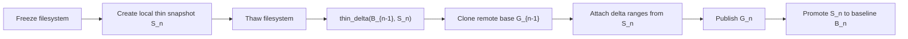

### 2.3 Consequence

V3 moves complexity out of the cut and into ordinary asynchronous work.

| Area | V2.2 | V3 |
|---|---|---|
| Snapshot base | live durable frontier | previous visible snapshot matching local baseline |
| Capture freeze path | fsfreeze, dm-cache suspend, metadata copy, DrainWrites, prepare, thin snapshot | fsfreeze, thin snapshot, thaw |
| Data to upload | dm-cache dirty ranges at capture | thin mapping differences since baseline |
| Main local metadata source | frozen dm-cache metadata plus thin rmap | thin metadata delta between two snapshots |
| Cache dependency | must identify dirty cache lines | read `S_n` through cache; no dirty-set analysis |
| Remote correctness dependency | `DrainWrites()` frontier | baseline pair invariant: `B_k == G_k` |
| Space pressure | one in-flight thin snapshot | retained baseline plus in-flight snapshot |

### 2.4 V3.2 revisions

V3.2 does not change the V3 correctness model. It closes review gaps in enforcement, liveness, and operational policy:

- Freeze-window liveness: mandatory freeze watchdog and placement rules that prevent capture-path deadlocks (Sections 7.11, 9.3).
- Explicit immutability enforcement for `S_n` and `B_k` via read-only activation and transaction-id tracking (Sections 7.3, 9.3, 15.1).
- Corrected `left_only` handling when `object_chunk_size > thin_chunk_size`: sub-object holes require read-modify-write objectization, not `ClearRange` (Sections 9.6, 10.5).
- Pool zeroing and tenancy policy for shared thin pools (Section 8.7).
- Publish-path NBD read amplification named as a first-class cost, with an optional server-side head-offset dedupe path (Sections 16.4, 17.10).
- Rejuvenation/snapshot concurrency rules, including the single metadata-snapshot reservation constraint (Sections 10.2, 14.12).
- Hardened pin lifecycle: publish implies pin, bootstrap pins `G_0`, pins are refcounted per holder (Sections 8.3, 11.1, 15.4).
- Periodic baseline-pair audit (Section 10.8).
- Explicit device placement and durability domains, plus a disaster-recovery/RPO statement for total local loss (Sections 6.5, 15.7).
- Sizing guidance formulas for admission thresholds and the chunk-size CoW trade-off (Sections 8.1, 8.2).
- Application-consistency scope made explicit with hook points (Sections 4.2, 9.10).
- New validation plan tied to the recovery matrix and invariants (Section 21).

---

## 3. Terminology

### Active thin volume `A`

The writable dm-thin device mounted by the filesystem.

### Local baseline `B_k`

A retained read-only local dm-thin snapshot whose contents are known to equal a visible remote snapshot `G_k`.

In steady state, `k = n - 1`, so the local baseline is `B_{n-1}` and the remote base is `G_{n-1}`. Recovery may allow the baseline pair to lag behind the most recent visible snapshot, but the pair must remain exact.

### Remote base `G_k`

The visible immutable SkyNBD snapshot corresponding to local baseline `B_k`.

### New local snapshot `S_n`

The dm-thin snapshot created during the current `fsfreeze` cut. `S_n` is the authoritative local point-in-time view that the new remote snapshot must represent.

### Prepared snapshot `P_n`

A hidden SkyNBD metadata root cloned from remote base `G_k`. It is not visible to readers and may be abandoned until published.

### Published snapshot `G_n`

A visible immutable SkyNBD snapshot. It is created by publishing `P_n` after all changed ranges and metadata are durable.

### Thin delta `Delta(B_k, S_n)`

The mapping-level difference between the retained baseline and the new local snapshot. It contains the logical ranges where `S_n` differs from `B_k`, including changed mappings, newly mapped ranges, and ranges that became holes or discards.

### Baseline pair

The pair:

```text
(B_k, G_k)
```

where `B_k` is local and `G_k` is remote, and both represent exactly the same logical block contents.

The baseline pair is the anchor for all incremental snapshot correctness.

### Abandon

The explicit act of discarding an unpublished snapshot attempt:

- abort hidden prepared snapshot `P_n`, if created,
- delete candidate local snapshot `S_n`,
- keep baseline `B_k`,
- preserve remote base `G_k`.

Abandon is a normal outcome under thin-pool pressure, object-store lag, local artifact loss, or explicit recapture.

---

## 4. Goals and Non-Goals

### 4.1 Goals

- Establish filesystem-consistent snapshots using `fsfreeze` and dm-thin snapshots.
- Keep the filesystem freeze window as close as possible to a pure local metadata operation.
- Avoid dm-cache metadata capture and dirty-cache reverse mapping.
- Make snapshot correctness independent of the live SkyNBD writable head.
- Publish snapshots only after all delta data and metadata are durable.
- Retain a local baseline so thin metadata can produce exact incremental deltas.
- Treat thin-pool data and metadata space pressure as a first-class safety constraint.
- Treat snapshot-induced thin-pool fragmentation as an expected lifecycle condition with explicit rejuvenation policy.
- Permit cheap abandonment of unpublished snapshots without compromising older snapshots.
- Keep the remote representation WORM-compatible: immutable data objects plus atomic metadata publication.
- Support no-XML production integration with thin delta enumeration.

### 4.2 Non-Goals

- Guarantee that every captured local point eventually becomes a visible remote snapshot.
- Make local thin snapshots free from CoW space pressure.
- Guarantee contiguous dm-thin physical allocation under repeated snapshot churn.
- Depend on the live SkyNBD durable head for snapshot correctness.
- Require dm-cache dirty metadata interpretation in the primary path.
- Require `dm-era` for correctness.
- Provide unlimited concurrent in-flight snapshots per volume.
- Promise deterministic filesystem free-space behavior under thin provisioning.
- Eliminate the need for full rebaseline when the local baseline is lost.
- Guarantee permanent physical contiguity of thin-data blocks after repeated snapshot churn.
- Provide application-level consistency. V3 snapshots are filesystem-consistent; application quiesce is available only through explicit pre/post capture hooks (Section 9.10).

---

## 5. Design Choice

V3 chooses **previous-visible remote base plus retained local thin baseline** as the primary correctness model.

### 5.1 Core equation

```text
Given:
  B_k == G_k

Create:
  S_n = local thin snapshot of active volume A at filesystem cut
  P_n = clone(G_k)
  Delta_n = thin_delta(B_k, S_n)

Publish:
  G_n = apply(P_n, Delta_n)
```

In steady state:

```text
k = n - 1
```

so the common case is:

```text
G_n = clone(G_{n-1}) + thin_delta(B_{n-1}, S_n)
```

### 5.2 Why this is simpler

The V2.2 design had to answer a subtle question:

> Which blocks are missing from the remote durable frontier because their latest contents are still only in dm-cache?

V3 replaces that with a simpler question:

> Which logical block mappings changed between two immutable local dm-thin snapshots?

The second question is exactly what thin metadata is good at answering.

### 5.3 Why dm-cache still helps

V3 no longer needs dm-cache metadata for correctness, but dm-cache remains valuable:

- normal writeback can continue to collapse hot overwrites,
- reads from `S_n` still pass through dm-cache and can retrieve dirty cached data,
- data already objectized by the live write path can be reused through hash-first dedupe,
- the snapshot cut does not require flushing the cache.

The important rule is:

> Delta objectization must read changed ranges through the `S_n` block device, not by bypassing dm-cache and reading the lower thin data device directly.

### 5.4 Why the live durable head is not the base

The live SkyNBD writable head can be ahead of, behind, or unrelated to the exact filesystem cut, depending on writeback timing and durability. V3 avoids this ambiguity by cloning a visible immutable snapshot that is known to correspond to the retained local baseline.

This makes `DrainWrites()` unnecessary for snapshot correctness.

The live head can still be used for normal writes, object dedupe, and optional optimizations. It is simply not part of the snapshot proof.

---

## 6. Architecture

### 6.1 Local and remote stack

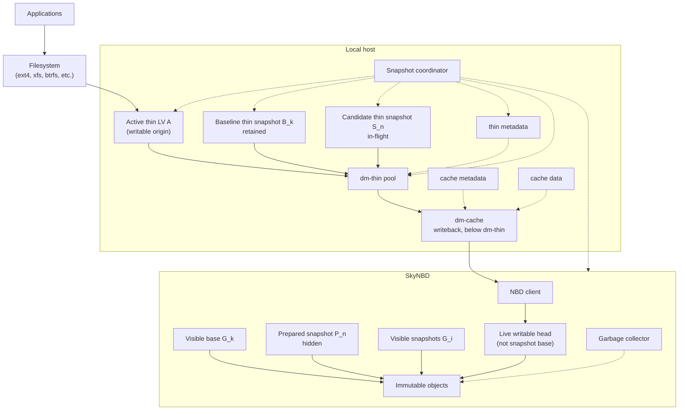

### 6.2 Baseline chain

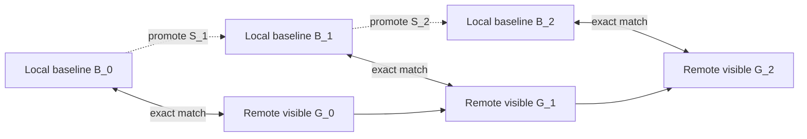

The local baseline chain is not necessarily retained in full. In normal operation only the current baseline is retained locally. Older remote visible snapshots may be retained remotely according to product policy.

### 6.3 Snapshot publication model

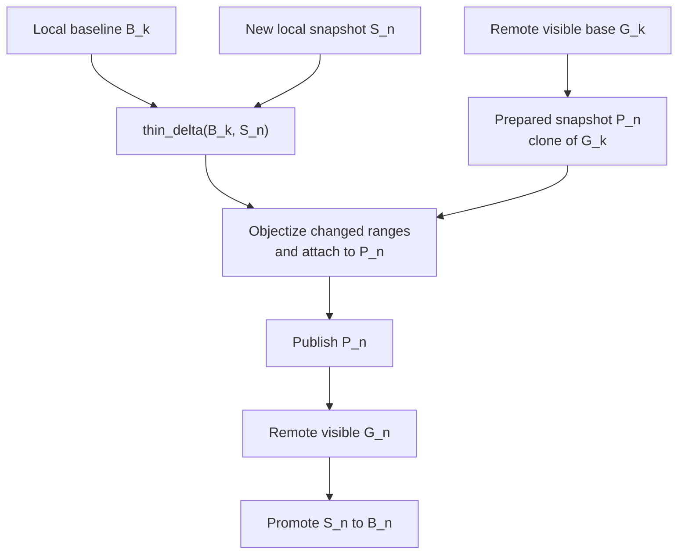

### 6.4 Steady-state local artifacts

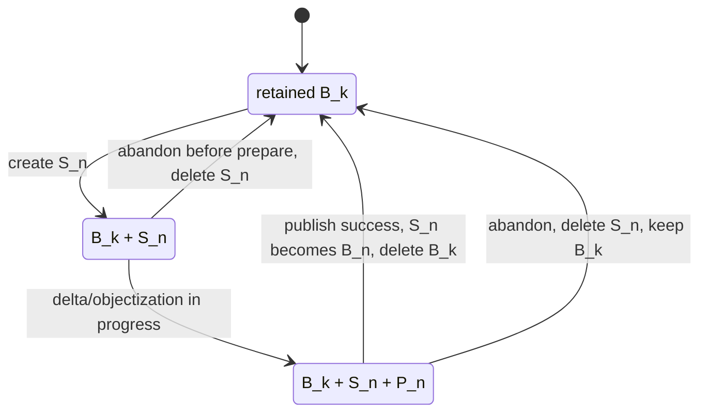

### 6.5 Device placement and durability domains

V3.2 makes device placement explicit because it determines what survives each failure class:

| Component | Placement | Durability domain |
|---|---|---|
| Thin-pool data device | dm-cache (writeback) over NBD | Remote once written back; dirty blocks are local-only until writeback completes |
| Thin-pool metadata device | Local fast storage, **not** on the NBD/cache path | Local only |
| dm-cache metadata and cache data | Local fast storage | Local only |
| Coordinator state and logs | Local storage on a filesystem that capture policy never freezes | Local only |
| Visible snapshots `G_i` and immutable objects | Object store | Remote, immutable |

Two consequences follow:

1. Thin metadata is deliberately kept off the cached NBD path. This keeps metadata I/O latency local and predictable, but it means the remote live head image is not self-describing: without local thin metadata, the head is an opaque pool-physical image. Recovery from total local loss therefore proceeds from visible snapshots `G_i`, never from the live head.
2. Anything local-only — thin metadata, dirty writeback blocks, coordinator state — is lost in a total local failure. Section 15.7 defines the recovery model and the resulting RPO.

---

## 7. Core Invariants

V3 is correct only if the following invariants hold.

### 7.1 Baseline pair invariant

For every active baseline pair:

```text
contents(B_k) == contents(G_k)
```

This is the root invariant. If it is lost, incremental snapshots from that baseline are invalid.

### 7.2 Baseline retention invariant

The local baseline `B_k` must not be deleted until a replacement baseline `B_n` has been established or the system has intentionally entered rebaseline mode.

The corresponding remote base `G_k` must remain cloneable while `B_k` is the active local baseline.

### 7.3 Candidate snapshot invariant

`S_n` is the authoritative local truth for the new snapshot.

All data objectization for changed ranges must read from `S_n`, not from the active origin `A`, not from the lower data device, and not from the live SkyNBD head.

Immutability of `S_n` and `B_k` must be **enforced, not assumed**. Both must be activated read-only, and the coordinator must record the thin device id and pool transaction id at creation so a stale or reused device cannot silently masquerade as the snapshot after recovery. A single stray write to `S_n` would corrupt both the published `G_n` and the promoted baseline `B_n` with no detection; read-only enforcement converts that failure into an immediate error. See Section 9.3 for the activation procedure.

### 7.4 Snapshot creation serialization invariant

The thin snapshot must be created while the filesystem is frozen and while snapshot creation is serialized correctly with the active thin origin.

With LVM, this is expected to be handled by the `lvcreate --snapshot` path. With raw dm-thin, the coordinator must follow the kernel thin-provisioning requirement to suspend or otherwise serialize the active origin around `create_snap`.

### 7.5 Remote base invariant

`P_n` must be cloned from the remote visible snapshot that corresponds to the retained local baseline:

```text
P_n = clone(G_k), where B_k == G_k
```

It must not be cloned from the live writable head unless the live head is explicitly known to equal `G_k`, which is not assumed in V3.

### 7.6 Thin delta completeness invariant

For every logical range where `S_n` differs from `B_k`, `thin_delta(B_k, S_n)` must emit a range that causes the prepared snapshot to be updated.

This includes:

- mapped-to-different-physical ranges,
- newly mapped ranges,
- ranges that became unmapped holes,
- discard/TRIM effects visible in the thin metadata.

### 7.7 Durable publish invariant

`G_n` becomes visible only after:

- every data object referenced by `P_n` is durable,
- every hole or clear operation is durable in `P_n` metadata,
- the prepared metadata root is committed,
- publication is atomic from the reader's point of view.

### 7.8 Local pool safety invariant

Thin-pool health overrides snapshot completion.

If retaining `S_n` would risk thin-pool data or metadata exhaustion, the coordinator must abandon the in-flight snapshot and delete `S_n`.

### 7.9 Single in-flight invariant

V3 supports at most one candidate snapshot per volume in the initial design:

```text
one baseline B_k + optional one candidate S_n
```

This keeps local CoW pressure, recovery, and remote prepared-state handling simple.

### 7.10 Cache read-path invariant

Changed ranges must be read through the normal `S_n` mapped device so dm-cache can supply dirty writeback data that has not yet reached SkyNBD.

A direct read of the lower data device or remote object store can return stale data and is invalid for snapshot objectization.

### 7.11 Freeze liveness invariant

No component that can run while the filesystem is frozen — LVM, udev handlers, the coordinator itself — may depend on writes to the frozen filesystem, and every freeze is bounded by a watchdog (Section 9.3).

A capture that cannot complete within its freeze budget must fail by thawing, never by waiting. A failed capture is recoverable; an unbounded freeze is an outage.

---

## 8. Provisioning and Operational Policy

### 8.1 Provisioning-time constants

| Constant | Meaning |
|---|---|
| `thin_chunk_size` | dm-thin allocation unit. Recommended to align with SkyNBD object chunking. |
| `object_chunk_size` | SkyNBD immutable object granularity. Recommended equal to or a multiple of `thin_chunk_size`. |
| `max_inflight_snapshots_per_volume` | Initially `1`. |
| `thin_pool_admit_data_free_bytes` | Minimum data free space required before creating `S_n`. |
| `thin_pool_admit_metadata_free_bytes` | Minimum metadata free space required before creating `S_n`. |
| `thin_pool_abandon_data_free_bytes` | Emergency data threshold below which in-flight snapshot must be abandoned. |
| `thin_pool_abandon_metadata_free_bytes` | Emergency metadata threshold below which in-flight snapshot must be abandoned. |
| `max_candidate_snapshot_age_s` | Maximum time `S_n` may remain in-flight before policy abort. |
| `max_baseline_age_s` | Operational alert threshold for stale local baseline. |
| `delta_backfill_bandwidth_floor_bytes_per_s` | Conservative floor used for API/workflow barrier admission. |
| `workflow_barrier_max_freeze_ms` | Hard cap for optional workflow-barrier mode. |
| `local_baseline_required` | Boolean profile flag. V3 incremental mode requires `true`. |
| `fragmentation_alert_score` | Threshold above which the coordinator recommends rejuvenation/rebaseline planning. |
| `fragmentation_rejuvenation_score` | Threshold above which new captures may be rate-limited until rejuvenation/rebaseline is scheduled. |
| `max_rejuvenation_interval_s` | Maximum age before a pool should be evaluated for proactive rejuvenation under sustained churn. |
| `pool_switch_freeze_budget_ms` | Hard cap for the final frozen cutover during ping-pong pool rejuvenation. |
| `rejuvenation_final_delta_max_bytes` | Maximum final unsynchronized delta allowed before attempting frozen pool switch. |
| `capture_freeze_watchdog_ms` | Hard cap on the default Phase 1 freeze window. The watchdog force-thaws and fails the capture if exceeded. |
| `baseline_audit_interval_s` | Interval for the periodic baseline-pair hash audit (Section 10.8). |
| `baseline_audit_sample_bytes` | Bytes sampled per baseline audit pass. |

#### 8.1.1 Sizing guidance

The admit and abandon thresholds are not arbitrary. They should be derived from the workload envelope:

```text
expected_publish_time = expected_delta_bytes / min(objectization_read_bw, object_store_put_bw)

cow_during_publish    = origin_write_rate * expected_publish_time * cow_amplification

admit_data_headroom  >= cow_during_publish * 2 + safety_margin
```

The factor of 2 reflects the two pinned points in time during publish: a chunk shared with both `B_k` and `S_n` can force allocation twice before publish completes. `cow_amplification` captures the ratio of thin chunks copied to bytes actually written — for small random writes against large thin chunks it is `thin_chunk_size / typical_write_size`, bounded below by 1.

Metadata headroom should be sized from observed metadata bytes per mapped chunk times the expected new-mapping count, with margin. These formulas set the floor; Section 20.5 still calls for empirical tuning per filesystem, workload, and chunk size.

### 8.2 Alignment policy

V3 no longer requires `dm-cache` block size to equal `dm-thin` chunk size. That requirement existed in V2.2 only because dirty cache lines had to be reverse-mapped through thin metadata.

For V3, the preferred alignment is:

```text
thin_chunk_size == object_chunk_size
```

or:

```text
object_chunk_size = N * thin_chunk_size
```

This makes delta ranges easy to coalesce and attach. Correctness does not require exact equality, but non-aligned sizes increase range splitting and metadata work.

Chunk size also has a CoW-amplification dimension that V2.2 did not have. Because V3 always retains a baseline, every first write to a chunk shared with `B_k` copies the entire thin chunk. Retained-baseline write amplification therefore scales with `thin_chunk_size` under small-random-write workloads. This pushes against large thin chunks in V3 even where large chunks would otherwise reduce metadata volume and fragmentation; validate the choice against the sizing formulas in Section 8.1.1 and the observed write profile.

Choosing `object_chunk_size = N * thin_chunk_size` with `N > 1` introduces a second amplification: a single changed thin chunk forces reading and uploading the full containing object chunk, and sub-object holes require read-modify-write objectization (Section 9.6).

### 8.3 Baseline provisioning

Every volume in V3 incremental mode must have a baseline pair:

```text
(B_k, G_k)
```

If no baseline exists, the system must run a bootstrap snapshot.

#### Bootstrap path

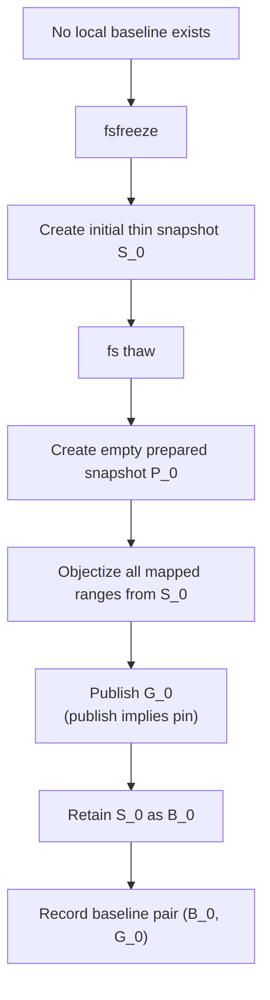

Bootstrap is full-snapshot work. Subsequent snapshots are incremental.

Bootstrap must establish the pin before the baseline pair is recorded: `G_0` is pinned at publish (Section 11.1), and the pair `(B_0, G_0)` is valid only once that pin is durable. V3.1 omitted this, leaving a window where retention policy could delete the only remote base.

Bootstrap objectization is also a full-volume read through the cache stack. Chunks not resident in dm-cache are fetched over NBD, and a naive sequential scan can pollute or thrash the cache. Bootstrap reads should be throttled and, where the cache policy supports it, paced so scan traffic does not evict the hot working set.

### 8.4 Thin-pool admission policy

Before creating `S_n`, the coordinator checks:

- thin-pool data free space,
- thin-pool metadata free space,
- current low-water events,
- baseline age,
- existing in-flight snapshot state,
- recent CoW growth rate,
- expected publish bandwidth.

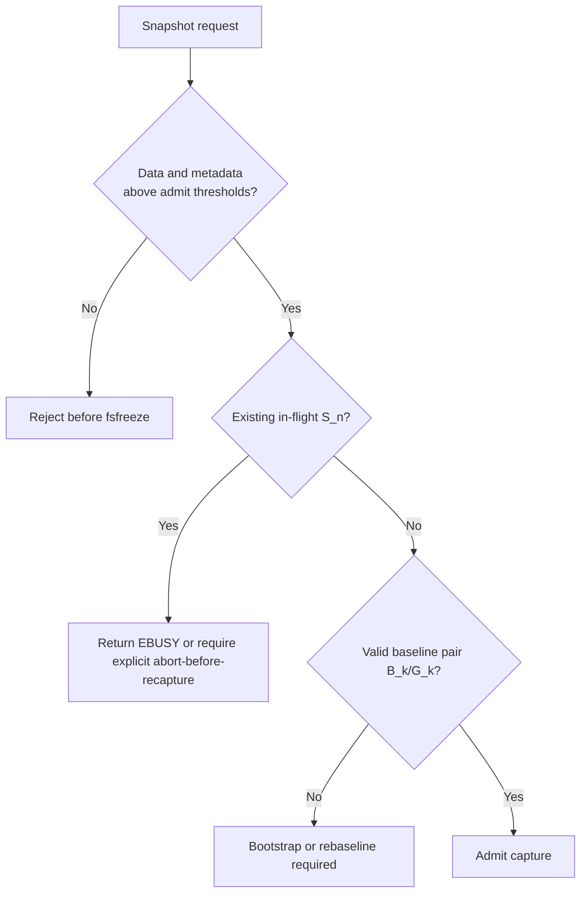

### 8.5 Thin-pool abandon policy

After `S_n` exists, the coordinator continuously monitors pool health.

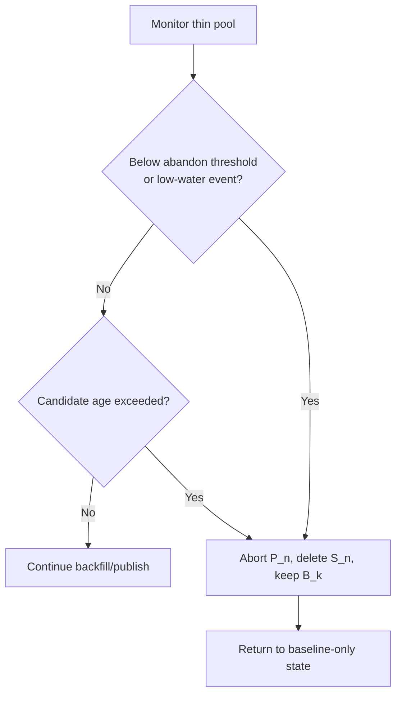

Abandon is preferred over allowing local thin-pool exhaustion.

### 8.6 Filesystem free-space reality

V3 assumes that filesystem-level free-space behavior is not perfectly predictable on modern filesystems.

This matters for:

- btrfs delayed allocation and metadata reservation behavior,
- XFS speculative preallocation and metadata behavior,
- copy-on-write filesystems above copy-on-write block layers,
- thin-pool metadata growth,
- delayed discard and discard coalescing,
- workload-dependent write amplification.

Therefore V3 does not promise that nominal filesystem free space or nominal thin-pool free space can predict all future allocation failures.

Instead, V3 requires conservative guardrails:

- admission thresholds with safety margin,
- emergency abandon thresholds,
- low-water event handling,
- maximum in-flight age,
- alerting on baseline age and CoW growth,
- explicit treatment of snapshot abandonment as normal behavior.

### 8.7 Pool zeroing and tenancy

dm-thin pools are commonly run with block zeroing disabled (`skip_block_zeroing`) for performance. With zeroing disabled, a provisioned-but-unwritten region of a thin chunk reads as stale pool data. That is invisible to well-behaved filesystems, but the V3 objectizer reads raw ranges from `S_n` and will faithfully upload whatever those regions contain.

This is self-consistent — `G_n` still equals `S_n` — but it has a tenancy implication: on a shared pool, stale regions can contain freed data from **other** thin volumes, and snapshot objectization would then copy another tenant's data into this volume's snapshot objects.

Policy:

- Single-tenant pools (one trust domain per pool) may disable zeroing for performance. This is the assumed V3 deployment shape.
- Shared or multi-tenant pools must enable block zeroing, or must not use V3 snapshot objectization.

The deployment profile must state which mode applies.

---

## 9. Snapshot Procedure

### 9.1 Overview

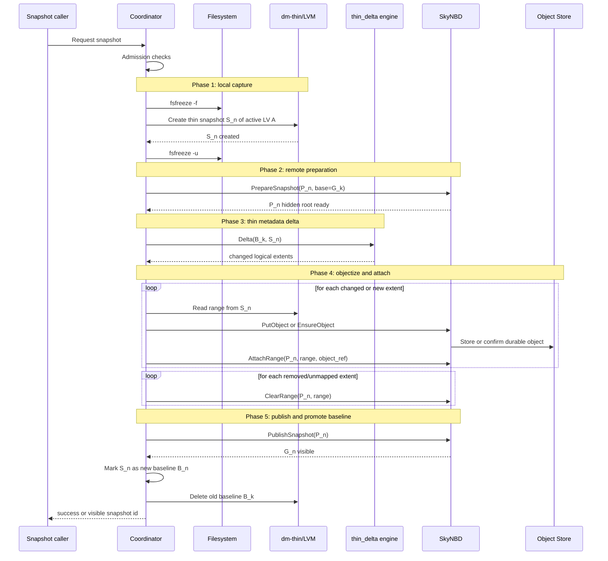

### 9.2 Phase 0: Admission

Before freezing the filesystem, the coordinator verifies:

- there is a valid baseline pair `(B_k, G_k)`, or bootstrap mode is requested,
- `G_k` is still retained and cloneable remotely,
- no in-flight candidate snapshot already exists for the volume,
- thin-pool data and metadata free space are above admit thresholds,
- the pool has not emitted unresolved low-water or error events,
- local coordinator state is clean,
- request mode is permitted by policy.

Failures in this phase return before `fsfreeze`.

### 9.3 Phase 1: Local capture

The capture sequence is intentionally small:

```text
fsfreeze -f <mountpoint>
lvcreate --snapshot --name S_n <thin-origin>
fsfreeze -u <mountpoint>
```

The implementation must ensure that thin snapshot creation is serialized correctly with the active thin origin. With LVM this should be handled by LVM's device-mapper orchestration. With raw dm-thin, the coordinator must suspend or otherwise serialize the origin around `create_snap`.

#### Freeze-window liveness requirements

The frozen window is short but not automatically safe. Two hazards can deadlock it:

1. **LVM writes on the frozen filesystem.** `lvcreate` may write archive/backup files, take locks, and trigger udev rules. If LVM's archive directory, lock directory, or anything a udev rule touches lives on the filesystem being frozen, snapshot creation blocks and the filesystem never thaws.
2. **Coordinator writes on the frozen filesystem.** If the coordinator logs or persists state to the frozen filesystem — especially in workflow barrier mode, where the freeze spans the entire publish — it deadlocks itself.

V3.2 therefore requires:

- LVM metadata, archive, backup, and lock directories must never reside on a freezable volume. Disable LVM archiving on capture hosts if placement cannot be guaranteed.
- Coordinator state, logs, and any control-plane persistence must live on a filesystem excluded from freeze by policy (Section 6.5).
- Udev rules triggered by snapshot creation or activation must not touch freezable filesystems.
- A **freeze watchdog** bounds the default capture window by `capture_freeze_watchdog_ms`. On expiry it force-thaws, deletes any partially created `S_n`, and fails the capture (Section 7.11).
- A preflight check validates these placement rules before the first capture on a host, not during one.

#### Snapshot activation

Thin snapshots carry the activation-skip flag by default, so `S_n` must be activated deliberately (`lvchange -ay -K`) and must be activated **read-only** (`-pr`). Read-only activation is the enforcement mechanism for the immutability assumption in Section 12.1; it applies to `B_k` at all times and to `S_n` from creation onward.

No SkyNBD remote operation is required in the frozen window.

No dm-cache suspend is required in the frozen window.

No dm-cache flush is required in the frozen window.

If capture fails:

1. delete partially created `S_n`, if any,
2. thaw the filesystem if still frozen,
3. keep baseline `B_k`,
4. report failure.

### 9.4 Phase 2: Prepare remote snapshot

After thaw, the coordinator creates a hidden remote snapshot:

```text
P_n = PrepareSnapshot(base = G_k)
```

`G_k` is the remote visible snapshot corresponding to `B_k`, not necessarily the latest visible snapshot in unusual recovery cases.

If remote preparation fails, the coordinator deletes `S_n` and returns to baseline-only state.

### 9.5 Phase 3: Compute thin delta

The coordinator computes:

```text
Delta_n = thin_delta(B_k, S_n)
```

Production integration should consume an in-memory range stream or equivalent machine interface. Parsing XML is not part of the preferred V3 hot path.

If the thin pool is live, metadata must be read through a safe thin metadata snapshot mechanism or an equivalent library path that provides a consistent metadata view.

The result is a set of logical extents classified into operations.

### 9.6 Phase 4: Apply delta to prepared snapshot

For every delta extent:

| Delta class | Meaning | Required SkyNBD action |
|---|---|---|
| `same` | `B_k` and `S_n` map to the same content | no-op |
| `different` | both are mapped, but to different thin data blocks | read from `S_n`, objectize, `AttachRange` |
| `right_only` | range exists in `S_n` but not in `B_k` | read from `S_n`, objectize, `AttachRange` |
| `left_only` | range existed in `B_k` but is unmapped in `S_n` | `ClearRange` if the hole covers whole object chunks; otherwise read-modify-write objectization (see below) |

The words `left` and `right` correspond to:

```text
left  = baseline B_k
right = new snapshot S_n
```

#### Sub-object holes

When `object_chunk_size = N * thin_chunk_size` with `N > 1`, a `left_only` thin chunk can fall inside an object chunk whose sibling thin chunks are still mapped. Clearing the whole object chunk would wipe live data. The correct action at object granularity is:

- If an object-aligned range is entirely `left_only`, emit `ClearRange`.
- Otherwise, read the full object-aligned range from `S_n` — the thin device returns zeros for the unmapped portion — and objectize and attach it exactly like a `different` range.

The same rule applies to any mixture of delta classes within one object chunk: the object chunk is rebuilt from an `S_n` read whenever it cannot be represented by a single whole-chunk operation. This is read-modify-write amplification and is the direct cost of choosing `N > 1` (Section 8.2).

### 9.7 Phase 5: Publish

When all operations have been durably applied to `P_n`, the coordinator calls:

```text
PublishSnapshot(P_n)
```

On success:

1. SkyNBD exposes `G_n` atomically.
2. The coordinator records that `S_n` is now the new local baseline `B_n` for `G_n`.
3. The coordinator deletes old baseline `B_k`, subject to local retention policy.
4. The remote base `G_k` may be released according to remote snapshot retention policy, but only after no local baseline depends on it.

The ordering is important:

```text
publish G_n
record S_n as B_n
only then delete B_k
```

If any step after publish fails, recovery must preserve at least one valid baseline pair.

### 9.8 API barrier mode

API barrier mode means:

- perform normal capture,
- thaw immediately,
- continue delta/objectization/publish,
- return to the caller only after publish succeeds or fails.

Application I/O is blocked only for the capture window.

### 9.9 Workflow barrier mode

Workflow barrier mode means:

- freeze the filesystem,
- create `S_n`,
- keep the filesystem frozen while delta/objectization/publish completes,
- thaw only after success, failure, or deadline expiry.

This mode is not needed for snapshot correctness. It exists only for workflows that require:

```text
Do not let the filesystem make forward progress unless this exact snapshot is visible and durable.
```

It must be bounded by `workflow_barrier_max_freeze_ms`.

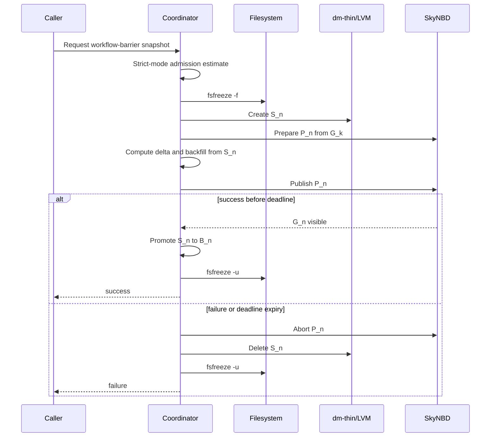

Workflow barrier mode should be rare. It can be expensive when the thin delta is large.

### 9.10 Application consistency scope

`fsfreeze` guarantees filesystem consistency: metadata is coherent and journaled state is replayable. It does **not** quiesce applications. Databases, message queues, and anything with multi-file or in-memory transactional state can be captured mid-transaction and will see the snapshot as a crash image.

V3 treats application consistency as out of scope for the core mechanism but defines hook points:

```text
pre_capture_hook   (before fsfreeze; may quiesce or checkpoint applications)
post_capture_hook  (after thaw; resumes applications)
```

Hooks run outside the frozen window: pre-hooks complete before `fsfreeze`, post-hooks run immediately after thaw. Pre-hook failure aborts the capture. Post-hook failure is reported but does not invalidate the snapshot, which remains crash-consistent. Callers requiring true application consistency must implement the pre-hook quiesce; workflow barrier mode does not substitute for it — it changes when the caller returns, not what the snapshot contains. External backup hooks (such as Velero's) must quiesce applications only, never invoke `fsfreeze`: the agent owns `FIFREEZE`/`FITHAW`, and nested `FIFREEZE` returns `EBUSY`.

---

## 10. Thin Delta Analysis

### 10.1 Required capability

V3 depends on a tool or library that can compare mappings between two dm-thin devices in the same pool:

```text
Delta(B_k, S_n)
```

The required output is an ordered stream of logical extents and operations, not a human-readable report.

Preferred production interface:

```text
for extent in thin_delta_ranges(pool_metadata, left_dev=B_k, right_dev=S_n):
    emit extent.logical_start
    emit extent.length
    emit extent.class
    emit extent.left_mapping, if any
    emit extent.right_mapping, if any
```

The implementation may be:

- an in-process Rust/library integration,
- a thin-provisioning-tools range-output mode,
- a small wrapper around the upstream delta visitor,
- a temporary CLI fallback during development.

XML parsing is acceptable for prototypes and test fixtures, but not for the production hot path.

### 10.2 Safe metadata access

The thin pool may remain live while delta analysis runs because `B_k` and `S_n` are immutable snapshots. However, the metadata reader still needs a consistent metadata view.

Required policy:

- use the kernel thin metadata snapshot mechanism, or
- use `thin_delta --metadata-snap`, or
- run against an offline/read-only metadata image, or
- use an equivalent library integration that guarantees consistency.

Do not parse a live thin metadata device directly without a metadata snapshot or equivalent safety mechanism.

The kernel supports **one reserved metadata snapshot per pool at a time** (`reserve_metadata_snap` / `release_metadata_snap`). All consumers — snapshot publication, rejuvenation catch-up deltas, baseline audits — contend for that single reservation. The coordinator must own a per-pool reservation lock, hold reservations only for the duration of a scan, and release stale reservations during crash recovery. Note that on an LVM-managed pool the reservation is issued via `dmsetup message` outside LVM's awareness, so its lifecycle belongs entirely to the coordinator. Concurrency rules are in Section 14.12.

### 10.3 Why mapping delta is sufficient

Because `B_k` is a retained dm-thin snapshot, writes to the active origin after `B_k` cause copy-on-write mapping divergence for the written logical chunks. Therefore, when `S_n` is later created:

- unchanged chunks are shared with `B_k`,
- changed chunks map differently,
- newly allocated chunks appear only in `S_n`,
- discarded chunks may disappear from `S_n`.

Thus a mapping delta is enough to identify all logical ranges where the new snapshot can differ from the base.

### 10.4 Data read rules

For every `different` or `right_only` range:

```text
read bytes from /dev/<S_n>
```

Do not read from:

- active origin `A`,
- raw thin data device,
- dm-cache data device,
- remote live head,
- remote visible base.

The `S_n` read path is authoritative because it goes through the same block stack that preserves the cut, including dm-cache if the newest block contents are still dirty in writeback cache.

### 10.5 Discard and hole rules

If `thin_delta` reports a range that exists in `B_k` but not in `S_n`, SkyNBD must make the corresponding range in `P_n` read as the same contents `S_n` would read.

Normally this means:

```text
ClearRange(P_n, logical_range)
```

where a cleared sparse range reads as zero.

`ClearRange` applies only at whole-object-chunk granularity. Holes smaller than an object chunk are handled by read-modify-write objectization as defined in Section 9.6.

If the SkyNBD remote format distinguishes holes from explicit zero objects, the operation must choose the representation that matches the volume's read semantics.

### 10.6 Coalescing

The delta engine should coalesce adjacent extents when doing so preserves semantics.

Useful coalescing boundaries:

- object chunk boundaries,
- thin chunk boundaries,
- remote metadata leaf boundaries,
- maximum object upload size,
- maximum idempotent operation size.

### 10.7 Verification mode

A debug or audit profile may verify correctness by sampling or hashing:

```text
hash(S_n[range]) == hash(G_n[range])
```

after publish.

This is not part of the minimal hot path, but it is useful during rollout.

### 10.8 Baseline pair audit

Publish-time verification checks `G_n` against `S_n`, but nothing in V3.1 ever re-checked the standing invariant `contents(B_k) == contents(G_k)` after promotion. Because every incremental snapshot inherits from that equality, silent drift — a bug in promotion, recovery, or rejuvenation — poisons every subsequent snapshot without detection.

V3.2 adds a periodic sampled audit:

```text
every baseline_audit_interval_s:
    select random logical ranges totaling baseline_audit_sample_bytes
    compare hash(B_k[range]) against hash(G_k[range])
```

On mismatch the coordinator must mark the baseline pair invalid, block new incremental captures, alert, and require rebaseline before incremental service resumes.

The audit also verifies that the recorded thin device id and pool transaction id for `B_k` (Section 15.1) still match live pool state, so a reused or stale device id is caught even when sampled contents happen to compare equal. Audit reads of `B_k` use the same mapped-device read path as objectization (Section 10.4).

---

## 11. SkyNBD Control Plane

### 11.1 Required operations

| Operation | Purpose |
|---|---|
| `PrepareSnapshotFromBase(volume_id, snapshot_id, base_visible_id)` | Clone visible snapshot `G_k` into hidden prepared snapshot `P_n`. |
| `PutObject(hash, data)` or `EnsureObject(hash, data)` | Store immutable object or confirm it already exists. |
| `AttachRange(snapshot_id, logical_range, object_ref)` | Point a logical range in `P_n` at a durable object. |
| `ClearRange(snapshot_id, logical_range)` | Make a range sparse/zero/unmapped in `P_n`. |
| `PublishSnapshot(snapshot_id)` | Atomically expose `P_n` as visible snapshot `G_n` after validating durability. Publish atomically establishes a pin on `G_n` held by the publishing coordinator. |
| `AbortSnapshot(snapshot_id)` | Discard hidden `P_n` and remove it from the prepared root set. |
| `GetSnapshotStatus(snapshot_id)` | Report prepared, backfilling, publishable, visible, aborted, failed. |
| `PinVisibleSnapshot(snapshot_id, holder_id)` | Prevent deletion of a visible snapshot while a dependent (local baseline, in-flight `P_n`) exists. Pins are refcounted and keyed by holder. |
| `UnpinVisibleSnapshot(snapshot_id, holder_id)` | Release one holder's pin. The snapshot becomes deletable only when no holders remain. |

Pin lifecycle rules:

- `PublishSnapshot` establishes a pin on the new `G_n` **before it returns**. There is no window in which a freshly published snapshot is visible but unpinned and eligible for retention deletion. V3.1's ordering (publish, then pin as a separate step) had exactly that window.
- `PrepareSnapshotFromBase` pins the base `G_k` for the lifetime of `P_n`; `AbortSnapshot` and `PublishSnapshot` release that holder.
- Pins are refcounted because Section 15.5 permits multiple retained baseline pairs, each an independent holder on its remote base.
- Bootstrap records the baseline pair only after the `G_0` publish pin is durable (Section 8.3).

### 11.2 Removed from primary path

V3 does not require the following V2.2 operation for snapshot correctness:

```text
DrainWrites(volume_id)
```

`DrainWrites()` may still exist for other product features, but V3 snapshots do not clone the live durable head and therefore do not need a live durable frontier.

### 11.3 Prepared snapshot state machine

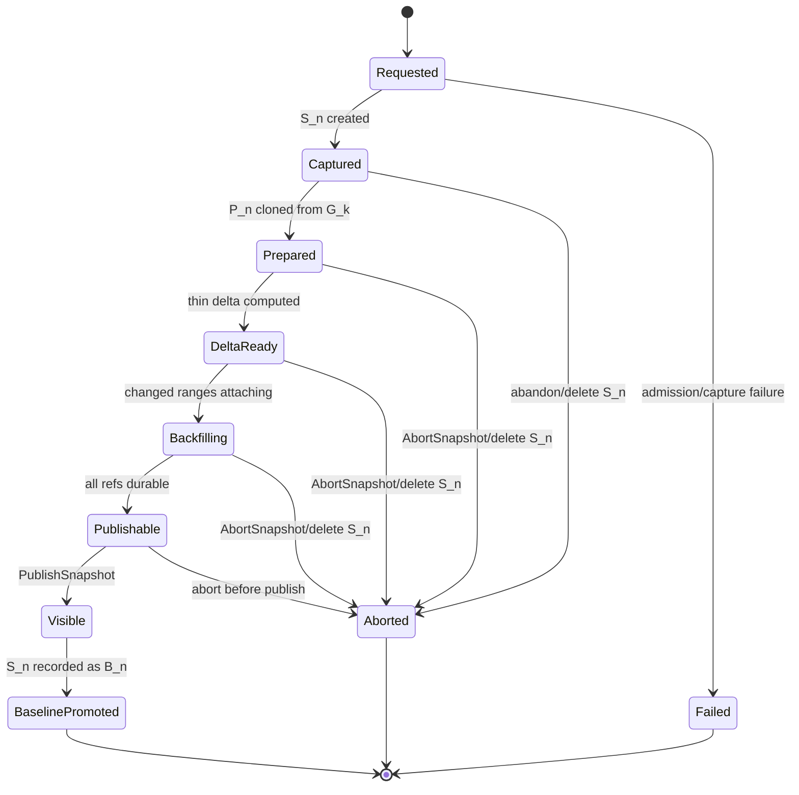

### 11.4 GC root model

Prepared snapshots remain GC roots until aborted or published.

Visible snapshots that correspond to active local baselines must also be pinned.

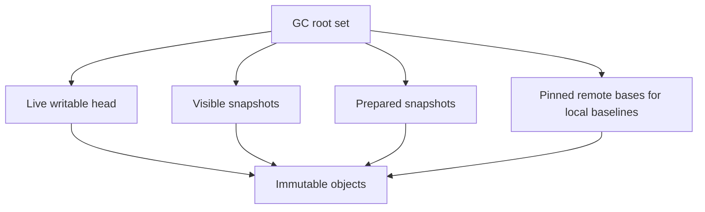

### 11.5 Idempotency

All control-plane operations should be idempotent by `snapshot_id` and operation key.

Examples:

```text
PutObject(hash, data)
AttachRange(snapshot_id, range, object_ref, op_id)
ClearRange(snapshot_id, range, op_id)
PublishSnapshot(snapshot_id)
AbortSnapshot(snapshot_id)
```

This makes crash recovery and retry logic simple.

---

## 12. Consistency Argument

The snapshot is correct if the published remote snapshot `G_n` equals the local thin snapshot `S_n` at every logical range.

### 12.1 Assumptions

1. `fsfreeze` creates a filesystem-consistent cut before `S_n` is created.
2. Thin snapshot creation is serialized correctly with the active thin origin.
3. `S_n` is immutable after creation, enforced by read-only activation (Section 9.3).
4. The baseline pair invariant holds: `B_k == G_k`.
5. `thin_delta(B_k, S_n)` emits every logical range where the two snapshots differ in content semantics.
6. Data for changed ranges is read from `S_n` through the normal mapped device path.
7. SkyNBD publishes only durable data and metadata.

### 12.2 Proof sketch

1. `fsfreeze` ensures the mounted filesystem is in a consistent state before the block snapshot is cut.
2. Creating `S_n` captures the block contents of the active thin volume at that cut.
3. `B_k` and `G_k` are equal by the baseline pair invariant.
4. `P_n` is cloned from `G_k`, so initially `P_n == B_k`.
5. `thin_delta(B_k, S_n)` identifies every logical range where `S_n` can differ from `B_k`.
6. For each changed or new range, V3 reads the authoritative bytes from `S_n` and attaches the resulting durable object to `P_n`.
7. For each removed range, V3 clears the corresponding range in `P_n` so it matches `S_n` read semantics.
8. All unchanged ranges remain inherited from `G_k`, which equals `B_k`, and therefore already match `S_n`.
9. After all delta operations complete, `P_n == S_n` for every logical range.
10. `PublishSnapshot(P_n)` atomically exposes that complete metadata root as `G_n`.

Therefore `G_n` is a filesystem-consistent snapshot of the volume at the cut.

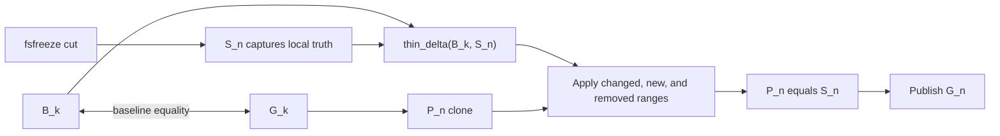

### 12.3 Why `DrainWrites()` is not needed

V2.2 needed `DrainWrites()` because it cloned the live durable head and had to prove that all non-dirty ranges were already represented there.

V3 does not clone the live durable head. It clones `G_k`, a previously visible immutable snapshot already known to be durable and equal to `B_k`.

All differences from that base are explicitly supplied by reading from `S_n`.

Thus the live durable frontier is not part of the correctness proof.

---

## 13. Space Pressure and Filesystem Reality

### 13.1 The accepted cost

V3 retains a local baseline thin snapshot at all times.

During an in-flight publish, it retains two local snapshots:

```text
B_k: baseline corresponding to remote base G_k
S_n: candidate snapshot being published
```

This is the central operational cost of V3.

### 13.2 Why pressure grows

With a retained baseline, every write to a chunk still shared with `B_k` forces copy-on-write allocation in the thin pool.

With an in-flight candidate `S_n`, writes after the cut may also be pinned by `S_n` until it is published or abandoned.

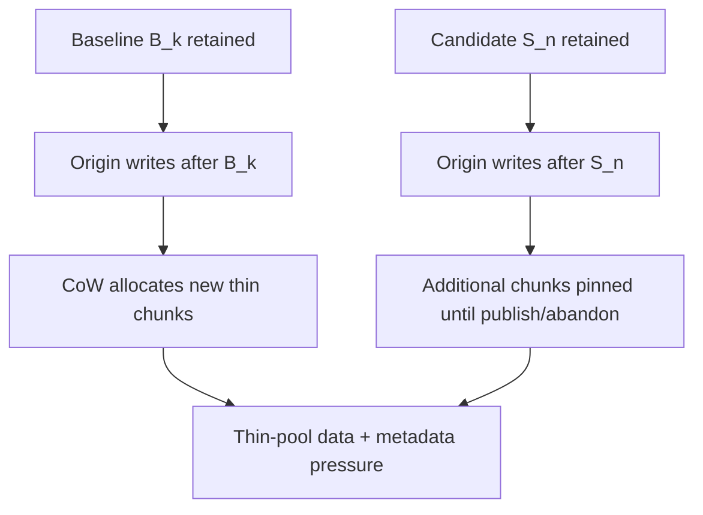

### 13.3 Filesystem behavior is not deterministic enough

The design assumes that space availability is a probabilistic operational envelope, not a deterministic guarantee.

This is especially true for modern filesystems and layered CoW systems:

- filesystem metadata may grow independently of file data,
- delayed allocation can shift the moment of allocation failure,
- discard timing can lag user-visible frees,
- speculative preallocation can consume temporary space,
- btrfs-style CoW can amplify writes above dm-thin CoW,
- xfs metadata and allocation behavior can surprise naive free-space estimates,
- thin-pool metadata can become the limiting factor before data space.

Therefore V3 treats out-of-space and early allocation failure as expected operational events that must be contained.

### 13.4 Safety policy

V3 uses four layers of defense:

1. **Admission control** before creating `S_n`.
2. **Continuous monitoring** while `S_n` exists.
3. **Abandon thresholds** that delete `S_n` before pool health is endangered.
4. **Rebaseline path** if the local baseline chain becomes too costly or invalid.

### 13.5 Abandon semantics under pressure

If thin-pool pressure crosses the abandon threshold:

```text
AbortSnapshot(P_n), if P_n exists
Delete local candidate S_n
Keep local baseline B_k
Keep remote base G_k pinned
Report snapshot abandoned
```

The system returns to a known-good incremental base.

### 13.6 What must not happen

The system must not:

- delete `B_k` before `S_n` is safely promoted,
- keep `S_n` indefinitely while thin-pool free space collapses,
- allow GC to delete `G_k` while `B_k` is the active local baseline,
- assume filesystem free-space estimates are exact,
- continue trying to publish a candidate if local pool health is at risk.

### 13.7 Product implication

V3 makes this promise:

```text
A failed or abandoned snapshot cannot corrupt prior visible snapshots or the active baseline.
```

V3 does not make this promise:

```text
Every captured local point will become visible remotely regardless of thin-pool pressure.
```

That distinction is intentional.

---

## 14. Thin-Pool Fragmentation and Rejuvenation

### 14.1 Scope

The space-pressure policy in Section 13 handles acute safety failures: thin-pool data or metadata exhaustion, low-water events, and candidates that must be abandoned before they endanger the active volume.

Fragmentation is a different problem. It is usually chronic rather than acute:

```text
space pressure = can the pool safely continue allocating?
fragmentation  = how scattered are the physical mappings and free extents?
```

V3 correctness does not depend on low fragmentation. A fragmented pool can still produce correct snapshots. However, fragmentation can degrade snapshot publication throughput, sequential read behavior, write amplification, metadata-cache locality, and recovery time. The design therefore treats fragmentation as an operational lifecycle issue with explicit monitoring and a planned pool-refresh path.

### 14.2 Why V3 can fragment a thin pool

V3 intentionally retains a local baseline snapshot `B_k`. During publication it also retains candidate snapshot `S_n`. Those retained snapshots are what make thin-delta correctness simple, but they also cause ordinary origin writes to allocate replacement chunks through dm-thin copy-on-write.

Over many cycles:

1. `B_k` pins old mappings.
2. Writes to the active origin allocate new chunks from the thin-pool free list.
3. `S_n` temporarily pins another point in time while publication runs.
4. Old baselines and candidates are deleted after publish or abandon.
5. Deleted snapshots return chunks to the free list in scattered positions.
6. Later writes reuse scattered chunks, so logical order and physical order drift apart.

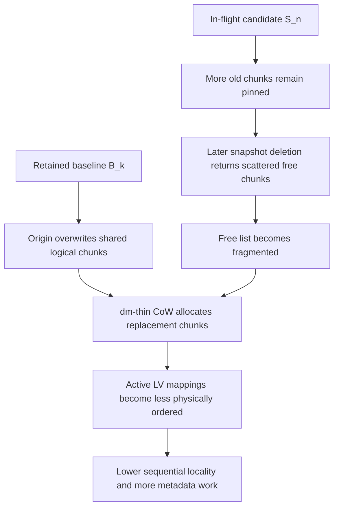

This is the normal cost of combining long-lived snapshots, write-heavy workloads, and a shared thin-pool allocator. It is not unique to SkyNBD, but V3 makes it more important because baseline retention is mandatory for incremental correctness.

### 14.3 Fragmentation symptoms

The coordinator should distinguish fragmentation from simple fullness.

Useful signals include:

- falling sequential read throughput from `S_n` during objectization,
- increasing random read amplification while processing changed extents,
- rising thin metadata lookup cost or metadata-cache miss rate,
- increasing number of physical runs per logical GiB,
- decreasing average physical run length for active-origin mappings,
- increasing delta objectization wall time for the same logical delta size,
- higher write latency under the same write rate and free-space percentage,
- persistent allocator scatter after old snapshots are deleted.

Recommended derived metrics:

```text
mapping_run_count_per_gib
average_physical_run_length_chunks
p95_physical_gap_between_adjacent_logical_chunks
objectization_read_mib_per_s
metadata_lookups_per_delta_extent
fragmentation_score = f(run_count, avg_run_length, p95_gap, read_throughput)
```

The exact formula is implementation-specific. The important rule is that fragmentation policy should be based on observed locality and throughput, not only on `thin_pool_free_bytes`.

### 14.4 Design policy

V3 uses two different responses:

| Condition | Response |
|---|---|
| Acute thin-pool pressure | Admit, rate-limit, abandon, or reject snapshots as described in Section 13. |
| Chronic fragmentation | Plan a pool rejuvenation / rebaseline cycle. |

Fragmentation alone should not force immediate abandonment of a correct in-flight snapshot unless it also creates acute pool risk or violates a publication deadline. Instead, it should trigger a controlled migration to a fresh pool.

### 14.5 Ping-pong pool rejuvenation

The preferred long-term mitigation is a **ping-pong pool** strategy.

The system maintains two thin pools, only one of which is active at a time:

```text
Pool A: active, accumulated snapshot/CoW fragmentation
Pool B: fresh target pool
```

A rejuvenation cycle copies the active volume to the fresh pool, incrementally catches up, performs a short final freeze, switches the active stack to the fresh pool, and then wipes the old pool for the next cycle.

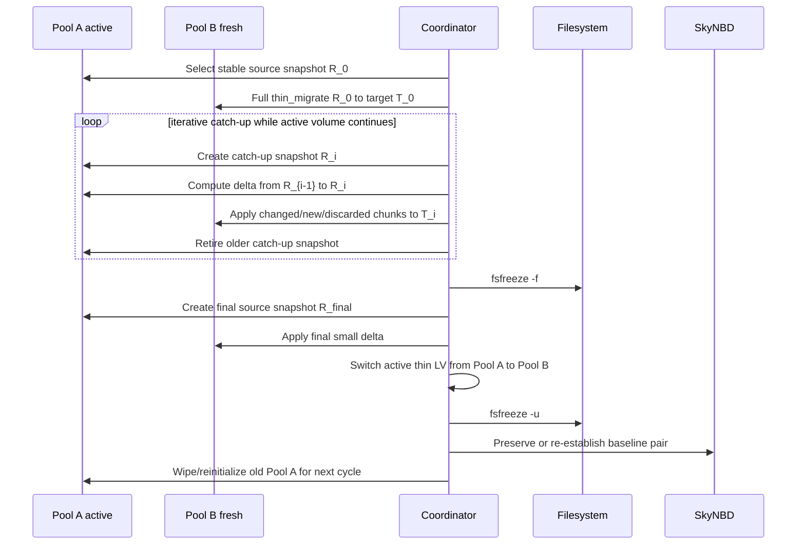

After the switch:

```text
Pool B becomes active and mostly contiguous.
Pool A becomes the fresh standby for the next rejuvenation cycle.
```

### 14.6 Relationship to `thin_migrate --delta-id`

The upstream tool direction that best matches this design is an incremental `thin_migrate` mode:

```text
thin_migrate --delta-id <baseline_thin_id> current_thin_id target_pool
```

Required behavior:

| Source delta class | Migration action on target |
|---|---|
| unchanged mapping | skip target write |
| different mapping | copy source chunk to target |
| new mapping | copy source chunk to target |
| removed mapping | discard or zero target range |

This is the same semantic shape as V3 snapshot publication, but the target is a fresh local thin pool rather than a hidden SkyNBD prepared snapshot.

The `baseline_thin_id` in this migration context is not automatically the SkyNBD baseline `B_k`. For iterative catch-up it is often a migration checkpoint such as `R_{i-1}`: the target already represents `R_{i-1}`, and the next pass applies `Delta(R_{i-1}, R_i)`. Keeping this distinction explicit prevents the remote-snapshot baseline invariant from being accidentally coupled to a local migration optimization.

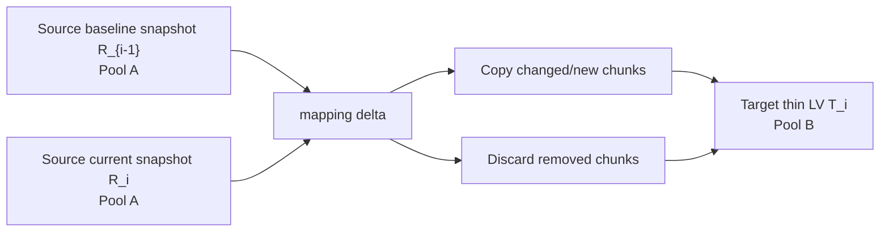

As of the issue tracked for this work, `thin_migrate` has partial scaffolding for `--delta-id`, but the option is not yet wired into the source stream, `DeltaStream` is not implemented, and the discard path still needs implementation. That makes this a desired upstream capability rather than a mandatory V3 Phase A dependency.

Implementation details to track against the upstream work:

- `--delta-id` should select a delta source stream instead of the normal full `ThinStream`.
- `DeltaStream` should walk the current and baseline mapping trees in parallel, like `thin_delta`.
- `DeltaStream` should emit `Copy`, `Skip`, and `Discard` operations rather than XML.
- `Discard` must be implemented in the local copier so ranges present in the baseline but absent in the current device are zeroed or discarded on the destination.
- The option should remain outside the SkyNBD correctness path until the copy/discard semantics are validated with crash-recovery tests.

### 14.7 Integration with SkyNBD baseline pairs

Pool rejuvenation must preserve the V3 baseline invariant:

```text
contents(B_k) == contents(G_k)
```

There are two safe strategies.

#### Strategy A: Preserve the existing remote base

During pool migration, carry the existing baseline pair forward into the fresh pool:

```text
baseline B_k_old -> B_k_new
remote base G_k  -> unchanged and still pinned
```

Then build the fresh active volume as a thin clone/snapshot of `B_k_new` and materialize only the ranges that differ from the old active volume's cut:

```text
A_new = clone(B_k_new) + local_delta(B_k_old, A_old_cut)
```

After switching pools, record:

```text
B_k_new <=> G_k
```

This keeps the same remote base and avoids forcing a new remote full snapshot.

A critical detail is sharing preservation. If `A_new` and `B_k_new` merely contain the same bytes but no longer share mappings for unchanged chunks, future `thin_delta(B_k_new, S_next)` may degrade toward a full-volume mapping delta. Baseline-preserving rejuvenation should therefore leave unchanged ranges shared with `B_k_new`, and allocate target chunks only for ranges that truly differ from the baseline.

#### Strategy B: Rebaseline after migration

After switching to the fresh pool, create a new baseline snapshot and publish or bind it as a new remote base:

```text
B_m_new <=> G_m
```

This may require full objectization unless SkyNBD can reuse existing content-addressed objects aggressively.

Strategy A is preferred when incremental local migration exists. Strategy B is simpler but can be more expensive.

### 14.8 Final-freeze requirements

The final pool switch is the only part of rejuvenation that must block filesystem progress.

The final freeze should include only:

1. create final source snapshot,
2. compute and apply the last small delta to the target pool,
3. verify target active LV and target baseline are consistent,
4. verify unchanged ranges are still represented by baseline sharing or an accepted rebaseline plan,
5. switch device mappings / activate target LV stack,
6. thaw.

This implies that iterative catch-up must continue until the estimated final delta is below a configured budget:

```text
final_delta_bytes / local_delta_copy_bandwidth <= pool_switch_freeze_budget
```

If the final delta cannot be made small enough, the coordinator should abort the rejuvenation attempt without switching pools.

### 14.9 Operational triggers

A rejuvenation cycle may be triggered by any of:

- fragmentation score above threshold,
- objectization read throughput below threshold,
- average physical run length below threshold,
- pool age or number of snapshot generations above threshold,
- repeated publication delays caused by scattered reads,
- scheduled maintenance window,
- operator request.

The trigger should be policy-based and rate-limited. A fragmented pool is not necessarily unsafe; it is just increasingly inefficient.

### 14.10 Failure and rollback

Before the final switch, rejuvenation is fully abortable:

```text
Delete target migration artifacts in Pool B.
Keep Pool A active.
Keep existing baseline pair B_k/G_k.
```

During the final switch, the coordinator must commit in an order that always leaves one bootable/activatable stack:

```text
1. Verify target active LV contents.
2. Verify target baseline pair or planned rebaseline state.
3. Persist switch intent.
4. Activate Pool B stack.
5. Confirm I/O path health.
6. Mark Pool B active.
7. Only then retire Pool A.
```

After a successful switch, the old pool must not be wiped until the coordinator has durable evidence that the new active stack and the local/remote baseline invariant are valid.

### 14.11 Product implication

V3 therefore has two maintenance loops:

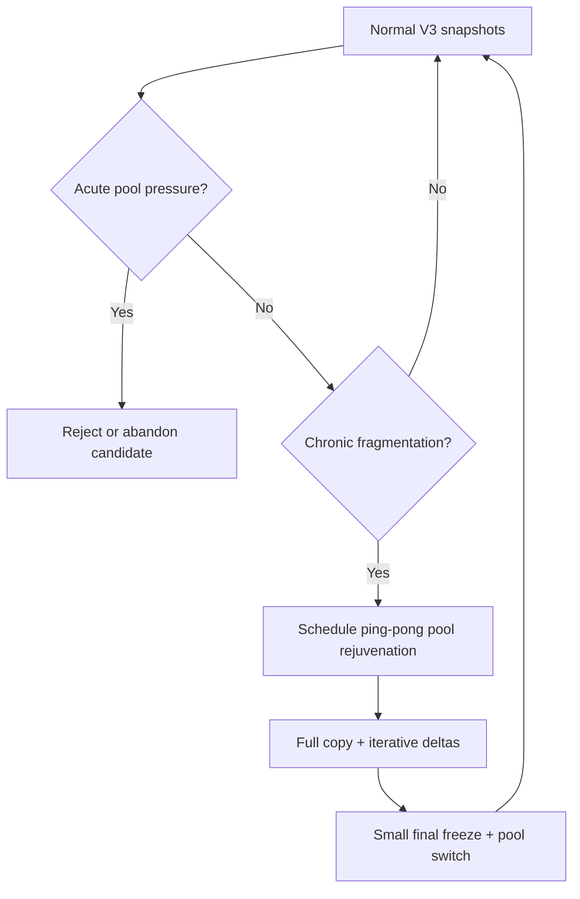

The important distinction is:

```text
Snapshots protect data consistency.
Abandon protects pool safety.
Rejuvenation restores pool locality.
```

### 14.12 Concurrency with normal snapshot operation

V3.1 left the interaction between rejuvenation and normal captures unspecified. V3.2 rules:

1. **Catch-up snapshots count against the pool.** Each `R_i` in Pool A is a thin snapshot consuming space and pinning chunks. Rejuvenation must pass the same admission thresholds as captures, and the abandon policy applies to the rejuvenation cycle as a whole: acute pool pressure aborts rejuvenation before it aborts a correct in-flight snapshot candidate.
2. **One metadata-snapshot reservation per pool.** Publication deltas, catch-up deltas, and baseline audits serialize on the single kernel reservation (Section 10.2) through a coordinator-owned per-pool lock. Holders must release promptly after each scan, and recovery must release orphaned reservations.
3. **Captures during catch-up are permitted; the switch is exclusive.** Normal capture and publish may proceed during iterative catch-up. The final frozen pool switch requires no in-flight candidate: the coordinator must wait for, or abandon, any in-flight `S_n` before entering the final freeze.
4. **Baseline promotion during migration retargets the carry-forward.** If a publish promotes `B_k -> B_n` while Strategy A migration runs, the migration's baseline carry-forward target changes. The coordinator must either quiesce promotions for the final catch-up iterations or restart the baseline carry-forward against the new pair. The switch-time verification in Section 14.8 must check the pair that is current at switch time, not the pair captured when rejuvenation began.

---

## 15. Crash Recovery and Abandon Semantics

### 15.1 Minimal durable coordinator state

The coordinator records:

- volume id,
- active baseline local device id `B_k`, with the thin device id and pool transaction id recorded at creation,
- corresponding remote base snapshot id `G_k`, and the pin holder id protecting it,
- candidate local snapshot id `S_n`, if any, with its thin device id and pool transaction id,
- prepared remote snapshot id `P_n`, if any,
- target visible snapshot id `G_n`,
- state: requested, captured, prepared, delta-ready, backfilling, publishable, visible, baseline-promoted, aborted,
- delta cursor or completed range bitmap, optional,
- objectization operation ids, optional,
- timestamps and deadlines,
- local pool health at last checkpoint.

### 15.2 Recovery matrix

| Crash point | Recovery action |
|---|---|
| Before `S_n` exists | Keep `B_k`; no remote action. |
| After `S_n`, before `P_n` | Continue by preparing `P_n`, or delete `S_n` and abandon. |
| After `P_n`, before delta complete | Recompute delta from `B_k` and `S_n`; continue or abort `P_n` and delete `S_n`. |
| During object upload | Retry idempotent `PutObject` / `AttachRange`; or abort and delete `S_n`. |
| During clear/hole operations | Retry idempotent `ClearRange`; or abort and delete `S_n`. |
| During publish | Query `GetSnapshotStatus`; if visible, proceed to baseline promotion; if hidden, continue or abort. |
| After publish, before baseline promotion | If `S_n` exists, record it as `B_n`; then delete old `B_k`. |
| After publish, `S_n` missing | Snapshot remains valid remotely; keep old `B_k` if available and rebaseline later, or run full bootstrap. |
| After old `B_k` deletion | Ensure `S_n` is already recorded as `B_n`; otherwise enter rebaseline recovery. |

### 15.3 Recomputability

Unlike V2.2, V3 does not depend on a frozen dm-cache metadata image. If the coordinator crashes during delta computation, it can recompute:

```text
thin_delta(B_k, S_n)
```

as long as both local snapshots still exist.

This is a major simplification.

### 15.4 Baseline promotion ordering

The safest local commit order after successful publish is:

```text
1. Verify G_n visible and pinned (publish implies pin, Section 11.1).
2. Persist mapping: local S_n corresponds to remote G_n.
3. Mark S_n as baseline B_n; transfer the publish pin to the baseline holder.
4. Unpin G_k for this holder, subject to retention policy and any other holders.
5. Delete old local baseline B_k.
```

If any step fails, recovery must preserve or reconstruct at least one valid baseline pair.

### 15.5 Local baseline loss

If the local baseline is lost, V3 incremental mode cannot continue from that baseline.

Allowed responses:

- run a new full bootstrap snapshot,
- reconstruct a local baseline from remote data if supported,
- keep using an older valid baseline pair if one exists and its remote base is still cloneable,
- declare the volume out of incremental-snapshot service until rebaseline completes.

### 15.6 Abandon is first-class

Abandon is not a correctness failure.

It is the normal result when:

- thin-pool data or metadata pressure is too high,
- object store durability is too slow,
- local candidate snapshot artifacts are missing,
- caller requests abort-before-recapture,
- workflow barrier deadline expires,
- remote prepared snapshot cannot be safely completed.

### 15.7 Total local loss and the disaster-recovery role of snapshots

Sections 15.1 through 15.6 cover coordinator crashes. A separate failure class is **total local loss**: the cache device dies with dirty writeback data, the thin metadata device is lost, or the host is destroyed.

The consequences follow directly from the durability domains in Section 6.5:

- Dirty writeback blocks that never reached the live head are gone. The head image is therefore **not trustworthy** after cache loss: it is missing an unknown set of recent writes and may be torn at the block level.
- Local thin metadata is gone, so the head's pool-physical image cannot be reinterpreted as logical volumes even where its data is intact.
- Visible snapshots `G_i` are unaffected. Each is a complete, immutable, logically addressed image whose publication required proven durability.

Recovery from total local loss is therefore always: provision a fresh local stack, rehydrate the volume from the most recent visible snapshot `G_n` (or expose it read-only while rehydrating), and bootstrap a new baseline pair.

This yields the design's disaster-recovery statement:

```text
For total local loss, RPO = time since the last published snapshot.
```

Snapshot cadence is not only a backup-granularity choice; it is the recovery-point guarantee for the failure mode that writeback caching itself introduces. This is the strongest product justification for V3's snapshot machinery and should drive cadence policy (Section 17.7) at least as much as backup retention requirements do.

---

## 16. Performance Profile and Pathological Cases

### 16.1 Capture latency

Default capture latency is approximately:

```text
capture_time = fsfreeze
             + thin_snapshot_create
             + fs_thaw
```

No remote operation and no cache metadata copy are in the default capture window.

### 16.2 Publish work

Publish work is approximately:

```text
publish_work = bytes_changed_since_B_k
             + metadata_ops_for_delta_extents
             + object_durability_latency
             + publish_latency
```

This may be larger than V2.2's dirty-at-capture work, but the implementation and proof are much simpler.

### 16.3 Best cases

V3 performs well when:

- snapshots are frequent,
- the changed set since baseline is modest,
- many changed blocks dedupe against existing objects,
- thin chunks align with object chunks,
- object store latency is stable,
- publish completes before in-flight CoW pressure grows.

### 16.4 Worse cases

V3 can perform worse than V2.2 when:

- many writes have already flushed through dm-cache before the snapshot and were then evicted, so objectization reads round-trip over NBD (see below),
- the delta since baseline is large,
- the object store is slow,
- the in-flight snapshot stays alive under heavy write load,
- thin-pool metadata grows faster than expected,
- discard-heavy workloads produce many clear-range operations.
- thin-pool mappings become fragmented enough that local reads dominate objectization time.

The flushed-and-evicted case deserves emphasis. For a chunk that changed since `B_k`, was written back, and was then evicted from dm-cache, the objectization read of `S_n` misses the cache and fetches the bytes **from the remote live head over NBD** — only to hash them and, at best, discover via dedupe that an identical object already exists. Hash-first dedupe (Section 17.1) eliminates the redundant upload but not the redundant download. On cold-cache, write-heavy volumes, publish cost can be dominated by these NBD reads. Section 17.10 defines an optional server-side path that removes them for clean chunks.

### 16.5 Long-running baseline

If `B_k` remains active for too long, the delta to the next candidate may become large and thin-pool pressure may grow.

Mitigations:

- schedule snapshots frequently enough,
- alert on baseline age,
- alert on CoW growth since baseline,
- force rebaseline when the delta becomes too large,
- throttle or reject new high-risk captures.

### 16.6 Object dedupe effect

Even though V3's logical work is changed-since-baseline, object bytes uploaded can be much smaller if hash-first dedupe finds that objects already exist.

This can happen when:

- the live write path already objectized the same content,
- a block was changed and then restored to old contents,
- multiple ranges share identical contents,
- zeros or sparse ranges dominate.

---

## 17. Optional Optimizations

### 17.1 Hash-first objectization

For every changed range:

```text
hash = Hash(S_n[range])
if object_exists(hash):
    AttachRange(P_n, range, hash)
else:
    PutObject(hash, S_n[range])
    AttachRange(P_n, range, hash)
```

This can eliminate many redundant uploads.

### 17.2 Same-content shortcut

If the hash of `S_n[range]` equals the hash already referenced by `G_k[range]`, the coordinator can skip attaching a new object because the cloned base is already correct.

This is useful when mappings changed but content did not.

### 17.3 Range batching

Batch adjacent operations:

- consecutive changed extents read as one large I/O,
- consecutive clear ranges merged into one metadata update,
- object uploads pipelined with bounded memory,
- remote attach operations grouped by metadata leaf.

### 17.4 Delta prefetch

Use the thin delta extent stream to issue asynchronous reads from `S_n` ahead of upload workers.

### 17.5 Live-head dedupe

The live writable SkyNBD head may already contain objects for some changed content. V3 can use content-addressed lookup to reuse those objects without depending on the live head's metadata as a snapshot base.

### 17.6 CAS promotion into live head

After publishing a range into `P_n`, SkyNBD may optionally update the live writable head to the same object reference if the live head still maps the expected old value.

This is an optimization only and must not affect snapshot correctness.

### 17.7 Adaptive snapshot cadence

The coordinator can adjust capture frequency based on:

- observed delta size,
- baseline age,
- thin-pool CoW growth,
- publish throughput,
- abandonment rate.

Frequent snapshots reduce incremental delta size but increase metadata churn and baseline turnover.

### 17.8 Fragmentation-aware maintenance scheduling

The coordinator can schedule pool rejuvenation based on mapping locality, objectization throughput, discard churn, and baseline rotation count. This is an optimization because a fragmented pool can still produce correct snapshots; the goal is to restore predictable performance before operators see severe degradation.

### 17.9 Rebaseline without full remote upload

If local baseline is lost but remote objects are content-addressed, a future implementation may reconstruct a local baseline snapshot lazily from remote references or use a local sparse rehydration path.

This is optional and outside the minimal V3 design.

### 17.10 Server-side objectization from the live head

Because the live head is an image of the thin-pool data device, pool-physical chunk `P` corresponds to head offset `P * chunk_size`. For a changed chunk that is **clean** in dm-cache — fully written back — the head's bytes at that offset are identical to what an `S_n` read would return for the logical range mapped to `P`.

The coordinator can exploit this to eliminate the NBD read amplification described in Section 16.4:

```text
for each changed extent with right_mapping = P:
    if every cache block covering P is clean:
        ObjectizeFromHead(P_n, logical_range, head_offset = P * chunk_size)
    else:
        read S_n[range] locally; PutObject; AttachRange
```

`ObjectizeFromHead` hashes and objectizes server-side, so clean chunks — typically the majority on flush-heavy workloads — never cross the NBD link at publish time.

Constraints:

- This reintroduces dm-cache dirty-state awareness, which V3 deliberately removed from the correctness path. It is admissible **only as an optimization** and must fail safe: if cleanliness cannot be established cheaply and race-free, use the local read path. Correctness never depends on it.
- The stability argument: a physical chunk mapped by immutable `S_n` is never rewritten, so once every cache block covering it is clean, the head bytes for that chunk are final. Cleanliness must be evaluated at dm-cache block granularity across the whole thin chunk.
- Verification mode (Section 10.7) should sample server-side-objectized ranges preferentially during rollout.

---

## 18. Alternatives Considered

### 18.1 V2.2 durable-frontier plus dm-cache dirty backfill

Valid but more complex. It minimizes snapshot-specific data transfer in some workloads, but it requires:

- dm-cache suspend,
- frozen cache metadata capture,
- `DrainWrites()` during the cut,
- dirty cache parsing,
- reverse mapping cache physical chunks through thin metadata.

V3 rejects that complexity for the primary path.

### 18.2 Clone live SkyNBD head and apply thin delta

Rejected.

The thin delta is relative to `B_k`, not the live head. If the live head differs from `G_k`, applying `Delta(B_k, S_n)` to the live head can produce an incorrect snapshot.

### 18.3 Delete local baseline after every publish and use remote state only

Rejected for incremental V3.

Without a local baseline thin snapshot, dm-thin has no local CoW reference point for mapping-delta correctness. The next snapshot would need a full scan, full rebaseline, or a different change tracking mechanism.

### 18.4 Use `dm-era` as the primary mechanism

Not required.

`dm-era` can track changed blocks over eras, but V3's correctness model is already provided by the retained dm-thin baseline and thin mapping delta.

### 18.5 Flush dm-cache before snapshot

Rejected.

Flushing dm-cache would make the lower remote path more durable, but V3 does not need that for snapshot correctness. It would add latency and reduce the benefit of writeback caching.

### 18.6 Multiple concurrent candidates

Deferred.

Multiple in-flight candidates could reduce caller-visible `EBUSY`, but they multiply thin-pool pressure and recovery complexity. V3 starts with one candidate per volume.

---

## 19. Implementation Phases

### Phase A: Minimal correct V3

- Add durable coordinator state for baseline pairs `(B_k, G_k)`.
- Implement bootstrap full snapshot when no baseline exists.
- Implement default capture: `fsfreeze`, thin snapshot create, thaw.
- Implement the freeze watchdog and freeze-placement preflight checks.
- Enforce read-only activation and transaction-id recording for `S_n` and `B_k`.
- Ensure thin snapshot creation is serialized correctly with active origin.
- Add `PrepareSnapshotFromBase(base_visible_id)`.
- Add `ClearRange` or equivalent sparse/hole operation.
- Integrate thin delta enumeration between `B_k` and `S_n`.
- Read changed ranges from `S_n` and attach objects to `P_n`.
- Publish atomically.
- Promote `S_n` to `B_n` after publish.
- Delete old baseline only after promotion is durable.
- Enforce one in-flight candidate per volume.
- Implement thin-pool admit, monitor, abandon policy.

### Phase B: Production hardening

- Replace XML parsing with an in-memory range iterator or stable machine format.
- Add idempotent attach/clear operation keys.
- Add hash-first dedupe.
- Add range coalescing and batching.
- Add publish progress and resumable cursors.
- Add verification sampling and the periodic baseline-pair audit.
- Add detailed metrics:
  - capture latency,
  - delta bytes,
  - delta extent count,
  - object bytes uploaded,
  - dedupe hit rate,
  - publish latency,
  - candidate age,
  - thin-pool data and metadata free space,
  - thin-pool fragmentation score,
  - objectization read throughput from candidate snapshots,
  - abandon count and reason.

### Phase C: Operational features

- API barrier mode.
- Workflow barrier mode with hard freeze cap.
- Rebaseline workflows.
- Pool rejuvenation / ping-pong pool migration workflows.
- Baseline reconstruction from remote data, if needed.
- Adaptive snapshot cadence.
- Fragmentation monitoring and pool rejuvenation planning.
- Integration with upstream or local `thin_migrate --delta-id` equivalent for proactive rejuvenation.
- Multi-volume consistency groups.
- Optional live-head CAS promotion.
- Optional server-side objectization from the live head for clean chunks.
- Incremental pool migration using `thin_delta`-style copy ranges.

### Phase D: Advanced retention

- Remote base pinning integrated with snapshot retention policies.
- Local baseline rotation policies.
- Optional retention of more than one local baseline for recovery.
- Policy-driven remote deletion that cannot break active local baselines.
- Integration with upstream or local `thin_migrate --delta-id` equivalent for proactive defragmentation.
- Ping-pong pool rejuvenation once incremental local thin migration is available.
- Baseline-preserving migration tests that prove unchanged ranges remain shared with the migrated baseline, or else deliberately enter rebaseline mode.

---

## 20. Open Questions

### 20.1 Thin delta integration boundary

Production needs a stable non-XML interface for delta enumeration. The exact choice remains open:

- vendor thin-provisioning-tools library code,
- upstream a range-output mode,
- create a thin wrapper around the internal delta visitor,
- use a temporary XML fallback only for early validation.

### 20.2 Exact LVM behavior around thin snapshot creation

The implementation should confirm the exact suspend/serialization behavior of the target LVM version when creating snapshots of active thin volumes. Raw dm-thin integrations must explicitly serialize the active origin.

### 20.3 Discard semantics

SkyNBD must define whether cleared ranges are represented as:

- holes,
- explicit zero objects,
- tombstones over cloned base ranges,
- a mixture depending on extent size.

The selected representation must match the read semantics of `S_n`.

### 20.4 Baseline loss policy

The product must choose the operational response when the local baseline is lost:

- full bootstrap,
- remote rehydration,
- fallback to older retained baseline,
- disable incremental snapshots until repaired.

### 20.5 Space policy tuning

The exact admit and abandon thresholds should be tuned empirically by filesystem, workload, thin chunk size, and objectization throughput.

V3 should expose policy profiles rather than a single universal setting.

### 20.6 Incremental local migration support

Pool rejuvenation is straightforward if `thin_migrate` or an equivalent local copier supports delta migration between a baseline thin ID and a current thin ID.

The product must also define whether the migration delta is checkpoint-relative or baseline-relative. In baseline-relative mode, `Skip` cannot simply mean "leave whatever is currently in the destination" if a previous iteration copied a now-reverted range; it must preserve or restore the destination's baseline semantics.

The product must choose whether to:

- wait for upstream `thin_migrate --delta-id`,
- contribute the missing upstream implementation,
- implement a SkyNBD-specific local copier using the same thin-delta range stream,
- use full-copy rebaseline as an interim operational fallback.

---

## 21. Validation Plan

The recovery matrix (Section 15.2) and the invariants (Section 7) define the test surface. V3 is trustworthy only if each recovery row and each invariant has a corresponding failure-injection test.

### 21.1 Crash-matrix fault injection

For every crash point in Section 15.2, kill the coordinator at that point and assert:

- exactly one valid baseline pair survives or is reconstructed,
- no visible snapshot is corrupted or partially published,
- recovery converges to baseline-only state or a resumed publish without manual repair,
- orphaned metadata-snapshot reservations and pins are released.

### 21.2 Freeze liveness tests

- Deliberately place an LVM archive directory on the frozen filesystem in a test rig and confirm the watchdog force-thaws within `capture_freeze_watchdog_ms` and fails the capture cleanly.
- Assert the placement preflight rejects hosts where coordinator persistence or LVM state resides on freezable volumes.

### 21.3 Pool-exhaustion drills

- Drive origin writes during publish until data, then metadata, thresholds trip; assert abandon fires before the pool reaches error state, `B_k` survives, and the next capture succeeds.
- Repeat with discard-heavy workloads to exercise clear-range and sub-object-hole paths.

### 21.4 Delta-correctness properties

- Property test: random write/discard workloads between cuts; after publish, full-volume compare `hash(S_n) == hash(G_n)`.
- Include `object_chunk_size = N * thin_chunk_size` configurations with `N > 1` to exercise read-modify-write objectization and partial holes.
- Include pools with zeroing disabled to confirm stale-region behavior matches Section 8.7 policy.

### 21.5 Invariant audits in soak

- The baseline-pair audit (Section 10.8) runs continuously in soak tests; any drift is a release blocker.
- Read-only activation is asserted for every `S_n` and `B_k` in every test run; a write attempt against either must fail visibly.

### 21.6 Rejuvenation interaction tests

- Concurrent capture/publish during catch-up, metadata-snapshot reservation contention, and baseline promotion mid-migration under both the retarget and quiesce paths of Section 14.12.
- Sharing-preservation proof for Strategy A: after migration, `thin_delta(B_k_new, S_next)` size must match pre-migration expectations rather than degrading toward a full-volume delta.

---

## 22. References

- V3.1 predecessor design: `skynbd-snapshot-design-v3_1.md`.
- V2.2 predecessor design: `skynbd-snapshot-design-v2.2.md`.
- `thin_delta` compares mappings between thin devices and supports safe live metadata access through metadata snapshots: https://manpages.debian.org/trixie/thin-provisioning-tools/thin_delta.8
- Linux kernel thin-provisioning documentation, including dm-thin internal snapshot behavior and metadata snapshot messages: https://www.kernel.org/doc/html/latest/admin-guide/device-mapper/thin-provisioning.html
- thin-provisioning-tools project mirror and upstream relocation note: https://github.com/jthornber/thin-provisioning-tools
- Upstream issue for incremental `thin_migrate --delta-id` support and ping-pong pool rejuvenation: https://github.com/jthornber/thin-provisioning-tools/issues/327

---

## Summary

V3 makes SkyNBD filesystem-consistent snapshots easier to reason about:

```text
Keep local baseline B_k equal to remote visible base G_k.
Freeze and create local thin snapshot S_n.
Compute thin_delta(B_k, S_n).
Clone G_k into hidden P_n.
Apply delta by reading changed ranges from S_n.
Publish only when objects and metadata are durable.
Promote S_n to new baseline B_n.
```

The resulting design removes the hardest V2.2 machinery from the snapshot cut and correctness proof. It accepts the operational cost of retaining a local thin baseline and handles that cost directly through admission, monitoring, abandon, rebaseline, and pool-rejuvenation policy.

V3.2 keeps that model intact and closes the enforcement and liveness gaps around it: bounded freezes with placement rules, enforced snapshot immutability, correct sub-object hole handling, explicit tenancy and zeroing policy, a named — and optionally eliminable — NBD read-amplification cost, defined rejuvenation concurrency, a hardened pin lifecycle, continuous baseline auditing, an explicit disaster-recovery statement, and a validation plan tied to the recovery matrix.
