# SkyNBD — Snapshot-Efficient NBD-as-a-Service Backed by S3

**Status:** v3 — implementation-ready MVP spec &nbsp;|&nbsp; **Supersedes:** v2 &nbsp;|&nbsp; **Companion:** Snapshot Design V3.2 (`skynbd-snapshot-design-v3_2.md`)[^snapv32] &nbsp;|&nbsp; **Target:** single-node MVP, testable and verifiable end to end

SkyNBD is a block device service implemented in **Rust** that speaks the Linux **NBD** protocol[^nbd-spec] and stores all data and metadata in **S3-compatible object stores** (AWS S3 / MinIO / Ceph RGW). Its differentiator is a **snapshot-first metadata design**: snapshots are O(1) to create, instantly mountable as read-only exports, cheap to diff, and efficient to advance incrementally (RPO-style).

## Changelog: v2 → v3

v3 aligns this server design with the **filesystem-consistent snapshot design V3.2**[^snapv32], which specifies a client-side coordinator (fsfreeze + dm-thin snapshots + `thin_delta`) and *requires* a specific server-side control plane. v3 makes SkyNBD the exact durable counterpart of that design:

- **Snapshot ingestion control plane** (§9A, new): hidden **prepared snapshots** cloned from a visible base (`PrepareSnapshotFromBase`), `AttachRange`/`ClearRange` mutation until publish, **atomic `PublishSnapshot` that establishes a pin before returning**, `AbortSnapshot`, resumable `GetSnapshotStatus`, and idempotent operations — implementing V3.2 §11.1 exactly, including the pin-lifecycle fixes of V3.2 §11.1 (no visible-but-unpinned window).
- **Content-addressed data objects** (§5): a second object kind `obj/{blake3}` beside packed segments, giving `PutObject`/`EnsureObject` hash-first dedupe (V3.2 §17.1) with a GC-safe resurrection rule (§10.2).
- **Refcounted pins** (§6.1, §9A.4): `PinVisibleSnapshot`/`UnpinVisibleSnapshot` keyed by holder, pins as GC roots (V3.2 §11.4), prepare-pins-base for the lifetime of `P_n` (V3.2 §13.6: GC must never delete `G_k` while `B_k` depends on it).
- **Two deployment shapes made explicit** (§3.3): in the V3.2 stack the NBD head export is the *thin-pool data device* (pool-physical, opaque) while visible snapshots `G_i` are *logical volume images* — different address spaces, so lineage volumes may have no writable head at all. v2 conflated these.
- **`ClearRange` representation decided** (answers V3.2 open question 20.3): cleared ranges become explicit `Zero` extents overriding the cloned base; reads-as-zero, reported as zero runs via `BLOCK_STATUS` (§9A.3).
- **E2E plan extended** (§14.4): S11 prepared-lifecycle + idempotent retry, S12 pin/GC safety, S13 server crash during backfill, S14 the full V3.2 loop on a real LVM thin stack asserting `hash(S_n) == hash(G_n)` — plus milestones M6–M7 gated on them (§15).
- New decisions D11–D14 (§2); importer/`SKYD1` receive path reframed as a client of the same prepared-snapshot machinery (§9.5).

## Changelog: v1 → v2

v1 surveyed the design space and left the key decisions open. v2 locks every open question into an MVP decision, and upgrades the snapshot design from a sketch to a full subsystem specification:

- **Snapshot subsystem is now fully specified**: snapshot manifests with lineage, a snapshot lifecycle state machine, an exact subtree-hash diff algorithm, a versioned native send/recv stream format (`SKYD1`), the RPO auto-advance policy, and epoch-based GC that is provably safe in the presence of concurrent snapshot creation.
- **All v1 open questions resolved** into explicit MVP decisions (§2), including the durability contract (flush-bounded), day-one segment packing, 1 GiB metadata shards, and export lifecycle rules.
- **Exact formats**: serialized layouts and versioning for segments, tree nodes, commits, superblocks, and refs (§5), plus the commit/CAS protocol and crash-recovery procedure with stated correctness invariants (§6).
- **Implementation surface pinned down**: NBD feature subset with flags/errors (§8), REST control API (§9), Cargo workspace layout with crate responsibilities (§11), and a config file schema (§12).
- **End-to-end verification plan** (§14): a four-layer test pyramid, a no-root userspace harness (`qemu-io` over NBD) plus a privileged kernel harness (`nbd-client` + ext4), ten concrete E2E scenarios with pass criteria, and milestones gated on those scenarios (§15).

---

## Table of Contents

- [1. Goals and Non-Goals](#1-goals-and-non-goals)
- [2. MVP Decisions (v1 Open Questions, Resolved)](#2-mvp-decisions-v1-open-questions-resolved)
- [3. Architecture](#3-architecture)
- [4. Storage Model: Extents + Persistent Snapshot Trees](#4-storage-model-extents--persistent-snapshot-trees)
- [5. Object Formats and Key Scheme](#5-object-formats-and-key-scheme)
- [6. Refs, Commit Protocol, and Crash Recovery](#6-refs-commit-protocol-and-crash-recovery)
- [7. IO Path](#7-io-path)
- [8. NBD Protocol: MVP Implementation Subset](#8-nbd-protocol-mvp-implementation-subset)
- [9. Snapshot Subsystem](#9-snapshot-subsystem)
- [9A. Snapshot Ingestion Control Plane (V3.2)](#9a-snapshot-ingestion-control-plane-v32)
- [10. Garbage Collection](#10-garbage-collection)
- [11. Codebase Layout (Cargo Workspace)](#11-codebase-layout-cargo-workspace)
- [12. Control API, CLI, and Configuration](#12-control-api-cli-and-configuration)
- [13. Observability](#13-observability)
- [14. End-to-End Test and Verification Plan](#14-end-to-end-test-and-verification-plan)
- [15. Milestones with Acceptance Criteria](#15-milestones-with-acceptance-criteria)
- [16. Post-MVP Roadmap](#16-post-mvp-roadmap)
- [17. Risks and Remaining Open Questions](#17-risks-and-remaining-open-questions)
- [References](#references)

---

## 1. Goals and Non-Goals

### 1.1 MVP Goals

1. **Serve Linux NBD exports** from a single `skynbdd` process:
   - one writable **head** export per volume (`vol/head`)
   - any number of read-only **snapshot** exports (`vol/snap/<name>`, `vol/rpo`)
2. **All durable state in S3** (data, metadata trees, commits, snapshot manifests); only small mutable refs live in an embedded local KV whose interface is swappable for etcd later.
3. **Snapshot efficiency** as the core property:
   - snapshot creation is one ref write — O(1), independent of volume size
   - a new snapshot is mountable within one export-registry refresh (< 1 s)
   - snapshots share unchanged tree nodes and data segments (content addressing)
   - snapshot-to-snapshot diff cost is proportional to *changed* data, not volume size
4. **Correct NBD semantics**: `FLUSH`/FUA map to durable commits; a crash never exposes torn or rolled-forward state — reconnecting clients always see the last durable commit.
5. **The V3.2 snapshot control plane**[^snapv32]: prepared snapshots, content-addressed objects with dedupe, attach/clear, atomic publish-implies-pin, abort, status, and refcounted pins — sufficient for the V3.2 coordinator's Phase A (bootstrap + incremental publish) to run unmodified against this server.
6. **End-to-end verifiability**: every guarantee above is exercised by an automated scenario in §14 that runs against real MinIO, a real NBD client, and (nightly) a real LVM thin coordinator stack.

### 1.2 Non-Goals (MVP)

- Multi-writer access to one export (single-writer lease semantics only).
- Distributed control plane (etcd/consul, multi-gateway) — interface-ready, not implemented (§16).
- Server-side read caching beyond in-memory node/segment LRU (clients are expected to run dm-cache/lvmcache writeback, which also coalesces writes).
- Compression and encryption at rest (feature-flag stubs only). Deduplication *is* in scope, but only at object-chunk granularity via `EnsureObject` (§9A) — no sub-object or rolling-hash dedupe.
- Compaction of fragmented segments (design reserved, §10.3; ships post-MVP).
- The production V3.2 client coordinator itself (freeze orchestration, thin-pool policy, rejuvenation — V3.2 §§8, 13, 14). This doc specifies the server half; the MVP ships only a **reference test coordinator** (`skynbd-coordinator-test`) that drives the control plane in scenario S14.
- `ObjectizeFromHead` server-side objectization (V3.2 §17.10) and live-head CAS promotion (V3.2 §17.6) — post-MVP optimizations (§16); the control plane is designed so they slot in without format changes.

---

## 2. MVP Decisions (v1 Open Questions, Resolved)

| # | v1 open question | MVP decision | Rationale |
|---|---|---|---|
| D1 | Durability contract: ack after S3 upload, or local WAL? | **Flush-bounded durability, no local WAL.** `WRITE` is acked once applied to the in-memory overlay and enqueued for upload; `FLUSH` (and FUA writes) ack only after all covered data is in S3 **and** the head ref CAS has committed. | Matches the NBD contract exactly (un-flushed writes may be lost on crash)[^nbd-flush]; removes the WAL from the trust base; keeps the MVP crash model simple: *the volume always reverts to the last durable commit*. A WAL is a post-MVP latency optimization, not a correctness feature. |
| D2 | Segment packing from day one? | **Yes — writes are packed into segment objects from day one**, sealed at `FLUSH`, at 8 MiB, or after 500 ms, whichever comes first. | Per-write PUTs make small-write workloads unusable on S3 (cost and latency) and would change the extent `DataRef` shape later. Packing at flush boundaries is only marginally more code than one-object-per-write and freezes the on-S3 format early. Compaction of dead space inside segments is deferred, not the format. |
| D3 | Metadata shard sizing | **1 GiB logical shards**, each an independent COW B+tree; a per-commit shard index maps shard number → shard root hash. | Bounds the metadata rewrite per commit to touched shards; 1 TiB volume ⇒ 1024-entry shard index (~40 KiB object), trivial to cache; aligns with replication windows and parallel commit building. Revisit only with data from S6/S7 benchmarks. |
| D4 | Export naming / lifecycle | Export names are `<volume>/head`, `<volume>/snap/<name>`, `<volume>/rpo`. Snapshot names are immutable once created; deletion is logical (ref removed, manifest tombstoned) and space is reclaimed by GC. **No retention policies in the MVP** — `skynbdctl snapshot rm` + GC is the only reclamation path. | Keeps the registry a pure function of the ref store. Policy engines (retention schedules) layer on the control API later without format changes. |
| D5 | Consistency groups (multi-volume atomic snapshots) | **Out of scope for MVP.** The commit format reserves an optional `group` field so a coordinator can later stamp commits across volumes. | Single-volume correctness must be verified first; the reserved field avoids a format break. |
| D6 | Ref store technology | **`redb`**[^redb] embedded KV behind a `RefStore` trait (`compare_and_swap`, `get`, `watch`, `lease`). etcd/postgres implementations are post-MVP drop-ins. | Zero-dependency single-node deployment that still forces all callers through CAS semantics identical to etcd's, so the distributed swap is a backend change, not a redesign. |
| D7 | Control API transport | **REST/JSON via `axum`** + `skynbdctl` CLI. gRPC (`tonic`) deferred. | curl-able API makes the E2E harness and manual verification dramatically simpler; the handler layer is thin enough to add gRPC beside it later. |
| D8 | NBD server implementation | **Rust-native NBD server** (own framing on `tokio`), not an nbdkit plugin. | Flush/commit interleaving is the heart of correctness here; owning the protocol loop keeps commit scheduling, backpressure, and structured errors in one async runtime. The protocol subset in §8 is small and is pinned by interop tests against `qemu-io` and `nbd-client`. |
| D9 | Data integrity checking | **BLAKE3 per sealed segment** (stored in the commit's segment table) + BLAKE3 content addresses for all metadata. Read-path verification of segment hashes is a config flag, default **off** in MVP (correctness scenarios verify content end to end instead). | Catches S3-side corruption when enabled without paying per-read hashing in the hot path by default. |
| D10 | Snapshot of an un-flushed head | `snapshot create` **forces a commit** (same code path as `FLUSH`) and then points the snapshot at it. This is the *server-native* snapshot path — crash-consistent snapshots of an attached head. The *client-coordinated* path (§9A) is the fs-consistent path per V3.2. | A snapshot must never reference volatile overlay state; reusing the flush path keeps one commit implementation. Crash-consistent by construction; app-consistent snapshots come from the V3.2 coordinator path, not from head snapshots — in the V3.2 stack the head is a pool-physical image and head snapshots are opaque (§3.3). |
| D11 | Object model for snapshot ingestion | **Two data-object kinds**: ULID-named packed **segments** (live NBD write path, D2) and BLAKE3-named **CAS objects** `obj/{hash}` (snapshot ingestion / `PutObject`). `DataRef` addresses either. | The V3.2 coordinator hashes fixed `object_chunk_size` ranges and needs existence checks by content hash (`EnsureObject`, hash-first dedupe). Packed segments can't serve that without an extra index; CAS keys make `PutObject` idempotent and dedupe a `HEAD` request. Live writes keep segments — per-chunk hashing on the hot write path would cost latency for no MVP benefit. |
| D12 | Prepared-snapshot durability | Prepared snapshots are **hidden refs + ordinary commits**: attach/clear ops accumulate in an engine overlay and are **checkpointed through the same `commit()` path** (kind=`Prepared`, ref `prepared/{snap_id}`, excluded from export registry). Ops since the last checkpoint are lost on server crash; clients resume from the durable op watermark reported by `GetSnapshotStatus`. | Zero new durability machinery — V3.2 explicitly makes coordinator ops idempotent and resumable (V3.2 §11.5, §15.2) precisely so the server may checkpoint lazily. Publish performs a final checkpoint, so the durable-publish invariant (V3.2 §7.7) holds regardless of checkpoint timing. |
| D13 | Pin storage | Pins are rows in the ref store: `(vol, snap_ref, holder_id) → pinned_commit`, written **in the same redb transaction** as the ref change that requires them (publish, prepare). GC treats pinned commits as roots. | Publish-implies-pin must be atomic with visibility (V3.2 §11.1) — a separate pin call would recreate the unpinned window V3.2 closed. The `RefStore` trait gains a transactional multi-op primitive that etcd can also satisfy (single txn). |
| D14 | Volume kinds and address spaces | A server volume is either **attached** (writable NBD head; e.g. the thin-pool data device in the V3.2 stack) or a **snapshot lineage** (logical volume image; content arrives only via prepared-snapshot publishes; exports are read-only snapshots, plus head-on-demand via rollback for DR). Both use identical formats and refs; lineage volumes simply have no live writer. | V3.2 §6.5/§15.7: the head and the visible snapshots live in *different address spaces* (pool-physical vs logical). Modeling them as two volumes of the same machinery keeps one commit path and gives the DR story (export `G_n` read-only, or materialize a head from it) for free. |

---

## 3. Architecture

### 3.1 MVP process layout

One `skynbdd` process contains four planes. Everything below the engine is a trait with at least two implementations (production + in-memory test double), which is what makes the E2E plan in §14 cheap to run.

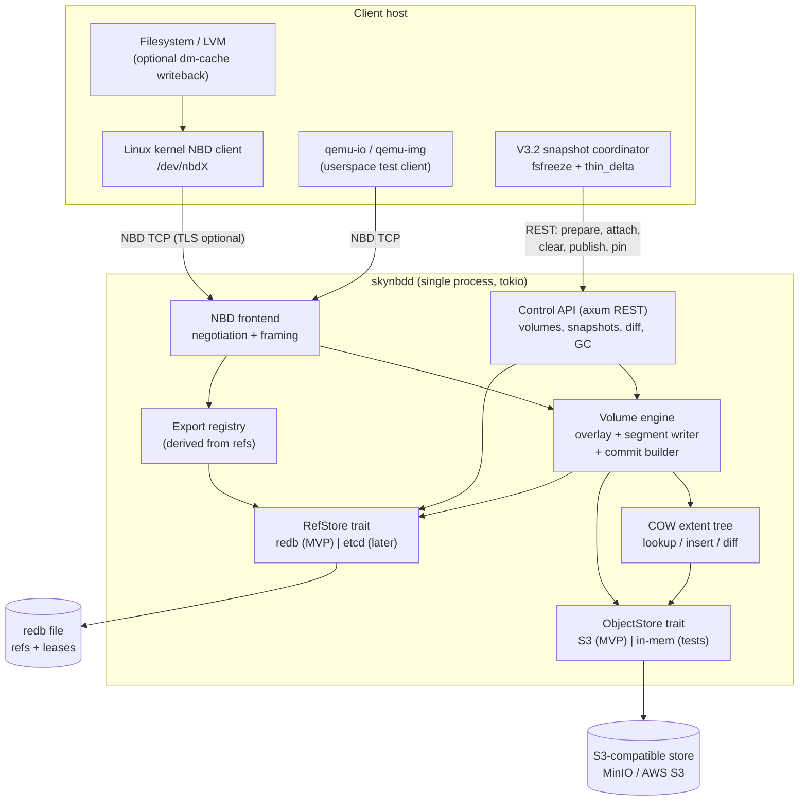

Component responsibilities:

- **NBD frontend** — terminates the NBD protocol: fixed-newstyle negotiation, export lookup via the registry, request validation and bounds checks, access-mode enforcement (RO for snapshot exports), and mapping `FLUSH`/FUA onto engine commits. One tokio task per connection; requests within a connection may complete out of order (permitted by NBD) but replies to a given cookie are exact.
- **Export registry** — a pure derivation of the ref store: every ref `refs/<vol>/...` is an export. It watches `RefStore` change events, so a snapshot created via the API is servable on the next incoming `NBD_OPT_GO` with no restart (target < 1 s, verified by S3-scenario timing assertion).
- **Volume engine** — owns a volume's write overlay, open segment, commit builder, and single-writer lease. All durability transitions go through exactly one code path: `commit()` (§6.3).
- **COW extent tree** — pure data-structure crate (no IO): extent lookup, overlay merge, node split/merge, subtree-hash diff. Property-tested against a flat reference model (§14.2).
- **ObjectStore / RefStore traits** — the seams for both testing (in-memory fakes, fault injection) and the post-MVP distributed deployment.

### 3.2 Deployment (MVP)

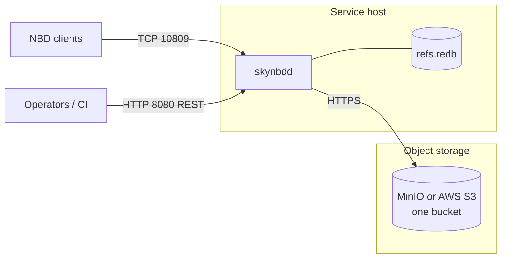

A single host, a single bucket, and a single `redb` file. The `redb` file is *not* a durability dependency for volume data — it holds only refs and leases, and §6.5 specifies how refs are recovered from S3 superblocks if it is lost.

### 3.3 Deployment shapes and address spaces (D14)

The server must be precise about *what* each volume's byte space represents, because the V3.2 stack splits them:

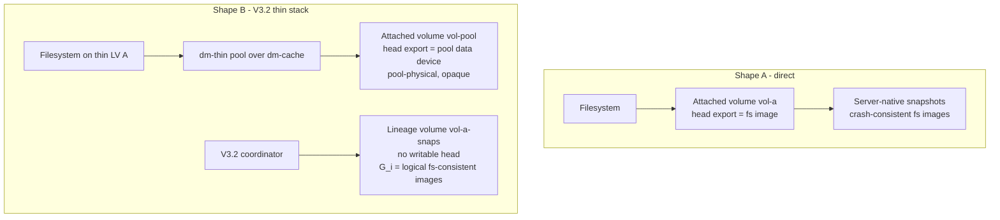

- **Shape A (direct)**: a filesystem sits directly on the NBD device. Server-native snapshots (D10) are crash-consistent filesystem images; `fsfreeze` before `snapshot create` upgrades them to fs-consistent. This is the shape scenarios S1–S10 exercise.
- **Shape B (V3.2 thin stack)**: the NBD head is the *thin-pool data device* under dm-cache writeback (V3.2 §6.5). Its bytes are pool-physical and cannot be interpreted without the client's local thin metadata — server-native snapshots of it are valid but opaque, and after a cache loss the head is untrustworthy (V3.2 §15.7). Fs-consistent logical snapshots `G_i` therefore arrive through the ingestion control plane (§9A) into a **lineage volume** whose address space is the thin LV's logical space. DR for shape B: export the lineage volume's latest `G_n` read-only (instantly, O(1)) while the client rehydrates a fresh local stack, per V3.2 §15.7 — `RPO = time since last published snapshot`.

One server, one set of formats, both shapes concurrently: `vol-pool` (attached) and `vol-a-snaps` (lineage) in the same bucket.

---

## 4. Storage Model: Extents + Persistent Snapshot Trees

### 4.1 Entities

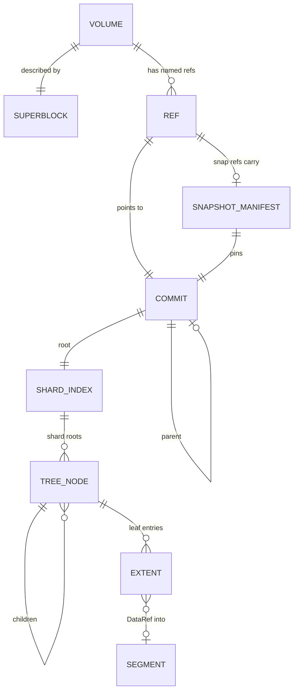

- **Volume** — fixed-size logical byte space `0..size`, 512-byte-aligned IO, described by an immutable-per-generation **superblock** object in S3.
- **Commit** — an immutable point-in-time mapping of the whole volume: a shard index plus a segment table. Commits form a parent chain (history).
- **Ref** — a small mutable named pointer in the ref store: `head`, `rpo`, `snap/<name>`. All refs are exports.
- **Snapshot manifest** — an immutable S3 object recording snapshot identity, lineage, and provenance (§9.2).
- **Extent** — a variable-length mapping `[lba_start, lba_start+len)` → `DataRef | Zero`. Unmapped space is implicitly zero (holes are the *absence* of extents; `Zero` extents exist so `WRITE_ZEROES`/`TRIM`/`ClearRange` can override inherited data cheaply).
- **Segment** — an immutable S3 object packing many live-write payloads, ULID-named (§5.2).
- **CAS object** — an immutable S3 object named by the BLAKE3 of its payload, produced by snapshot ingestion (`PutObject`); the unit of hash-first dedupe (D11, §9A).
- **Prepared snapshot** — a hidden, mutable-until-published metadata root: ref `prepared/{snap_id}` + ordinary commits of kind `Prepared` (D12, §9A).
- **Pin** — a refcounted, holder-keyed guard on a visible snapshot's commit; a GC root (D13, §9A.4).

### 4.2 Extent representation

```rust
// crate skynbd-types (all offsets/lengths in bytes, 512-aligned)
pub struct Extent {
    pub lba_start: u64,
    pub len: u64,
    pub target: Target,
}

pub enum Target {
    Data(DataRef),
    Zero,            // reads as zeros; overrides anything inherited below
}

pub enum DataRef {
    Seg { segment: SegmentId, offset: u64 },  // ULID segment + byte offset (live write path)
    Cas { hash: [u8; 32], offset: u64 },      // CAS object + byte offset (snapshot ingestion)
}

pub type NodeHash = [u8; 32];   // BLAKE3 of canonical node bytes
pub type CommitHash = [u8; 32]; // BLAKE3 of canonical commit bytes
```

Extents are stored exactly as written (post-coalescing by dm-cache on the client), so large sequential or writeback-flushed IO becomes few large extents. Adjacent extents that reference contiguous bytes of the same segment are merged on insert.

**Shard geometry is a property of the volume (normative).** The shard index is a *positional* array — slot `i` holds the extents of `[i·shard_bytes, (i+1)·shard_bytes)` — so a tree is only interpretable alongside the `shard_bytes` it was written under. That value therefore lives in the superblock and is adopted on open; `EngineConfig::shard_bytes` chooses it at create and nothing else. A clone inherits its base's, because its first commit points at the base's shard index verbatim. Without this, two readers configured differently disagree about what the tree says, and a commit under the wrong geometry rewrites part of the array on a different grid — or, if the geometry shrank, truncates the array and drops the roots past the new end, whose extents GC then reclaims. `commit()` refuses a shrinking resize rather than performing it.

### 4.3 Persistent COW tree

Each 1 GiB shard is an independent copy-on-write B+tree keyed by `lba_start`, with content-addressed immutable nodes:

- **Leaf node**: sorted non-overlapping extents for a sub-range. Soft cap 256 extents; split at cap, merge siblings below 25% on rewrite.
- **Internal node**: separator keys + child `NodeHash`es. Soft cap 256 children.
- **Shard index**: array of `(shard_no, NodeHash | Empty)` — the per-commit root.

Properties this buys, stated as testable claims (verified in §14):

1. Snapshot creation is one ref write (S3 scenario asserts constant time vs volume size).
2. Two commits share every node whose subtree is unchanged — diff walks only differing hashes, so `diff` cost ∝ changed extents (S7 asserts byte counts).
3. Any commit is self-contained: given its hash, a reader needs nothing from the ref store (this is what makes snapshot exports trivially servable and GC tractable).

---

## 5. Object Formats and Key Scheme

### 5.1 S3 key scheme

All keys live under a configurable prefix (default `skynbd/`). `{vol}` is the volume ULID.

| Key | Object | Mutability |
|---|---|---|
| `skynbd/v1/{vol}/sb/{gen}` | Superblock, generation-numbered | immutable, new gen per change |
| `skynbd/v1/{vol}/seg/{ulid}` | Data segment (live writes) | immutable |
| `skynbd/v1/{vol}/obj/{hex(hash)}` | CAS data object (snapshot ingestion) | immutable, content-addressed |
| `skynbd/v1/{vol}/node/{hex(hash)}` | Tree node (leaf/internal/shard-index) | immutable, content-addressed |
| `skynbd/v1/{vol}/commit/{hex(hash)}` | Commit | immutable, content-addressed |
| `skynbd/v1/{vol}/snap/{ulid}` | Snapshot manifest | immutable |
| `skynbd/v1/{vol}/gc/{epoch}` | GC epoch marker (§10) | immutable |
| `skynbd/v1/{vol}/refs` | The volume's refs object (`SREF`, D-M1/D-M2): all refs, pins and meta rows, plus the D-M3 owner. | **mutable**, conditional-PUT only — the one exception to immutability, and the reason it needs the CAS the others don't |

Content-addressed writes are idempotent: `PUT` of an existing key is a no-op by construction, which makes commit retry after partial failure safe (§6.4).

### 5.2 Serialization

All metadata objects are [`postcard`](https://docs.rs/postcard)-serialized Rust structs wrapped in a 8-byte frame: `magic (4B ASCII) | version (u16 LE) | flags (u16 LE)`. Unknown major versions are rejected; flags are feature bits (compression, encryption — reserved, zero in MVP).

| Object | Magic | Body (postcard) |
|---|---|---|
| Segment | `SSEG` | raw concatenated payload bytes only — *no* per-extent framing; extents index into it by offset. Footerless; BLAKE3 + length live in the commit's segment table. |
| CAS object | *(none)* | raw payload bytes, **unframed** — the S3 key is `blake3(payload)`, so the object is self-verifying and any frame would break client-computed hashes (the V3.2 coordinator hashes raw `S_n` range bytes). Typical size = the coordinator's `object_chunk_size`. |
| Tree node | `SNOD` | `enum Node { Leaf(Vec<ExtentEnc>), Internal(Vec<(u64, NodeHash)>), ShardIndex(Vec<Option<NodeHash>>) }` |
| Commit | `SCMT` | see below |
| Superblock | `SSUP` | `{ vol_id, size, created_at, block_hints: {min:512, preferred:4096, max_io:1<<20}, format_major: 1, shard_bytes, group: Option<GroupId> }` — v2; a v1 body lacks `shard_bytes` and decodes as 1 GiB, the only value it could have been written under |
| Snapshot manifest | `SSNP` | §9.2 |
| Refs object | `SREF` | `{ refs: [(name, commit, generation)], pins: [(name, holder)], meta: [(key, bytes)], owner: Option<(holder, epoch, expires_at_ms)> }` — one per volume, D-M1/D-M2 |
| Diff stream | `SKYD` | §9.4 |

Leaf extents are delta-encoded (`lba_start` deltas, varint lengths via postcard's native varints) with 1-byte target tags — the v1 space-efficiency notes, now normative.

```rust
pub struct Commit {
    pub vol_id: VolumeId,
    pub parent: Option<CommitHash>,
    pub shard_index: NodeHash,          // hash of the ShardIndex node
    pub segments: Vec<SegmentMeta>,     // segments *introduced by this commit*
    pub flush_seq: u64,                 // monotonic per volume
    pub created_at_ms: u64,             // wall clock, informational only
    pub kind: CommitKind,               // Flush | Checkpoint | Import | SnapshotForced | Prepared
    pub group: Option<GroupStamp>,      // reserved (D5)
}

pub struct SegmentMeta {
    pub id: SegmentId,
    pub len: u64,
    pub blake3: [u8; 32],
}
```

`segments` lists only newly introduced segments, so the *full* live-segment set of a commit is the union along the parent chain — but readers never need that union: every `DataRef` is resolved by fetching `seg/{ulid}` directly, and GC computes liveness from tree reachability, not from segment tables. The per-commit segment table exists for integrity metadata (D9) and observability.

### 5.3 Size and alignment rules (normative)

- All NBD offsets/lengths must be 512-aligned; the server rejects unaligned IO with `NBD_EINVAL` (advertised via block-size info, §8.2).
- Max NBD request payload: 1 MiB (`max_io`). Larger client writes are impossible after negotiation; larger *extents* still form via segment-contiguity merging.
- Segment seal thresholds: 8 MiB or 500 ms or `FLUSH`/FUA, whichever first (D2). Config-tunable (§12).
- Serialized node soft cap ≈ 64 KiB (256 entries) — small enough for sub-ms decode, large enough to keep trees shallow: a fully fragmented 1 GiB shard at 4 KiB granularity is ≤ 256 Ki extents ⇒ ≤ 3 levels.

---

## 6. Refs, Commit Protocol, and Crash Recovery

### 6.1 Ref store schema (redb tables)

| Table | Key | Value |
|---|---|---|
| `volumes` | `vol_id` | `{ name, size, kind: Attached\|Lineage, sb_gen, created_at, deleted: bool }` |
| `refs` | `(vol_id, ref_name)` | `{ commit: CommitHash, generation: u64 }` — `ref_name` ∈ `head`, `rpo`, `snap/*`, `prepared/*` (hidden: never exported) |
| `pins` | `(vol_id, snap_ref, holder_id)` | `{ commit: CommitHash, created_at }` — refcounted by row count per `snap_ref` (D13) |
| `prepared` | `(vol_id, snap_id)` | `{ base: Option<CommitHash>, state, op_watermark: u64, target_name: Option<String> }` (§9A) |
| `leases` | `vol_id` | `{ holder_id, expires_at_ms }` |
| `gc` | `vol_id` | `{ current_epoch, in_progress: Option<EpochState> }` |

The `RefStore` trait exposes exactly the operations etcd can also provide, so the MVP cannot accidentally depend on stronger local semantics:

```rust
#[async_trait]
pub trait RefStore: Send + Sync {
    async fn get(&self, vol: VolumeId, name: &RefName) -> Result<Option<RefValue>>;
    /// CAS on (commit, generation). `expected: None` means create-if-absent.
    async fn compare_and_swap(&self, vol: VolumeId, name: &RefName,
        expected: Option<RefValue>, new: Option<RefValue>) -> Result<CasOutcome>;
    async fn list(&self, vol: VolumeId) -> Result<Vec<(RefName, RefValue)>>;
    fn watch(&self) -> broadcast::Receiver<RefEvent>;   // feeds the export registry
    async fn acquire_lease(&self, vol: VolumeId, holder: HolderId, ttl: Duration) -> Result<Lease>;
    async fn renew_lease(&self, lease: &Lease) -> Result<()>;
    /// Atomic multi-op: CAS refs + pin/unpin rows in one transaction (D13).
    /// redb: one write txn; etcd later: one Txn. Used by publish, prepare, abort.
    async fn transact(&self, vol: VolumeId, ops: Vec<RefOp>) -> Result<TxnOutcome>;
}
```

### 6.2 Correctness invariants (normative — each maps to tests in §14)

- **I1 — Reachability before visibility.** A ref may only point to a commit whose entire closure (commit object, all tree nodes, all referenced segments) is durably in S3 *before* the ref CAS is issued. The invariant is established by the commit sequence (§6.3) and *verified* by `fsck` and at snapshot publish — not on every open. Re-walking a finalized snapshot's closure each time it is served pays a full tree walk to re-answer an answered question: nothing mutates it, and only a GC bug could break it, which I6 forbids and `fsck` catches (see `skynbd-multinode-design.md` D-M8).
- **I2 — Linear head history.** `head` advances only by CAS from the current `(commit, generation)`; a lease-holder that loses a CAS must abandon its overlay and re-open from the winning commit.
- **I3 — Read-your-writes on a connection.** After a `WRITE` ack, subsequent `READ`s on that export observe the write (served from the overlay pre-commit).
- **I4 — Flush durability.** After a `FLUSH` (or FUA write) ack, the data is recoverable from S3 + refs alone, surviving `SIGKILL` of `skynbdd` and loss of the host.
- **I5 — Snapshot immutability.** The commit reachable from `snap/<name>` never changes for the life of the ref; snapshot exports are bit-stable.
- **I6 — GC safety.** GC never deletes an object reachable from any ref (including hidden `prepared/*` refs), nor from any pinned commit, nor any object that a concurrent in-flight commit or `EnsureObject` reply could reference (epoch protocol + resurrection rule, §10.2).
- **I7 — Crash equivalence.** After any crash, the visible content of every export equals the content at some `FLUSH`-ack boundary — never a partial commit.
- **I8 — Publish atomicity with pin.** `PublishSnapshot` makes `G_n` visible, records its manifest, and establishes the publisher's pin in one ref-store transaction: there is no observable state in which `G_n` is visible but unpinned (V3.2 §11.1). Likewise, `PrepareSnapshotFromBase` pins the base in the same transaction that creates the prepared ref, so `G_k` cannot be deleted while any `P_n` or recorded holder depends on it (V3.2 §13.6).
- **I9 — Prepared isolation.** A prepared snapshot is invisible to `NBD_OPT_LIST`/`GO` and to snapshot listings until published; aborting it changes no visible state and releases its pins. Content published is exactly `clone(base) + applied ops` — attach/clear ops affect no other ref (verified by S11/S12).

### 6.3 Commit sequence

Exactly one code path (`Engine::commit`) produces durable state, used by `FLUSH`, FUA, periodic checkpoints, RPO advance, snapshot-forced commits (D10), and the importer:

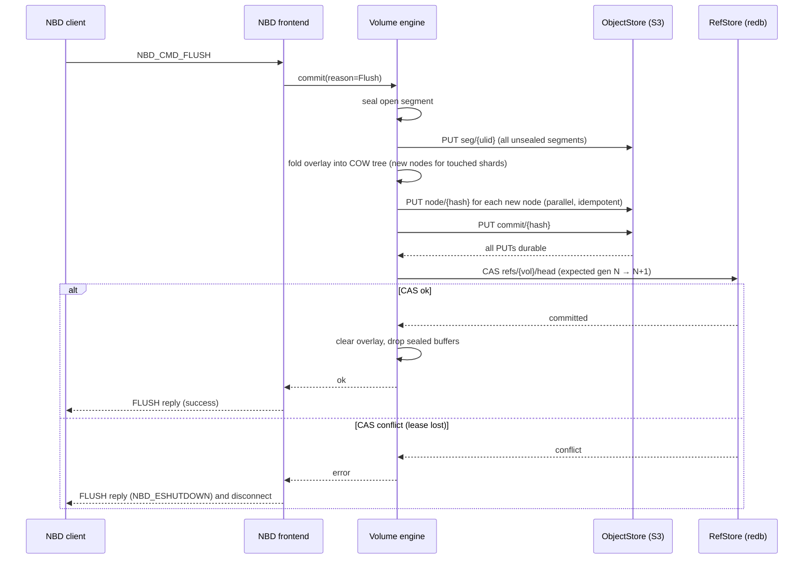

Notes:

- Segment/node/commit PUTs are the *only* awaited S3 work in the flush path; node PUTs for independent shards proceed in parallel.
- Writes arriving *during* a commit go to a fresh overlay generation; they are not covered by the in-flight flush ack (NBD requires flushing only writes acked before the flush was issued[^nbd-flush]).
- Periodic checkpoints (default: every 30 s or 256 MiB of overlay, §12) run the same path with `reason=Checkpoint`, bounding replay-invisible data loss for clients that rarely flush, and bounding overlay memory.

### 6.4 Failure handling in the commit path

| Failure point | Outcome |
|---|---|
| Crash before any PUT | Overlay lost; head unchanged. I7 holds. |
| Crash after some PUTs, before ref CAS | Orphan segments/nodes in S3; head unchanged; orphans are collected by GC (they belong to no epoch root). I7 holds. |
| PUT retry ambiguity (S3 500 then success) | All keys are idempotent (content-addressed or ULID-unique); re-PUT is safe. |
| Ref CAS fails (generation mismatch) | Another holder won (I2): engine drops overlay, closes NBD connections with `NBD_ESHUTDOWN`, releases lease. |
| Crash after CAS, before ack to client | Client sees dropped connection; on reconnect it observes the committed state — NBD clients must treat un-acked flushes as unknown; data is durable, which is the safe direction. |

### 6.5 Recovery and ref-store loss

Normal restart: read `refs` from redb, open head commit, serve. No log replay exists because there is no log — this is the payoff of D1.

Loss of the redb file (host rebuild): refs are reconstructible because every commit is self-describing: scan `sb/` for volumes, list `commit/` objects, and rebuild `head` as the commit with the highest `flush_seq` whose closure is complete (verify by walking); snapshot refs are rebuilt from `snap/{ulid}` manifests, which name their target commit and ref name. `skynbdctl fsck --rebuild-refs` implements this (verified by scenario S9b). RPO refs rebuild from the newest manifest of kind `rpo`.

**Rebuild is never implicit (normative).** The object store is shared; a refs store is not. "Superblock present, no `head` ref" therefore means one of two things — the refs were lost, or they belong to a server this process cannot see — and *neither* is an absent volume. A provisioner that treats it as one re-creates the volume, republishing live data as an empty disk that a CSI node plugin will format. `skynbd_engine::has_history` is the discriminator: any snapshot manifest, any commit past the initial one, or a clone-base marker means the volume exists and creation is refused (`ProvisionError::RefsLost` → 409, pointing at `fsck --rebuild-refs`). A volume created but never written carries no history and stays creatable, so a create interrupted before its head CAS can still be retried. Recovery stays an operator decision until per-volume ownership exists (§16): a server that adopts another's head by scanning S3 has forked the volume, not recovered it.

**Cost.** Rebuild is `N+1` closure walks for `N` snapshots — the walks share no cache — preceded by a GET of every `commit/` object. On a 100 GiB volume with 50 GiB live and 100 snapshots that is ~10⁶ round trips: hours at S3 latency, and the same walk backs `fsck` and `gc`. Sequencing is the fix (see §7.2 on fan-out); the standing constraint is that rebuild is a disaster-recovery tool and must never sit on an attach path.

---

## 7. IO Path

### 7.1 Write / trim / write-zeroes

1. Validate bounds, alignment, and RW mode; reject writes to snapshot exports with `NBD_EPERM`.
2. `WRITE`: append payload to the open segment buffer; insert `Extent { target: Data(DataRef{open_seg, off}) }` into the overlay. Ack immediately (D1). If FUA is set, run `commit()` before acking.
3. `TRIM`: insert `Zero` extents over the range (logical discard; space returns at GC). Advisory per NBD, but we implement it precisely so S5 can assert zero-reads.
4. `WRITE_ZEROES`: identical to `TRIM` mapping-wise (insert `Zero`), but non-advisory: always acked only after overlay insert; honors FUA.
5. Overlay is an in-memory interval map (`lba → Extent`) layered over the head commit; overlay memory is bounded by the checkpoint policy (§6.3).

### 7.2 Read

1. Query overlay first, then the COW tree, producing a full cover of `[off, off+len)` as `(Data | Zero | Hole)` runs.
2. `Zero`/`Hole` runs synthesize zeros. `Data` runs resolve to `(segment, offset, len)`.
3. Fetch via S3 **Range GET**; adjacent runs in the same segment are coalesced into one request; distinct segments fetch in parallel. Open-segment (unsealed) data is served from memory.
4. An in-process LRU caches decoded tree nodes (default 256 MiB) and recently read segment ranges (default 128 MiB) (§12).

**Lazy materialization (normative, D-M8).** Opening a volume — head, snapshot export, or clone — reads its superblock, commit and shard-index node, and stops: a constant number of objects however large the volume. Each shard's extents materialize into the committed index on the first read, block-status query, or commit fold that touches it, and never for shards nothing touches. I1 is not re-verified at open (§6.2); a broken closure surfaces at the read that touches it, and `fsck` is the tool that finds it first.

**Tree-walk fan-out.** Opening a volume materializes its whole extent map (M1 serving model), so `Engine::open` is thousands of small node GETs and nothing else — pure round-trip latency against a few MiB of payload. Walks therefore fetch each tree level with bounded concurrency (`WALK_CONCURRENCY`, 32) rather than one node at a time: the depth is fixed, so a walk is two flat fan-outs (shard roots, then leaves) plus one for the closure walks' data-object probes. Measured at 10 ms injected latency, this is ~12× on a small map and approaches the fan-out width as maps grow. The bound stays well inside S3's 5,500 GET/s per-prefix ceiling with several volumes opening at once. `tests/open_walk.rs` measures it.

**Extent coalescing (normative).** Extent count multiplies all of the above — leaf nodes, walk width, resident memory, and the size of any flat extent-map object — and the overlay records one extent per IO. `commit()` therefore merges adjacent extents as it folds each shard: a pair merges when it is adjacent in LBA *and* contiguous in the same backing object (`Extent::continues_into` — arithmetic on the target, not target equality, since two writes landing back-to-back in one segment have different `DataRef`s but describe one run). The merge is **maximal and deterministic**, so the tree is a function of content rather than of write history: the same folded map always yields the same nodes, and equal content dedupes across snapshots. It happens at fold time rather than in `ExtentMap::insert`, leaving the write path's last-writer-wins semantics untouched.

The ceiling is one extent per *segment* — an extent cannot span the seal boundary — so `segment_max_bytes` is the second lever on fragmentation. Measured by `tests/extent_shape.rs`: 128 IOs/extent for 64 KiB sequential writes, 2048 for 4 KiB, 16 for 1 MiB runs, and ~1 for uniformly random writes, which are contiguous in a segment only by coincidence. Random-write volumes stay fragmented by nature; they hit the 65,536-extents-per-shard tree cap (§4.3) before anything else becomes the constraint.

### 7.3 Engine concurrency model

Per volume: one writer task owning overlay + open segment (message-passing from connection tasks), N reader tasks. Reads at snapshot exports never touch the writer path — they walk immutable trees only, so snapshot serving scales independently and cannot block flushes.

---

## 8. NBD Protocol: MVP Implementation Subset

Interoperability targets (all exercised in CI): Linux kernel `nbd.ko` via `nbd-client 3.24+`, `qemu-io`/`qemu-nbd` 8.x, `libnbd`/`nbdinfo`.

### 8.1 Handshake

- **Fixed newstyle** negotiation only[^nbd-spec]: server sends `NBDMAGIC` + `IHAVEOPT` + handshake flags `NBD_FLAG_FIXED_NEWSTYLE | NBD_FLAG_NO_ZEROES`.
- Options implemented: `NBD_OPT_LIST` (enumerate exports from the registry), `NBD_OPT_GO` (preferred), `NBD_OPT_EXPORT_NAME` (legacy fallback), `NBD_OPT_ABORT`, `NBD_OPT_STRUCTURED_REPLY` (accepted; required for `BLOCK_STATUS`), `NBD_OPT_SET_META_CONTEXT` for `base:allocation`.
- `NBD_OPT_GO` replies include `NBD_INFO_EXPORT` (size, transmission flags) and `NBD_INFO_BLOCK_SIZE` (min 512, preferred 4096, max 1 MiB) — the alignment contract behind §5.3.
- TLS (`NBD_OPT_STARTTLS`, rustls) is config-gated and off by default in MVP; the E2E suite runs one smoke scenario with it on.

### 8.2 Transmission flags per export

| Export | Flags |
|---|---|
| `vol/head` | `HAS_FLAGS \| SEND_FLUSH \| SEND_FUA \| SEND_TRIM \| SEND_WRITE_ZEROES` |
| `vol/snap/*`, `vol/rpo` | `HAS_FLAGS \| READ_ONLY` |

`NBD_FLAG_CAN_MULTI_CONN` is **not** advertised in MVP even though the single-engine design would nearly satisfy it — deferring the cross-connection flush-visibility audit keeps it honest. Revisit post-MVP.

### 8.3 Commands

| Command | Support | Semantics |
|---|---|---|
| `NBD_CMD_READ` (0) | ✅ | §7.2; structured replies use one data chunk in MVP (no fragmentation), `DF` therefore trivially honored |
| `NBD_CMD_WRITE` (1) | ✅ | §7.1; FUA honored |
| `NBD_CMD_DISC` (2) | ✅ | Graceful: drain in-flight, run `commit()` (courtesy; clients must still flush), close |
| `NBD_CMD_FLUSH` (3) | ✅ | `commit()` — §6.3 |
| `NBD_CMD_TRIM` (4) | ✅ | §7.1 |
| `NBD_CMD_CACHE` (5) | ❌ | `NBD_ENOTSUP` |
| `NBD_CMD_WRITE_ZEROES` (6) | ✅ | §7.1; `NO_HOLE` flag honored (mapping is identical either way — reads are zero regardless) |
| `NBD_CMD_BLOCK_STATUS` (7) | ✅ (with structured replies) | Reports `base:allocation` runs: `HOLE\|ZERO` for unmapped/`Zero`, `0` (allocated) for `Data` — computed from the same extent cover as reads; enables `qemu-img map`-based sparse verification in S5 |

Error mapping: `NBD_EPERM` (write to RO export), `NBD_EINVAL` (bounds/alignment/flag misuse), `NBD_EIO` (unrecoverable S3 error after retry policy), `NBD_ENOSPC` (reserved), `NBD_ENOTSUP`, `NBD_ESHUTDOWN` (lease lost / server stopping). S3 timeouts follow the retry policy in §12 before surfacing `NBD_EIO`; an `EIO` reply never leaves the engine in an inconsistent state (the overlay still reflects only acked writes).

---

## 9. Snapshot Subsystem

Snapshots as a first-class, fully specified subsystem. This section covers the *server-native* mechanics (refs, manifests, RPO, diff, streams); §9A adds the *client-coordinated* ingestion plane that V3.2 requires.

### 9.1 Snapshot lifecycle

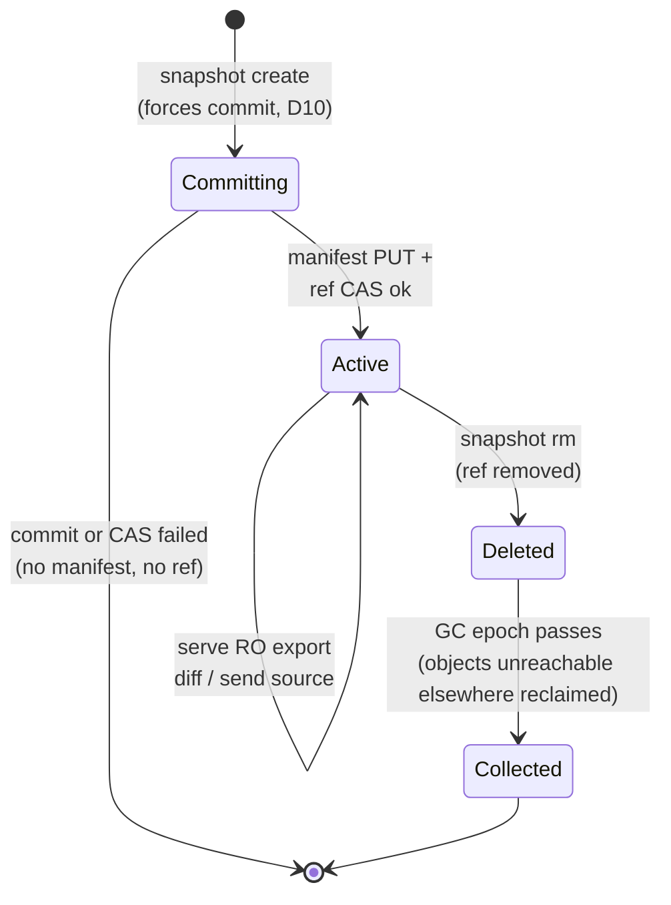

Ordering rule: the manifest is PUT **before** the ref CAS (so a ref never dangles), and the ref is removed **before** the manifest is tombstoned on delete. A manifest without a ref is harmless garbage; a ref without a manifest would violate recovery (§6.5) and never occurs.

### 9.2 Snapshot manifest (`SSNP`)

```rust
pub struct SnapshotManifest {
    pub snap_id: SnapId,               // ULID — also the S3 key
    pub vol_id: VolumeId,
    pub ref_name: String,              // "snap/nightly-2026-07-20" | "rpo"
    pub commit: CommitHash,            // the pinned commit
    pub parent_snap: Option<SnapId>,   // lineage: previous snapshot on this line
    pub kind: SnapKind,                // Manual | Rpo | Imported
    pub source: Option<StreamSource>,  // for Imported: upstream ids + stream cursor
    pub created_at_ms: u64,
}
```

Lineage (`parent_snap`) is what makes incremental workflows first-class: `skynbdctl send --from <snapA> --to <snapB>` resolves both manifests, checks they share a volume and that `from` is an ancestor (walk `parent_snap`), then diffs commits. The importer records `source` so replication is resumable and idempotent (S7).

### 9.3 RPO auto-advance

A per-volume policy (config or API, §12) advances the `rpo` ref by running the normal snapshot path with `ref_name = "rpo"` and `kind = Rpo`, replacing the previous manifest's ref (the old rpo commit stays pinned only if some other snapshot references it — otherwise it becomes GC-eligible):

- **time-based**: every N seconds (default 60) *if* `flush_seq` advanced since last rpo
- **bytes-based**: after M bytes committed (optional, additive)
- **import-based**: after each importer batch (§9.5)

The measurable guarantee (scenario S6): after a crash at any instant, `vol/rpo` is mountable and its content lag behind the last pre-crash flush is bounded by the policy interval.

### 9.4 Diff algorithm and the `SKYD1` stream

Diff of commits A → B walks both shard indexes; for each shard with differing root hashes it descends, pruning equal-hash subtrees, then merge-walks leaf extents to emit minimal `(offset, len)` difference runs classified as `DATA` (present in B) or `UNMAP` (mapped in A, zero/hole in B). Cost: `O(changed extents · log(shard))`, never `O(volume)` — asserted by S7's byte accounting.

Stream format (`SKYD` frame, version 1):

```text
Header  { magic "SKYD", version 1, vol_id, size,
          from: Option<CommitHash>, to: CommitHash }   // from=None ⇒ full baseline
Record  DATA  { offset u64, len u64, payload [len bytes] }
Record  ZERO  { offset u64, len u64 }                  // explicit zeros in B
Record  UNMAP { offset u64, len u64 }                  // discard in B
Trailer END   { records u64, payload_blake3 [32] }
```

Transport-agnostic bytes: `skynbdctl send` writes to stdout / HTTP; `recv` reads from stdin / HTTP (§12). A stream applies transactionally: the receiver builds one commit and advances refs only at `END` with a verified checksum — a torn stream changes nothing (S7 kill-mid-stream assertion).

### 9.5 Importer (native + thin_send-style)

The importer is a thin adapter over the same engine `commit()` path:

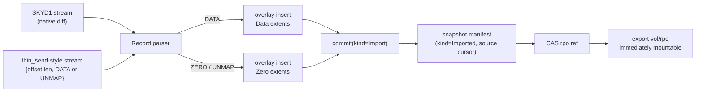

LVM `thin_send`-produced deltas[^thin-send] and native `SKYD1` streams therefore share every line of durability code. Consistency guidance is unchanged from v1: quiesce at the source (`fsfreeze`, app hooks); SkyNBD guarantees crash-consistency of whatever byte stream it is given, transactional application, and instant mountability of the result.

In v3 the importer is reframed as **a client of the prepared-snapshot machinery** (§9A): applying a stream is `PrepareSnapshotFromBase` (or an empty base) + batched attach/clear + `PublishSnapshot`. The stream path and the V3.2 coordinator path are two front-ends over one ingestion implementation — one set of invariants (I8, I9), one recovery story, one test surface.

### 9.6 Snapshot operations summary (API surface in §12)

| Operation | Cost | Mechanism |
|---|---|---|
| create | O(1) + one forced commit | commit → manifest PUT → ref CAS |
| list | O(refs) | ref store scan |
| mount/export | O(1) | registry watch, next `NBD_OPT_GO` sees it |
| delete | O(1) | ref delete; space via GC |
| diff/send | O(changed) | subtree-hash pruned walk |
| recv/import | O(stream) | overlay + single commit |
| rollback head to snapshot | O(1) | CAS `head` to snapshot's commit (refuses while head export has a live writer connection) |

---

## 9A. Snapshot Ingestion Control Plane (V3.2)

This section implements the server side of Snapshot Design V3.2[^snapv32] — the operations its coordinator calls (V3.2 §11.1), with the pin-lifecycle and atomicity fixes V3.2 §11.1 demands. The target of ingestion is normally a **lineage volume** (D14) whose logical space is the client's thin LV.

### 9A.1 Terminology mapping

| V3.2 term | Server entity |
|---|---|
| Visible snapshot `G_k` / `G_n` | `snap/<name>` ref → commit + manifest |
| Prepared snapshot `P_n` | hidden `prepared/{snap_id}` ref → commits of kind `Prepared` + `prepared` table row |
| Immutable objects | CAS objects `obj/{hash}` (+ inherited segments/objects of the base commit) |
| Pin | `pins` table row `(vol, snap_ref, holder_id)` |
| Live writable head (not snapshot base) | the *attached* pool volume's `head` — a different volume; never an ingestion base |
| Baseline pair `B_k == G_k` | client-side invariant; the server's contribution is I5 (snapshot immutability) + I8 (pinned `G_k` undeletable) |

### 9A.2 Operations

All operations are idempotent as marked; the coordinator may retry any of them blindly after a timeout or crash (V3.2 §11.5).

| Operation (V3.2 name) | Server semantics | Idempotency |
|---|---|---|
| `PrepareSnapshotFromBase(vol, snap_id, base)` | Resolve `base` (a visible snapshot name, or none ⇒ empty mapping, used by bootstrap `P_0`); in **one ref-store txn**: create `prepared/{snap_id}` pointing at the base commit, insert `prepared` row (state `Prepared`, watermark 0), and pin the base with holder `prepared:{snap_id}` (I8). | by `snap_id`: re-issue returns existing state; conflicting `base` for an existing `snap_id` is an error |
| `PutObject(vol, hash, bytes)` | Verify `blake3(bytes) == hash` (reject otherwise), PUT `obj/{hash}`. | naturally: key is content-addressed; re-PUT is a no-op |
| `EnsureObject(vol, snap_id, hash)` | If `obj/{hash}` exists **and is protected or resurrectable** (§10.2), record `hash` in the prepared root's pending-ref set and return `exists=true`; else return `exists=false` (client must `PutObject`). Scoped to a prepared snapshot so a positive answer is a promise GC honors. | pure query + monotonic pending-ref insert |
| `AttachRange(vol, snap_id, ranges[], op_id)` | For each `{lba, len, hash, obj_offset}`: insert extent `Data(Cas{hash, obj_offset})` into the prepared overlay. Batched (V3.2 §17.3). Rejected unless state ∈ {`Prepared`, `Backfilling`}; moves state to `Backfilling`. | by `(snap_id, op_id)` watermark; semantically idempotent anyway (same range → same object) |
| `ClearRange(vol, snap_id, ranges[], op_id)` | Insert `Zero` extents over each range (§9A.3). | same as attach |
| `PublishSnapshot(vol, snap_id, name, holder)` | Final checkpoint of the prepared overlay through `commit()` (durable-publish invariant, V3.2 §7.7: every referenced object durable *before* visibility); PUT manifest; then **one ref-store txn**: create `snap/<name>` → commit, pin it with holder `holder`, delete `prepared/{snap_id}` ref + row, unpin the base holder `prepared:{snap_id}` (I8). Registry watch makes it exportable immediately. | by `snap_id`: if already published, returns the existing `G_n` id |
| `AbortSnapshot(vol, snap_id)` | One txn: delete `prepared/{snap_id}` ref + row, unpin base. Accumulated `Prepared` commits and CAS objects become epoch-aged garbage (§10). | by `snap_id`: aborting the absent is a no-op |
| `GetSnapshotStatus(vol, snap_id)` | Returns `{ state, base, op_watermark, last_durable_commit, published_as? }` — `op_watermark` is the highest `op_id` folded into a **durable** checkpoint; ops above it were volatile and must be replayed after a server crash (D12). | pure |
| `PinVisibleSnapshot(vol, name, holder)` / `UnpinVisibleSnapshot(vol, name, holder)` | Insert/delete a `pins` row. `DELETE snapshot` and GC refuse while any pin row exists. Used by the coordinator for baseline holders (V3.2 §15.4: transfer publish pin to baseline holder, then unpin `G_k`). | by `(name, holder)` |

### 9A.3 Attach/Clear semantics — and V3.2 open question 20.3, answered

- Ranges must be 512-aligned; the server does **not** require `object_chunk_size` alignment — whole-chunk discipline (V3.2 §9.6 sub-object holes, read-modify-write) is the coordinator's job, and the server's variable-length extents accept whatever correct ranges it sends.
- `ClearRange` inserts explicit **`Zero` extents** that override the cloned base — *not* hole-punching (extent removal), which could re-expose base data if ranges partially overlap. Reads return zeros; `BLOCK_STATUS` reports the runs as `ZERO` (allocated-zero) or `HOLE|ZERO` where nothing was ever mapped. This satisfies V3.2 §10.5's requirement that a cleared range reads exactly as `S_n` would read it, and closes V3.2 §20.3: **the representation is explicit zero extents over cloned bases; true holes exist only where no ancestor ever mapped data.** (Tree-level note: adjacent `Zero` extents merge, so large discards stay cheap.)
- Attach over attach (same range, retried or revised) last-writer-wins within a prepared root — safe because ops are ordered by `op_id` per coordinator.

### 9A.4 Pin lifecycle

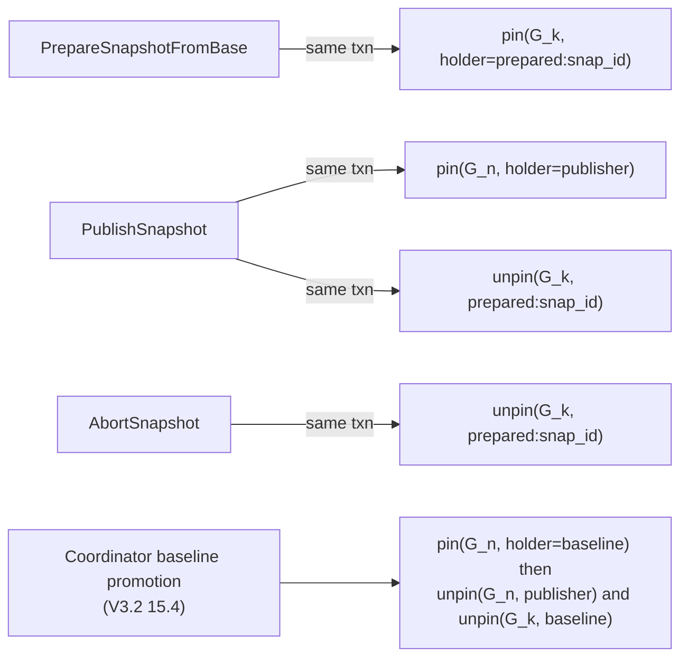

Rules (mirroring V3.2 §11.1): publish-implies-pin with **no visible-but-unpinned window** (I8); prepare pins the base for `P_n`'s lifetime; pins are refcounted per holder because multiple baseline pairs may hold the same base (V3.2 §15.5); bootstrap's pair `(B_0, G_0)` is recordable only after the publish pin is durable — which is automatic here, since the pin is in the publish transaction itself.

### 9A.5 Prepared-snapshot state machine

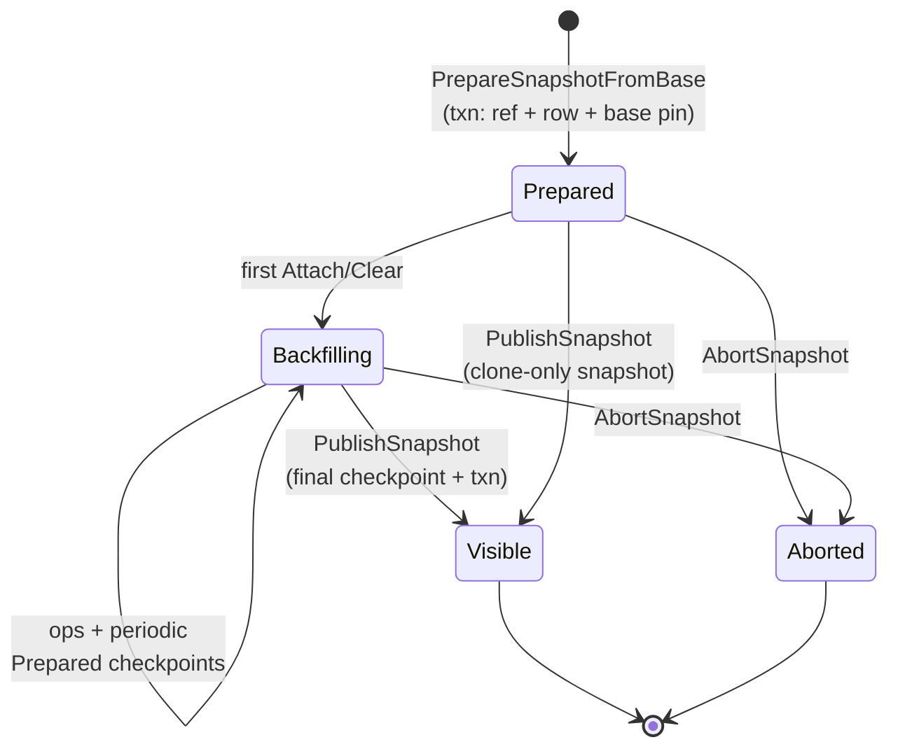

The server intentionally has fewer states than the coordinator's machine (V3.2 §11.3) — `Requested`/`Captured`/`DeltaReady` are client-side phases invisible to the server, and `Publishable` is a client judgment ("all my ops are at or below the durable watermark"), checkable via `GetSnapshotStatus`, not a server state.

### 9A.6 Durability, resume, and crash recovery (D12)

The prepared overlay checkpoints through the ordinary `commit()` path (same cadence knobs as heads, §12), advancing `prepared/{snap_id}` by CAS and persisting `op_watermark` with the row. Consequences, keyed to V3.2's recovery matrix (§15.2):

| Event | Server guarantee | Coordinator action (per V3.2) |
|---|---|---|
| Server crash mid-backfill | Prepared ref = last durable checkpoint; ops above `op_watermark` lost | Read status, replay ops with `op_id > watermark` (or recompute the delta — always possible while `B_k`,`S_n` exist, V3.2 §15.3) |
| Coordinator crash mid-backfill | Nothing changes server-side; prepared root and pins persist (GC root) | Resume by status, or `AbortSnapshot` |
| Crash during publish | Publish txn is atomic: either `G_n` visible+pinned or still prepared | `GetSnapshotStatus`: `Visible` ⇒ proceed to baseline promotion; else re-publish or abort — exactly the V3.2 matrix row |
| Prepared root abandoned forever (coordinator never returns) | Pins keep the base alive indefinitely | Operational: `max_prepared_age` alert + `skynbdctl prepared ls/abort` for operator cleanup — deliberately **not** auto-abort; V3.2 §15.6 makes abandon a client decision |

### 9A.7 Ingestion write path

Attach/clear ops bypass the NBD frontend but reuse the engine: a lineage volume's "writer" is its ingestion task, so single-writer-per-volume (I2) covers prepared snapshots too — one coordinator per lineage volume at a time (V3.2's one-in-flight rule, §7.9, maps to one prepared root per lineage volume in the MVP; the schema supports more later). Reads never see prepared state (I9).

Data flow for an attach with a fresh object: `PutObject` → S3 `obj/{hash}` (durable immediately) → `AttachRange` → overlay insert (volatile) → periodic/final checkpoint → nodes + commit PUT → ref CAS. The client-visible commit point for *ranges* is the checkpoint; for *bytes* it is `PutObject` — which is why `EnsureObject`'s pending-ref promise (§10.2) matters.

### 9A.8 Bootstrap and disaster recovery

- **Bootstrap (V3.2 §8.3)**: `PrepareSnapshotFromBase(base=None)` gives an empty mapping; the coordinator objectizes all mapped ranges of `S_0` and publishes `G_0`. Full-volume work, same ops, no special cases server-side.
- **DR from total local loss (V3.2 §15.7)**: the lineage volume's newest `G_n` is exportable read-only in O(1) — attach and rehydrate, or serve degraded reads directly from it. After rehydration the coordinator may re-establish a baseline pair against `G_n` without re-upload by pinning it as baseline holder and verifying contents via sampled hashes (V3.2 §10.8 audit machinery); the server needs no new operation for this.
- **Materializing a writable volume from `G_n`** (restore-in-cloud): `rollback`+attach on the lineage volume, or post-MVP `clone` (§16) — not required for the V3.2 loop.

---

## 10. Garbage Collection

### 10.1 Model

Mark-and-sweep over an immutable object graph. Roots (this is V3.2 §11.4's root model, realized): every ref in the ref store — including hidden `prepared/*` refs — every **pinned commit** in the `pins` table, every prepared root's **pending-ref set** (`EnsureObject` promises, §9A.2), plus every in-progress commit's would-be root (protected by epochs, below). Reachability: commit → shard index → nodes → segments/CAS objects (via `DataRef`s); commit → parent chain is *not* followed — parents unreachable from any root are garbage by design (history is pruned to what refs and pins hold).

### 10.2 Epoch protocol (satisfies I6)

1. GC begins: CAS `gc.current_epoch` from `E` to `E+1` and PUT marker `gc/{E+1}`. Writers learn the epoch on their next commit; any commit started under epoch ≤ E is still protected because…
2. **Grace rule:** sweep in epoch `E+1` may delete only objects (a) unreachable from all refs *and* (b) whose S3 `LastModified` predates the start of epoch `E` — one full epoch of grace, so no in-flight commit's freshly-PUT objects can be swept before its ref CAS lands or fails.
3. Mark: walk from all roots (refs, pins, pending-ref sets), record live set (bloom filter + exact set per prefix).
4. Sweep: `LIST` each prefix, delete unreferenced-and-aged objects in batches of 1000.

**CAS resurrection rule** (closes the `EnsureObject` race): an existing-but-unreachable `obj/{hash}` may be re-referenced by a new attach at any time. `EnsureObject` therefore answers `exists=true` only if it can *protect* the object — it inserts the hash into the prepared root's pending-ref set (a GC root) *before* replying, and answers `exists=false` for any object already in the current sweep's candidate list, forcing an idempotent re-`PutObject`. Between the two, a positive dedupe answer is never invalidated by a concurrent sweep (I6; verified in S12).

Single-node MVP simplification: GC runs inside `skynbdd` (API-triggered or interval), so "writers learn the epoch" is an in-process handoff; the protocol is nevertheless specified as above so the distributed version changes no formats. Verified by S8, including the concurrent-snapshot-during-GC race.

### 10.3 Compaction (post-MVP, format-ready)

Overwrites strand dead bytes inside sealed segments. The commit's `SegmentMeta` + tree reachability give exact live-byte accounting per segment; a compactor rewrites segments below a liveness threshold into fresh segments and publishes a normal commit (kind reserved). No format change required — this is why segment packing was pulled into the MVP (D2) but compaction was not.

---

## 11. Codebase Layout (Cargo Workspace)

```text
skynbd/
├── Cargo.toml                  # workspace
├── crates/
│   ├── skynbd-types/           # ids (ULID), Extent/Target/DataRef, hashes, errors
│   ├── skynbd-format/          # framed postcard codecs for SSEG/SNOD/SCMT/SSUP/SSNP/SKYD
│   ├── skynbd-tree/            # pure COW B+tree: lookup, insert, split/merge, diff walk
│   ├── skynbd-store/           # ObjectStore trait; s3 impl (aws-sdk-s3), memory impl,
│   │                           #   fault-injecting wrapper (latency, errors, kill-points)
│   ├── skynbd-refs/            # RefStore trait; redb impl, memory impl
│   ├── skynbd-engine/          # volume engine: overlay, segment writer, commit(),
│   │                           #   prepared-snapshot roots + pins (§9A),
│   │                           #   checkpoint/rpo timers, lease keepalive, GC
│   ├── skynbd-nbd/             # protocol framing, negotiation, per-connection loop
│   ├── skynbd-stream/          # SKYD1 + thin-stream parsers/emitters, importer
│   └── skynbd-api/             # axum REST handlers + skynbdctl client lib
├── bins/
│   ├── skynbdd/                # daemon: config load, planes wiring, graceful shutdown
│   └── skynbdctl/              # CLI over the REST API (+ fsck --rebuild-refs)
└── tests/
    ├── proptest/               # tree & engine property tests (vs reference model)
    ├── integration/            # engine ↔ MinIO (testcontainers), crash-point matrix
    ├── coordinator/            # skynbd-coordinator-test: reference V3.2 coordinator
    │                           #   (fsfreeze + lvcreate + thin_delta → control plane; S14)
    └── e2e/                    # scenario scripts S1–S14 (bash + rust harness), CI entry
```

Dependency shortlist (pinned in-repo; the point is which layer owns what): `tokio`/`bytes`/`tokio-util` (runtime & framing), `aws-sdk-s3` + `aws-config` (path-style + custom endpoint for MinIO), `redb`, `postcard`+`serde`, `blake3`, `ulid`, `axum`+`clap`, `moka` (LRU), `tracing` + `prometheus`, `tokio-rustls` (gated), `proptest` + `testcontainers` (dev). No crate outside `skynbd-nbd` knows about NBD; no crate outside `skynbd-store` knows about S3.

---

## 12. Control API, CLI, and Configuration

### 12.1 REST API (axum, `:8080`)

| Method & path | Action |
|---|---|
| `POST /v1/volumes` `{name, size, kind}` | create volume (`attached` or `lineage`, D14; superblock PUT + refs init; head = empty commit) |
| `GET /v1/volumes` · `GET /v1/volumes/{vol}` | list / inspect (incl. flush_seq, segment & extent counts) |
| `DELETE /v1/volumes/{vol}` | logical delete (refuses with live connections; space via GC) |
| `POST /v1/volumes/{vol}/snapshots` `{name}` | snapshot create (D10 forced commit) → manifest |
| `GET /v1/volumes/{vol}/snapshots` | list with lineage |
| `DELETE /v1/volumes/{vol}/snapshots/{name}` | snapshot delete (refused while pinned, I8) |
| `POST /v1/volumes/{vol}/snapshots/{name}/pins` `{holder}` · `DELETE …/pins/{holder}` | `PinVisibleSnapshot` / `UnpinVisibleSnapshot` (§9A.4) |
| `POST /v1/volumes/{vol}/prepared` `{snap_id, base?}` | `PrepareSnapshotFromBase` (§9A.2; omit `base` for bootstrap) |
| `GET /v1/volumes/{vol}/prepared` · `GET …/prepared/{id}` | list prepared roots · `GetSnapshotStatus` (state, op watermark) |
| `PUT /v1/volumes/{vol}/objects/{hash}` | `PutObject` — raw body, server verifies BLAKE3 |
| `POST /v1/volumes/{vol}/prepared/{id}/ensure` `{hashes[]}` | `EnsureObject`, batched; registers pending refs (§10.2) |
| `POST /v1/volumes/{vol}/prepared/{id}/attach` `{ranges[], op_id}` | `AttachRange`, batched |
| `POST /v1/volumes/{vol}/prepared/{id}/clear` `{ranges[], op_id}` | `ClearRange`, batched |
| `POST /v1/volumes/{vol}/prepared/{id}/apply` `{ops[], op_id}` | `AttachRange`/`ClearRange` interleaved in one call: each op is `{op: "attach", off, len, hash, obj_off}` or `{op: "clear", off, len}`, staged in order, all validated before any is staged. Advertised as `prepared-apply` in the `x-skynbd-features` response header |
| `POST /v1/volumes/{vol}/prepared/{id}/publish` `{name, holder}` | `PublishSnapshot` — atomic visible+pinned (I8) |
| `DELETE /v1/volumes/{vol}/prepared/{id}` | `AbortSnapshot` |
| `POST /v1/volumes/{vol}/rollback` `{snapshot}` | CAS head to snapshot commit |
| `GET /v1/volumes/{vol}/diff?from=&to=` | stream `SKYD1` (chunked response) |
| `POST /v1/volumes/{vol}/import` | accept `SKYD1` or thin-style stream body → §9.5 |
| `POST /v1/volumes/{vol}/rpo` `{interval_s?, bytes?}` | set / trigger rpo policy |
| `GET /v1/exports` | export registry dump (name, mode, commit, size) |
| `POST /v1/gc` · `GET /v1/gc/status` | trigger / observe GC |
| `GET /healthz` · `GET /metrics` | liveness · Prometheus |

`skynbdctl` mirrors this 1:1 (`volume create/ls/rm`, `snapshot create/ls/rm/pin/unpin`, `prepared create/ls/status/attach/clear/publish/abort`, `object put/ensure`, `send`, `recv`, `rollback`, `rpo`, `gc`, `fsck`), which is exactly the surface the E2E scenarios — and the reference V3.2 test coordinator — script against.

### 12.2 Configuration (`skynbd.toml`)

```toml
[server]
nbd_listen = "0.0.0.0:10809"
api_listen = "127.0.0.1:8080"
tls = false                        # NBD_OPT_STARTTLS when true

[s3]
endpoint = "http://127.0.0.1:9000" # MinIO in dev/CI; empty ⇒ AWS default chain
bucket = "skynbd"
prefix = "skynbd/"
force_path_style = true
retry_max_attempts = 4             # then NBD_EIO (§8.3)
op_timeout_ms = 10000

[refs]
path = "/var/lib/skynbd/refs.redb"

[engine]
segment_max_bytes = 8388608        # 8 MiB seal threshold (D2)
segment_max_open_ms = 500
checkpoint_interval_s = 30
checkpoint_max_overlay_bytes = 268435456
node_cache_bytes = 268435456
data_cache_bytes = 134217728
verify_segment_hashes = false      # D9 read-path verification

[rpo]
default_interval_s = 60
```

---

## 13. Observability

- **Tracing**: `tracing` spans per NBD command and per commit, with `vol`, `export`, `flush_seq`, and object-count fields; `RUST_LOG`-style filtering; optional OTLP export.
- **Metrics (Prometheus)**, the set the E2E suite also scrapes for assertions: `nbd_requests_total{cmd,export,outcome}`, `nbd_request_duration_seconds{cmd}`, `engine_flush_duration_seconds`, `engine_overlay_bytes`, `engine_open_segment_bytes`, `s3_ops_total{op,outcome}` / `s3_op_duration_seconds{op}`, `s3_bytes_total{dir}`, `snapshot_create_duration_seconds`, `rpo_lag_seconds` (now − last rpo commit's created_at), `gc_last_run_timestamp`, `gc_objects_deleted_total`, `cache_hits_total{cache}` / `cache_misses_total{cache}`, and the ingestion set: `ingest_ops_total{op,outcome}`, `ingest_bytes_total{kind}` (put vs deduped), `ensure_dedupe_hits_total`, `prepared_roots{vol}`, `prepared_age_seconds`, `pins{vol}`.
- Scenario S6 asserts on `rpo_lag_seconds`; S8 on GC counters; the performance smoke (S10) records `s3_ops_total` deltas to catch PUT-amplification regressions.

---

## 14. End-to-End Test and Verification Plan

The MVP is "done" when every layer below passes in CI. Each correctness invariant from §6.2 is named where it is verified.

### 14.1 Test pyramid

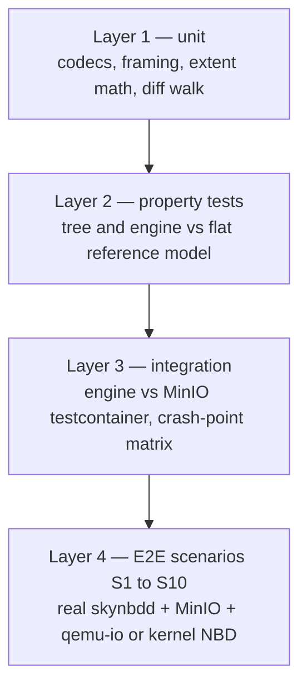

### 14.2 Layers 1–3

- **Unit**: round-trip every `skynbd-format` codec (including version-mismatch rejection); NBD frame encode/decode against golden byte vectors from the spec; extent split/merge cases; leaf delta-encoding edge cases (adjacent, overlapping, zero-length rejection).
- **Property (proptest)**: (a) *tree ≡ model*: random sequences of write/trim/zero/read against `skynbd-tree` + overlay vs a plain `Vec<u8>` reference model — read equivalence after every op (I3); (b) *diff correctness*: for random commit pairs, applying `diff(A,B)` to A's content yields exactly B's content; (c) *commit idempotence*: replaying a commit's PUT set is byte-identical (§6.4).
- **Integration (real MinIO via testcontainers)**: the **crash-point matrix** — using the fault-injecting `ObjectStore`, kill the engine at every labeled point in the commit sequence (§6.3: before PUTs, mid-segment-PUT, mid-node-PUTs, after commit PUT, before CAS, after CAS) × {reopen, rebuild-refs} and assert I1/I4/I7: content equals the last acked flush, closure of head is complete, no torn state. Also: S3 5xx/timeout retry behavior, and `NBD_EIO` surfacing after retry exhaustion.

### 14.3 E2E harness

Two client tiers so correctness runs anywhere and kernel realism runs where privileged:

- **Tier A (no root, every CI run)**: `qemu-io -f raw nbd://127.0.0.1:10809/<export>` for reads/writes/flush/discard, `qemu-img map --output=json nbd://…` for allocation via `BLOCK_STATUS`, `qemu-img convert` for full-device checksum extraction, `nbdinfo` for negotiation conformance.
- **Tier B (privileged runner / VM, nightly + pre-release)**: `nbd-client` attach to `/dev/nbdX`, `mkfs.ext4`, mount, real workloads (`fio`, corpus copy), `fsfreeze`, `fsck`. For S14 the runner additionally provisions a loop-device **LVM thin pool** whose data LV sits on the NBD device (dm-cache optional) with pool metadata on local disk — the V3.2 shape-B stack — and needs `lvm2` + `thin-provisioning-tools` (`thin_delta` with `--metadata-snap`; XML output is acceptable in the test coordinator per V3.2 §10.1).

Harness layout: `tests/e2e/run.sh <scenario>` boots MinIO (docker compose) + `skynbdd` with a scenario-scoped bucket and redb file, executes the scenario script, and always ends with the **global postconditions**: `skynbdctl fsck` clean (every ref's closure complete, hashes verified), no server panics in logs, metrics scrape succeeds.

### 14.4 Scenarios and pass criteria

| ID | Scenario (tier) | Steps | Pass criteria |
|---|---|---|---|
| S1 | Basic IO round-trip (A) | create 1 GiB vol; qemu-io write random-patterned regions; flush; read back; disconnect/reconnect; read again | byte-exact reads pre/post reconnect (I3); `nbdinfo` shows advertised flags/sizes of §8 |
| S2 | Flush durability & crash (A) | write P1, flush; write P2 (no flush); `kill -9 skynbdd`; restart; read | P1 present, P2 either absent-in-full or (if a checkpoint raced) at a commit boundary; content equals some flush-ack boundary (I4, I7); fsck clean |
| S3 | Snapshot correctness & instant export (A) | write A; snapshot `s1` (timed); overwrite same range with B; read `vol/snap/s1` and `vol/head` | `s1` reads A, head reads B (I5); snapshot API→mountable latency < 1 s; snapshot create time flat across 1 GiB vs 64 GiB volume (O(1) claim) |
| S4 | Filesystem + app-consistent snapshot (B) | attach, mkfs.ext4, mount, copy corpus (checksummed), `fsfreeze -f`, snapshot, unfreeze, keep writing; attach snapshot RO on second device | `fsck -n` on snapshot clean; corpus checksums in snapshot match exactly; head unaffected |
| S5 | TRIM / WRITE_ZEROES / sparse (A+B) | write; blkdiscard (B) / qemu-io discard+write-zeroes (A); `qemu-img map` | discarded ranges read zero; map shows holes/zero runs matching issued ops; after snapshot-drop + GC, bucket bytes shrink accordingly |
| S6 | RPO guarantee (A) | rpo policy 5 s; steady write+flush load 60 s; `kill -9`; restart; mount `vol/rpo` | rpo mounts; content lag vs last pre-kill flush ≤ 5 s of writes (per S6's write journal); `rpo_lag_seconds` metric was ≤ 5+ε throughout |
| S7 | Diff / send / recv (A) | snapshot s1; mutate K MiB; snapshot s2; `send --from s1 --to s2 \| recv` into fresh volume seeded from s1; also kill `recv` mid-stream once | received volume checksum == s2 exactly; stream payload bytes ≤ K + ε (O(changed) claim); killed stream leaves target refs unchanged (§9.4) |
| S8 | GC safety & reclamation (A) | build snapshots s1..s3 with overwrites; delete s2; run GC; concurrently create s4 during a second GC run | s1, s3, s4, head checksums unchanged (I6); bucket object count & bytes drop by the s2-only set; fsck clean after every GC |
| S9 | Restart & ref recovery (A) | 9a: graceful restart mid-workload, reconnect, continue. 9b: delete `refs.redb`, run `skynbdctl fsck --rebuild-refs`, restart | 9a: no data loss for flushed writes, clients resume; 9b: head + all snapshot refs rebuilt to identical commits (§6.5), all checksums intact |
| S10 | Performance smoke (B, nightly) | fio: 4k randwrite + 1M seqwrite + 4k randread, with dm-cache writeback configured as in §1 assumptions; record metrics deltas | no correctness assertions — records baselines (IOPS, p99 latency, `s3_ops_total`/GiB); regression gate: PUT-per-GiB-written may not grow > 20% vs recorded baseline |
| S11 | Prepared lifecycle & idempotent retry (A) | lineage volume; bootstrap publish `G_0` via prepared ops; prepare `P_1` from `G_0`; attach (with `EnsureObject` dedupe of repeated content), clear (incl. whole-object and sub-object-shaped ranges), **replay every op once** with the same `op_id`s; publish; also run one full abort flow | published content == `clone(G_0) + ops` exactly (byte-diff via qemu-img convert); duplicate ops change nothing; `P_1` absent from `NBD_OPT_LIST` and snapshot list until publish, present within 1 s after (I9); abort leaves no visible change and fsck clean; conflicting re-prepare rejected |
| S12 | Pin & GC safety under ingestion (A) | publish `G_1` (holder h1); prepare `P_2` from `G_1`; attempt `DELETE G_1` (must refuse); run GC during backfill; `EnsureObject` an unreachable-but-existing hash mid-GC; abort `P_2`, unpin all, delete `G_1`, GC again | delete refused while pinned (I8); GC during backfill collects nothing reachable from `P_2` incl. pending-refs (I6, resurrection rule §10.2); after unpin+delete+GC, bucket shrinks by exactly the `G_1`-only set; `G_0`/head checksums unchanged |
| S13 | Server crash during backfill (A) | attach K ops; `kill -9 skynbdd` between checkpoints; restart; `GetSnapshotStatus` → replay ops above watermark; publish; separately, `kill -9` during the publish txn window, restart, re-issue publish | status reports a watermark ≤ K with durable prefix intact; replay converges — final content identical to the no-crash run; publish is atomic: after restart `G_n` is either visible+pinned or still prepared, re-publish idempotent (I8); fsck clean |
| S14 | Full V3.2 loop (B, nightly) | loop-device LVM thin pool (data LV over `/dev/nbdX` head, metadata local, per V3.2 §6.5); ext4 + corpus; reference coordinator runs V3.2 Phase A: bootstrap `G_0` (fsfreeze, thin snap `S_0`, full objectize, publish, pin, promote `B_0`); then two incremental cycles: fsfreeze → `S_n` → thaw → `thin_delta(B_{n-1},S_n)` → prepare/attach/clear → publish `G_n` → promote baseline, incl. discards in the workload | for each cycle `hash(S_n) == hash(G_n)` full-device (V3.2 §10.7); freeze window < 1 s (capture is metadata-only, V3.2 §16.1); uploaded bytes ≈ delta size, not volume size; baseline pins transferred per V3.2 §15.4 (old `G_{n-1}` deletable only after promotion); `fsck -n` clean on every published snapshot export |

### 14.5 CI pipeline

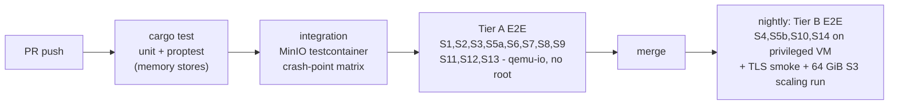

GitHub Actions: Tier A jobs run on standard runners (`services: minio`, `apt install qemu-utils`); Tier B runs on a self-hosted or nested-virt privileged runner with `modprobe nbd`. Every job uploads `skynbdd` logs, metrics dumps, and fsck reports as artifacts on failure.

---

## 15. Milestones with Acceptance Criteria

Each milestone is complete only when its scenario gate passes in CI.

| M | Deliverable | Gate |
|---|---|---|
| M0 | Workspace scaffold; `skynbd-types`/`-format`/`-tree` with unit + property tests; in-memory stores | Layer 1–2 green |
| M1 | Engine + S3 store + redb refs: volume create, write/read/flush via engine API (no NBD yet); crash-point matrix | Layer 3 green (I1, I4, I7) |
| M2 | NBD frontend (§8) + export registry; `qemu-io`/`nbdinfo` interop | S1, S2 |
| M3 | Snapshot subsystem: create/list/delete, forced-commit, manifests, registry publication, rollback | S3; S4 on a dev box |
| M4 | TRIM/WRITE_ZEROES/BLOCK_STATUS; GC with epochs; fsck + rebuild-refs | S5, S8, S9 |
| M5 | RPO policy; diff/send/recv + importer (reframed over prepared machinery, §9.5); CLI for §12 pre-ingestion surface | S6, S7; S10 baseline recorded |
| M6 | **Snapshot ingestion control plane** (§9A): lineage volumes, CAS objects + `PutObject`/`EnsureObject`, prepared roots + checkpointing, attach/clear, atomic publish+pin txn, abort, status, pins API, GC roots/resurrection rule | S11, S12, S13 |
| M7 | Reference V3.2 test coordinator (`tests/coordinator`); Tier B thin-stack rig; CI pipeline fully wired incl. nightly | S14, full matrix green |
| M8 | **Production snapshot agent core** (`crates/skynbd-agent`, see `skynbd-agent-design.md`): durable state machine, recovery planner (V3.2 §15.2 as pure fn + crash-injection property suite), freeze watchdog, `LocalStack`/`FakeStack` split, HTTP client + static-token auth in `skynbd-api` | S15 (PR CI); S14a agent-parity (nightly) |
| M9 | Agent hardening. First slice landed: `DmOps` seam — DmStack orchestration rootless over a contract-enforcing mock kernel (crash matrix + full pipeline in PR CI; found+fixed the §15.4 two-baselines promotion window via the `u-` untagged role). Remaining: pool admit/abandon thresholds, lease, metrics/audit, packaging + privilege split | Seam: `dm_contract.rs`, `crash_matrix_dm.rs`, `cycle_dm_mock.rs` (PR CI). Rest: S16, S17 (nightly); 24 h soak, audit clean |
| M10 | **Pulled ahead of M9.** M10a: NBD over Unix domain sockets; API auth token + pins/data read endpoints; agent `HttpControlPlane`; S15 in PR CI. M10b: `DmStack` (raw dm-thin, LVM-free — `LvmStack` dropped), freeze watchdog, CLI, raw-dmsetup Tier B rig | M10a: S15 + UDS interop (PR CI). M10b: S14a on the dm rig (nightly) |

Post-M7 the MVP claim of §1.1 — including goal 5, the V3.2 control plane — is fully verified end to end. M8–M9 productionize the client side; the server MVP does not change shape (only addition: optional API auth token, agent doc §9).

---

## 16. Post-MVP Roadmap

1. **Distributed control plane** — per-volume ownership with fencing generations (already in the CAS schema), multiple gateways (read-any for snapshots, lease-holder for head), `CAN_MULTI_CONN` audit. Designed in **`skynbd-multinode-design.md`**, which takes the refs store into the object store itself (one conditionally-written object per volume, carrying the owner and epoch alongside the refs) rather than requiring etcd; etcd remains the option for heavy multi-writer. That document also covers lazy extent-map materialization, the commit epoch that makes bounded recovery safe, and CSI handoff at `NodeUnstage`, with the task sequence.
2. **Compaction** (§10.3) and read-path integrity verification on by default.
3. **Local WAL** in front of S3 for flush-latency reduction — an *optimization* layered under the same commit protocol, permitted to change only latency, never the durability contract (the crash-point matrix must pass unmodified).
4. Per-volume encryption + compression (format flag bits reserved), retention policies on the control API (must consult pins, I8), consistency groups (D5 field), gRPC surface.
5. **V3.2 optimizations**: `ObjectizeFromHead(P_n, range, head_offset)` — server-side objectization of clean chunks straight from the attached pool volume's extents, eliminating the coordinator's NBD read amplification (V3.2 §16.4/§17.10; cross-volume read, no format change needed); live-head CAS promotion (V3.2 §17.6); `clone` (materialize a writable volume from any `G_n`, which motivates moving `node/obj` keys to a bucket-global namespace for O(1) cross-volume sharing + global dedupe — a format-major bump, so deliberately post-MVP).

---

## 17. Risks and Remaining Open Questions

- **Flush latency on high-RTT S3** is bounded below by PUT latency (D1: no WAL). Mitigation now: parallel node PUTs, checkpoint cadence, client-side writeback caching; mitigation later: WAL (roadmap 3). S10 quantifies it early.
- **Metadata amplification under small scattered flushed writes** (each flush rewrites a leaf-to-root path per touched shard). The 256-entry nodes and 1 GiB shards bound this; S10's PUT-per-GiB gate watches it. Fallback knobs: node size, checkpoint batching.
- **`redb` single-file refs** are a single point of failure between commits and ref rebuild (§6.5) is the recovery story; acceptable for MVP, removed by roadmap 1.
- **NBD conformance edge cases** (option haggling order, structured-reply corner cases) are mitigated by testing against three independent clients (kernel, qemu, libnbd) rather than a single reference.
- **Open**: should `rollback` require the head export to be detached, or fence live connections automatically (current spec: refuse while attached)? Revisit with operator feedback in M3.
- **Open**: rpo ref reuse vs timestamped rpo snapshots (`rpo/<ts>` ring) — current spec reuses one ref for mount-path stability; a ring is a pure additive change.
- **Abandoned prepared roots pin their base indefinitely** (§9A.6) — correct per V3.2 §15.6 (abandon is a client decision) but an operational footgun on flaky coordinators. Mitigated by `prepared_age_seconds` alerting and operator abort; revisit auto-expiry with a lease-style prepared TTL once real coordinator behavior is observed.
- **Ingestion-rate mismatch**: the V3.2 coordinator's publish throughput bound is `min(objectization_read_bw, object_store_put_bw)` (V3.2 §8.1.1) — the server should not be the bottleneck, so S14 records attach-op and `PutObject` throughput as a baseline; batching sizes (§12) are the tuning knobs.
- **Open**: per-volume CAS namespace blocks cross-volume dedupe between the pool head and lineage volumes (V3.2 §17.5 live-head dedupe). Deferred with `clone` to the global-namespace format bump (§16.5).

---

## References

[^nbd-spec]: NBD protocol specification (fixed newstyle negotiation, transmission phase, structured replies, block status): https://github.com/NetworkBlockDevice/nbd/blob/master/doc/proto.md
[^nbd-flush]: NBD `FLUSH`/FUA semantics — a flush reply must not be sent until all writes *for which a reply has already been sent* are durable; writes never acked may be lost on crash. See the ordering discussion in the NBD spec, ibid.
[^redb]: `redb` — pure-Rust embedded ACID key-value store with MVCC and crash safety: https://github.com/cberner/redb
[^thin-send]: `thin_send`/`thin_recv` incremental transfer of dm-thin snapshots (part of thin-provisioning-tools): https://github.com/jthornber/thin-provisioning-tools
[^snapv32]: *SkyNBD: Filesystem-Consistent Snapshot Design V3*, version 3.2 (July 2026) — the client-side coordinator design (fsfreeze + dm-thin + `thin_delta`, baseline pairs, prepared/publish protocol, pins, freeze liveness, pool policy) whose §11.1 control-plane contract this document implements server-side. See also `thin_delta(8)` with `--metadata-snap` (https://manpages.debian.org/trixie/thin-provisioning-tools/thin_delta.8) and the kernel dm-thin provisioning documentation (https://www.kernel.org/doc/html/latest/admin-guide/device-mapper/thin-provisioning.html).

*End of document.*
