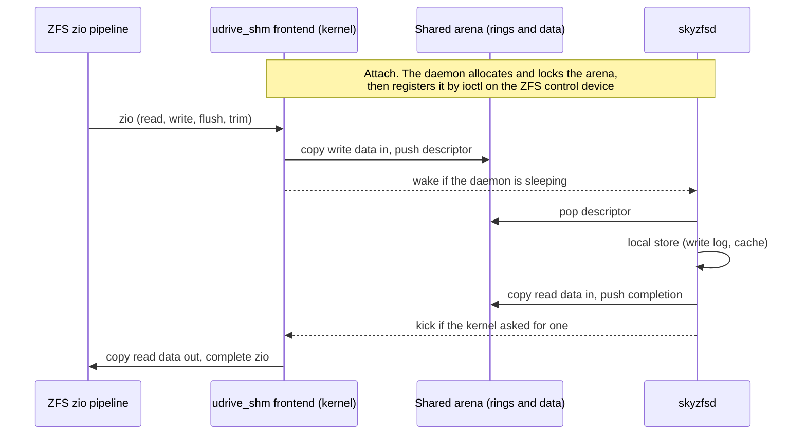
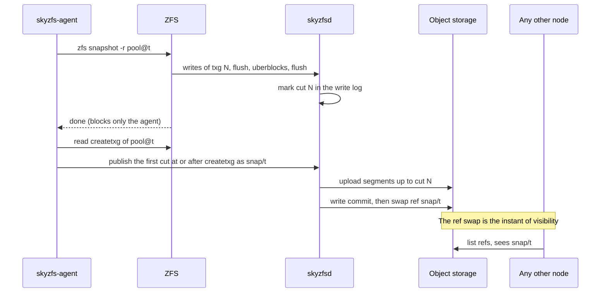
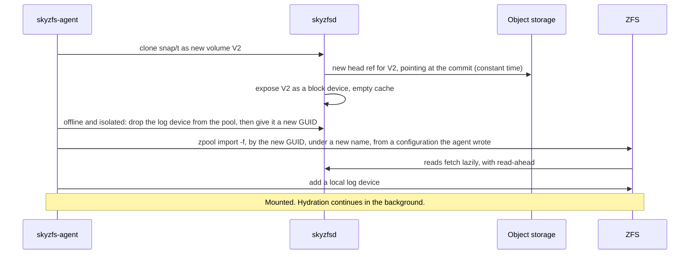
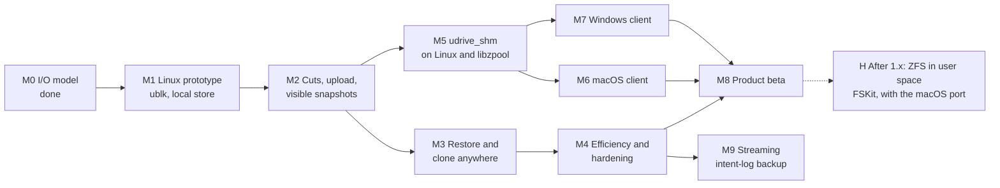

# SkyZFS: Architecture and Roadmap

| | |
|---|---|
| Status | Draft. Decisions of 2026-11-10 recorded in §10.1. M1 is in progress: the contract of §4.1 is merged as an executable model with a conformance suite that reports what a given harness cannot exercise (`crates/skyzfs-blk`), so are the write log and the store on top of it, tested on a simulated disk and, under `kill -9`, on real files (`crates/skyzfs-local`, §5.1), and so is the power-cut replay rig that M1's exit criterion rests on, which reads every copy of every reachable block and checks what `fsync` promised, so far run against the ublk project's reference server (`tests/kernel/replay-rig.sh`). A second kernel rig takes a server through kills, an orderly stop, a held request, a failed volume and the conformance suite, with requests in flight at its kills, so far against a stand-in for the daemon (`tests/kernel/daemon-rig.sh`). Of the ublk transport and `skyzfsd`, everything that needs no kernel is merged and tested against fakes: the translation of requests, the pump, the record of what was acknowledged, and the order of steps at a start (`crates/skyzfs-ublk`, §4.2). The binding to the kernel and `serve` are not built, and nothing of the daemon has run against a kernel yet |
| Date | 2026-11-10 |
| Supersedes | The dm-thin node stack of `skynbd_design.md` and `skynbd-origin-advance-design.md`, for this repository. The object formats, refs and commit protocol carry over. |
| Evidence | `skynbd-postgres-study.md` §10 |

## 1. Context

SkyNBD keeps a volume in object storage and gives each node a local copy-on-write stack built from dm-thin and dm-cache. That stack works, but it is Linux-only, it amplifies PostgreSQL's writes, and every snapshot costs the workload throughput for as long as chunks are being copied.

The product goal has also widened. The target is easy, consistent data protection for individuals and small businesses, across clouds and vendors, with **native clients on Linux, macOS and Windows**. The core promise is unchanged: cheap snapshots every minute, keep the last *n*, and restore any of them instantly on any machine.

This document proposes replacing the node stack with OpenZFS on a block device served by a node-local Rust daemon, and lays out the path from a Linux prototype to clients on all three systems.

### 1.1 What the I/O study established

The topology benchmark modelled ZFS on a userspace block backend and compared it with the dm-thin two-volume split (`twovol`) on one machine, on equal backing and equal memory[^study].

| Question | Result |
|---|---|
| Throughput with the working set on local flash, no snapshots | Level. zfs-slog ran at 0.85 to 1.14 of twovol at 8 clients (median 1.04), and was ahead on five of six machines at 1 and at 32 clients. |
| Throughput with a snapshot every minute | zfs-slog ran 1.26 to 1.60 times twovol. A thin snapshot cost twovol 16 to 24% of its throughput. `zfs snapshot` cost nothing. |
| Latency with a snapshot every minute | p99 6.8 to 9.2 ms against 10.5 to 13.7 ms. Slowest transaction under 0.2 s against 1.5 to 4.1 s. |
| Flash writes | 37 to 75% of twovol's. |
| Cold origin at 10 ms | ZFS is bound by page reads. It needs a backend read cache with read-ahead, which the model did not have. |

The study also produced three rules that this design adopts: the log device must be allocated storage, dirty data must be capped to fit the pool's free space and the ARC, and the uploader must know what ZFS has freed.

## 2. Goals and non-goals

### 2.1 Goals

1. **One engine, three operating systems.** The Rust daemon and the object formats are identical on Linux, macOS and Windows. Only the last hop into the kernel differs.
2. **Snapshots that cost the workload nothing**, taken every minute, with no filesystem freeze.
3. **A snapshot is visible everywhere at one instant**: when its data is in object storage and one ref has been swapped.
4. **Instant restore and clone on any node and any supported OS**, reading lazily from object storage.
5. **Pools portable between operating systems.** A snapshot taken on a Mac restores on Linux and on Windows.
6. **Vendor independence.** Any S3-compatible store first, then other object APIs, then more than one target at once.
7. **Stock ZFS on Linux.** No patched kernel module where the distribution already ships one.

### 2.2 Non-goals for this document

- Multi-writer access to one volume.
- Application-consistent snapshots (VSS writers, database quiesce hooks). ZFS snapshots are atomic across the pool, which is crash consistency for every dataset at once.
- zvols carrying NTFS or APFS. Clients expose ZFS datasets (decision D1, §10.1).
- Kubernetes integration. `skynbd-csi-design.md` will need its own revision once M3 lands.
- Client user interface design.

## 3. Architecture

The design has four layers.

| Layer | Role | Portability |
|---|---|---|
| ZFS | Filesystem, snapshots, compression, checksums, encryption | OpenZFS on Linux upstream. macOS and Windows from their ports. |
| Transport | Carries block I/O from the kernel to the daemon | Per OS. ublk on Linux, `udrive_shm` elsewhere. |
| Block target contract | The semantics every transport must provide | One definition, one conformance suite. |
| Engine and local store | Write log, cache, cuts, upload, refs, garbage collection | One Rust codebase. |

The frontend is called `udrive_shm`: a userspace-served drive over shared memory. Two earlier names were dropped because each sat too close to an unrelated part of Linux: `udev_shm` (the device manager `udev`) and `udisk_shm` (the disk-management daemon `udisks`). The name says drive where the kernels say disk; it means the same object, a whole block device.

### 3.1 What carries over from SkyNBD

| Existing crate | Fate |
|---|---|
| `skynbd-types`, `-format`, `-tree`, `-store`, `-refs` | Kept. Extents, COW shard trees, commits, object keys and ref CAS are unchanged. |
| `skynbd-engine` | Kept and extended with the local store. Today a flush acknowledges only after upload and a ref swap[^d1]. ZFS flushes many times a second, so a flush must become local. |
| `skynbd-nbd` | Kept as a third transport: a fallback for Linux kernels without ublk, and a remote read-only export. |
| `skynbd-agent` | The dm-thin orchestration is replaced by ZFS orchestration. The capture state machine, watchdog and crash matrix tests are the model for the new agent. |
| `skynbd-api`, `skynbdctl` | Kept, with snapshot publish reshaped around cuts (§5.2). |

New code: `skyzfs-blk` (contract and conformance suite), `skyzfs-ublk`, `skyzfs-shm` (user side of the shared-memory transport), `skyzfs-local` (write log and cache), the `skyzfsd` binary, and `kmod/udrive_shm` (the C frontend and its per-OS glue, kept as patches against the two ports).

## 4. The block target

### 4.1 Contract

Every transport delivers the same operations to the daemon and must honour the same rules. The rules are written from what the daemon can observe, so that one reference model can express them and one suite can test them. This section was tightened after an independent review of the first draft (§10.2).

**Parameters.** A target reports these when it is opened, and they do not change while it is open:

| Parameter | Value |
|---|---|
| Size | Fixed, a multiple of 1 MiB |
| Logical and physical block size | 4096 bytes. Every offset and length is a multiple of it |
| Largest read or write | 1 MiB. A transport splits anything larger |
| Requests in flight | A stated bound. The transport holds the rest |
| Discard and write_zeroes | Any aligned range inside the device |
| Volatile write cache | Yes: flushes are meaningful and must be delivered |
| Forced-unit-access writes | Not advertised. ZFS does not send them. A transport that delivers one treats it as a write followed by a flush |
| Discard | Supported |
| Read-only | Set for an export that must never change, such as a remote read-only export over NBD (§3.1). Browsing a snapshot does not use it (§5.4) |

**Content.** A volume has a base: empty, which reads as zeros, or a commit, for a clone or a restore. The content of a 4 KiB block is what the last operation covering it in the daemon's order left there, or else the base.

| Operation | Rule |
|---|---|
| `read` | Returns the content of each block. |
| `write` | Replaces the content. |
| `write_zeroes` | A write of zeros, with a write's ordering and durability. It need not store data, but on a clone it must hide the base: it is a recorded zero extent, not an absence. |
| `discard` | The content of each block becomes unspecified until the next write to it: the content just before the discard, zeros or the base, possibly differing between reads, never bytes from another offset or volume. A crash may forget a discard. A discard is never applied to data written after it. |
| `flush` | Completes only when every operation acknowledged on the volume before the daemon received the flush is durable against power loss. That includes operations an earlier instance of the daemon acknowledged. It need not cover or wait for operations still in flight. It never waits for upload. |

**Order.** The daemon applies writes, write_zeroes and discards in one total order, which is the order of the write log, and applies each of them whole. An operation submitted after another was acknowledged follows it in that order. Two overlapping operations that are both in flight may be ordered either way round. The later one then wins on every block they share, and it is the same one in memory, in the log, after replay and in every cut. A read is not part of that order. A read submitted after an operation was acknowledged sees it on every block. A read in flight together with an overlapping write may see each block either before or after that write, block by block, but never a block that is itself partly written: that is what a disk gives, and ZFS does not read a block it is writing. A server that hands requests to its store as they arrive has to do the ordering itself: direct I/O to a file does not order two overlapping writes, and a stand-in server that relied on it returned blocks from both[^tear].

Reads are not in the log. A read received after an operation was acknowledged observes it. A read that overlaps an operation still in flight sees, for each block, the content before it or after it.

**Two kinds of failure.** They promise different things, and treating them as one corrupts a pool. The daemon cannot tell which one it is recovering from, so recovery is one procedure: every start replays the longest valid prefix of the write log and makes it durable before it serves the first request. A second crash then cannot take back what the first recovery exposed, and a flush received by the new instance covers what the old one acknowledged.

- **The daemon is lost and the kernel carries on.** ZFS never restarted, so nothing it was told is done may be undone. An operation is therefore acknowledged only once it would survive the daemon process: appended whole to the write log, though not necessarily flushed to the device. The longest valid prefix then contains every acknowledged operation. Requests that were not acknowledged are issued again. They may arrive in any order, and may include ones the lost daemon had already applied, so all five operations are idempotent. A reissued request carries nothing that ties it to its first delivery, so it is a new operation in the order, and one the lost daemon had applied is in the order twice. This shows only where two overlapping operations were in flight at the loss, which ZFS does not do.
- **Power is lost.** The recovered volume is a prefix of the daemon's order that includes at least what every completed flush covered. Every operation in it is whole: none is torn. Blocks that no lost operation touched are unchanged.

**Errors.**

- A request that is misaligned, empty or beyond the end is rejected and has no effect.
- A flush or a discard is never answered "not supported". ZFS would stop issuing it for good[^zfserr].
- A flush is never failed for a condition that can recover. It is held.
- The write log has failed for good once a write or a sync of it has failed. From then on the volume has **failed**: no flush the daemon receives succeeds, and from the first failure the daemon reports, **every later request fails**, reads included. A request already in flight when the log fails may still complete either way. A flush among them succeeds only if its work was done before the failure. A disk that would refuse the next sync, and has not been asked, has not failed yet: a flush that finds every acknowledged operation already covered by a completed flush has nothing to make durable, promises nothing new, and may succeed without asking the disk. The daemon is not required to probe. Every completed flush stays a promise on a failed volume, whichever side of the failure it completed on: when the volume is next opened for a new client, after a power cut or a repair, it holds a prefix of the daemon's order that includes at least what each of them covered, exactly as after a power cut. Recovery is one procedure, and a cut is a position in that order (§5.2), so no recovery may leave anything but a prefix. A daemon restart in between adds nothing to that promise: what an instance acknowledged on a log that has failed, and no completed flush covered, may be missing when the volume is opened again. The rule that an acknowledged operation survives the daemon holds for a log that has not failed. While the volume is failed, nothing else about its content is promised. ZFS ignores the result of the flushes on either side of its uberblocks[^zfserr], so it is the next write that has to fail, and the content of a block whose log record was lost is unknown, so a read of it must not return something older.
- A failed volume stays failed across a daemon restart for as long as its client stays attached. A new instance must never serve a shorter log to a ZFS that was told more. Three things keep that rule when the log itself is what failed: the log leaves a marker (§5.1), the transport gives up the attachment so that no later instance can recover it, and every start in the same boot checks that the log it recovered reaches everything acknowledged in that boot (§4.2). A failed volume fails every request, including the reads and writes with which ZFS probes a device that has just returned an error. That is what tells ZFS the device is gone: when its probe fails too, ZFS itself raises `ENXIO`, the one error on which it suspends the pool and does not pass a read failure to an application[^readerr]. The kernel rig has seen both: the pool suspended, and its readers and writers blocked without an error (§4.2). A transport need not deliver `ENXIO`, and on Linux it cannot (§4.2). It must not answer with an error that means something else to ZFS, above all "not supported".
- A read that needs object storage that cannot be reached is **held until the storage answers**. It is not failed after a timeout. ZFS hands an ordinary read error straight to the application and counts it against the pool, and suspends the pool only when the device itself is gone[^readerr]. A network outage must not become application errors, so the daemon waits and reports the stall through its own status and alerts. ZFS reports it too, as a slow I/O. A held read of pool metadata can stall the open transaction group until storage returns, which is the same wait. Giving up is the administrator's decision: detaching the volume fails every request as a device that is gone, and `failmode=wait` then suspends the pool.
- On a read-only target, writes, write_zeroes and discards fail and a flush succeeds.

**Clients.** A kernel transport is one kind of client. The agent's own tools are another: reading labels to build an import, and rewriting a clone's GUID (§5.4). They use the same contract through a library interface in the daemon, exclusive with a kernel attachment to the same volume. No device node is needed for them, which matters on macOS and Windows, where there is none.

A conformance suite in `skyzfs-blk` exercises these rules against any implementation with a reference model. It distinguishes the two failures: after daemon loss every acknowledged operation is readable, and after power loss only flushed ones are guaranteed. Passing it is the entry condition for every transport and for the local store.

The suite drives an implementation through a harness, and a harness states what it cannot do: cut the power, start from a base that is not empty, serve a read-only volume, fail the log on demand, issue an invalid request, reopen a failed volume. A case whose property needs a missing capability is reported as not exercised, with the capability named, before it runs anything. A case that used the capability only to check more runs in a weaker form and says which. Nothing is left out silently, and a harness must not claim a capability it only imitates. This is what lets one suite run both in process and through a kernel block device, where a rig can do few of these things. The cost is stated with it: a harness with none of the six sees 13 of the 26 cases not exercised and 12 weakened, and 15 of the model's 24 planted faults pass it unnoticed, among them every fault that only a power cut reveals. So "the suite passes through `/dev/ublkbN`" is a much weaker statement than "the suite passes in process", and the durability of the whole stack rests on the store's own tests and on the replay rig (§9), not on that run.

Two deployment rules are outside the suite and are covered by a stress test in the kernel rig: the daemon locks its memory, and it keeps its own files off any pool it serves. A daemon that page-faults onto its own pool deadlocks the machine. `skyzfsd serve` checks both before it touches a device. For the second it refuses a volume directory or a run directory on any file system of type `zfs`, whichever pool that is, because it cannot know which pools its devices will carry. That is wider than the rule in one way and narrower in another: a file system of another type that itself lies on ZFS, on a zvol or on a loop file, is not seen, and keeping the daemon's files off those stays the operator's rule. Each check has an override, for tests.

### 4.2 Linux: ublk

ublk is the in-kernel userspace block driver, driven by io_uring passthrough commands[^ublk]. The daemon fetches requests per queue, copies data to or from its own buffers, and commits results. The kernel presents an ordinary block device, so ZFS uses its normal disk vdev and nothing in ZFS is patched.

- **Recovery.** ublk's user-recovery mode lets a restarted daemon take the device over[^ublk]. The contract needs the variant that reissues in-flight requests, not the one that fails them. With the failing variant ZFS sees I/O errors on its only vdev and has to retry them.
- **Flushes must reach the daemon.** The device advertises a volatile write cache and a 4096-byte logical block. Without the first the block layer completes flushes itself, and there would be no durability and no cuts.
- **One zio is not one request.** The kernel splits and merges to the advertised limits.
- **Held requests.** A read may be held for as long as object storage is unreachable (§4.1). The kernel lets a ublk device do that for minutes: on a stand-in server one read held for 300 s completed without an error, and the kernel logged nothing in that time, in one run on each of two images[^failrig]. Longer holds, many at once, and the daemon itself are for the rig in M3.
- **One instance per volume.** The store takes an exclusive lock on the volume's directory when it is opened and holds it until the process ends. Opening a store is a recovery that writes, so a second daemon must be stopped before it opens anything. The lock belongs to the open file and not to the process: a child process holds a copy from its fork until its exec, and the lock outlives a plain close for that long. So the store unlocks explicitly when it closes, and the daemon starts no other process while it serves. If a daemon is killed while a child of its own is between the two, the next instance may find the volume locked for a moment and must try again. The kernel also refuses a second server for a device: beginning a recovery is refused as busy while the device is live, or while a dying server has not yet let go of it[^ublkdrv]. But the daemon reaches that step only after the store is open, so the refusal is no substitute for the lock. **Everything that changes a volume's attachment is done under this lock**: its record, its notes, adding and deleting its device. That holds for a start that fails as much as for one that serves, and for `skyzfsd detach`. Taking the lock is therefore a step of its own before the recovery: the lock first, then the acknowledged position is read, then the store is recovered against it. Read before the lock, the position could be older than what an instance that was still serving went on to acknowledge.
- **Attachment across restarts.** Before it adds a device the daemon records, durably and in the volume's directory, the device's number, a fresh random nonce, the kernel's boot id, and the size, queues, depth and flags it will ask for. It asks the driver which numbers are taken and passes those over before it records one. If the kernel still refuses the number, the daemon chooses another and writes the record again before it adds. Its note for the device under `/run`, with the same nonce, is written only once the add has succeeded, and before the device is started. **A note exists only while its device may exist**: wherever the daemon or `skyzfsd detach` deletes a device, the note is removed first. A note that outlived its device would vouch for whatever program was given the freed number next. The kernel keeps no identity for a device, so whose device stands under the recorded number is the daemon's bookkeeping, and only as good as the files it rests on. With a record from this boot it is decided by the note first and by the kernel's values second:
  - A whole note with the record's nonce: the device is this volume's. If it waits for a server it is taken over, provided the size, queues, depth and flags the kernel reports are the recorded ones; if they are not, the daemon stops and touches nothing. If it was added and never started it is deleted, and a new one is added. If it is still live the daemon asks again for up to 5 s and refuses if it stays live: after a `kill -9` the kernel goes on reporting the device as live, with no server, for a moment. Timed over 20 kills per image in each of four runs[^liverig]: on Ubuntu 24.04 the device was still live 209 ms after the kill in one run (158, 54 and 6 ms at most in the others) and no longer live by 222 ms at the latest; on 26.04 no look found it live in three runs, and in the fourth it was still live after 56 ms at most and no longer live by 76 ms. Why some kills take that long was not looked into. The next instance can hold the store's lock well before that.
  - A whole note with another nonce: another volume's device, which got the number between this volume's look and its add. The daemon leaves it and attaches under another number.
  - No note, and the kernel's values differ from the record: not this volume's, because a device is added with exactly the recorded values and they cannot change afterwards[^ublkdrv]. The daemon leaves it and attaches under another number.
  - No note, and the same values: the daemon cannot tell this volume's device after a lost `/run` from a stranger's of the same geometry. A device that was never started has never had a client, so it is left and the daemon attaches elsewhere. That leaks one number for every daemon killed between its add and its note, until an operator deletes the device or the machine reboots. A live or waiting device may have this volume's client on it, so the daemon stops, touches nothing, and names the device for an operator to judge.
  - A note that is not a whole record: the volume is treated as failed (below) and the device is left.
  - A device that was deleted while a client held it keeps its number until the client lets go (below), and the driver reports it as dead, exactly as it reports one that was added and never started. The two are not told apart. A dead device with this volume's note is deleted, which changes nothing if it was deleted before, and the daemon attaches under another number; one without a note is left. A dead device is never taken over, and an add passes its number by.

  After a reboot no client can still be attached, and the daemon adds a new device. A device's parameters cannot be changed once it has been started[^ublkdrv], so a new instance follows the device's values and not its own defaults. The flags the kernel reports include bits the daemon did not ask for, so they are compared under the mask of what it asked (Library, below). At every start the store is recovered and made durable before a recovery is begun or a device goes live (§4.1). The kernel delivers no request before the recovery is ended.
- **The states of a device.** The driver reports three states: dead, live, and waiting for a server. With the flags the daemon asks for (recovery by the user, with reissue), these are the events and where each leads. The last column says what the row rests on: the spike[^spike], the binding's own kernel tests[^bind], the daemon rig or the failed-volume observations[^failrig][^liverig], or a reading of the driver[^ublkdrv] that no run has shown yet.

  | The device is | Event | It becomes | Rests on |
  |---|---|---|---|
  | not there | an add under a free number | dead: it has a number, a control node and no block device | spike, binding's tests |
  | in any state | an add under its number | unchanged; the add is refused as taken | spike, for a device that was added and for one deleted and held; binding's tests for one that was added; reading for the rest |
  | dead, never started | its parameters are set, its queue fetches, it is started | live | spike, binding's tests |
  | dead, never started | the process that added it ends | unchanged | spike |
  | dead, never started | a process begins a recovery | unchanged; the recovery is refused as busy, the same answer as for a server that is still being torn down | binding's tests, one run per image |
  | live | its server ends, by a kill or by an orderly stop, which never stops the device | waiting, after a moment in which it still reads live (above). Requests in flight and new ones are held, without error | daemon rig and spike for a kill; spike and binding's tests for a server that ends without a kill, since the rig's stand-in server stops by being killed |
  | live | another process begins a recovery | unchanged; the recovery is refused as busy | reading |
  | waiting | a server begins a recovery, fetches, and ends the recovery | live. No request is delivered before the end; then the requests that were in flight are issued again, and none fails | daemon rig, spike, binding's tests |
  | waiting | a server begins a recovery and ends before ending it | unchanged; the next server can take over | spike, one run per image |
  | waiting | no server comes | unchanged, with no limit in time: the driver never times a request out for a device added by root. Seen for 300 s under a pool: the device read as waiting at every look, the kernel logged no I/O error, no request timed out and no abort, and the take-over afterwards lost nothing. After about two minutes the kernel reports every task blocked on the pool as hung (the pool's sync thread, a `zpool sync`, a writer); those are warnings and nothing fails | reading for the limit; daemon rig for 300 s, three runs per image[^waitrig] |
  | in any state, with nothing holding the block device open | a delete | not there; the number is free | spike; binding's tests; daemon rig for a waiting device |
  | in any state, held open | a delete | dead, with no nodes; every request in flight and every later one fails; the number stays taken. Nothing under `/dev` or `/sys` names the device any more, so a look through those does not show it and only a lookup of its number does. When the holder lets go the device is not there | failed-volume observations, spike |
  | dead after a delete | anything but its holder letting go | unchanged: it cannot be started, taken over or added over | spike for the add; reading for the rest |

  The daemon sends no command that stops a device without deleting it, so that event is not in the table. A dead device that was never started and one that was deleted while held differ in their nodes and in nothing the driver reports; the rules above do not need to tell them apart.
- **A failed volume gives up its attachment.** When the write log fails, the daemon writes a failure note under the host's `/run`, removes the device's note, deletes the ublk device, and exits. It does not wait for the log's own marker (§5.1), which needs the disk that has just failed and may never be written. The delete is the asynchronous one, and nothing waits for the number to come free. The driver frees a number only when the last holder of the deleted device lets go, the plain delete waits for exactly that, and a suspended pool never lets go[^ublkdrv]. A daemon that waited would hang on its way out, holding the store's lock. Deleting the device fails every request that arrives afterwards, and ZFS finds the disk dead when it checks[^ublkdrv]. A request that the server holds is another matter, and this paragraph was wrong about it until a rig measured it: the driver's delete of a live device, the asynchronous one included, does not return until the server has answered every request it holds, the held request does not fail meanwhile, and for as long as the delete waits every add and every delete of any ublk device on the node waits behind it[^delwait]. If the server's process ends, the waiting delete returns at once and the held request fails with an I/O error. So a failed volume must hold no request when its device is deleted: the daemon answers every request it holds with an error, hands the store nothing more, and only then deletes. That is work package M1.3d and is not built. Until it is, the daemon answers a request only when the store completes it, and a store call that hangs at the failure leaves the delete waiting, the daemon unable to exit, and every other volume on the node unable to start or detach until that daemon is killed. The first candidate for such a call is the write of the log's own marker on the disk that has just failed. That a kill ends the wait is measured with a test server in another process than the one that deletes, and not yet with the daemon, whose deleting thread and queue are in one process. Where the daemon completes a request of a failed volume itself, it answers with a plain I/O error: the block layer carries a status and not an errno, and no status reaches ZFS as `ENXIO`[^ublkdrv].
  `/run` is kept in memory and emptied by a reboot, which is exactly how long the note has to live. The note also carries the boot id, for a `/run` that is not. It says whether a client held the device open at the failure: yes, no, or not known, because only an exclusive holder can be detected without I/O (Library, below). A later start settles "not known" by the driver, before anything else: if the device that the volume's record names is no longer there, nobody holds it, and the note is rewritten as not held. In every other case it counts as held: the device is still there, this boot has no record of a device for the volume, the record or the device's note cannot be read, or the settled value cannot be written. Every start reads the note before it takes a device over or adds one. If a client held the device, the volume is not served again until the next boot, whatever an operator says. The reason is `zpool clear`: a suspended pool's status tells the operator to bring the device back and clear the error, and on a device that is served again ZFS then carries on from its own memory, on a log that may be shorter than what it was told. That is measured, below. It matters whenever the daemon dies before it has deleted the device, which then waits for a server like the device of a daemon that was only killed. If no client held the device, an operator may acknowledge the failure and serve the volume again. In another boot the store checks the log from the device before it reopens (§5.1).
  What the kernel rig has measured of this, on Linux 7.0 with ZFS 2.4.1 and zed not running, with a stand-in server and not yet `skyzfsd`, in one run on each of two images[^failrig]:
  - When every request is answered with an error, or the device is deleted, the pool is suspended, within a few seconds where that was timed (the deleted device). Readers and writers block, and none is handed an error. The vdev is still shown as online, with errors counted.
  - **That holds when a read or a flush fails. A pool that only writes does not suspend: ZFS retries its failed writes without end.** Measured on the daemon, in four runs of the kernel rig, one per image each[^refwr]: a pool under a writer of 4 MiB files with `fsync`, the daemon killed, and the next start refused, which deletes the waiting device. Nothing was waiting at the device then: the writer's data was in the intent log and in memory. From the first look after the refusal the device had no node. The transaction group that began to sync a few seconds later never finished: the pool's list of transaction groups was the same at 10 s, at 60 s and at the end, and the syncing thread stood in the same wait. The pool and the vdev read ONLINE throughout, while the vdev's count of write errors ran into the tens of millions and the pool posted error events by the ten thousand a second, 14,000 to 27,000 by their numbering, every one a write that failed with `ENXIO` and was executed again. No event said that the device was gone or had failed a probe. That is how ZFS is written: a write that needs an allocation and may not fail is executed again for every error but a full pool, and only a read or a free that fails, or a write with nowhere left to go, suspends the pool[^zioreexec]. With writes alone the pool did not suspend in any of eight courses on the two images, for up to 351 s. The first read that had to reach the device suspended it within a second or two: a read of a file that was in no cache, in four of four, and the start of a scrub, in two of two. Meanwhile synchronous writes went on being acknowledged out of the log device (§6.1): a second writer's 4 MiB write with `fsync` returned in 132 to 159 ms, minutes after the device was gone, in five of six tries. In the sixth it hung, in the one job where the first writer had by then been told "written" for 192 MB more. A pool with no log device did not acknowledge: the same write hung, two of two. Earlier runs with the pool at rest gave the same course in small: one failed write, and the pool ONLINE two minutes later. What an operator sees while it lasts: `zpool status` says ONLINE, with a status line about data corruption, the vdev ONLINE with write errors in the millions, and a file named as having permanent errors; the kernel log has a few lines at the first second and then nothing until the hung-task reports two minutes later. So "ZFS finds the disk dead when it checks" is true only of reads, and a pool that only writes does not check. For the product this is decision D2's loss without its bound: applications are told "written" for data that is only on the local log device and in memory, for as long as the limit on dirty data allows, a core is spent on the retries and the events, and nothing says that the volume is gone. **The rule that follows: after a failure or a refusal, the pool of an attached client is made to read, so that it suspends within a bound.** The daemon cannot do that: it is below ZFS, the device is gone, and it knows no pool. It says so in every message of a failure or a refusal and in `skyzfsd status` (M1.3d), and the agent, which owns the pool, acts on it: when the daemon reports a volume failed or refused under an imported pool, the agent starts a read that must reach the device and reports the pool as lost for this boot (M2). Until the agent exists that is the operator's step, and the daemon's message names it. Not yet measured: which command is the surest read (a scrub is the candidate), what `zpool export`, `zpool reopen` and `zpool clear` do in that state, whether zed changes anything, and whether the same holds after a failure while serving, where the daemon answers what it holds with an error before it deletes.
  - A delete of a live device whose server holds a request waits for that request. Measured with a test server and no pool, in one run on each image, the two agreeing to about 100 ms[^delwait]: with a read held for 20 s and the delete sent 2 s into the hold, the delete returned after 18.0 s, and after 58.0 s of a hold of 60 s; the held read then returned its data. While the delete waited, an add under an unrelated number and a delete of a second, idle device each waited 17 s and returned when it did, and so did a lookup of the device itself that reads its parameters; a lookup of a free number was answered in about 0.1 s. When the server was killed 5 s after the delete was sent, the delete returned within 20 ms of the kill, the commands that had waited returned with it, and the held read failed with an I/O error. With a client holding the device open and the server holding nothing, which is the case the paragraph above was written for, the delete returned in 11 to 21 ms over two runs, the client's next read failed, and the number came free 22 ms after the client let go, measured once, on 26.04, in an earlier run of the same checks.
  - On a device that was kept and is served again, the pool stays suspended until `zpool clear`. After it the pool is online, the blocked writers carry on, and no error is counted. ZFS has resumed from its memory, which is why a failed volume must not be served to it again. What that costs was then seen: the kept device was served again from an older copy of its image, `zpool clear` brought the pool online, and ZFS carried on with hundreds of checksum errors and with files lost or damaged that it had acknowledged after an `fsync`, 7 and 11 of the writer's 16 in two runs on one image, 1 and 14 of 16 on the other. The copy was taken from a live image, so it is an earlier and possibly torn state and not a clean one; the outcome is what a shorter log would give.
  - On a device that was deleted, nothing that was tried brought the pool back: not a new device under another number, and not one with the old path pointing at it. The old number cannot be had while the pool holds the deleted device. `zpool clear` on such a pool did not return and could not be killed, while `zpool status` still answered.
  - So deleting the device is final for that import, and nothing short of a reboot was found that removes the suspended pool. `zpool export -f` and `zpool destroy -f` both failed at once and left it listed and suspended, on a pool on which a `zpool clear` was already stuck and equally on one that nothing had touched since it suspended[^liverig], and the device's number stayed taken afterwards. A scrub that was running when the device failed stays reported as in progress. Unmounting its datasets first (`umount -l`) changed nothing: both commands then answered that the pool's I/O is suspended. A failed write log under an imported pool therefore costs a reboot of the node before that pool can be imported again. Other pools on the node keep running meanwhile.
  - The design does not lean on ZFS declining to resume. Why the pool did not take the device behind the old path is not established, so the daemon's own rule stands: not served again in this boot.
  - A suspended pool produced between 0.4 and 2.7 million pool events per scenario, in every run but one. Whatever reads events on the node has to survive that. With zed running nothing else changed: the pool stayed suspended and `zpool clear` blocked. zed itself logged a missed event some fourteen thousand times in thirty seconds and took a tenth of a CPU.
  - A suspended pool does not hold up the syncing of other file systems: beside one, `fsync` and `fdatasync` of a file on the root file system and `syncfs` of that file system returned as fast as before. What did not return was the `sync FILE` command of Ubuntu 26.04, which is the Rust rewrite of coreutils and not GNU's; GNU's on 24.04 returned at once. A `sync()` of everything did not return either, on both images, while `fsync` and `syncfs` of the other file system went on returning beside it. What 26.04's command calls was not traced; it behaves like the latter. **The daemon never syncs anything but its own files and directories**, and neither do its scripts: one failed pool must not stall the other volumes on the node.

  Two limits. A daemon in a container must be given the host's `/run`, or a restarted container forgets the note. If neither the note nor the marker can be written, a later instance cannot know that the volume failed; in the same boot the check below still catches a log that came back shorter.
- **The run directory is shared by every daemon on the machine**, so nothing in it is one file per directory. A device's note is named by the device's number, which is unique on the machine. Everything that belongs to a volume is in a subdirectory named by the device and inode numbers of the volume's directory: the acknowledged position (below), the failure note, and a small status file. The serving daemon replaces the status file as its counters change, so that `skyzfsd status` reports without opening the store and without a channel to the daemon; writing it never holds or fails a request. Inode numbers can be reused within a boot, which is why the store's identity is inside the records where a mix-up would matter.
- **Detaching.** `skyzfsd detach` deletes the device of a volume whose daemon has stopped. It never stops a daemon, and it refuses a device with a live server. It holds the volume's lock from its first look to its last step, without recovering the store, and refuses if a daemon has it: otherwise a daemon that starts in between has its device deleted under it, or its fresh record removed. It removes the note, deletes asynchronously, looks for the deleted device for up to 5 s, and removes the attachment record. The driver's delete returns before an unheld device is gone: on the runners that took up to about 30 ms, and the device was still there at the first look once in several hundred deletes[^m13b]. So only a device that outlasts the looks counts as held. The looks ask about the deleted device and not about its number, which another volume's start can take as soon as it is free: a device there with other values, with a note, or with a live server is somebody else's, and the deleted one is gone. A device with the same values, no note and no server stays "held", the safe side, also where it is another volume's whose start was killed between its add and its note. A start that settles a failure of unknown holding looks the same way. If a client still holds the device `detach` says so, with an exit status of its own (6; 0 only when nothing of the volume is left attached, 1 when it cannot tell whose the device is): by the measurements above that client's pool is cut off and will not resume in this boot, so a pool is exported before its volume is detached. `detach` cannot know beforehand that no client holds a waiting device: only an exclusive holder can be detected without I/O (Library, below). So it does not ask first. It deletes, looks, and says what it found.
- **What was acknowledged is checked at every start.** The failure note is written when the daemon learns of the failure, and a daemon that dies first leaves none. That is not a narrow window. A write-back error reaches the daemon only at its next sync. If the daemon is gone by then, the kernel reports the error once to whoever syncs the file next, and forgets it, together with the pages it could not write, if the file's inode leaves memory first[^wberr]. The next instance would then recover a shorter log without any sign of it, complete the flush that the kernel issues again, and ZFS would carry on believing in writes that are gone. So the daemon keeps, in its record for the volume under `/run`, the log position at which the last record it has acknowledged starts.
  - The position is stored before the request is completed to the kernel, on every queue, and it never moves back: one writer, or a comparison before every store. It is overwritten in place at a fixed width, so that a daemon killed in the act leaves the old value or the new one. If it cannot be stored, the request is not acknowledged. It is held, like any condition that can recover (§4.1). An orderly stop does not wait for that without limit: it tries a stated number of times, then ends without completing those requests and says that it was not an orderly stop. The kernel gives them to the next server again.
  - Every start in the same boot compares, before a device is taken over or added: the prefix that recovery found valid must end beyond the stored position. Not the log's end: recovery seals the prefix with a mark behind it, so the log always ends beyond the place where a lost record began. For the same reason the recovery makes the comparison itself, before it writes the seal or anything else. A log that fails it is left as it was, and a daemon that dies at that moment leaves the next one to find the same. Positions are compared, not records. After a checkpoint the record may be in the home image and no longer in the log; its position is then below the log's start, and the comparison still holds. Storing where the record starts keeps the comparison clear of how a record's end is padded at a change of segment.
  - The position belongs to the volume and the boot, not to one device. It survives a take-over and a detach followed by a new attachment, because `zpool clear` resumes a suspended pool on a device that is served again (measured, above). It is stored with an identity of the store it belongs to, derived from the log's key: a volume made again under the same name, or rolled back to a cut, is another store with a log that rightly ends lower, and a position recorded for another store counts as none. The store makes that comparison too, inside its open, because the identity is known only once the log has been read. It starts empty in a new boot, and again when an operator has acknowledged a failure of a volume that no client held.
  - A daemon that was only killed always passes: an acknowledged record was whole in the kernel's cache before its position was stored, and recovery makes the cache durable and then validates what the device holds. The check rests on that last step (§5.1). The pages that could not be written stay readable through the cache for a while, so a recovery that validated through the cache would pass and lose the data later. A platform with no read path around the cache cannot rely on this check.
  - A start also counts the operations it recovered beyond the stored position: what the server before it had applied and not yet acknowledged, which the kernel then issues again. `skyzfsd status` shows the count. It is a lower bound. The position is stored before the answers of a batch go to the kernel, so a kill between the two leaves requests unanswered that the count does not include, and an operation that a checkpoint has already moved out of the log is not counted either.
  - If the comparison fails, or if the recovery's own sync returns the error, acknowledged operations are gone and a client may still be attached. The volume is treated as one that failed while held: the note is written, this volume's device is deleted if it waits for a server or was never started, and the volume is not served again in this boot. An error from the recovery's sync is never "could not open, try again".

  A false alarm suspends a healthy pool, so the kernel rig is to pin that kills under load never raise one, across a change of log segment and right after a checkpoint that reclaimed the whole log. How the kernel loses the pages is read from its history and not measured here.
- **Library.** The transport is built on the `libublk` crate[^libublk], pinned to one version and confined to one module, for the queue: fetching requests, the per-request buffers, committing results, and waking the queue's thread from another one. It is written by the maintainer of the kernel driver. A spike against the kernel settled what a reading of the source had left open[^spike]. A request can be executed on a worker thread and completed on the queue's own thread after an eventfd wake: a verified load ran clean, and three kills per image under it were each taken over with reissue and no error. That was the condition for building on it. The control path is used only in part. In this version a failed control command comes back as "not supported" whatever the driver answered, and a failed add deletes the device that holds the number, with the delete that waits, because the object is dropped inside its constructor. The daemon's start depends on "this number is taken" being an answer, and must never delete a stranger's device. So the daemon sends these control commands itself and takes the driver's own answers: add, lookup of a device's state and of its parameters, the asynchronous delete, and the begin and the end of a recovery. The begin of a recovery is answered as busy while the server before is still being torn down, and the daemon asks again for up to five seconds. The library's control object is made with no flag and only for a device that exists, so dropping it deletes nothing. It sets the parameters and starts a device that this instance added, and it is the handle the queue is built on. Made that way the library writes no file: the daemon writes and removes nothing under `/run/ublksrvd`, the directory of the ublk project's own server, and a file of another server found there under the same number is left as it was. The binding's own tests showed each of these against the kernel[^bind]. What the spike also fixed: the driver reports three states and not four, since a device that was never started and one that was deleted while held both read as dead, so the rules above treat a dead device by its note alone; the driver reports more flag bits than were asked for, so flags are compared under the mask of what the daemon set; and only an exclusive holder of a device can be detected without I/O, so the daemon can know that a client holds its device but never that none does. A failure note therefore says held, not held, or unknown, and a later start settles an unknown by the driver: if the recorded device is no longer there, nobody holds it. All `unsafe` code of the transport is in one small crate beside the library. The costs: the build needs libclang, the crate brings some forty packages, and its API is still changing.
- **Pinned memory.** With one copy per request the daemon keeps two buffers per request slot, locked: the slot's own, and the one the library's first fetch of the slot names (Copies, below). That is 2 × queues × depth × largest request: at one queue, a depth of 64 and 1 MiB, 128 MiB for a volume, which matters with many pools on a node (M4). **These buffers are never given back to the allocator.** The driver holds their addresses in the fetch commands of the queue's thread for as long as that thread lives, also after the queue has been dropped at a stop, and it copies a write that arrives then to the address it was told. With the buffers freed at the drop, a run ended in a corrupted heap as soon as writes arrived after the memory had been handed out again[^m13b]. So the queue forgets its buffers instead of freeing them, and a buffer that is replaced is kept as well. A daemon serves once in its life, so this costs nothing there; a process that served several times would pay the buffers once per time. A test allocator that counts every deallocation inside the ranges the driver was told is what shows the property; damage is not waited for, because a test that waited for it passed with the defect in place. Gate G1 measures smaller values.
- **Labels at byte 0.** `zpool create` partitions only what it recognises as a whole disk, and its device table does not list ublk[^wholedisk], so the pool's labels sit at the start of the device, as they do through `udrive_shm`. CI pins this (§6.2).
- **Copies.** One copy per request to start with. The buffer of a request slot is the daemon's own: the queue is told its address, the request carries the buffer to the store and the completion brings it back, so nothing is copied between the transport and the store. One exception: the library's first fetch of a request slot can name only a buffer of its own, so the first write of each slot after a start arrives there and is copied once more. A take-over is a start. That is at most the queue's depth in copies per start, and `skyzfsd status` counts them. The zero-copy modes are a later optimisation and are not needed to meet the study's numbers, which included a comparable per-request cost in dm-snapshot.
- **What the review of M1.3b added to the rules above**[^m13b].
  - A request for which no buffer can be had is answered with an I/O error; nothing waits for memory on the request path.
  - A device whose largest request is larger than the daemon's buffers is not opened: the start fails as an error, before anything is served. The driver accepts such a device at the add, so the check is the daemon's.
  - An orderly stop hands the queue the last results it committed before the queue ends. If it cannot, the stop is an error and says how many completed requests were not answered; they are issued again to the next instance. A test that stops a server under writers 24 times fails when that step is taken out: 20 to 64 requests were then issued again after a stop that had committed them.
  - `create` makes the last part of its directory. It refuses a directory that holds anything but what a failed create leaves, by exact names, and a create that fails leaves nothing of a directory it made.
  - The volume's lock is on the file the name `lock` names. A lock taken on a file that was opened under that name and has since been unlinked or replaced excludes nobody, so after locking, the locked file is compared with what the name names, and the lock is taken again if they differ. That comparison is made on Unix only; whether the case arises on Windows is not known (a point for M7).
  - The main thread holds a share of the volume's lock for the whole of serving, whatever the queue's thread does with the store, so the cleanup after a failure runs under the lock also when that thread has panicked.
  - The rule that the daemon keeps its files off any pool (§4.1) is asked of the kernel, by `statfs` of the real path, and the mount table is not read. The volume's directory must exist and is judged as itself. The run directory is judged where it will be made and again once it is made, because a path can land elsewhere than predicted (`missing/../pool/run`). It is a guard against a deployment mistake and not a boundary against someone who can write there.
  - `ready` is printed only after the first write of the status file by this instance has been tried, for at most 5 s. `status` shows counters only from a status file that carries this store's identity.
  - "Gone to a lookup" comes before "free for an add" in the driver. After a delete, a lookup found no device and an add under the same number was answered "taken" in 5 of some 250 adds that followed a server's end, on both images (kernels 7.0.0-1017 and 7.0.0-1019), and in none of those that followed a device never started; the next add succeeded at most 31 ms after the delete. By the driver's source that is the time between the last reference going and its release having run, so nobody holds the device then, which is all the daemon takes from a lookup that finds nothing. The daemon's add treats "taken" as an answer and takes the next number.
  - Setting parameters on a started device is refused by the driver with a permission error, as the source said.

- **Kernels.** ublk was merged in Linux 6.0. Feature flags and their kernel versions must be pinned during M1 against the kernel documentation, not from memory.
- **Evidence so far.** A probe on GitHub's Ubuntu 24.04 and 26.04 runner images (kernel 7.0, ZFS module 2.4.1) put a pool on a ublk device served by the ublk project's reference server, not by `skyzfsd`[^probe]. On both images the pool was on the bare device with its first label at byte 0, and flush requests reached the ublk queue during `zpool sync`. The server was then killed with `kill -9` five times per image, each time with writes in flight. With reissue on recovery no application write failed, no error was counted on the vdev, and the pool scrubbed clean. Without reissue every kill left two write errors on the vdev, although the pool stayed online and no application write failed. That is one kernel line and a handful of runs. Older kernels are untested. In four paired comparisons on three machines the same pool ran on ublk at 0.94 to 1.09 of its throughput on a kernel loop device, one run per cell. Two of the machines drifted during their sequence by more than half of that spread. The data supports "between nothing and about 6%" for the hop and nothing finer, which is the first input to gate G1. A second rig records every write below the pool and checks the pool at each record prefix of that record, again on the reference server[^replay]. In four complete runs on one kernel, with 2,879 to 3,439 prefixes each and all of them checked but one, the pool imported and every file promised by the last completed sync was intact at every prefix checked, and a scrub was clean at every flush boundary. Those runs showed the limit of that check: when one copy of redundant pool metadata was applied late, nothing failed, because every check read another copy. The rig now reads every copy[^replay2]. At the first and the last record prefix of every transaction group it takes from zdb every block the newest uberblock reaches and compares each copy on the image with the checksum in its block pointer. It runs two layouts: the product's, with the intent log on a local device outside the record, and one with no log device, where the record holds the whole pool. In the second it also checks, at the very record where each `fsync` returned, that the file is there and correct after the intent log is replayed. In three runs per layout on one kernel, with 49 to 64 transaction groups and 367 to 390 fsync marks each, every prefix checked passed every check. A copy of pool metadata applied late was caught by the every-copy check in every run and by no other check reliably, and a withheld intent-log block was caught by the fsync check and by nothing else. One further run per layout left discarded ranges as they were, which is what the store does, and passed too. What the rig still does not show: the uberblock copies in the labels themselves; an intent-log block that no fsynced file depends on; the fsync promise in the product layout, where the log device is outside the record; and a copy missing only in the middle of a transaction group. Two narrow errors in how it judges its own negative controls are known and being fixed. A third rig (M1.T4, skyzfs/skyzfs#11) takes a server through kills, an orderly stop, a held request and a failed volume[^failrig]. On a stand-in server, in one run per image: 20 of 20 kills with writes in flight were recovered with no failed write, no error on the vdev and a clean scrub. Five kills of a server that does not reissue left 9 to 13 write errors on the vdev, in three runs per image, and nothing else, no failed application write and a clean scrub: ZFS retried, so the error count on the vdev is the only thing that tells such a server from a correct one. What that rig measured of a failed volume is above. The rig also runs the contract's conformance suite through the block device. Until M1.T5 (skyzfs/skyzfs#12) its kills found the server idle every time, because the stand-in answers in under a millisecond and the signal came later; they showed a restart and nothing of the kernel's reissue. Since then the tool sends the signal itself: in twelve image-runs 17 or 18 of the 29 kills of a live server found requests in flight, about 50 a run, the suite's model held, and a run in which fewer than a third do is an error of the rig. Whether the lost server had already applied a request the kernel issues again was not told apart until the stand-in could delay its answer (M1.T6, skyzfs/skyzfs#13)[^waitrig]: with a delay of 20 ms between applying a write and acknowledging it, the servers that took over found 9 to 16 requests applied and not acknowledged over the 29 take-overs of the suite's pass, in fourteen image-runs, and the suite's model held in all of them; under a pool, 10 of 10 kills in each of four runs per image lost nothing, with 19 to 40 such requests found. With the delay moved before the write the count is zero, as it must be. All of that is on the reference server or a stand-in built around it. `skyzfsd` itself has since run under the same rig, from the branch of M1.3b, since merged[^bind]. In two runs per image, with neither deployment rule overridden, these lines passed: its parameters, 20 of 20 kills under load taken over with no failed write, no error on the vdev and a clean scrub, a second server and a detach refused beside a live one, an orderly stop that keeps the device, and the pool suspended on a failed volume. The conformance suite through the block device ended as declared, with no violation. Two lines failed in those runs, both for faults of the rig that M1.T6 fixed: the flush count, which the rig read before the daemon's status could show it, and the held request, where the rig counted the text of hung-task reports as errors. A third run per image, with that rig, added the flush count, a request held for 300 s with nothing in the kernel log, and no file of the daemon's under the reference server's directory after 220 serves. Without any delay the daemon found requests applied and not acknowledged at 8 of 49 take-overs in one run on one image. Not settled in that third run: the count of such requests under the delay hook was zero, a fault of the hook that is fixed and not yet rerun; and a control at the end of the run found no block device at the path the daemon reported, most likely because a `dd` of the rig had made a regular file of that name (M1.T6b, skyzfs/skyzfs#14), which also leaves the line "a failed volume that no client held is served again when acknowledged" without a valid result on the daemon. Both are settled since, in one run per image on the code as reviewed[^m13b]: under the delay hook the daemon found 30 requests applied and not acknowledged over 10 take-overs, and the failed volume that no client held was served again when acknowledged, with the serving daemon's own count of writes going from 0 to 1. On the merged code the whole rig ran on the daemon once per image: 36 pins passed on each, among them the kills under load, the device left 300 s without a server and then taken over, the request held 300 s, and the lines of the failed volume; the conformance cases were weaker or not exercised exactly as declared; five controls failed as they must. One control differed on both images, and it is not explained: after a kill under a writer, a start made to find its log one record short refused with status 4, as it must, and the pool had not suspended 120 s later. ZFS had logged only failed writes on that pool, 10 and 2 of them at one instant, and nothing after. In the three runs of the daemon whose kernel logs were read, every pool that suspended had a read or a flush fail and suspended within 17 ms of the first failure. So "the pool suspends within seconds of the delete", above, holds where a read or a flush meets the dead device, and is not shown where only writes were pending; the kernel rig is to measure that case (M1.T7). The daemon does not checkpoint yet (§5.1), so each start in those runs replayed the whole log.
- **Fallback.** Where ublk is missing, the existing NBD server on a local socket is the transport.

### 4.3 macOS and Windows: `udrive_shm`

Neither system has an equivalent of ublk. Both have an OpenZFS port that the user must install in any case, and both ports are active and close to upstream: on 2026-11-10 the macOS port was at 2.4.3-rc3 and the Windows port at 2.4.4-rc3[^ports]. The proposal is a small frontend inside each port that hands zios to the daemon through shared memory.

**It is feasible. The frontend must not be a new vdev type.** Two facts from the port sources decide this:

1. The vdev type table is a static array in common code[^vdevtable]. A new type means patching it in every port.
2. The leaf's type string is stored in the labels and in the pool's own configuration. A ZFS that does not know the type rejects the configuration, and a file vdev refuses anything that is not a regular file[^vdevfile].

A pool created on a Mac must import on stock Linux, where the leaf is a disk at `/dev/ublkbN`. So the leaf must be of type `disk` on every system, and the frontend must sit **below** the disk vdev, selected by the device path.

| Port | Hook | Why it fits |
|---|---|---|
| macOS | A third provider in the port's layered-driver interface, next to its IOKit and vnode providers[^ldi]. | The disk vdev already opens by name and calls `ldi_strategy` and `ldi_ioctl`. The provider is tried first in `ldi_open_by_name`, for paths under `/dev/udrive_shm/`, and the vdev itself is not changed. |
| Windows | A dispatch on the path prefix at the top of the disk vdev's open, start and close. | The Windows disk vdev opens an NT path and builds IRPs[^winvdev]. A path under `/dev/udrive_shm/` takes the shared-memory route in its place, before the port chooses between the stored physical path and the path. |

**The path is absolute and names no node.** On both systems the data leaf's path is `/dev/udrive_shm/<name>`. Both ports' disk vdevs refuse a path that is not absolute before any provider sees it[^abspath], so a form such as `user:<name>`, which an earlier draft used, would never reach the frontend. Nothing exists at that path in the file system and nothing needs to: the frontend matches the prefix before the port looks anything up. Tools that stat or scan device nodes cannot be used on such a path. The agent therefore creates and imports these pools by handing ZFS a configuration it wrote itself (§5.4), with this path on the data leaf and neither a physical path nor a device id, since the Windows port opens a stored physical path in preference to the path[^abspath]. The path the labels hold is whatever the last system to import the pool wrote. It is never relied on.

The I/O path, common to both:

Design points:

- **The daemon owns the memory.** It allocates a page-aligned arena, locks it, and passes its address in the attach ioctl. The kernel wires and maps it. Each OS needs only two primitives: wire user pages, and sleep and wake. No Mach ports, section objects or new device nodes.
- **The control path is the port's existing control device.** `/dev/zfs` on macOS and the ZFS device on Windows already take ioctls from an administrator. Attach, wait and kick are three more.
- **Two single-producer rings and a data area.** Descriptors are fixed-size: request id, operation, offset, length, data offset in the arena, priority, and the transaction group as a hint. Completions carry an id and a status.
- **One copy each way**, in and out of the arena. The vdev queue above the frontend still bounds concurrency and aggregates adjacent I/O, so a ring depth of a few hundred is enough.
- **No daemon code in the frontend.** The frontend module contains nothing from the daemon, and the daemon nothing from the frontend. They share only the protocol's definition, one header under a permissive licence. This keeps the CDDL code of the ports and the FSL daemon apart (§10).
- **The kernel never trusts the arena.** Every descriptor field is copied out and validated before use. The daemon is privileged, but a corrupt daemon must not corrupt the kernel.
- **Daemon loss.** When the daemon's handle closes, the provider holds new and in-flight zios. A daemon that re-attaches under the same name within a timeout gets the in-flight requests again. Request ids carry an attach generation, so a completion from before the loss cannot complete a reissued request. Past the timeout every request fails, as a device that is gone, and keeps failing until the daemon is back, so that a flush error ZFS ignores cannot be followed by an uberblock write that succeeds (§4.1). ZFS's `failmode=wait` then suspends the pool until it is cleared. This reuses ZFS's own handling of a vanished disk.
- **A full data area makes the frontend wait**, holding nothing that memory reclaim needs. The area is sized for the largest request times the ring depth.
- **The frontend splits a zio larger than the largest request.** ZFS aggregates up to a tunable limit of 16 MiB, and a pool created elsewhere may hold records larger than 1 MiB.
- **The transaction group in the descriptor is a hint for diagnostics only.** Cuts are detected the same way on every transport (§5.2), so that one tested rule covers them all.
- **Bring-up shortcut.** Before the shared arena exists, the same descriptors can travel inside the wait and kick ioctls with the data copied by the kernel. That is slower and proves everything else.

**Size.** The common C code is a ring, an allocator for the data area, the lifecycle state machine and the vdev-facing calls. Per-OS glue is page wiring, the ioctl entries and the hook above. The estimate is 1,500 to 2,500 lines across both ports, plus tests. It is small in lines. It is not small in responsibility: it runs in the kernel, it must never deadlock against memory reclaim, and it must be rebased as the ports follow upstream.

**Why develop it on Linux first.** The common code can be compiled into userspace `libzpool`, where `ztest` can hammer it against the real daemon with no kernel in the loop, and into a patched Linux module in CI. The protocol is then proven before the first macOS or Windows build (M5).

## 5. Engine and local store

### 5.1 Local store

The daemon keeps two things on local flash.

- **Write log.** Append-only and preallocated. A flush is one write and one device flush that returns only when the data is persistent. On macOS that is `F_FULLFSYNC`, and on Windows `FlushFileBuffers`. Their cost sets commit latency and must be measured (§10). macOS's cheaper `F_BARRIERFSYNC` cannot implement the contract's flush: it orders writes but promises nothing about what is persistent when it returns[^barrier]. A mode built on it would keep the pool consistent after a power cut and could lose flushes that had completed. That is a different durability class, offered by name if at all, and never a faster implementation of the same contract.
  The log's format rests on five rules. Each one came out of a test or a review that broke the simpler version.
  - *Nothing below the log is atomic.* A record counts only if its header and its payload both verify. Recovery keeps the longest prefix of records that do, reads them from the device and not from the operating system's cache, and makes that prefix durable before the volume is served.
  - *A block that holds flushed records is never written again.* The first record after a flush starts in a new write unit, and recovery marks the end of the prefix in a new unit. The unit is the size the layer below rewrites as a whole, stored in the log: 4 KiB on x86, 16 KiB on Apple silicon. Without this rule a torn rewrite of a shared block could take flushed records with it.
  - *Record headers are keyed.* A record's payload is client data and can lie exactly where recovery looks for the next record. Headers therefore carry a 64-bit keyed tag chained to the record before, with a random key that is stored only in the log's own superblock. A client that only chooses what it writes cannot make a header. Whoever can read the log's files has the key, and could already write them, so the files are private to the daemon's user.
  - *Corruption of what was durable is reported, never repaired and never read as a shorter log.* Every superblock write starts an epoch, so anything written after a lost superblock copy is recognisably newer and the open fails. A read error fails the open and changes nothing on the device. Such a volume falls back to its last uploaded cut, which D2 accepts through M4.
  - *A failed write or flush fails the log for good*, which is the failed volume of §4.1. A marker records it across restarts.

  The log is checked on ext4 and XFS. macOS and Windows have no read path that bypasses the cache yet. Until those ports supply one, a log that was marked failed and cannot be checked against the device is not reopened, and the volume falls back to its last uploaded cut.
- **Home image.** In M1 the store is the log and one file of the volume's size. A write, a write-zeroes and a discard are each one log record. An index in memory names, for each block, the newest record that writes it, and a read takes the block from that record, or from the home image if there is none. A checkpoint copies durable records into the home image, syncs it, moves the log's start, and only then lets go of those index entries. Three rules were added to that, each by a review or a test.
  - *A checkpoint puts only its own blocks at risk.* A write into the home image rewrites a whole write unit, and a power cut can garble the unit's other blocks, which nothing else may hold. Where the unit is larger than a block, a checkpoint works in batches: it saves those neighbours in a small keyed file and syncs it before it writes the home image. The file is bound to the log's start. The reclaim that ends a batch moves the start durably and so retires the file without another write, and an open writes a file back only if it is whole and belongs to the start the log has.
  - *One instance.* Opening a store is a recovery that writes, so the store locks its directory before it reads anything and unlocks explicitly when it closes (§4.2).
  - *A failure is announced before it is recorded.* The store tells its owner that it has failed before it attempts the marker, which needs the disk that has just failed (§4.2).

  A discard is recorded in the log, for the cut, and changes nothing locally. It is not a way to make data unreadable on the local disk. Four things are not yet as this document wants them: log segments are created on demand and not preallocated, so a full disk is found on the commit path; a file system that fills during a checkpoint fails the volume, where §4.1 holds a condition that can recover; what a checkpoint in batches costs is not measured (§10); and the store still makes a full checkpoint when its log is full, beside the rule below, and whether the rule keeps a served volume's log from ever reaching that has not been checked against the log's capacity.
- **When the daemon checkpoints.** A start replays the whole log, so the log's length is the time a take-over costs, and a log that is never checkpointed grows until the disk is full. The first run of the daemon on the kernel showed the first of these: with no checkpoint at all, the twentieth take-over of one volume took 23 s where the first took under 3 s[^ckpt]. The rule, decided on 2026-11-11 and built in M1.3c (skyzfs/skyzfs#17):
  - *Two marks on the log's live size*, the distance from its start to its end. Above the high mark the store's worker checkpoints, in steps, until the log is below the low mark. The marks are counted in whole segments, because disk comes back only in whole segments. The first values are two segments and one. The high mark is meant to keep the replay to about a second. On a GitHub runner the replay read 140 to 160 MiB of log a second, which puts two segments just under that[^ckpt]; it has to be measured again on the hardware the daemon is meant for.
  - *A step is bounded, and requests go on between steps.* The worker executes one command at a time, so a step holds up every request, reads included, for as long as it takes: at most 8 MiB of what its records cover written into the home image, or 1024 records, and one sync of it. Every record counts as one, a discard too, so a log of discards is not one long step. While the log is above the high mark the worker runs one step after every request it executes, and whenever it has none. A step takes more out of the log than a request can add, so the log stops growing at the high mark: the client is slowed, and the log's size is bounded, which bounds the take-over. That holds for writes and, at the daemon's record alignment, for discards. **It does not hold when the oldest records are write-zeroes** (found by Codex on skyzfs/skyzfs#17, by arithmetic; not yet run). Such a record covers up to 1 MiB of the volume, which is what a step is bounded by because that is what it writes, and takes one header in the log. A step then takes eight of them, 32 KiB of log, while the next write adds up to 1 MiB. A log filled to the high mark with them can grow to about thirty times the mark under writes before the steps reach the writes. ZFS sends no write-zeroes to its vdevs[^zfsnozero], so a pool does not get there; another client of the device can. The fix belongs to the rule and not to the step: above the high mark the worker takes steps until the log is back at the mark before it executes the next request, as far as anything can be taken (M1.3e). What that costs a write load is measured at gate G1; if it is too much, the checkpoint moves off the worker, which the store's single order does not allow as it is built.
  - *Only what is durable is checkpointed.* A record written since the last flush stays in the log. Under a client that does not flush, the worker syncs the log itself before a step. That makes durable what the client did not ask to be, which the contract allows, and it is not a flush in the client's order: it marks no cut (§5.2).
  - *Nothing extra at a start or at a stop.* An orderly stop does not checkpoint: it has to be quick, and the next start pays at most a log of the high mark and what the last moments added. A start does not checkpoint before the device is taken over: a long log that it found is worked off afterwards, by the same rule, while the client is served. The rule begins when the device is this instance's and the worker runs, which is before the daemon says `ready`: the start does not wait for a step, and the first request can wait for the one under way. A hold that is released or moved has the rule asked again with no request to follow.
  - *A failed step fails the volume*, as any failed write or sync of the store does. A kill in the middle of a step is covered by the order the checkpoint already keeps.
  - *The daemon says what it did.* `skyzfsd status` shows the log's live size (`log_live`), the steps taken (`checkpoint_steps`), the syncs of the log that the rule made itself (`checkpoint_syncs`) and whether a step is under way (`checkpoint_step`), and a start says how long each of its parts took and how much log it replayed. The status file is version 3; version 2 is still read. The marks are `serve --log-high` and `--log-low`, in segments.

  What a kernel has shown of it so far, run by hand on the code as merged and not yet by the rig's own checks, one run per image[^ckptrun]. Over twenty kills under a pool's write load the log that a take-over found was never more than about 120 KiB above the high mark, the replay took at most 2.0 s, and the start did not grow, where it had gone from 2.8 s to 23.4 s. Under 640 MiB of synced writes the daemon took 72 steps, the log was within 132 KiB of the high mark at every look, steps were caught under way with requests in flight, and the pool scrubbed clean before an orderly stop and after the restart, with its content unchanged. The replay of 81 MB took 0.3 to 0.4 s in one run and 1.6 to 2.2 s in another on the same kind of runner, so "about a second" is not yet a property of the high mark.

  What the kernel rig still has to show (M1.T7): the same by its own lines, with the status read under load; that kills known to land in the middle of steps lose nothing; and that the conformance suite passes through the device with the marks set so low that steps fall between its operations.
- **Block cache.** Everything written and everything fetched, with read-ahead around a miss. The study's cold-origin result is entirely a statement about this cache.

Two policies cover the two kinds of machine.

| Policy | Local flash holds | For |
|---|---|---|
| `complete` | The whole volume. Nothing is evicted. | Desktops and laptops. The machine works offline and object storage is the protected copy. |
| `cache` | The working set. Clean, uploaded blocks may be evicted. | Servers, and any node that has just restored a volume. |

A restore always starts in `cache` and can be promoted to `complete` by hydrating in the background.

### 5.2 Cuts and snapshot visibility

ZFS writes a transaction group, flushes, writes the uberblocks, and flushes again[^txgorder]. The daemon recognises the uberblock writes by their position in the labels and reads the transaction group *N* from them.

A **cut** is a position in the write log: the end of the log at the moment the daemon receives the first flush after it has acknowledged an uberblock write for *N*. The log up to that position is a complete pool at *N*, whatever else was in flight, for two reasons[^cutproof]:

- Every block of *N* was acknowledged before ZFS submitted the first uberblock write, so the order rule (§4.1) puts it earlier in the log. The argument does not use ZFS's flush before the uberblocks, so it holds even where that flush is skipped or its error ignored.
- Nothing that uberblock *N* can reach is overwritten or discarded before the cut. Blocks freed in *N* become allocatable, and are trimmed, only after ZFS has finished writing *N*'s uberblocks and the flush that follows them. On a nearly full pool that protection covers *N* alone and not *N*−1, which is all a cut needs.

Other writes do land before a cut: blocks of the next transaction group, intent-log blocks that fell back to the main device, repairs. Within a group ZFS also rewrites, in place, blocks it allocated earlier in the same group, as its sync passes converge. Those rewrites all precede the uberblock. They add blocks that *N* does not reference, and nothing else. They can also make the first flush after the uberblock write a stray one, which the definition allows: one copy of the uberblock is enough to import at *N*.

Three details make the rule exact:

- **What counts as an uberblock write.** A write to an uberblock slot that carries the uberblock magic and a transaction group above zero. ZFS fills every slot with transaction group 0 when it creates a pool.
- **What counts as a repeat.** An uberblock whose transaction group and root block pointer both equal the previous one's makes no new cut. *N* alone does not identify a pool state: after a rewind import some versions write a different pool state under a number already used. A cut is identified by its log position, with *N* recorded beside it.
- **When a cut may be published.** Only once the log is durable up to its position. ZFS also ignores the result of the flush after the uberblocks[^zfserr], so it can believe *N* is safe on a volume that has just failed.

- **No freeze, no pause.** Applications keep writing throughout. The study measured no cost.
- **Atomic visibility.** A snapshot does not exist for other nodes until one compare-and-swap on the ref. A crash before it leaves no trace, and the existing commit protocol and its crash matrix apply unchanged.
- **Retention** is ref deletion plus `zfs destroy` locally. Garbage collection reclaims what no ref reaches.
- **Recovery point.** Between published snapshots the newest cut in object storage is the recovery point. With a local log device, a cut holds the last synced transaction group and not the fsynced tail (§6.1). That is accepted through M4 (decision D2). §5.5 sketches how the tail is recovered later.

### 5.3 What is uploaded

Most of what ZFS writes is dead within a minute: in the study 2 to 6 MB per thousand transactions was still live at the end of a window, against 12 to 19 MB written[^study]. A cut therefore uploads only blocks that are live **at the cut's position**:

- blocks overwritten before the cut are superseded in the extent tree,
- blocks ZFS freed before the cut arrive as discards, with `autotrim=on`, and are dropped,
- intent-log blocks normally do not reach the device, because the intent log is on a local log device. ZFS falls back to the main device when the log device is full or has failed, and `logbias=throughput` and direct I/O log their data there by design.

Nothing after the cut may leak into it. Upload can lag the cut by minutes on a slow uplink, and in that time ZFS reuses uberblock slots and trims blocks that were live at the cut. The local store therefore keeps the cut-time version of every block until the cut is uploaded or abandoned. The engine's copy-on-write extent tree gives a cut its own root. The store must not reclaim what that root references.

### 5.4 Restore and clone

- **A new GUID before import.** ZFS refuses a pool whose GUID is already imported[^guid], and a clone must be importable on the node that still holds the original. `zpool reguid` only works on an imported pool, so the agent changes the GUID offline with `libzpool`. That is a real transaction: it writes labels and uberblocks, which the daemon sees as a cut on the new volume.
- **The log device goes first.** ZFS changes a pool's GUID only while the pool is healthy, and a pool whose log device cannot be opened is degraded[^reguid]. The cut does not contain the log device (§6.1). So the same offline session first removes the log device from the pool, and any cache or spare device the pool names, and only then changes the GUID. An earlier draft changed the GUID first and removed the log after the import, which ZFS would have refused. Removing a log device that is missing is the documented recovery after an import with `-m`. That it works in this session is for M3 to prove.
- **The offline session can open the clone and nothing else.** The copied labels and the pool's own configuration still name the source pool's log device, and may name cache and spare devices. On the node that holds the original, those paths lead to live devices that belong to the original pool and carry its GUID. Allowing a missing log does not protect them: ZFS counts a log device as missing only when it cannot be opened, and in `libzpool` a disk leaf is opened as a file by its path[^reguid]. A session that could open them would claim log blocks and write labels on the original's devices. Two things prevent it, and both are required. First, ZFS is never given a configuration the agent did not write: the agent reads the clone's labels through the daemon and replaces the path, physical path and device id of every leaf but the clone's data device with ones that cannot resolve. Second, the session runs where only the clone can be opened at all. With the frontend built into `libzpool` (M5) that is the frontend's own resolver, which knows the clone's name and fails every other path without touching the file system. Until then, on Linux, it is a private mount namespace in which the clone's device node is the only one. M3 tests this on one host with the original pool imported and writing to its log device, and checks that no device of the original was opened or written.
- **Labels are read through the daemon.** `zpool import` normally scans device nodes from user space. The agent builds the import configuration from labels it reads through the daemon's client interface (§4.1), which also works where there is no device node.
- **`-f`, and no `-m`.** The cut is of a pool that was imported elsewhere. Its log device was removed in the offline session, so the kernel import has nothing to miss and nothing of the original's to find.
- **Read-only browsing.** On the node that holds the pool, a snapshot is browsed through ZFS's own `.zfs/snapshot` directory, with no import at all. Anywhere else, browsing is a throwaway clone: the daemon serves the commit under a local overlay that is never uploaded, the agent gives the pool a new GUID as above, and the pool is imported with `readonly=on`, which skips log replay. The new GUID is needed even though nothing will be written. ZFS refuses any kernel import whose pool GUID is already open, read-only or not[^guid]. Without it a node could not browse a snapshot of a pool it has imported, or two snapshots of one pool at once.

### 5.5 Later: streaming the intent log

Through M4 a node loss costs everything since the newest uploaded cut. A reboot or a daemon crash costs nothing, because the log device is local and survives both. A later milestone (M9) closes the gap for tiers that need it, by shipping the intent log off the node continuously.

The sketch, to be designed in its own document before M9 starts:

- **The log device moves onto the daemon** as a second block target. Its writes go to the same local write log as the data vdev's, in one order.
- **The daemon uploads that ordered log as it is written**, as short-lived tail objects, in addition to the cuts.
- **A restore point is then any flush boundary in the stream.** Both devices as of one flush are exactly what a power cut would have left. ZFS imports that image and replays the intent log, which recovers every transaction fsynced before that point.
- **Tail objects are garbage once a later cut is published**, so they cost upload bandwidth but little storage.

Why both devices must come from the same point: the pool at a cut points at the start of a log chain, and ZFS frees and reuses log blocks once their transaction group has synced. A log device image taken much later than the cut no longer holds that chain, and replay would stop at the first block that does not belong. Pairing a cut with an arbitrary later log image is therefore not safe. Restoring both to one flush boundary is.

Open for that design: how much the stream adds to upload volume (intent-log blocks were three quarters of device writes without a separate log[^study]), whether a flush may wait for the stream to bound the loss to zero, and how the stream is throttled on a slow uplink.

## 6. The ZFS layer

### 6.1 Pool layout

One pool per protected volume: one data vdev on the transport, and one log device on local flash.

- **The log device is allocated storage.** A partition, or a file written through once. On a sparse file a lone commit took up to 2.4 times as long[^study].
- **The log device is local on purpose.** It keeps the intent log out of the upload stream. The price is that a node loss drops what was fsynced since the newest uploaded cut. That fits a product whose promise is minute-level snapshots, it is accepted through M4 (decision D2), and it must be stated to users. M9 removes it for the tiers that need more (§5.5).

### 6.2 Portability rules

A pool must import on all three systems, so pools are created the same way everywhere.

| Rule | Reason |
|---|---|
| `compatibility=` pinned to one published feature set, the oldest of the three ports' | The ports track upstream at different speeds. |
| Leaf vdev of type `disk` | §4.3. |
| No partition table: the pool's first label is at byte 0 of the device | Cut detection finds the labels by position, and the layout must be the same on every system. |
| `ashift=12` | One block size for every transport. |
| `multihost=off` | It rewrites uberblocks outside a sync. |
| `failmode=wait`, which is the default | With `continue`, a read on a pool whose device has failed returns an error to the application, which §4.1 promises does not happen. |
| `xattr`, `normalization`, `casesensitivity` and `acltype` set explicitly at creation, to one set of values for all three systems | Most cannot change later, and the defaults differ between the systems. |
| ZFS native encryption on by default | The object store, and the vendor, see ciphertext. Keys stay with the user. |

File semantics do not port perfectly. ACL models, extended attributes and case rules differ between the three systems. The promise for a cross-OS restore is "your files and their contents", not every attribute. Same-OS restore is exact.

### 6.3 Sizing dirty data

ZFS's defaults assume a large pool and an uncapped ARC. A pool per volume is often small, and the study found two cliffs where writers wait out a whole sync[^study]:

- dirty data times 24 (`spa_asize_inflation`) must fit in the pool's free space,
- dirty data must stay under half the ARC.

`zfs_dirty_data_max` defaults to 10% of RAM regardless of either, and is one value for the whole module. The agent therefore sets it from the smallest pool and the ARC cap on the machine. Smaller transaction groups cost flash writes, 27% more in the one configuration measured, so the value is a trade to tune in M4 and not a constant.

## 7. Platform matrix

| | Linux | macOS | Windows |
|---|---|---|---|
| ZFS | Distribution packages, unpatched | OpenZFS on OS X port, patched with the frontend | OpenZFS on Windows port, patched with the frontend |
| Transport | ublk. NBD as fallback | `udrive_shm` under the LDI | `udrive_shm` under the disk vdev |
| Kernel code we ship | None | The ZFS kext with our patch | The ZFS driver with our patch |
| Install barrier | A package | Apple silicon: the user must lower the security policy to Reduced Security in Recovery and approve the extension[^applekext] | A signed driver. Microsoft requires an EV certificate and attestation signing through the Hardware Dev Center[^winsign] |
| Daemon | systemd service, io_uring | launchd daemon | Windows service |

**The macOS barrier is the largest risk in this design.** Apple discourages kernel extensions and is moving filesystems to user space with FSKit[^applekext][^fskit]. A ZFS kext needs the reduced-security step whatever we add to it, so the frontend adds no new barrier, but the barrier is real for a wide audience. The first releases accept it (decision D4): 1.x on macOS is for developers and enthusiasts, who can take that step. A client without kernel code follows in 2.x, on FSKit (§8).

## 8. Alternatives considered

| Alternative | Verdict |
|---|---|
| **A new vdev type** talking to the daemon | Rejected. Breaks import on stock ZFS (§4.3). |
| **A generic userspace block device per OS**, with the ports unpatched: DriverKit on macOS, WNBD or WinSpd on Windows[^wnbd] | Kept as the fallback for M6 and M7. It avoids carrying patches, and the device would serve other filesystems too. It adds a second kernel component to install and sign, puts a SCSI or block layer between ZFS and the daemon, and on macOS depends on an Apple entitlement that has not been investigated yet. |
| **A Linux VM on the Mac or PC** running the Linux stack, with files shared to the host | Rejected as the product, kept as a test vehicle. One kernel codebase and no extensions, but the files are not native to the host. |
| **ZFS in user space** behind FSKit on macOS and WinFsp on Windows, with the vdev in the daemon's own process | Later, for 2.x (decision D4). No kernel code at all, and the block target contract already allows an in-process transport. It needs the ZFS POSIX layer outside the kernel, which upstream does not provide, so the plan is to follow the macOS port of OpenZFS when it moves to FSKit and not to build that layer here. The daemon, the contract and the frontend's common code as built into `libzpool` (M5) carry over. |
| **Stay on dm-thin** | Rejected for this product. Linux only, and the snapshot cost is structural. |
| **An object-store vdev inside ZFS**, as Delphix presented in 2021[^delphix] | Not available upstream. Worth reading for its agent protocol and restart handling before M5. It ties the pool format to the object store, where this design keeps ZFS unmodified above a block contract. |

## 9. Roadmap

Sizes are relative: S is weeks, M is one to two months, L is a quarter, for a small team. They are estimates to be replaced after M1.

| Milestone | Size | Deliverables | Exit criteria |
|---|---|---|---|
| **M0** I/O model | Done | Topology benchmark, study §10 | Throughput level with twovol. Snapshots free. |
| **M1** Linux prototype | M | `skyzfs-blk` with the conformance suite. ublk transport. Local store with write log and cache, no upload. `skyzfsd` serving one volume. | Pool creates, scrubs clean, and survives `kill -9` of the daemon under load with no error counted on the vdev (ZFS retries a lost request, so a server that loses them shows nowhere else). Power-cut replay: the pool imports at every record prefix of the log, not only at flush boundaries; at the first and the last prefix of every transaction group every block the newest uberblock reaches is present in every copy with the checksum its pointer records; and where the intent log is on the device under test, every file whose `fsync` had returned is intact at the record where it returned. An import alone does not show that: ZFS keeps two or three copies of pool metadata and reads a good one. tpcb within 10% of the benchmark model on the same machine. |
| **M2** Cuts and visibility | M | Uberblock detection, cuts, background upload, commit and ref swap, publish handshake in the agent. | A snapshot on node A is listed on node B once its ref is swapped, and imports read-only there with a clean scrub. A snapshot every minute changes p99.9 by no more than run-to-run noise. The crash matrix passes at every step of publish. |
| **M3** Restore and clone | M | Lazy fetch with read-ahead, clone from a ref, offline GUID rewrite, import flow, throwaway clones for browsing, background hydration, both cache policies. | A restored volume mounts in under 30 s whatever its size. At a 10 ms origin tpcb reaches half its hydrated throughput within 5 minutes. A clone imports on the node that holds the original while the original is imported and writing to its log device, and no device of the original is opened or written by the clone operation. Ten minutes without object storage, under load with the `cache` policy, produce no application error and no pool error, and work resumes when storage returns. |
| **M4** Efficiency and hardening | L | Discard tracking, live-only upload, garbage collection and retention, encryption by default, dirty-data sizing in the agent, second object API, many pools on one node, metrics. | Bytes uploaded per cut within 1.5 times the live bytes ZFS reports. Seven-day soak with a snapshot every minute and no leak in store or log. Twenty pools on one node without a stalled second. |
| **M5** `udrive_shm` | M | Protocol specification. `skyzfs-shm`. Common C frontend built into `libzpool` and into a patched Linux module. | The conformance suite passes on ublk and on `udrive_shm`. `ztest` runs 24 h against the daemon. Daemon restart recovery works. tpcb within 10% of ublk. |
| **M6** macOS client, alpha | L | LDI provider in the port. Daemon on launchd. Local log and cache on APFS. Installer with the extension approval flow. Keychain for keys. | Mac snapshot restores on Linux and Linux snapshot restores on the Mac, verified by checksum. Survives sleep and wake, network loss and daemon restart. Commit latency measured with `F_FULLFSYNC`, and with `F_BARRIERFSYNC` only to price the weaker class of §5.1. |
| **M7** Windows client, alpha | L | Path dispatch in the port's disk vdev. Daemon as a service. Signed driver. | The same cross-OS restore pairs with Windows. Loads with memory integrity enabled. |
| **M8** Product beta | L | Client UI, snapshot browser, policies, two object-store targets at once, fleet view for small businesses, security review. | External beta users restore without help. |
| **M9** Streaming intent-log backup | M | Design document. Log device served by the daemon. Ordered tail upload. Restore to any flush boundary with log replay. | A node killed at a random moment under pgbench restores with every transaction that was acknowledged more than a stated lag before the kill, checked against the client's own record. The lag bound is a number in the design document. |
| **H** ZFS in user space on macOS, after 1.x | Not sized | Deferred by decision D4, and no longer a hedge for M6. A macOS client on FSKit, built on the macOS port once that supports FSKit, with the daemon and the `udrive_shm` code of M5 reused. | Planned once 1.x has shipped and the port's FSKit work exists to build on. |

Decision gates:

| Gate | After | Question |
|---|---|---|
| G1 | M1 | Does ublk with one copy meet the model's numbers? If not, adopt the zero-copy modes before M2. |
| G2 | M3 | Is cold restore good enough for the server case? If not, the read cache gets a milestone of its own before M4. |
| G3 | M5 | Carry patches on the two ports, or switch M6 and M7 to a generic block device? Decided by the measured size and rebase cost of the frontend. |
| G5 | M6 and M7 in alpha | Is the frontend stable enough to offer to the port maintainers (decision D3)? |
| G4 | Closed by decision D4 | Was: is a kernel extension still acceptable on current macOS for this audience? Yes for 1.x, whose macOS audience is developers and enthusiasts. Asked again when 2.x is planned. |

## 10. Risks and open questions

| Risk | Consequence | Mitigation |
|---|---|---|
| Apple removes or further restricts kernel extensions | No native macOS client until the FSKit client of 2.x | Accepted for 1.x (decision D4). The engine and the contract do not depend on the transport, and most of `udrive_shm` carries over to a client on FSKit. If Apple closes the door before 2.x exists, the macOS client waits for it. |
| Rebase cost of patches on two ports that follow upstream | Ongoing maintenance, carried alone until gate G5 | Keep the hook minimal and below the disk vdev. Rebase in CI against both ports' development branches from M5 on, so drift shows early. Gates G3 and G5. |
| Driver signing and distribution on Windows | Delay, and a dependency on Microsoft's process | Start the EV certificate and Hardware Dev Center account during M5. |
| A write log that fails under an imported pool leaves the pool suspended, and nothing short of a reboot was found that removes it (§4.2, measured on a stand-in) | The node must be rebooted before that volume's pool can be imported again. Its other pools keep running until then | The log is on local storage that the node already depends on. The failure is announced, the volume is refused until the reboot, and nothing else on the node waits on the suspended pool. Unmounting first, `zpool export -f` and `zpool destroy -f` were tried and do not remove it. |
| Daemon and kernel deadlock under memory pressure | Hung machine | Locked memory, no allocation in the daemon's I/O path, daemon files off its own pools, a stress test in the kernel rig. |
| A call into the local store hangs and neither returns nor fails, as a write or a sync on a sick disk can | The requests behind it are held without bound, the volume is never declared failed, and an orderly stop waits with them. At a failure the daemon's delete of its device waits for the held requests, and with it every add and delete of a ublk device on the node (§4.2) | M1.3d makes a failed volume answer what it holds before it deletes, which removes the wait at a failure. Open: whether a store call that exceeds a bound should itself fail the volume, and what an orderly stop does when its flush does not return. Decided with M1.3d, from where such a bound would sit and what it costs. |
| A pool that only writes does not notice that its device is gone: ZFS retries failed writes without end and suspends only at a failed read (§4.2, measured on the daemon, four runs per image) | The pool stays ONLINE for minutes over a deleted device, spends a core on retries and tens of thousands of events a second, and with its log device goes on acknowledging synchronous writes: 192 MB in one run. Applications are told "written" for data that no transaction group can carry. A node lost in that state loses all of it, beyond the bound D2 states | The daemon says it in every message of a failure or a refusal and in `skyzfsd status` (M1.3d). The agent makes the pool read, which suspends it within a second or two, and reports it lost for this boot (M2); until then that is the operator's step. Open: the surest command, and what export, reopen, clear and zed do in that state (M1.T7). |
| The M1 store creates log segments on demand and fails the volume when its file system fills during a checkpoint | A full disk is found on the commit path, and a condition that could recover ends the volume, against §4.1 | Preallocate the log and hold on a full file system before a pool outside the test rigs is served from it. Until then both are stated limits of `skyzfs-local`. The cost of a checkpoint in batches, a superblock write and a sync per batch on platforms with write units above 4 KiB, is measured at gate G1. |
| Flush cost on consumer SSDs, above all `F_FULLFSYNC` on macOS | Slow commits | Measure in M6. The log device is the only place that pays it per commit. Whether to offer an ordering-only class is a product decision taken on those numbers (§5.1). |
| Many small pools on one machine sharing one ARC and one dirty-data limit | Stalls from a noisy neighbour | Measured in M4. |
| One workload behind the evidence: pgbench, 1.5 GiB, very compressible, fresh pool | Results may not hold for large or aged pools | Add a database larger than RAM and an aged pool to the benchmark before M4 exits. |
| Licensing | The frontend lives in CDDL code. The daemon is FSL. | Publish the frontend under CDDL and the protocol header under a permissive licence, and link no daemon code into the frontend module (§4.3). A preliminary check on 2026-11-11, the owner's, made with two AI assistants, found the split sound on that condition. It is not a lawyer's opinion. One is still due before the frontend is distributed. The daemon's ublk transport brings one dependency that is not under a permissive licence: `bitmaps`, MPL-2.0, through `libublk` (found in the review of M1.3b). MPL-2.0 binds changes to that crate's own files and is used unmodified. What it asks of a distribution in that case, by the owner's second check of 2026-11-11 with an AI assistant and by the lead's reading of the licence's text (its §3.2 and §3.3), neither of them a lawyer's opinion: whoever receives the daemon as a binary must be told where the crate's source can be had, the daemon's own licence must not limit their rights in that source, and the crate's notices stay. So every installer bundle and container image that carries the daemon gets a NOTICES file that names each such crate, says that it is under the Mozilla Public License 2.0, and points to its source, with the licence's text beside it. That is a release task and not a design change: it is due with the first binary that leaves the project, and a check that the list of crates under non-permissive licences is complete (`cargo deny` or the like) belongs in CI before then. The lawyer's review covers it with the rest. |
| ZFS trims late: freed blocks reach the device as discards at least two transaction groups after the free, batched over 32 | A cut carries blocks ZFS already considers free, so uploads exceed the live bytes | Measure in M4 against its upload criterion. Options: a smaller `zfs_trim_txg_batch`, or a second source of liveness. |
| twovol's 2 s stalls in the benchmark are unexplained | The far-tail comparison may flatter ZFS without snapshots | Does not affect the snapshot result. Listed in the study as open. |

### 10.1 Decisions

D1 to D3 were recorded on 2026-11-10, D4 on 2026-11-11.

| # | Question | Decision |
|---|---|---|
| D1 | What does a Mac or Windows user see: a ZFS dataset, or a zvol formatted natively? | **Datasets.** Snapshots stay freeze-free and atomic across the pool. zvols remain a non-goal. |
| D2 | Is losing the fsynced tail on node loss acceptable? | **Yes for M1, and through M4.** The log device stays local. Streaming backup of the intent log comes later as M9 (§5.5). |
| D3 | Offer the frontend to the port maintainers from the start? | **No.** They are better served by a stable proof of concept that is likely to stick. The frontend is developed out of tree and offered at gate G5. |
| D4 | Is a kernel extension acceptable for the macOS client? | **Yes for 1.x.** The first releases on macOS are for developers and enthusiasts and ship the ZFS kernel extension with the frontend. A client on FSKit comes later, in 2.x, when the macOS port of OpenZFS supports it. Most of the code, the `udrive_shm` frontend and the daemon, is reused. This closes gate G4 and moves the userspace work (H) behind 1.x. |

### 10.2 Review record

| Date | Scope | Outcome |
|---|---|---|
| 2026-11-10 | §4.1, §5.2, §4.3 and §5.4, an independent read before any code | The first draft allowed a daemon that passed its tests and corrupted a pool, in two ways: it treated daemon loss as a power cut, and it left discards outside the write order. Both are fixed in §4.1, with an error model, limits, a crash model and a definition of a cut as a log position. §5.3 now keeps cut-time block versions. Left for CI to pin on the runners: flush delivery on ublk, the recovery flags, and where `zpool create` puts the labels. |
| 2026-11-10 | The revised §4.1, §5.2 and §5.3, a second independent read | The cut argument holds against concurrent writes, deferred frees and TRIM, checked in the source, and no longer leans on ZFS's flush before the uberblocks. Fixed: overlapping in-flight operations had been allowed to mix per block, which no log order can produce; a repeat uberblock was defined by transaction group alone, which could suppress a real cut after a rewind; flush coverage and the failed state were undefined across a daemon restart; reads had no place in the order. Not yet checked: the 2.4 port branches, only upstream master. |
| 2026-11-10 | The whole document, automated review on the design pull request (skyzfs/skyzfs#2) | Read-only browsing had been described as an import of the snapshot under its original GUID. ZFS refuses a second import of an open GUID even read-only, so browsing is now a throwaway clone with a new GUID, or `.zfs/snapshot` on the node that holds the pool (§5.4). The write log's flush on macOS had been given as `F_FULLFSYNC` or `F_BARRIERFSYNC`. The second does not persist, so it cannot meet §4.1 (§5.1). A read that could not reach object storage had been failed after a bound, on the assumption that `failmode=wait` would then suspend the pool. ZFS passes an ordinary read error to the application instead, so such reads are now held (§4.1). |
| 2026-11-11 | §4.2, how the daemon keeps and gives up a ublk attachment, an independent read before any code, against OpenZFS 2.4.1, Linux 7.0 and the `libublk` source | The first version let ZFS resume on a shorter log in two ways. If the failing disk also refused the log's marker, the next instance saw a healthy volume and no device, added one under the old name, and `zpool clear` carried on. And an operator could acknowledge a failure while the pool was still suspended. Fixed: a failure note in `/run` that does not depend on the failing disk, written before the device is deleted and before the marker is attempted, and no second service in the same boot of a volume a client held when it failed. Also fixed: nothing stopped a second daemon from recovering a log under a live writer (a lock on the volume's directory); the identity check rested on a file the crate keeps and now uses a nonce; the crate deletes a device when its handle is dropped, which would have taken the device from under a pool at every orderly exit. Corrected: the daemon cannot deliver `ENXIO` on Linux, and ZFS raises it itself once its probe fails. Not established: what a scrub in progress records at the failure, and whether the event daemon reopens a device that reappears. |
| 2026-11-11 | §4.3 and §5.4, review on the design pull request (skyzfs/skyzfs#2), checked against both ports' sources | Two errors. The frontend's path had the form `user:<name>`, which both ports' disk vdevs reject as not absolute before any provider is asked, so the hook would never have been reached; the path is now `/dev/udrive_shm/<name>`. And a clone made on the node that holds the original could have opened the original's log device: the copied configuration names it, an import that allows a missing log still opens one that is present, and the offline GUID change writes labels. The offline session is now isolated so that it can open the clone only, and the agent writes every configuration ZFS sees. Checking the second finding showed a third error: ZFS refuses to change the GUID of a pool whose log device is missing, so the log device is now removed first, in the same session. The same review found no counterexample to the cut rule of §5.2 in either port's source for a single data vdev; that is a reading, not a test. |
| 2026-11-11 | §4.2, the check of what was acknowledged, an independent read against the store's code, with the kernel's behaviour from its sources and history | The rule closes the hole it was written for. As first worded it could miss in two ways and raise a false alarm in two. Fixed: the position never moves back, across queues and across instances; positions are compared and not records, so a log reclaimed by a checkpoint passes; the start of the record is stored, clear of padding at a change of segment; the store of the position cannot tear and cannot be skipped; an error from the recovery's sync counts as a failed check. Added by the lead on reading it again: the position belongs to the volume and the boot, so a detach and a new attachment are checked as well; the reviewer then found that this needs the position bound to the store's own identity, or a volume made again under the same name raises a false alarm. The check works only because recovery validates from the device. Building it then showed that both the lead's wording and the read had compared the wrong end: the log's, which recovery's own seal moves, and not the valid prefix's. Not measured: that the kernel drops the pages it could not write. |
| 2026-11-11 | §4.2, the library, after a spike on the kernel (M1.3b) | The reading held for the queue: completion from another thread, the idle time-out, take-over with reissue under load. It did not hold for the control path, in two ways that only a run showed: every failed command reads as "not supported", and a failed add deletes whatever device holds the number. The daemon now sends add, lookup and delete itself. The four device states the start-up rules assumed are three in the driver. Open: whether the library's control object can start a device it did not add (read, not run). |
| 2026-11-11 | M1.3a (skyzfs/skyzfs#10), the daemon without the kernel, reviewed against §4.2 | The order of steps holds against every kill and every stranger the reviewer could construct, 20,000 random chains included. Two races it does not hold against, both in the text as much as in the code: `detach` acted without the volume's lock, so a daemon starting beside it could lose its device or its record; and the acknowledged position was read before the lock, so it could be older than what a still-serving instance went on to acknowledge. Fixed in the text: everything that changes the attachment is done under the lock, and the lock is a step before the position is read. |
| 2026-11-11 | §4.2, the attachment and the failed volume, against the first kernel rounds of the daemon rig (M1.T4, a stand-in server, one run per image) and a test in M1.3 that kills a start after every step | Measured what had only been read: the pool suspends and applications block without an error; a kept device resumes after `zpool clear`, from ZFS's memory. New: a deleted device never came back, its number stays taken while the pool holds it, and the plain delete waits for that, so the delete is asynchronous. The test found that a crash between a refused add and the next record left the record naming a stranger's device and every later start refused; and that a note left behind a deleted device would vouch for the next program given its number. Fixed: taken numbers are passed over before a record is written; whose device it is goes by the note first and the kernel's values second, in every state; a note is removed before its device is deleted. The lead's first layout had one acknowledged position per run directory, which two volumes on a machine would have shared; per-volume files now have their own subdirectory. A later round: neither `zpool export -f` nor `zpool destroy -f` removes the suspended pool; `fsync` and `syncfs` of other file systems are not held up by it, and the `sync` that hung was the `sync FILE` of 26.04's coreutils. Later rounds added: unmounting first does not help; zed changes nothing and floods; a `sync()` of everything hangs too; and, on a kept device served again from an older image, `zpool clear` resumed the pool with acknowledged files lost, which is the case the refusal is for. Not measured: any of it on `skyzfsd` itself. |
| 2026-11-11 | §4.2, every sentence about the driver or the binding, read by the testing session for what a kernel check can pin (plan of M1.T6) | Nineteen pins proposed, and five places where the text could not be pinned as it stood: the wait for a device that is still live had no number and an outdated measurement; one sentence still called the flags an open question that another had settled; the states were named and their transitions nowhere listed; the step at which the kernel refuses a second server was not named; what `detach` can know of a holder was still put as a question. All five fixed in the text; the transitions are now a table that says for each row whether a run or a reading stands behind it. |
| 2026-11-11 | §5.1, the first run of `skyzfsd` through the kernel rig (M1.3b, before review) | Every check of the rig that judges the daemon passed on both images. It also showed a gap in this document: §5.1 said what a checkpoint is and never when one happens, the daemon therefore called none, and the take-over time grew with the log from under 3 s to 23 s over twenty kills. The rule for when the daemon checkpoints is now in §5.1; building it is work package M1.3c. |
| 2026-11-11 | §4.2, the failed volume's delete, against the control checks of the kernel rig (M1.T7, a test server, one run per image) and the driver's source | The paragraph said that deleting the device fails every request in flight. It does not fail one that the server holds: the delete waits for it, and every add and delete of a ublk device on the node waits behind the delete. `skyzfsd` as built in M1.3b deletes its device while its pump may hold requests that a hanging store call never completes. Recorded as a finding on skyzfs/skyzfs#15 and not as a reason to hold it; the fix is work package M1.3d, in which a failed volume answers what it holds before it deletes. |
| 2026-11-11 | §4.2, the daemon as built (M1.3b), reviewed on the code by the review session and by Codex, and against runs with defects put back | The largest finding was in memory and not in logic: the request buffers were freed at the queue's drop while the driver still held their addresses, and the kernel test written to catch that passed with the defect in place. The property is now shown by counting deallocations, and the damage was shown once on purpose. Also found and fixed: the last commits of a stop not handed over, a device with larger requests than the buffers, a create into a directory with other files, the lock on a file the name no longer names, a run directory that lands on a pool through a path that did not resolve, and a deleted device counted as held because another volume had taken its number. Two kernel tests asserted more than the driver promises and were changed, each after one failing run, with the run named. One gap is carried and not fixed: a failed volume can hold requests when its device is deleted (M1.3d). |
| 2026-11-11 | §4.2, what a pool does after a refused start, from the testing session's observation on the daemon (one run per image) | "ZFS finds the disk dead when it checks" had been measured only with a reader running. With writes alone the pool stayed ONLINE over a deleted device for more than five minutes and kept acknowledging synchronous writes from its log device. Written down as measured, with the cause open: a paragraph in §4.2 and a risk in §10. The aim "the pool is told within a bound" becomes part of M1.3d's acceptance; the rig is to record where ZFS stands in that window (M1.T7). |
| 2026-11-11 | §4.2, the same observation with the pool's transaction groups, events, thread stacks and error counters recorded, and a pool without a log device; read against `zio_done` in OpenZFS 2.4.1 | The cause is in ZFS and by design: failed writes are executed again without end, and only a failed read suspends the pool. The log device is what keeps acknowledging. Decided: the daemon reports the state and the agent makes the pool read (M2); the daemon does not act on a pool. |
| 2026-11-11 | §5.1, the rule of the marks as built (M1.3c, skyzfs/skyzfs#17), reviewed on the code by the review session and by Codex, and run on a kernel by hand | The rule held as designed. Found in review and fixed: discards were not counted in a step's bound, so one step could take a whole log of them; a hold released on an idle volume left the worker asleep over a long log; the status was one write behind on an idle volume and said a log of 0 after a start; and three tests assumed how the worker is scheduled, one of which failed only in the slower coverage build. On a kernel the log stayed at the high mark under load and the start no longer grows with the kills. Not shown there yet: a kill inside a step, and the suite with low marks. And one gap in the rule itself, found by Codex at the end: write-zeroes records at the log's start let the log outgrow the high mark (M1.3e). |

## References

[^study]: `docs/skynbd-postgres-study.md` §10, in particular §10.7 for the same-machine comparison, the dirty-data limits and the snapshot runs, and §10.3 for what reaches the vdev.
[^d1]: `docs/skynbd_design.md` §2, decision D1: flush-bounded durability with no local write-ahead log.
[^ublk]: Linux kernel documentation, "Userspace block device driver (ublk driver)", <https://docs.kernel.org/block/ublk.html>. Feature flags are defined in `include/uapi/linux/ublk_cmd.h`.
[^ports]: `openzfsonosx/openzfs-fork` and `openzfsonwindows/openzfs`, branch `development`, `META` files as cloned on 2026-11-10. Upstream `openzfs/zfs` carries `module/os/linux` and `module/os/freebsd` only.
[^vdevtable]: `module/zfs/vdev.c`, `vdev_ops_table`, identical in upstream and in both ports.
[^vdevfile]: `module/zfs/vdev.c`, `vdev_alloc`: an unknown type returns `EINVAL`. `module/zfs/vdev_file.c`, `vdev_file_open`: "Make sure it's a regular file".
[^ldi]: `openzfsonosx/openzfs-fork`, `module/os/macos/zfs/vdev_disk.c` and `include/os/macos/zfs/sys/ldi_impl_osx.h` (`LDI_TYPE_IOKIT`, `LDI_TYPE_VNODE`).
[^winvdev]: `openzfsonwindows/openzfs`, `module/os/windows/zfs/vdev_disk.c` (`ZwCreateFile`, `IoBuildAsynchronousFsdRequest`).
[^zfserr]: `module/zfs/zio.c`: a flush that returns `ENOTSUP` sets `vdev_nowritecache`, and `zio_flush` is issued with `ZIO_FLAG_DONT_PROPAGATE`. `module/zfs/vdev_label.c`: `vdev_config_sync` discards the result of the flush before the labels, and `vdev_uberblock_sync_list` that of the flush after the uberblocks. Read in upstream master on 2026-11-10. Observed once on ZFS 2.4.1 as packaged for Ubuntu 26.04: with a fault injected into every flush, `zpool sync` returned success, the pool stayed online with no errors counted, and ZFS went on issuing flushes[^probe].
[^libublk]: `libublk`, <https://github.com/ublk-org/libublk-rs>, version 0.4.8 as published on crates.io, MIT or Apache-2.0. Read on 2026-11-11: `src/ctrl.rs` (recovery, quiesce; `ublk_ctrl_need_retry` and `ublk_ctrl_cmd`, which return the result of a retry with the legacy opcode; `Drop for UblkCtrlInner`, which deletes the device of an object made for an add and not disowned), `src/io.rs` (queue handling, completion from another context, the buffer's address given at the fetch and at each completion), and the build script of `libublk-rs-sys`.
[^spike]: `docs/skyzfs-ublk-spike.md`, part of work package M1.3b (skyzfs/skyzfs#15): a server over a file, driven by `fio` with verification and no pool, on GitHub's Ubuntu 24.04 and 26.04 images (kernel 7.0), runs <https://github.com/skyzfs/skyzfs/actions/runs/42997706015> and <https://github.com/skyzfs/skyzfs/actions/runs/42999759799>. Two runs per image for most answers, one for the kills under load and for the driver's own error codes. That the library's control object can start a device the daemon added itself was read from its source then; the binding's tests have since shown it[^bind].
[^bind]: The kernel tests of the binding (`crates/skyzfs-ublk-sys/tests/kernel.rs`) and `skyzfsd` under the daemon rig, both from work package M1.3b (skyzfs/skyzfs#15; its description has every figure with its run), as root on GitHub's Ubuntu 24.04 and 26.04 images (kernel 7.0), one runner per image. The binding's tests: <https://github.com/skyzfs/skyzfs/actions/runs/43013227075> (an add reports a dead device; a second add is refused as taken and changes nothing; the asynchronous delete frees the number; the library's control object made with no flag sets the parameters and starts a device the binding added; dropping the library's objects deletes nothing; `/run/ublksrvd` is not created) and <https://github.com/skyzfs/skyzfs/actions/runs/43028536432> (also: writes of 4 KiB and of 1 MiB arrive whole in one life and across a take-over, with one first-write copy in each life at a depth of 8; a take-over beside another server's files under `/run/ublksrvd` leaves them unchanged; the begin of a recovery on a device that was never started is answered as busy). One run per image for each. The daemon under the rig: <https://github.com/skyzfs/skyzfs/actions/runs/43013952798>, <https://github.com/skyzfs/skyzfs/actions/runs/43023027664> and <https://github.com/skyzfs/skyzfs/actions/runs/43028536432>.
[^wberr]: Linux records a write-back error on the file's in-memory inode and returns it from the next `fsync` of each open file that has not seen it; a `write` does not return it. Since 4.17 an error nobody has seen is also reported once to a file opened afterwards ("errseq: Always report a writeback error once", <https://lkml.iu.edu/hypermail/linux/kernel/1804.3/06625.html>). The record is lost if the inode is evicted first, and file systems usually leave the pages that could not be written marked clean, so they too can be dropped and a later read returns what the disk holds (LWN, "PostgreSQL's fsync() surprise", 2018, <https://lwn.net/Articles/752063/>). Read on 2026-11-11, not measured.
[^ublkdrv]: Linux v7.0, `drivers/block/ublk_drv.c`: a server's result becomes a block status through `errno_to_blk_status`, which has no entry for `ENXIO`; `SET_PARAMS` is refused once the device has been started; stopping a device aborts its queued requests and deletes the disk; ending a recovery makes the device live and only then requeues what was waiting; beginning one answers `EBUSY` unless the device waits and its former server's handle is released (`ublk_ctrl_start_recovery`); the request time-out only re-arms itself for a device that was not added unprivileged (`ublk_timeout`). OpenZFS 2.4.1, `include/os/linux/kernel/linux/blkdev_compat.h`, `bi_status_to_errno`: no status maps to `ENXIO`; `module/os/linux/zfs/vdev_disk.c`, `vdev_disk_io_done`: on `EIO` the disk is checked and a dead one is marked for removal; `module/zfs/vdev.c`, `vdev_probe_done`: a failed probe makes the vdev inaccessible. Read on 2026-11-11, not run. Also in `ublk_drv.c`: a device's number is freed in `ublk_cdev_rel`, when the last reference to the device is dropped, and the disk holds one from `START_DEV` until `ublk_free_disk`, that is until its last opener closes. Until then an add on that number fails with `EEXIST` (`ublk_alloc_dev_number`), and `DEL_DEV` waits for the number to be freed where `DEL_DEV_ASYNC` does not (`ublk_ctrl_del_dev`). The rig then showed both[^failrig].
[^probe]: Workflow `skyzfs-kernel-probe`, runs of 2026-11-10: <https://github.com/skyzfs/skyzfs/actions/runs/42923293696> and, for the repeated kills, <https://github.com/skyzfs/skyzfs/actions/runs/42925564790>. The probe is `tests/kernel/ublk-probe.sh` on the `zfs-topology` branch, and the benchmark rows are `zfs-ublk` and `zfs-loop` in `tests/bench/topology-bench.sh` (runs 42919169910, 42919174435 and 42924784572).
[^replay]: Workflow `skyzfs-replay-rig`, runs of 2026-11-11 on Ubuntu 26.04 (kernel 7.0, ZFS module 2.4.1): <https://github.com/skyzfs/skyzfs/actions/runs/42928531993>, <https://github.com/skyzfs/skyzfs/actions/runs/42932034365>, <https://github.com/skyzfs/skyzfs/actions/runs/42935788757> and <https://github.com/skyzfs/skyzfs/actions/runs/42939816010>. The rig is `tests/kernel/replay-rig.sh` with `tests/kernel/replay_check.py`; the fault those runs did not catch was the negative control `reorder`.

[^replay2]: The same workflow after M1.T3 (skyzfs/skyzfs#8), runs of 2026-11-11 on Ubuntu 26.04, each layout on its own runner: <https://github.com/skyzfs/skyzfs/actions/runs/42955828146>, <https://github.com/skyzfs/skyzfs/actions/runs/42955831435> and <https://github.com/skyzfs/skyzfs/actions/runs/42955835534>; with discards left as they were, <https://github.com/skyzfs/skyzfs/actions/runs/42959595626>; the merged code's own run, <https://github.com/skyzfs/skyzfs/actions/runs/42963005043>. The every-copy check costs about 1.2 s against 6 s for `zdb -bcc`, which also passes with one bad copy among three. What each negative control must show is the table `EXPECTED` in `tests/kernel/replay_check.py`.
[^m13b]: Work package M1.3b, skyzfs/skyzfs#15, whose description has every figure with its run. The buffers: with the queue's buffers freed at its drop, <https://github.com/skyzfs/skyzfs/actions/runs/43073520161> (freed memory reused under the thread's blocks, four writes in flight, no byte changed, and the allocator's count: 400 deallocations at 25 of 25 stops), <https://github.com/skyzfs/skyzfs/actions/runs/43076882940> (writers held until the memory was taken: glibc's `corrupted size vs. prev_size` at the first such stop, Ubuntu 24.04) and <https://github.com/skyzfs/skyzfs/actions/runs/43078737004> (the test as it is now: it ends at the first stop, on the count). With the buffers kept, three runs on both images, the last at the merged head: <https://github.com/skyzfs/skyzfs/actions/runs/43082993738>: the binding's ten kernel tests pass, no deallocation at any of 25 stops, and in 12 of 12 stops with the writers held, writes were issued after the memory was taken and no byte changed. The deletes: 40 of each kind per image and run in the binding's delete test, five runs; still there at the first look once (26.04, <https://github.com/skyzfs/skyzfs/actions/runs/43080463343>), longest time to gone 31 ms. "Taken" after a lookup had found nothing: once as a failure of the test as first written (<https://github.com/skyzfs/skyzfs/actions/runs/43079066283>, 26.04), then, counted per 39 adds, 2 and 0 on 26.04 and 0 and 0 on 24.04 in the binding's own runs, and 1 on each image in the control rig of M1.T7 (<https://github.com/skyzfs/skyzfs/actions/runs/43085579233>). The whole rig on the daemon at the merged code: <https://github.com/skyzfs/skyzfs/actions/runs/43086281904>; the run before it on the daemon, checks a, b and d: <https://github.com/skyzfs/skyzfs/actions/runs/43064604469>. One runner per image and run.
[^delwait]: The control checks of the kernel rig, work package M1.T7 (branch `skyzfs-testing-m1.t7`, not merged when this was written), Ubuntu 24.04 and 26.04, kernels 7.0.0-1017 and 7.0.0-1019, one run per image and one measurement per figure: <https://github.com/skyzfs/skyzfs/actions/runs/43073076409> (holds of 20 s and 60 s) and <https://github.com/skyzfs/skyzfs/actions/runs/43074927907> (the other commands timed while the delete waits, and the server killed); the time for the number to come free is from <https://github.com/skyzfs/skyzfs/actions/runs/43070686788>. The driver's source reads the same way, in a tree newer than those kernels: `ublk_ctrl_del_dev` takes the driver's one control mutex, which `ublk_ctrl_add_dev` also takes, and calls `ublk_remove` before it looks at whether to wait for the number; for a device with user recovery that does not fail I/O, `ublk_stop_dev` holds the device's mutex and loops in `ublk_wait_tagset_rqs_idle` until no started request is left; a device that is not live skips the loop.
[^refwr]: The daemon rig's check b on `skyzfsd`, from the branch `skyzfs-testing-m1.t7`, one run per image each (Linux 7.0.0-1017 on Ubuntu 24.04 and 7.0.0-1019 on 26.04, ZFS 2.4.1, zed not running, `failmode=wait`). The refused start is the rig's control that has the recovery count the log one record short. Run 43093721420 at 6e431fb (lines from the job logs; its artifacts were lost to a failed upload at GitHub): the pool ONLINE for 337 s and 351 s, and the 192 MB. Run 43100887191 at 562f951, with and without a log device: the transaction groups, the events, the thread stacks, the error counters, and the read of an uncached file, after which the pool suspended at 268 s and 276 s with a log device and at 291 s and 318 s without. The lead checked the result lines of the three runs in the job logs; the counters, the events and the stacks are in the artifacts of 43100887191 and were read by the testing session. Run 43100211375 at 7b0d1c0: the pool ONLINE until a scrub was started at 293 s and 300 s, and suspended 1 to 2 s later. The times at which the rig sent its probes are from the kernel log; the rig's own figures for them were loop counts and too early. The pool at rest: runs 43086281904 and 43087975967.
[^zioreexec]: OpenZFS 2.4.1, `module/zfs/zio.c`, `zio_done`: for a logical zio with an error, one that is allocating and has not `ZIO_FLAG_CANFAIL` is marked for re-execution unless the error is `ENOSPC`, in which case the pool is suspended; a read or a free that fails with `ENXIO` suspends the pool unless `failmode` is `continue`; and any other zio that may not fail and is not marked for re-execution suspends it. Each re-executed write posts an `ereport.fs.zfs.data` event, which is the stream the rig counted.
[^failrig]: `tests/kernel/daemon-rig.sh` and `failed-volume-obs.sh`, workflows `skyzfs-daemon-rig` and `skyzfs-failed-volume`, work package M1.T4 (skyzfs/skyzfs#11), whose description has every figure with its run. Runs of 2026-11-11 on GitHub's Ubuntu 24.04 (kernel 7.0.0-1017-azure) and 26.04 (7.0.0-1019-azure) images, ZFS 2.4.1, each image on its own runner, one run per image: the daemon rig, <https://github.com/skyzfs/skyzfs/actions/runs/42972177917> and <https://github.com/skyzfs/skyzfs/actions/runs/42980469527>; a device deleted under an imported pool, <https://github.com/skyzfs/skyzfs/actions/runs/42971643028>; syncing beside a suspended pool, and `zpool export -f` and `zpool destroy -f` on one, <https://github.com/skyzfs/skyzfs/actions/runs/42975781582> (26.04 only), <https://github.com/skyzfs/skyzfs/actions/runs/42979323211>, <https://github.com/skyzfs/skyzfs/actions/runs/42985731155> (zed, `sync()` of everything) and <https://github.com/skyzfs/skyzfs/actions/runs/42986104286> (unmounting first); the green runs of the whole daemon rig, with the older-content observation, <https://github.com/skyzfs/skyzfs/actions/runs/42988261841> and <https://github.com/skyzfs/skyzfs/actions/runs/42992148479>. On the 24.04 image the ZFS commands are 2.2.2 beside the 2.4.1 kernel module. The server is a stand-in for `skyzfsd` built around the ublk project's reference server. Several of these runs ended red for faults of the rig that were then fixed, and one was cancelled part way; the figures quoted are from the checks that ran. The review of the rig checked the figures of the kill test, the held read, the kept device and the refusals against one image's logs, and corrected one: the rig's first figure for how long a killed server's device stays live was the length of one look, not that time.
[^liverig]: The daemon rig's watcher, work package M1.T5 (skyzfs/skyzfs#12): during each of 20 kills of a stand-in server under a pool's load it looks at the device without pause and records when the last look that answered live began and when the first that did not began. The first figure is a lower bound that a slow look cannot inflate, since the state moves one way only; the second can be inflated. Runs of 2026-11-11, one runner per image: <https://github.com/skyzfs/skyzfs/actions/runs/42997095276>, <https://github.com/skyzfs/skyzfs/actions/runs/43006180589>, <https://github.com/skyzfs/skyzfs/actions/runs/43006577372> and <https://github.com/skyzfs/skyzfs/actions/runs/43012202732>. The same package's runs have the scrub at a failure (three runs per image) and the pool that nothing touched after it suspended (<https://github.com/skyzfs/skyzfs/actions/runs/42997101770>). The spike's own figure, without a pool, was 4 to 54 ms on an idle device and 6 to 17 ms under load, three kills per image each[^spike].
[^tear]: The daemon rig's stand-in server, the ublk project's reference server over a file opened for direct I/O, in the first run of work package M1.T6: <https://github.com/skyzfs/skyzfs/actions/runs/43010288006>, Ubuntu 26.04. Two writes of blocks 12 to 15 and a write-zeroes of 13 to 14 were submitted in the same millisecond; after all three had returned, block 12 held one write's data and block 15 the other's. Seen once, in one of two image-runs with a commit delay and in none of about thirty without. The conformance suite's case for it is `overlapping_operations_in_flight_apply_whole`; its model lets a read in flight with a write mix per block (`model.rs`, rule R3).
[^waitrig]: The daemon rig, work package M1.T6 (skyzfs/skyzfs#13, whose description has every figure with its run), on a stand-in server, GitHub's Ubuntu 24.04 and 26.04 images, one runner per image. The waiting device: <https://github.com/skyzfs/skyzfs/actions/runs/43012676160>, <https://github.com/skyzfs/skyzfs/actions/runs/43016426113> and <https://github.com/skyzfs/skyzfs/actions/runs/43022806023>; the kernel's limit of ten hung-task reports per boot was lifted for the run, so the reports' presence means something. The same runs have the kills with the delayed acknowledgement. The run on the code as merged, after review: <https://github.com/skyzfs/skyzfs/actions/runs/43031173395> (the device waiting at all 30 looks in 300 s on both images; 28 and 29 requests found applied and not acknowledged over ten take-overs under a pool, 13 and 12 over the 29 of the suite's pass).
[^ckpt]: The daemon rig on `skyzfsd` itself for the first time, work package M1.3b before its review, Ubuntu 26.04 and 24.04, one run per image: <https://github.com/skyzfs/skyzfs/actions/runs/43013952798>. Twenty kills of the daemon under a pool's write load, each taken over by a new daemon: the time until the device was served again was 2.8 s after the first kill and 23.4 s after the twentieth on 26.04, growing at nearly every kill; the reference server stays between one and two seconds. A second run, in which the daemon says where each start's time went, shows that the growth is the replay of the log and nothing else: <https://github.com/skyzfs/skyzfs/actions/runs/43023027664>, 26.04. Over 22 take-overs the log grew from 0.4 GiB to 4.3 GiB and its replay from 2.6 s to 34 s, all but about 50 ms of each start; the lock, the stored position, the wait for the device and the begin and end of the recovery took under a millisecond together. That is 140 to 160 MiB of log a second. The volume is 8 GiB: after a few minutes of a pool's writes the log was more than half that size, and nothing stops it growing past it.
[^ckptrun]: `skyzfsd` as of skyzfs/skyzfs#17, from a run-only branch with that code, on Ubuntu 24.04 (Linux 7.0.0-1017) and 26.04 (7.0.0-1019), one run per image each. The daemon rig with all checks and a step that writes 640 MiB to a pool and reads the daemon's status during it: <https://github.com/skyzfs/skyzfs/actions/runs/43102947215>, the code of fac0ed6, which the merged code differs from in tests only. The same step alone, on the code of 01d17a0: <https://github.com/skyzfs/skyzfs/actions/runs/43100512642> (the replay of 0.3 to 0.4 s). An earlier whole rig, on the code of e57dd4b: <https://github.com/skyzfs/skyzfs/actions/runs/43094385803>. The figures are from the daemon's own start lines and status, read by the lead; the readings are on the pull request.
[^zfsnozero]: OpenZFS 2.4.1 has no use of `REQ_OP_WRITE_ZEROES` or `blkdev_issue_zeroout` under `module/` or `include/`. Its disk vdev trims with `__blkdev_issue_discard` and `blkdev_issue_secure_erase` (`module/os/linux/zfs/vdev_disk.c`).
[^readerr]: `module/zfs/zio.c`, `zio_done`: a failed read is marked for suspension only when its error is `ENXIO`. Any other error on a zio issued with `ZIO_FLAG_CANFAIL`, which demand reads are (`module/zfs/dbuf.c`), is returned to the caller. `zio_vdev_io_assess` turns a leaf error into `ENXIO` only once the vdev is no longer accessible. Slow I/O is reported after `zfs_deadman_ziotime_ms` (`module/zfs/spa_misc.c`), and with the default `zfs_deadman_failmode=wait` it is only reported. Read in upstream master on 2026-11-10.
[^wholedisk]: `lib/libzutil/os/linux/zutil_device_path_os.c`, `zfs_dev_is_whole_disk`, and `lib/libefi/rdwr_efi.c`, `efi_get_info`: device names are matched against a fixed list.
[^cutproof]: `module/zfs/spa.c`, `spa_sync`; `module/zfs/vdev_label.c`, `vdev_config_sync` and `vdev_uberblock_sync_list`; `module/zfs/metaslab.c`, `metaslab_sync_done` (deferred frees and the trim tree); `module/zfs/zio.c`, `zio_alloc_zil` (the fallback of intent-log blocks to the main device). Read in upstream master on 2026-11-10. The macOS and Windows port branches are still to be checked.
[^txgorder]: `module/zfs/vdev_label.c`, `vdev_config_sync`: flush every written vdev, sync the even labels, write the uberblocks, flush, then sync the odd labels and flush.
[^abspath]: `openzfsonosx/openzfs-fork`, `module/os/macos/zfs/vdev_disk.c`, `vdev_disk_open`: "We must have a pathname, and it must be absolute", checked before `ldi_open_by_name`; `module/os/macos/zfs/ldi_osx.c`, `ldi_open_by_name`: IOKit media by path, then a device number from a vnode lookup, then a vnode. `openzfsonwindows/openzfs`, `module/os/windows/zfs/vdev_disk.c`, `vdev_disk_open`: the path must begin with `/`, `#` or `\`, and `vdev_physpath` is opened in preference to `vdev_path` when it is set. Branch `development` of both, read on 2026-11-11.
[^reguid]: `module/zfs/spa.c`, `spa_change_guid_check`: `ENXIO` unless the root vdev is healthy. `module/zfs/vdev.c`, `vdev_propagate_state`: a top-level log device that cannot be opened makes the root degraded. `module/zfs/spa.c`, `spa_check_for_missing_logs`: with `ZFS_IMPORT_MISSING_LOG`, a log device is missing only in the state `CANT_OPEN`. `module/zfs/vdev_file.c`: in a userland build `vdev_disk_ops` is the file vdev's, so a disk leaf is opened as a file by its path. Read in the macOS port's tree at 2.4.3-rc3 on 2026-11-11; this is common code.
[^guid]: `module/zfs/spa.c`, `spa_ld_parse_config`: an import fails with `EEXIST` when `spa_guid_exists` finds the pool GUID already open. In the kernel there is no exception for a read-only import. The only exception, for a read-only import of a checkpoint, is compiled for userland tools.
[^barrier]: Apple, `fcntl(2)`, `F_BARRIERFSYNC`: "no assumption should be made on what has been persisted or not when this call returns", and "typically useful to guarantee valid state on disk when ordering is a concern but durability is not". <https://github.com/apple-oss-distributions/xnu/blob/main/bsd/man/man2/fcntl.2>, read 2026-11-10.
[^applekext]: Apple Platform Security, "Securely extending the kernel in macOS", <https://support.apple.com/guide/security/sec8e454101b>, and "Change security settings on the startup disk of a Mac with Apple silicon", <https://support.apple.com/guide/mac-help/mchl768f7291>.
[^fskit]: Howard Oakley, "How macOS is moving away from kernel extensions", 2024, <https://eclecticlight.co/2024/07/24/how-macos-is-moving-away-from-kernel-extensions/>.
[^winsign]: Microsoft, "Driver code signing requirements", <https://learn.microsoft.com/windows-hardware/drivers/dashboard/code-signing-reqs>. To be re-read against the current page before M7.
[^wnbd]: WNBD, <https://github.com/ceph/wnbd>, and WinSpd, <https://github.com/winfsp/winspd>. Both present a userspace-served disk through a Storport virtual miniport.
[^delphix]: "ZFS on Object Storage", Wilson, Ahrens, Dagnelie and Joseph, OpenZFS Developer Summit 2021, <https://openzfs.org/wiki/OpenZFS_Developer_Summit_2021>.
