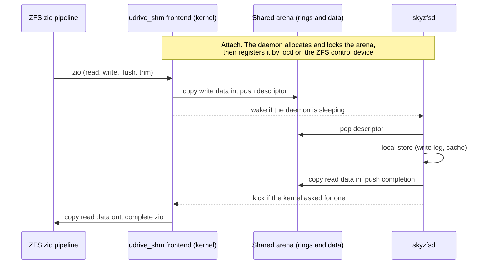
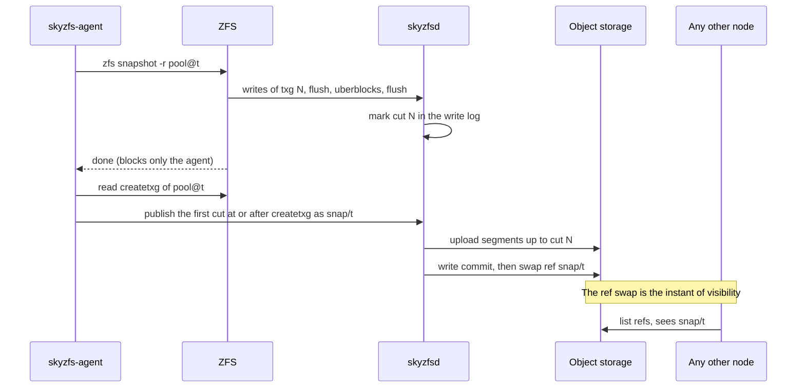
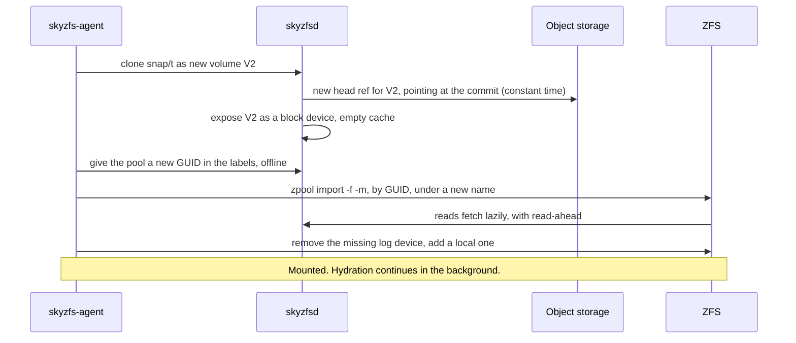
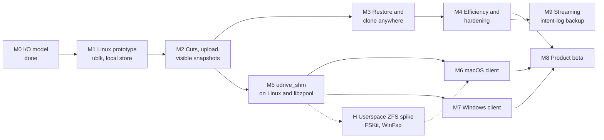

# SkyZFS: Architecture and Roadmap

| | |
|---|---|
| Status | Draft. Decisions of 2026-11-10 recorded in §10.1. M1 is in progress: the contract of §4.1 is merged as an executable model with a conformance suite (`crates/skyzfs-blk`), and so is the power-cut replay rig that M1's exit criterion rests on, so far run against the ublk project's reference server (`tests/kernel/replay-rig.sh`) |
| Date | 2026-11-10 |
| Supersedes | The dm-thin node stack of `skynbd_design.md` and `skynbd-origin-advance-design.md`, for this repository. The object formats, refs and commit protocol carry over. |
| Evidence | `skynbd-postgres-study.md` §10 |

## 1. Context

SkyNBD keeps a volume in object storage and gives each node a local copy-on-write stack built from dm-thin and dm-cache. That stack works, but it is Linux-only, it amplifies PostgreSQL's writes, and every snapshot costs the workload throughput for as long as chunks are being copied.

The product goal has also widened. The target is easy, consistent data protection for individuals and small businesses, across clouds and vendors, with **native clients on Linux, macOS and Windows**. The core promise is unchanged: cheap snapshots every minute, keep the last *n*, and restore any of them instantly on any machine.

This document proposes replacing the node stack with OpenZFS on a block device served by a node-local Rust daemon, and lays out the path from a Linux prototype to clients on all three systems.

### 1.1 What the I/O study established

The topology benchmark modelled ZFS on a userspace block backend and compared it with the dm-thin two-volume split (`twovol`) on one machine, on equal backing and equal memory[^study].

| Question | Result |
|---|---|
| Throughput with the working set on local flash, no snapshots | Level. zfs-slog ran at 0.85 to 1.14 of twovol at 8 clients (median 1.04), and was ahead on five of six machines at 1 and at 32 clients. |
| Throughput with a snapshot every minute | zfs-slog ran 1.26 to 1.60 times twovol. A thin snapshot cost twovol 16 to 24% of its throughput. `zfs snapshot` cost nothing. |
| Latency with a snapshot every minute | p99 6.8 to 9.2 ms against 10.5 to 13.7 ms. Slowest transaction under 0.2 s against 1.5 to 4.1 s. |
| Flash writes | 37 to 75% of twovol's. |
| Cold origin at 10 ms | ZFS is bound by page reads. It needs a backend read cache with read-ahead, which the model did not have. |

The study also produced three rules that this design adopts: the log device must be allocated storage, dirty data must be capped to fit the pool's free space and the ARC, and the uploader must know what ZFS has freed.

## 2. Goals and non-goals

### 2.1 Goals

1. **One engine, three operating systems.** The Rust daemon and the object formats are identical on Linux, macOS and Windows. Only the last hop into the kernel differs.
2. **Snapshots that cost the workload nothing**, taken every minute, with no filesystem freeze.
3. **A snapshot is visible everywhere at one instant**: when its data is in object storage and one ref has been swapped.
4. **Instant restore and clone on any node and any supported OS**, reading lazily from object storage.
5. **Pools portable between operating systems.** A snapshot taken on a Mac restores on Linux and on Windows.
6. **Vendor independence.** Any S3-compatible store first, then other object APIs, then more than one target at once.
7. **Stock ZFS on Linux.** No patched kernel module where the distribution already ships one.

### 2.2 Non-goals for this document

- Multi-writer access to one volume.
- Application-consistent snapshots (VSS writers, database quiesce hooks). ZFS snapshots are atomic across the pool, which is crash consistency for every dataset at once.
- zvols carrying NTFS or APFS. Clients expose ZFS datasets (decision D1, §10.1).
- Kubernetes integration. `skynbd-csi-design.md` will need its own revision once M3 lands.
- Client user interface design.

## 3. Architecture

The design has four layers.

| Layer | Role | Portability |
|---|---|---|
| ZFS | Filesystem, snapshots, compression, checksums, encryption | OpenZFS on Linux upstream. macOS and Windows from their ports. |
| Transport | Carries block I/O from the kernel to the daemon | Per OS. ublk on Linux, `udrive_shm` elsewhere. |
| Block target contract | The semantics every transport must provide | One definition, one conformance suite. |
| Engine and local store | Write log, cache, cuts, upload, refs, garbage collection | One Rust codebase. |

The frontend is called `udrive_shm`: a userspace-served drive over shared memory. Two earlier names were dropped because each sat too close to an unrelated part of Linux: `udev_shm` (the device manager `udev`) and `udisk_shm` (the disk-management daemon `udisks`). The name says drive where the kernels say disk; it means the same object, a whole block device.

### 3.1 What carries over from SkyNBD

| Existing crate | Fate |
|---|---|
| `skynbd-types`, `-format`, `-tree`, `-store`, `-refs` | Kept. Extents, COW shard trees, commits, object keys and ref CAS are unchanged. |
| `skynbd-engine` | Kept and extended with the local store. Today a flush acknowledges only after upload and a ref swap[^d1]. ZFS flushes many times a second, so a flush must become local. |
| `skynbd-nbd` | Kept as a third transport: a fallback for Linux kernels without ublk, and a remote read-only export. |
| `skynbd-agent` | The dm-thin orchestration is replaced by ZFS orchestration. The capture state machine, watchdog and crash matrix tests are the model for the new agent. |
| `skynbd-api`, `skynbdctl` | Kept, with snapshot publish reshaped around cuts (§5.2). |

New code: `skyzfs-blk` (contract and conformance suite), `skyzfs-ublk`, `skyzfs-shm` (user side of the shared-memory transport), `skyzfs-local` (write log and cache), the `skyzfsd` binary, and `kmod/udrive_shm` (the C frontend and its per-OS glue, kept as patches against the two ports).

## 4. The block target

### 4.1 Contract

Every transport delivers the same operations to the daemon and must honour the same rules. The rules are written from what the daemon can observe, so that one reference model can express them and one suite can test them. This section was tightened after an independent review of the first draft (§10.2).

**Parameters.** A target reports these when it is opened, and they do not change while it is open:

| Parameter | Value |
|---|---|
| Size | Fixed, a multiple of 1 MiB |
| Logical and physical block size | 4096 bytes. Every offset and length is a multiple of it |
| Largest read or write | 1 MiB. A transport splits anything larger |
| Requests in flight | A stated bound. The transport holds the rest |
| Discard and write_zeroes | Any aligned range inside the device |
| Volatile write cache | Yes: flushes are meaningful and must be delivered |
| Forced-unit-access writes | Not advertised. ZFS does not send them. A transport that delivers one treats it as a write followed by a flush |
| Discard | Supported |
| Read-only | Set for an export that must never change, such as a remote read-only export over NBD (§3.1). Browsing a snapshot does not use it (§5.4) |

**Content.** A volume has a base: empty, which reads as zeros, or a commit, for a clone or a restore. The content of a 4 KiB block is what the last operation covering it in the daemon's order left there, or else the base.

| Operation | Rule |
|---|---|
| `read` | Returns the content of each block. |
| `write` | Replaces the content. |
| `write_zeroes` | A write of zeros, with a write's ordering and durability. It need not store data, but on a clone it must hide the base: it is a recorded zero extent, not an absence. |
| `discard` | The content of each block becomes unspecified until the next write to it: the content just before the discard, zeros or the base, possibly differing between reads, never bytes from another offset or volume. A crash may forget a discard. A discard is never applied to data written after it. |
| `flush` | Completes only when every operation acknowledged on the volume before the daemon received the flush is durable against power loss. That includes operations an earlier instance of the daemon acknowledged. It need not cover or wait for operations still in flight. It never waits for upload. |

**Order.** The daemon applies writes, write_zeroes and discards in one total order, which is the order of the write log, and applies each of them whole. An operation submitted after another was acknowledged follows it in that order. Two overlapping operations that are both in flight may be ordered either way round. The later one then wins on every block they share, and it is the same one in memory, in the log, after replay and in every cut.

Reads are not in the log. A read received after an operation was acknowledged observes it. A read that overlaps an operation still in flight sees, for each block, the content before it or after it.

**Two kinds of failure.** They promise different things, and treating them as one corrupts a pool. The daemon cannot tell which one it is recovering from, so recovery is one procedure: every start replays the longest valid prefix of the write log and makes it durable before it serves the first request. A second crash then cannot take back what the first recovery exposed, and a flush received by the new instance covers what the old one acknowledged.

- **The daemon is lost and the kernel carries on.** ZFS never restarted, so nothing it was told is done may be undone. An operation is therefore acknowledged only once it would survive the daemon process: appended whole to the write log, though not necessarily flushed to the device. The longest valid prefix then contains every acknowledged operation. Requests that were not acknowledged are issued again. They may arrive in any order, and may include ones the lost daemon had already applied, so all five operations are idempotent. A reissued request carries nothing that ties it to its first delivery, so it is a new operation in the order, and one the lost daemon had applied is in the order twice. This shows only where two overlapping operations were in flight at the loss, which ZFS does not do.
- **Power is lost.** The recovered volume is a prefix of the daemon's order that includes at least what every completed flush covered. Every operation in it is whole: none is torn. Blocks that no lost operation touched are unchanged.

**Errors.**

- A request that is misaligned, empty or beyond the end is rejected and has no effect.
- A flush or a discard is never answered "not supported". ZFS would stop issuing it for good[^zfserr].
- A flush is never failed for a condition that can recover. It is held.
- If the write log has failed for good, the volume has **failed**: no flush the daemon receives from then on succeeds, and from the first failure the daemon reports, **every later request fails**, reads included. A request already in flight when the log fails may still complete either way. A flush among them succeeds only if its work was done before the failure. Every completed flush stays a promise on a failed volume, whichever side of the failure it completed on: when the volume is next opened for a new client, after a power cut or a repair, it holds at least what each of them covered. Later operations may or may not be there, and nothing else about a failed volume's content is promised. ZFS ignores the result of the flushes on either side of its uberblocks[^zfserr], so it is the next write that has to fail, and the content of a block whose log record was lost is unknown, so a read of it must not return something older.
- A failed volume stays failed across a daemon restart for as long as its client stays attached. A new instance must never serve a shorter log to a ZFS that was told more. How the daemon remembers this when the log itself is what failed is part of M1.2. The simplest form is to give up the attachment so that it cannot be recovered. A failed volume answers as a device that is gone (`ENXIO`, where the transport can choose the error), because that is the error on which ZFS suspends the pool and does not pass a read failure to an application[^readerr].
- A read that needs object storage that cannot be reached is **held until the storage answers**. It is not failed after a timeout. ZFS hands an ordinary read error straight to the application and counts it against the pool, and suspends the pool only when the device itself is gone[^readerr]. A network outage must not become application errors, so the daemon waits and reports the stall through its own status and alerts. ZFS reports it too, as a slow I/O. A held read of pool metadata can stall the open transaction group until storage returns, which is the same wait. Giving up is the administrator's decision: detaching the volume fails every request as a device that is gone, and `failmode=wait` then suspends the pool.
- On a read-only target, writes, write_zeroes and discards fail and a flush succeeds.

**Clients.** A kernel transport is one kind of client. The agent's own tools are another: reading labels to build an import, and rewriting a clone's GUID (§5.4). They use the same contract through a library interface in the daemon, exclusive with a kernel attachment to the same volume. No device node is needed for them, which matters on macOS and Windows, where there is none.

A conformance suite in `skyzfs-blk` exercises these rules against any implementation with a reference model. It distinguishes the two failures: after daemon loss every acknowledged operation is readable, and after power loss only flushed ones are guaranteed. Passing it is the entry condition for every transport and for the local store.

Two deployment rules are outside the suite and are covered by a stress test in the kernel rig: the daemon locks its memory, and it keeps its own files off any pool it serves. A daemon that page-faults onto its own pool deadlocks the machine.

### 4.2 Linux: ublk

ublk is the in-kernel userspace block driver, driven by io_uring passthrough commands[^ublk]. The daemon fetches requests per queue, copies data to or from its own buffers, and commits results. The kernel presents an ordinary block device, so ZFS uses its normal disk vdev and nothing in ZFS is patched.

- **Recovery.** ublk's user-recovery mode lets a restarted daemon take the device over[^ublk]. The contract needs the variant that reissues in-flight requests, not the one that fails them. With the failing variant ZFS sees I/O errors on its only vdev and has to retry them.
- **Flushes must reach the daemon.** The device advertises a volatile write cache and a 4096-byte logical block. Without the first the block layer completes flushes itself, and there would be no durability and no cuts.
- **One zio is not one request.** The kernel splits and merges to the advertised limits.
- **Held requests.** A read may be held for as long as object storage is unreachable (§4.1). That the kernel lets a ublk device hold a request for minutes without timing it out is to be pinned by the kernel rig in M3.
- **Labels at byte 0.** `zpool create` partitions only what it recognises as a whole disk, and its device table does not list ublk[^wholedisk], so the pool's labels sit at the start of the device, as they do through `udrive_shm`. CI pins this (§6.2).
- **Copies.** One copy per request to start with. The zero-copy modes are a later optimisation and are not needed to meet the study's numbers, which included a comparable per-request cost in dm-snapshot.
- **Kernels.** ublk was merged in Linux 6.0. Feature flags and their kernel versions must be pinned during M1 against the kernel documentation, not from memory.
- **Evidence so far.** A probe on GitHub's Ubuntu 24.04 and 26.04 runner images (kernel 7.0, ZFS module 2.4.1) put a pool on a ublk device served by the ublk project's reference server, not by `skyzfsd`[^probe]. On both images the pool was on the bare device with its first label at byte 0, and flush requests reached the ublk queue during `zpool sync`. The server was then killed with `kill -9` five times per image, each time with writes in flight. With reissue on recovery no application write failed, no error was counted on the vdev, and the pool scrubbed clean. Without reissue every kill left two write errors on the vdev, although the pool stayed online and no application write failed. That is one kernel line and a handful of runs. Older kernels are untested. In four paired comparisons on three machines the same pool ran on ublk at 0.94 to 1.09 of its throughput on a kernel loop device, one run per cell. Two of the machines drifted during their sequence by more than half of that spread. The data supports "between nothing and about 6%" for the hop and nothing finer, which is the first input to gate G1. A second rig records every write below the pool and checks the pool at each record prefix of that record, again on the reference server[^replay]. In four complete runs on one kernel, with 3,160 to 3,439 prefixes each, the pool imported and every file promised by the last completed sync was intact at every prefix checked, and a scrub was clean at every flush boundary. The same runs show the limit of that check: when one write among several in a transaction group that carry the same bytes is applied late, nothing fails. The likely reason, not yet verified, is that these are copies of pool metadata and the checks read another copy. Until a check reads every copy, the rig proves that the pool imports and that promised files are intact at every prefix, and not that every block a transaction group references is on the device when its uberblock is.
- **Fallback.** Where ublk is missing, the existing NBD server on a local socket is the transport.

### 4.3 macOS and Windows: `udrive_shm`

Neither system has an equivalent of ublk. Both have an OpenZFS port that the user must install in any case, and both ports are active and close to upstream: on 2026-11-10 the macOS port was at 2.4.3-rc3 and the Windows port at 2.4.4-rc3[^ports]. The proposal is a small frontend inside each port that hands zios to the daemon through shared memory.

**It is feasible. The frontend must not be a new vdev type.** Two facts from the port sources decide this:

1. The vdev type table is a static array in common code[^vdevtable]. A new type means patching it in every port.
2. The leaf's type string is stored in the labels and in the pool's own configuration. A ZFS that does not know the type rejects the configuration, and a file vdev refuses anything that is not a regular file[^vdevfile].

A pool created on a Mac must import on stock Linux, where the leaf is a disk at `/dev/ublkbN`. So the leaf must be of type `disk` on every system, and the frontend must sit **below** the disk vdev, selected by the device path.

| Port | Hook | Why it fits |
|---|---|---|
| macOS | A third provider in the port's layered-driver interface, next to its IOKit and vnode providers[^ldi]. | The disk vdev already opens by name and calls `ldi_strategy` and `ldi_ioctl`. A provider for paths of the form `user:<name>` needs no change to the vdev. |
| Windows | A dispatch on the path prefix at the top of the disk vdev's open, start and close. | The Windows disk vdev opens an NT path and builds IRPs[^winvdev]. A `user:<name>` path takes the shared-memory route in its place. |

The I/O path, common to both:

Design points:

- **The daemon owns the memory.** It allocates a page-aligned arena, locks it, and passes its address in the attach ioctl. The kernel wires and maps it. Each OS needs only two primitives: wire user pages, and sleep and wake. No Mach ports, section objects or new device nodes.
- **The control path is the port's existing control device.** `/dev/zfs` on macOS and the ZFS device on Windows already take ioctls from an administrator. Attach, wait and kick are three more.
- **Two single-producer rings and a data area.** Descriptors are fixed-size: request id, operation, offset, length, data offset in the arena, priority, and the transaction group as a hint. Completions carry an id and a status.
- **One copy each way**, in and out of the arena. The vdev queue above the frontend still bounds concurrency and aggregates adjacent I/O, so a ring depth of a few hundred is enough.
- **The kernel never trusts the arena.** Every descriptor field is copied out and validated before use. The daemon is privileged, but a corrupt daemon must not corrupt the kernel.
- **Daemon loss.** When the daemon's handle closes, the provider holds new and in-flight zios. A daemon that re-attaches under the same name within a timeout gets the in-flight requests again. Request ids carry an attach generation, so a completion from before the loss cannot complete a reissued request. Past the timeout every request fails, as a device that is gone, and keeps failing until the daemon is back, so that a flush error ZFS ignores cannot be followed by an uberblock write that succeeds (§4.1). ZFS's `failmode=wait` then suspends the pool until it is cleared. This reuses ZFS's own handling of a vanished disk.
- **A full data area makes the frontend wait**, holding nothing that memory reclaim needs. The area is sized for the largest request times the ring depth.
- **The frontend splits a zio larger than the largest request.** ZFS aggregates up to a tunable limit of 16 MiB, and a pool created elsewhere may hold records larger than 1 MiB.
- **The transaction group in the descriptor is a hint for diagnostics only.** Cuts are detected the same way on every transport (§5.2), so that one tested rule covers them all.
- **Bring-up shortcut.** Before the shared arena exists, the same descriptors can travel inside the wait and kick ioctls with the data copied by the kernel. That is slower and proves everything else.

**Size.** The common C code is a ring, an allocator for the data area, the lifecycle state machine and the vdev-facing calls. Per-OS glue is page wiring, the ioctl entries and the hook above. The estimate is 1,500 to 2,500 lines across both ports, plus tests. It is small in lines. It is not small in responsibility: it runs in the kernel, it must never deadlock against memory reclaim, and it must be rebased as the ports follow upstream.

**Why develop it on Linux first.** The common code can be compiled into userspace `libzpool`, where `ztest` can hammer it against the real daemon with no kernel in the loop, and into a patched Linux module in CI. The protocol is then proven before the first macOS or Windows build (M5).

## 5. Engine and local store

### 5.1 Local store

The daemon keeps two things on local flash.

- **Write log.** Append-only and preallocated. A flush is one write and one device flush that returns only when the data is persistent. On macOS that is `F_FULLFSYNC`, and on Windows `FlushFileBuffers`. Their cost sets commit latency and must be measured (§10). macOS's cheaper `F_BARRIERFSYNC` cannot implement the contract's flush: it orders writes but promises nothing about what is persistent when it returns[^barrier]. A mode built on it would keep the pool consistent after a power cut and could lose flushes that had completed. That is a different durability class, offered by name if at all, and never a faster implementation of the same contract.
- **Block cache.** Everything written and everything fetched, with read-ahead around a miss. The study's cold-origin result is entirely a statement about this cache.

Two policies cover the two kinds of machine.

| Policy | Local flash holds | For |
|---|---|---|
| `complete` | The whole volume. Nothing is evicted. | Desktops and laptops. The machine works offline and object storage is the protected copy. |
| `cache` | The working set. Clean, uploaded blocks may be evicted. | Servers, and any node that has just restored a volume. |

A restore always starts in `cache` and can be promoted to `complete` by hydrating in the background.

### 5.2 Cuts and snapshot visibility

ZFS writes a transaction group, flushes, writes the uberblocks, and flushes again[^txgorder]. The daemon recognises the uberblock writes by their position in the labels and reads the transaction group *N* from them.

A **cut** is a position in the write log: the end of the log at the moment the daemon receives the first flush after it has acknowledged an uberblock write for *N*. The log up to that position is a complete pool at *N*, whatever else was in flight, for two reasons[^cutproof]:

- Every block of *N* was acknowledged before ZFS submitted the first uberblock write, so the order rule (§4.1) puts it earlier in the log. The argument does not use ZFS's flush before the uberblocks, so it holds even where that flush is skipped or its error ignored.
- Nothing that uberblock *N* can reach is overwritten or discarded before the cut. Blocks freed in *N* become allocatable, and are trimmed, only after ZFS has finished writing *N*'s uberblocks and the flush that follows them. On a nearly full pool that protection covers *N* alone and not *N*−1, which is all a cut needs.

Other writes do land before a cut: blocks of the next transaction group, intent-log blocks that fell back to the main device, repairs. Within a group ZFS also rewrites, in place, blocks it allocated earlier in the same group, as its sync passes converge. Those rewrites all precede the uberblock. They add blocks that *N* does not reference, and nothing else. They can also make the first flush after the uberblock write a stray one, which the definition allows: one copy of the uberblock is enough to import at *N*.

Three details make the rule exact:

- **What counts as an uberblock write.** A write to an uberblock slot that carries the uberblock magic and a transaction group above zero. ZFS fills every slot with transaction group 0 when it creates a pool.
- **What counts as a repeat.** An uberblock whose transaction group and root block pointer both equal the previous one's makes no new cut. *N* alone does not identify a pool state: after a rewind import some versions write a different pool state under a number already used. A cut is identified by its log position, with *N* recorded beside it.
- **When a cut may be published.** Only once the log is durable up to its position. ZFS also ignores the result of the flush after the uberblocks[^zfserr], so it can believe *N* is safe on a volume that has just failed.

- **No freeze, no pause.** Applications keep writing throughout. The study measured no cost.
- **Atomic visibility.** A snapshot does not exist for other nodes until one compare-and-swap on the ref. A crash before it leaves no trace, and the existing commit protocol and its crash matrix apply unchanged.
- **Retention** is ref deletion plus `zfs destroy` locally. Garbage collection reclaims what no ref reaches.
- **Recovery point.** Between published snapshots the newest cut in object storage is the recovery point. With a local log device, a cut holds the last synced transaction group and not the fsynced tail (§6.1). That is accepted through M4 (decision D2). §5.5 sketches how the tail is recovered later.

### 5.3 What is uploaded

Most of what ZFS writes is dead within a minute: in the study 2 to 6 MB per thousand transactions was still live at the end of a window, against 12 to 19 MB written[^study]. A cut therefore uploads only blocks that are live **at the cut's position**:

- blocks overwritten before the cut are superseded in the extent tree,
- blocks ZFS freed before the cut arrive as discards, with `autotrim=on`, and are dropped,
- intent-log blocks normally do not reach the device, because the intent log is on a local log device. ZFS falls back to the main device when the log device is full or has failed, and `logbias=throughput` and direct I/O log their data there by design.

Nothing after the cut may leak into it. Upload can lag the cut by minutes on a slow uplink, and in that time ZFS reuses uberblock slots and trims blocks that were live at the cut. The local store therefore keeps the cut-time version of every block until the cut is uploaded or abandoned. The engine's copy-on-write extent tree gives a cut its own root. The store must not reclaim what that root references.

### 5.4 Restore and clone

- **A new GUID before import.** ZFS refuses a pool whose GUID is already imported[^guid], and a clone must be importable on the node that still holds the original. `zpool reguid` only works on an imported pool, so the agent changes the GUID offline with `libzpool`. That is a real transaction: it writes labels and uberblocks, which the daemon sees as a cut on the new volume.
- **Labels are read through the daemon.** `zpool import` normally scans device nodes from user space. The agent builds the import configuration from labels it reads through the daemon's client interface (§4.1), which also works where there is no device node.
- **`-f` and `-m`.** The cut is of a pool that was imported elsewhere, and its log device is not in the cut.
- **Read-only browsing.** On the node that holds the pool, a snapshot is browsed through ZFS's own `.zfs/snapshot` directory, with no import at all. Anywhere else, browsing is a throwaway clone: the daemon serves the commit under a local overlay that is never uploaded, the agent gives the pool a new GUID as above, and the pool is imported with `readonly=on`, which skips log replay. The new GUID is needed even though nothing will be written. ZFS refuses any kernel import whose pool GUID is already open, read-only or not[^guid]. Without it a node could not browse a snapshot of a pool it has imported, or two snapshots of one pool at once.

### 5.5 Later: streaming the intent log

Through M4 a node loss costs everything since the newest uploaded cut. A reboot or a daemon crash costs nothing, because the log device is local and survives both. A later milestone (M9) closes the gap for tiers that need it, by shipping the intent log off the node continuously.

The sketch, to be designed in its own document before M9 starts:

- **The log device moves onto the daemon** as a second block target. Its writes go to the same local write log as the data vdev's, in one order.
- **The daemon uploads that ordered log as it is written**, as short-lived tail objects, in addition to the cuts.
- **A restore point is then any flush boundary in the stream.** Both devices as of one flush are exactly what a power cut would have left. ZFS imports that image and replays the intent log, which recovers every transaction fsynced before that point.
- **Tail objects are garbage once a later cut is published**, so they cost upload bandwidth but little storage.

Why both devices must come from the same point: the pool at a cut points at the start of a log chain, and ZFS frees and reuses log blocks once their transaction group has synced. A log device image taken much later than the cut no longer holds that chain, and replay would stop at the first block that does not belong. Pairing a cut with an arbitrary later log image is therefore not safe. Restoring both to one flush boundary is.

Open for that design: how much the stream adds to upload volume (intent-log blocks were three quarters of device writes without a separate log[^study]), whether a flush may wait for the stream to bound the loss to zero, and how the stream is throttled on a slow uplink.

## 6. The ZFS layer

### 6.1 Pool layout

One pool per protected volume: one data vdev on the transport, and one log device on local flash.

- **The log device is allocated storage.** A partition, or a file written through once. On a sparse file a lone commit took up to 2.4 times as long[^study].
- **The log device is local on purpose.** It keeps the intent log out of the upload stream. The price is that a node loss drops what was fsynced since the newest uploaded cut. That fits a product whose promise is minute-level snapshots, it is accepted through M4 (decision D2), and it must be stated to users. M9 removes it for the tiers that need more (§5.5).

### 6.2 Portability rules

A pool must import on all three systems, so pools are created the same way everywhere.

| Rule | Reason |
|---|---|
| `compatibility=` pinned to one published feature set, the oldest of the three ports' | The ports track upstream at different speeds. |
| Leaf vdev of type `disk` | §4.3. |
| No partition table: the pool's first label is at byte 0 of the device | Cut detection finds the labels by position, and the layout must be the same on every system. |
| `ashift=12` | One block size for every transport. |
| `multihost=off` | It rewrites uberblocks outside a sync. |
| `xattr`, `normalization`, `casesensitivity` and `acltype` set explicitly at creation, to one set of values for all three systems | Most cannot change later, and the defaults differ between the systems. |
| ZFS native encryption on by default | The object store, and the vendor, see ciphertext. Keys stay with the user. |

File semantics do not port perfectly. ACL models, extended attributes and case rules differ between the three systems. The promise for a cross-OS restore is "your files and their contents", not every attribute. Same-OS restore is exact.

### 6.3 Sizing dirty data

ZFS's defaults assume a large pool and an uncapped ARC. A pool per volume is often small, and the study found two cliffs where writers wait out a whole sync[^study]:

- dirty data times 24 (`spa_asize_inflation`) must fit in the pool's free space,
- dirty data must stay under half the ARC.

`zfs_dirty_data_max` defaults to 10% of RAM regardless of either, and is one value for the whole module. The agent therefore sets it from the smallest pool and the ARC cap on the machine. Smaller transaction groups cost flash writes, 27% more in the one configuration measured, so the value is a trade to tune in M4 and not a constant.

## 7. Platform matrix

| | Linux | macOS | Windows |
|---|---|---|---|
| ZFS | Distribution packages, unpatched | OpenZFS on OS X port, patched with the frontend | OpenZFS on Windows port, patched with the frontend |
| Transport | ublk. NBD as fallback | `udrive_shm` under the LDI | `udrive_shm` under the disk vdev |
| Kernel code we ship | None | The ZFS kext with our patch | The ZFS driver with our patch |
| Install barrier | A package | Apple silicon: the user must lower the security policy to Reduced Security in Recovery and approve the extension[^applekext] | A signed driver. Microsoft requires an EV certificate and attestation signing through the Hardware Dev Center[^winsign] |
| Daemon | systemd service, io_uring | launchd daemon | Windows service |

**The macOS barrier is the largest risk in this design.** Apple discourages kernel extensions and is moving filesystems to user space with FSKit[^applekext][^fskit]. A ZFS kext needs the reduced-security step whatever we add to it, so the frontend adds no new barrier, but the barrier is real for the audience this product targets. §8 and the roadmap carry a hedge.

## 8. Alternatives considered

| Alternative | Verdict |
|---|---|
| **A new vdev type** talking to the daemon | Rejected. Breaks import on stock ZFS (§4.3). |
| **A generic userspace block device per OS**, with the ports unpatched: DriverKit on macOS, WNBD or WinSpd on Windows[^wnbd] | Kept as the fallback for M6 and M7. It avoids carrying patches, and the device would serve other filesystems too. It adds a second kernel component to install and sign, puts a SCSI or block layer between ZFS and the daemon, and on macOS depends on an Apple entitlement that has not been investigated yet. |
| **A Linux VM on the Mac or PC** running the Linux stack, with files shared to the host | Rejected as the product, kept as a test vehicle. One kernel codebase and no extensions, but the files are not native to the host. |
| **ZFS in user space** behind FSKit on macOS and WinFsp on Windows, with the vdev in the daemon's own process | The hedge. No kernel code at all, and the block target contract already allows an in-process transport. It needs the ZFS POSIX layer outside the kernel, which upstream does not provide. Spiked in parallel with M5, decided at gate G4. |
| **Stay on dm-thin** | Rejected for this product. Linux only, and the snapshot cost is structural. |
| **An object-store vdev inside ZFS**, as Delphix presented in 2021[^delphix] | Not available upstream. Worth reading for its agent protocol and restart handling before M5. It ties the pool format to the object store, where this design keeps ZFS unmodified above a block contract. |

## 9. Roadmap

Sizes are relative: S is weeks, M is one to two months, L is a quarter, for a small team. They are estimates to be replaced after M1.

| Milestone | Size | Deliverables | Exit criteria |
|---|---|---|---|
| **M0** I/O model | Done | Topology benchmark, study §10 | Throughput level with twovol. Snapshots free. |
| **M1** Linux prototype | M | `skyzfs-blk` with the conformance suite. ublk transport. Local store with write log and cache, no upload. `skyzfsd` serving one volume. | Pool creates, scrubs clean, and survives `kill -9` of the daemon under load. Power-cut replay: the pool imports at every record prefix of the log, not only at flush boundaries, and at sampled prefixes every block the newest uberblock reaches is present in every copy. An import alone does not show that: ZFS keeps two or three copies of pool metadata and reads a good one. tpcb within 10% of the benchmark model on the same machine. |
| **M2** Cuts and visibility | M | Uberblock detection, cuts, background upload, commit and ref swap, publish handshake in the agent. | A snapshot on node A is listed on node B once its ref is swapped, and imports read-only there with a clean scrub. A snapshot every minute changes p99.9 by no more than run-to-run noise. The crash matrix passes at every step of publish. |
| **M3** Restore and clone | M | Lazy fetch with read-ahead, clone from a ref, offline GUID rewrite, import flow, throwaway clones for browsing, background hydration, both cache policies. | A restored volume mounts in under 30 s whatever its size. At a 10 ms origin tpcb reaches half its hydrated throughput within 5 minutes. A clone imports on the node that holds the original. Ten minutes without object storage, under load with the `cache` policy, produce no application error and no pool error, and work resumes when storage returns. |
| **M4** Efficiency and hardening | L | Discard tracking, live-only upload, garbage collection and retention, encryption by default, dirty-data sizing in the agent, second object API, many pools on one node, metrics. | Bytes uploaded per cut within 1.5 times the live bytes ZFS reports. Seven-day soak with a snapshot every minute and no leak in store or log. Twenty pools on one node without a stalled second. |
| **M5** `udrive_shm` | M | Protocol specification. `skyzfs-shm`. Common C frontend built into `libzpool` and into a patched Linux module. | The conformance suite passes on ublk and on `udrive_shm`. `ztest` runs 24 h against the daemon. Daemon restart recovery works. tpcb within 10% of ublk. |
| **M6** macOS client, alpha | L | LDI provider in the port. Daemon on launchd. Local log and cache on APFS. Installer with the extension approval flow. Keychain for keys. | Mac snapshot restores on Linux and Linux snapshot restores on the Mac, verified by checksum. Survives sleep and wake, network loss and daemon restart. Commit latency measured with `F_FULLFSYNC`, and with `F_BARRIERFSYNC` only to price the weaker class of §5.1. |
| **M7** Windows client, alpha | L | Path dispatch in the port's disk vdev. Daemon as a service. Signed driver. | The same cross-OS restore pairs with Windows. Loads with memory integrity enabled. |
| **M8** Product beta | L | Client UI, snapshot browser, policies, two object-store targets at once, fleet view for small businesses, security review. | External beta users restore without help. |
| **M9** Streaming intent-log backup | M | Design document. Log device served by the daemon. Ordered tail upload. Restore to any flush boundary with log replay. | A node killed at a random moment under pgbench restores with every transaction that was acknowledged more than a stated lag before the kill, checked against the client's own record. The lag bound is a number in the design document. |
| **H** Userspace ZFS spike | S | A read-only pool served through FSKit from a process that links `libzpool`. | A written go or no-go for a kernel-free client. |

Decision gates:

| Gate | After | Question |
|---|---|---|
| G1 | M1 | Does ublk with one copy meet the model's numbers? If not, adopt the zero-copy modes before M2. |
| G2 | M3 | Is cold restore good enough for the server case? If not, the read cache gets a milestone of its own before M4. |
| G3 | M5 | Carry patches on the two ports, or switch M6 and M7 to a generic block device? Decided by the measured size and rebase cost of the frontend. |
| G5 | M6 and M7 in alpha | Is the frontend stable enough to offer to the port maintainers (decision D3)? |
| G4 | Before M6 leaves alpha | Is a kernel extension still acceptable on current macOS for this audience? If not, the macOS client follows the userspace path from H. |

## 10. Risks and open questions

| Risk | Consequence | Mitigation |
|---|---|---|
| Apple removes or further restricts kernel extensions | No native macOS client on this design | Hedge H and gate G4. The engine and contract do not depend on the transport. |
| Rebase cost of patches on two ports that follow upstream | Ongoing maintenance, carried alone until gate G5 | Keep the hook minimal and below the disk vdev. Rebase in CI against both ports' development branches from M5 on, so drift shows early. Gates G3 and G5. |
| Driver signing and distribution on Windows | Delay, and a dependency on Microsoft's process | Start the EV certificate and Hardware Dev Center account during M5. |
| Daemon and kernel deadlock under memory pressure | Hung machine | Locked memory, no allocation in the daemon's I/O path, daemon files off its own pools, a stress test in the kernel rig. |
| Flush cost on consumer SSDs, above all `F_FULLFSYNC` on macOS | Slow commits | Measure in M6. The log device is the only place that pays it per commit. Whether to offer an ordering-only class is a product decision taken on those numbers (§5.1). |
| Many small pools on one machine sharing one ARC and one dirty-data limit | Stalls from a noisy neighbour | Measured in M4. |
| One workload behind the evidence: pgbench, 1.5 GiB, very compressible, fresh pool | Results may not hold for large or aged pools | Add a database larger than RAM and an aged pool to the benchmark before M4 exits. |
| Licensing | The frontend lives in CDDL code. The daemon is FSL. | Publish the frontend under CDDL and the protocol header under a permissive licence. Needs legal review. |
| ZFS trims late: freed blocks reach the device as discards at least two transaction groups after the free, batched over 32 | A cut carries blocks ZFS already considers free, so uploads exceed the live bytes | Measure in M4 against its upload criterion. Options: a smaller `zfs_trim_txg_batch`, or a second source of liveness. |
| twovol's 2 s stalls in the benchmark are unexplained | The far-tail comparison may flatter ZFS without snapshots | Does not affect the snapshot result. Listed in the study as open. |

### 10.1 Decisions

Recorded 2026-11-10.

| # | Question | Decision |
|---|---|---|
| D1 | What does a Mac or Windows user see: a ZFS dataset, or a zvol formatted natively? | **Datasets.** Snapshots stay freeze-free and atomic across the pool. zvols remain a non-goal. |
| D2 | Is losing the fsynced tail on node loss acceptable? | **Yes for M1, and through M4.** The log device stays local. Streaming backup of the intent log comes later as M9 (§5.5). |
| D3 | Offer the frontend to the port maintainers from the start? | **No.** They are better served by a stable proof of concept that is likely to stick. The frontend is developed out of tree and offered at gate G5. |

### 10.2 Review record

| Date | Scope | Outcome |
|---|---|---|
| 2026-11-10 | §4.1, §5.2, §4.3 and §5.4, an independent read before any code | The first draft allowed a daemon that passed its tests and corrupted a pool, in two ways: it treated daemon loss as a power cut, and it left discards outside the write order. Both are fixed in §4.1, with an error model, limits, a crash model and a definition of a cut as a log position. §5.3 now keeps cut-time block versions. Left for CI to pin on the runners: flush delivery on ublk, the recovery flags, and where `zpool create` puts the labels. |
| 2026-11-10 | The revised §4.1, §5.2 and §5.3, a second independent read | The cut argument holds against concurrent writes, deferred frees and TRIM, checked in the source, and no longer leans on ZFS's flush before the uberblocks. Fixed: overlapping in-flight operations had been allowed to mix per block, which no log order can produce; a repeat uberblock was defined by transaction group alone, which could suppress a real cut after a rewind; flush coverage and the failed state were undefined across a daemon restart; reads had no place in the order. Not yet checked: the 2.4 port branches, only upstream master. |
| 2026-11-10 | The whole document, automated review on the design pull request (skyzfs/skyzfs#2) | Read-only browsing had been described as an import of the snapshot under its original GUID. ZFS refuses a second import of an open GUID even read-only, so browsing is now a throwaway clone with a new GUID, or `.zfs/snapshot` on the node that holds the pool (§5.4). The write log's flush on macOS had been given as `F_FULLFSYNC` or `F_BARRIERFSYNC`. The second does not persist, so it cannot meet §4.1 (§5.1). A read that could not reach object storage had been failed after a bound, on the assumption that `failmode=wait` would then suspend the pool. ZFS passes an ordinary read error to the application instead, so such reads are now held (§4.1). |

## References

[^study]: `docs/skynbd-postgres-study.md` §10, in particular §10.7 for the same-machine comparison, the dirty-data limits and the snapshot runs, and §10.3 for what reaches the vdev.
[^d1]: `docs/skynbd_design.md` §2, decision D1: flush-bounded durability with no local write-ahead log.
[^ublk]: Linux kernel documentation, "Userspace block device driver (ublk driver)", <https://docs.kernel.org/block/ublk.html>. Feature flags are defined in `include/uapi/linux/ublk_cmd.h`.
[^ports]: `openzfsonosx/openzfs-fork` and `openzfsonwindows/openzfs`, branch `development`, `META` files as cloned on 2026-11-10. Upstream `openzfs/zfs` carries `module/os/linux` and `module/os/freebsd` only.
[^vdevtable]: `module/zfs/vdev.c`, `vdev_ops_table`, identical in upstream and in both ports.
[^vdevfile]: `module/zfs/vdev.c`, `vdev_alloc`: an unknown type returns `EINVAL`. `module/zfs/vdev_file.c`, `vdev_file_open`: "Make sure it's a regular file".
[^ldi]: `openzfsonosx/openzfs-fork`, `module/os/macos/zfs/vdev_disk.c` and `include/os/macos/zfs/sys/ldi_impl_osx.h` (`LDI_TYPE_IOKIT`, `LDI_TYPE_VNODE`).
[^winvdev]: `openzfsonwindows/openzfs`, `module/os/windows/zfs/vdev_disk.c` (`ZwCreateFile`, `IoBuildAsynchronousFsdRequest`).
[^zfserr]: `module/zfs/zio.c`: a flush that returns `ENOTSUP` sets `vdev_nowritecache`, and `zio_flush` is issued with `ZIO_FLAG_DONT_PROPAGATE`. `module/zfs/vdev_label.c`: `vdev_config_sync` discards the result of the flush before the labels, and `vdev_uberblock_sync_list` that of the flush after the uberblocks. Read in upstream master on 2026-11-10. Observed once on ZFS 2.4.1 as packaged for Ubuntu 26.04: with a fault injected into every flush, `zpool sync` returned success, the pool stayed online with no errors counted, and ZFS went on issuing flushes[^probe].
[^probe]: Workflow `skyzfs-kernel-probe`, runs of 2026-11-10: <https://github.com/skyzfs/skyzfs/actions/runs/42923293696> and, for the repeated kills, <https://github.com/skyzfs/skyzfs/actions/runs/42925564790>. The probe is `tests/kernel/ublk-probe.sh` on the `zfs-topology` branch, and the benchmark rows are `zfs-ublk` and `zfs-loop` in `tests/bench/topology-bench.sh` (runs 42919169910, 42919174435 and 42924784572).
[^replay]: Workflow `skyzfs-replay-rig`, runs of 2026-11-11 on Ubuntu 26.04 (kernel 7.0, ZFS module 2.4.1): <https://github.com/skyzfs/skyzfs/actions/runs/42928531993>, <https://github.com/skyzfs/skyzfs/actions/runs/42932034365>, <https://github.com/skyzfs/skyzfs/actions/runs/42935788757> and <https://github.com/skyzfs/skyzfs/actions/runs/42939816010>. The rig is `tests/kernel/replay-rig.sh` with `tests/kernel/replay_check.py`; the fault it does not catch is its negative control `reorder`, recorded in the table `EXPECTED` there.
[^readerr]: `module/zfs/zio.c`, `zio_done`: a failed read is marked for suspension only when its error is `ENXIO`. Any other error on a zio issued with `ZIO_FLAG_CANFAIL`, which demand reads are (`module/zfs/dbuf.c`), is returned to the caller. `zio_vdev_io_assess` turns a leaf error into `ENXIO` only once the vdev is no longer accessible. Slow I/O is reported after `zfs_deadman_ziotime_ms` (`module/zfs/spa_misc.c`), and with the default `zfs_deadman_failmode=wait` it is only reported. Read in upstream master on 2026-11-10.
[^wholedisk]: `lib/libzutil/os/linux/zutil_device_path_os.c`, `zfs_dev_is_whole_disk`, and `lib/libefi/rdwr_efi.c`, `efi_get_info`: device names are matched against a fixed list.
[^cutproof]: `module/zfs/spa.c`, `spa_sync`; `module/zfs/vdev_label.c`, `vdev_config_sync` and `vdev_uberblock_sync_list`; `module/zfs/metaslab.c`, `metaslab_sync_done` (deferred frees and the trim tree); `module/zfs/zio.c`, `zio_alloc_zil` (the fallback of intent-log blocks to the main device). Read in upstream master on 2026-11-10. The macOS and Windows port branches are still to be checked.
[^txgorder]: `module/zfs/vdev_label.c`, `vdev_config_sync`: flush every written vdev, sync the even labels, write the uberblocks, flush, then sync the odd labels and flush.
[^guid]: `module/zfs/spa.c`, `spa_ld_parse_config`: an import fails with `EEXIST` when `spa_guid_exists` finds the pool GUID already open. In the kernel there is no exception for a read-only import. The only exception, for a read-only import of a checkpoint, is compiled for userland tools.
[^barrier]: Apple, `fcntl(2)`, `F_BARRIERFSYNC`: "no assumption should be made on what has been persisted or not when this call returns", and "typically useful to guarantee valid state on disk when ordering is a concern but durability is not". <https://github.com/apple-oss-distributions/xnu/blob/main/bsd/man/man2/fcntl.2>, read 2026-11-10.
[^applekext]: Apple Platform Security, "Securely extending the kernel in macOS", <https://support.apple.com/guide/security/sec8e454101b>, and "Change security settings on the startup disk of a Mac with Apple silicon", <https://support.apple.com/guide/mac-help/mchl768f7291>.
[^fskit]: Howard Oakley, "How macOS is moving away from kernel extensions", 2024, <https://eclecticlight.co/2024/07/24/how-macos-is-moving-away-from-kernel-extensions/>.
[^winsign]: Microsoft, "Driver code signing requirements", <https://learn.microsoft.com/windows-hardware/drivers/dashboard/code-signing-reqs>. To be re-read against the current page before M7.
[^wnbd]: WNBD, <https://github.com/ceph/wnbd>, and WinSpd, <https://github.com/winfsp/winspd>. Both present a userspace-served disk through a Storport virtual miniport.
[^delphix]: "ZFS on Object Storage", Wilson, Ahrens, Dagnelie and Joseph, OpenZFS Developer Summit 2021, <https://openzfs.org/wiki/OpenZFS_Developer_Summit_2021>.
