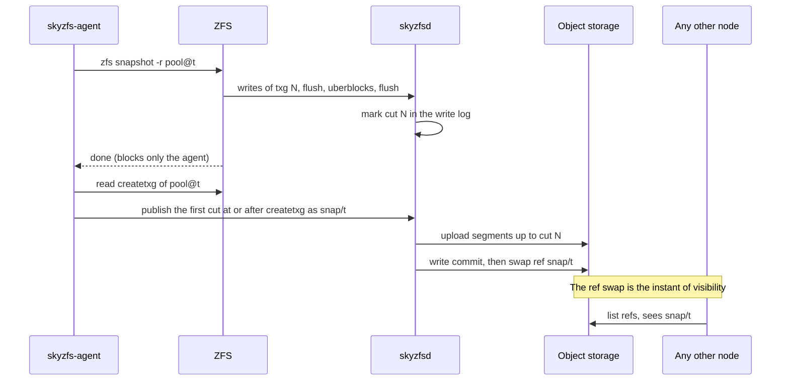
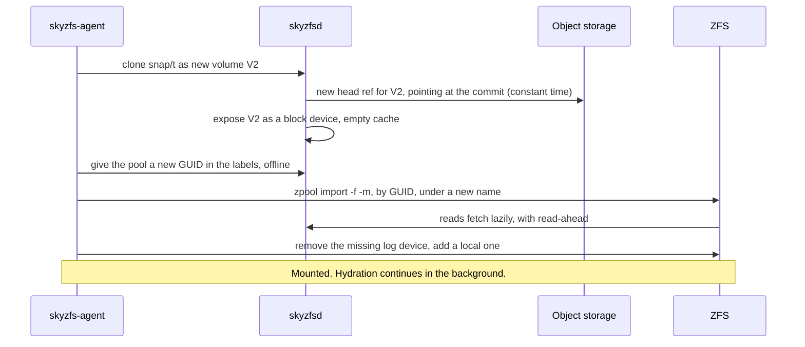
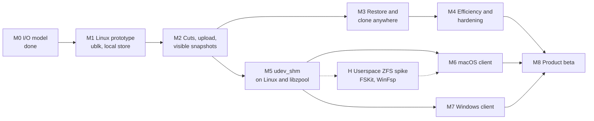

# SkyZFS: Architecture and Roadmap

| | |
|---|---|
| Status | Draft for review |
| Date | 2026-11-10 |
| Supersedes | The dm-thin node stack of `skynbd_design.md` and `skynbd-origin-advance-design.md`, for this repository. The object formats, refs and commit protocol carry over. |
| Evidence | `skynbd-postgres-study.md` §10 |

## 1. Context

SkyNBD keeps a volume in object storage and gives each node a local copy-on-write stack built from dm-thin and dm-cache. That stack works, but it is Linux-only, it amplifies PostgreSQL's writes, and every snapshot costs the workload throughput for as long as chunks are being copied.

The product goal has also widened. The target is easy, consistent data protection for individuals and small businesses, across clouds and vendors, with **native clients on Linux, macOS and Windows**. The core promise is unchanged: cheap snapshots every minute, keep the last *n*, and restore any of them instantly on any machine.

This document proposes replacing the node stack with OpenZFS on a block device served by a node-local Rust daemon, and lays out the path from a Linux prototype to clients on all three systems.

### 1.1 What the I/O study established

The topology benchmark modelled ZFS on a userspace block backend and compared it with the dm-thin two-volume split (`twovol`) on one machine, on equal backing and equal memory[^study].

| Question | Result |
|---|---|
| Throughput with the working set on local flash, no snapshots | Level. zfs-slog ran at 0.85 to 1.14 of twovol at 8 clients (median 1.04), and was ahead on five of six machines at 1 and at 32 clients. |
| Throughput with a snapshot every minute | zfs-slog ran 1.26 to 1.60 times twovol. A thin snapshot cost twovol 16 to 24% of its throughput. `zfs snapshot` cost nothing. |
| Latency with a snapshot every minute | p99 6.8 to 9.2 ms against 10.5 to 13.7 ms. Slowest transaction under 0.2 s against 1.5 to 4.1 s. |
| Flash writes | 37 to 75% of twovol's. |
| Cold origin at 10 ms | ZFS is bound by page reads. It needs a backend read cache with read-ahead, which the model did not have. |

The study also produced three rules that this design adopts: the log device must be allocated storage, dirty data must be capped to fit the pool's free space and the ARC, and the uploader must know what ZFS has freed.

## 2. Goals and non-goals

### 2.1 Goals

1. **One engine, three operating systems.** The Rust daemon and the object formats are identical on Linux, macOS and Windows. Only the last hop into the kernel differs.
2. **Snapshots that cost the workload nothing**, taken every minute, with no filesystem freeze.
3. **A snapshot is visible everywhere at one instant**: when its data is in object storage and one ref has been swapped.
4. **Instant restore and clone on any node and any supported OS**, reading lazily from object storage.
5. **Pools portable between operating systems.** A snapshot taken on a Mac restores on Linux and on Windows.
6. **Vendor independence.** Any S3-compatible store first, then other object APIs, then more than one target at once.
7. **Stock ZFS on Linux.** No patched kernel module where the distribution already ships one.

### 2.2 Non-goals for this document

- Multi-writer access to one volume.
- Application-consistent snapshots (VSS writers, database quiesce hooks). ZFS snapshots are atomic across the pool, which is crash consistency for every dataset at once.
- zvols carrying NTFS or APFS. The first clients expose ZFS datasets.
- Kubernetes integration. `skynbd-csi-design.md` will need its own revision once M3 lands.
- Client user interface design.

## 3. Architecture

The design has four layers.

| Layer | Role | Portability |
|---|---|---|
| ZFS | Filesystem, snapshots, compression, checksums, encryption | OpenZFS on Linux upstream. macOS and Windows from their ports. |
| Transport | Carries block I/O from the kernel to the daemon | Per OS. ublk on Linux, `udev_shm` elsewhere. |
| Block target contract | The semantics every transport must provide | One definition, one conformance suite. |
| Engine and local store | Write log, cache, cuts, upload, refs, garbage collection | One Rust codebase. |

`udev_shm` is a working name. Linux already has an unrelated `udev`, so the name should change before anything ships.

### 3.1 What carries over from SkyNBD

| Existing crate | Fate |
|---|---|
| `skynbd-types`, `-format`, `-tree`, `-store`, `-refs` | Kept. Extents, COW shard trees, commits, object keys and ref CAS are unchanged. |
| `skynbd-engine` | Kept and extended with the local store. Today a flush acknowledges only after upload and a ref swap[^d1]. ZFS flushes many times a second, so a flush must become local. |
| `skynbd-nbd` | Kept as a third transport: a fallback for Linux kernels without ublk, and a remote read-only export. |
| `skynbd-agent` | The dm-thin orchestration is replaced by ZFS orchestration. The capture state machine, watchdog and crash matrix tests are the model for the new agent. |
| `skynbd-api`, `skynbdctl` | Kept, with snapshot publish reshaped around cuts (§5.2). |

New code: `skyzfs-blk` (contract and conformance suite), `skyzfs-ublk`, `skyzfs-shm` (user side of the shared-memory transport), `skyzfs-local` (write log and cache), the `skyzfsd` binary, and `kmod/udev_shm` (the C frontend and its per-OS glue, kept as patches against the two ports).

## 4. The block target

### 4.1 Contract

Every transport delivers the same five operations to the daemon and must honour the same rules.

| Operation | Rule |
|---|---|
| `read(offset, len)` | Returns the latest acknowledged write for every byte, or zeros. |
| `write(offset, len, data)` | Acknowledged once in the daemon's memory and queued for the write log. May be lost on a crash until a later flush completes. |
| `flush()` | Completes only when every write acknowledged before the flush was submitted is durable in the local write log. Never waits for upload. |
| `discard(offset, len)` | Advisory. Recorded so that the uploader and the cache skip dead blocks. |
| `write_zeroes(offset, len)` | Same durability as `write`. |

Further rules:

- Offsets and lengths are multiples of 4 KiB. Pools are created with `ashift=12`.
- Writes to one offset are applied in acknowledgement order. The daemon may complete independent requests out of order.
- The daemon may disappear and return. In-flight requests are then reissued by the transport and must be idempotent, which reads, writes by offset, flushes and discards all are.
- The daemon locks its memory and keeps its own files off any pool it serves. A daemon that page-faults onto its own pool deadlocks the machine.

A conformance suite in `skyzfs-blk` exercises these rules against any transport with a reference model, including kill-and-restart and power-cut replays. Passing it is the entry condition for every transport.

### 4.2 Linux: ublk

ublk is the in-kernel userspace block driver, driven by io_uring passthrough commands[^ublk]. The daemon fetches requests per queue, copies data to or from its own buffers, and commits results. The kernel presents an ordinary block device, so ZFS uses its normal disk vdev and nothing in ZFS is patched.

- **Recovery.** `UBLK_F_USER_RECOVERY` lets a restarted daemon take the device over, with in-flight requests reissued[^ublk]. This is what makes a daemon upgrade or crash survivable.
- **Copies.** One copy per request to start with. The zero-copy modes are a later optimisation and are not needed to meet the study's numbers, which included a comparable per-request cost in dm-snapshot.
- **Kernels.** ublk was merged in Linux 6.0. Feature flags and their kernel versions must be pinned during M1 against the kernel documentation, not from memory.
- **Fallback.** Where ublk is missing, the existing NBD server on a local socket is the transport.

### 4.3 macOS and Windows: `udev_shm`

Neither system has an equivalent of ublk. Both have an OpenZFS port that the user must install in any case, and both ports are active and close to upstream: on 2026-11-10 the macOS port was at 2.4.3-rc3 and the Windows port at 2.4.4-rc3[^ports]. The proposal is a small frontend inside each port that hands zios to the daemon through shared memory.

**It is feasible. The frontend must not be a new vdev type.** Two facts from the port sources decide this:

1. The vdev type table is a static array in common code[^vdevtable]. A new type means patching it in every port.
2. The leaf's type string is stored in the labels and in the pool's own configuration. A ZFS that does not know the type rejects the configuration, and a file vdev refuses anything that is not a regular file[^vdevfile].

A pool created on a Mac must import on stock Linux, where the leaf is a disk at `/dev/ublkbN`. So the leaf must be of type `disk` on every system, and the frontend must sit **below** the disk vdev, selected by the device path.

| Port | Hook | Why it fits |
|---|---|---|
| macOS | A third provider in the port's layered-driver interface, next to its IOKit and vnode providers[^ldi]. | The disk vdev already opens by name and calls `ldi_strategy` and `ldi_ioctl`. A provider for paths of the form `user:<name>` needs no change to the vdev. |
| Windows | A dispatch on the path prefix at the top of the disk vdev's open, start and close. | The Windows disk vdev opens an NT path and builds IRPs[^winvdev]. A `user:<name>` path takes the shared-memory route in its place. |

The I/O path, common to both:

Design points:

- **The daemon owns the memory.** It allocates a page-aligned arena, locks it, and passes its address in the attach ioctl. The kernel wires and maps it. Each OS needs only two primitives: wire user pages, and sleep and wake. No Mach ports, section objects or new device nodes.
- **The control path is the port's existing control device.** `/dev/zfs` on macOS and the ZFS device on Windows already take ioctls from an administrator. Attach, wait and kick are three more.
- **Two single-producer rings and a data area.** Descriptors are fixed-size: request id, operation, offset, length, data offset in the arena, priority, and the transaction group as a hint. Completions carry an id and a status.
- **One copy each way**, in and out of the arena. The vdev queue above the frontend still bounds concurrency and aggregates adjacent I/O, so a ring depth of a few hundred is enough.
- **The kernel never trusts the arena.** Every descriptor field is copied out and validated before use. The daemon is privileged, but a corrupt daemon must not corrupt the kernel.
- **Daemon loss.** When the daemon's handle closes, the provider holds new and in-flight zios. A daemon that re-attaches under the same name within a timeout gets the in-flight requests again. Past the timeout the zios fail, and ZFS's `failmode=wait` suspends the pool until the daemon returns and the pool is cleared. This reuses ZFS's own handling of a vanished disk.
- **Bring-up shortcut.** Before the shared arena exists, the same descriptors can travel inside the wait and kick ioctls with the data copied by the kernel. That is slower and proves everything else.

**Size.** The common C code is a ring, an allocator for the data area, the lifecycle state machine and the vdev-facing calls. Per-OS glue is page wiring, the ioctl entries and the hook above. The estimate is 1,500 to 2,500 lines across both ports, plus tests. It is small in lines. It is not small in responsibility: it runs in the kernel, it must never deadlock against memory reclaim, and it must be rebased as the ports follow upstream.

**Why develop it on Linux first.** The common code can be compiled into userspace `libzpool`, where `ztest` can hammer it against the real daemon with no kernel in the loop, and into a patched Linux module in CI. The protocol is then proven before the first macOS or Windows build (M5).

## 5. Engine and local store

### 5.1 Local store

The daemon keeps two things on local flash.

- **Write log.** Append-only and preallocated. A flush is one write and one device flush. On macOS that means `F_FULLFSYNC` or `F_BARRIERFSYNC`, and on Windows write-through. Their cost sets commit latency and must be measured (§10).
- **Block cache.** Everything written and everything fetched, with read-ahead around a miss. The study's cold-origin result is entirely a statement about this cache.

Two policies cover the two kinds of machine.

| Policy | Local flash holds | For |
|---|---|---|
| `complete` | The whole volume. Nothing is evicted. | Desktops and laptops. The machine works offline and object storage is the protected copy. |
| `cache` | The working set. Clean, uploaded blocks may be evicted. | Servers, and any node that has just restored a volume. |

A restore always starts in `cache` and can be promoted to `complete` by hydrating in the background.

### 5.2 Cuts and snapshot visibility

ZFS writes a transaction group, flushes, writes the uberblocks, and flushes again[^txgorder]. After that flush the device holds a complete, self-consistent pool at transaction group *N*. The daemon recognises the uberblock writes by their position in the labels and reads *N* from them. That point in its write log is a **cut**.

- **No freeze, no pause.** Applications keep writing throughout. The study measured no cost.
- **Atomic visibility.** A snapshot does not exist for other nodes until one compare-and-swap on the ref. A crash before it leaves no trace, and the existing commit protocol and its crash matrix apply unchanged.
- **Retention** is ref deletion plus `zfs destroy` locally. Garbage collection reclaims what no ref reaches.
- **Recovery point.** Between published snapshots the newest cut in object storage is the recovery point. With a local log device, a cut holds the last synced transaction group and not the fsynced tail (§6.1).

### 5.3 What is uploaded

Most of what ZFS writes is dead within a minute: in the study 2 to 6 MB per thousand transactions was still live at the end of a window, against 12 to 19 MB written[^study]. A cut therefore uploads only blocks that are live at the cut:

- overwritten blocks are superseded in the extent tree before upload,
- blocks freed by ZFS arrive as discards, with `autotrim=on`, and are dropped,
- ZIL blocks never reach the device, because the intent log is on a local log device.

### 5.4 Restore and clone

- **A new GUID before import.** ZFS refuses a pool whose GUID is already imported[^guid], and a clone must be importable on the node that still holds the original. `zpool reguid` only works on an imported pool, so the agent rewrites the GUID offline with `libzpool`.
- **`-f` and `-m`.** The cut is of a pool that was imported elsewhere, and its log device is not in the cut.
- **Read-only browsing** needs no clone. The daemon exposes the ref read-only and the pool is imported with `readonly=on`, which skips log replay.

## 6. The ZFS layer

### 6.1 Pool layout

One pool per protected volume: one data vdev on the transport, and one log device on local flash.

- **The log device is allocated storage.** A partition, or a file written through once. On a sparse file a lone commit took up to 2.4 times as long[^study].
- **The log device is local on purpose.** It keeps the intent log out of the upload stream. The price is that a node loss drops what was fsynced since the last synced transaction group. That fits a product whose promise is minute-level snapshots, and it must be stated to users.

### 6.2 Portability rules

A pool must import on all three systems, so pools are created the same way everywhere.

| Rule | Reason |
|---|---|
| `compatibility=` pinned to one published feature set, the oldest of the three ports' | The ports track upstream at different speeds. |
| Leaf vdev of type `disk` | §4.3. |
| `ashift=12` | One block size for every transport. |
| `xattr`, `normalization`, `casesensitivity` and `acltype` set explicitly at creation, to one set of values for all three systems | Most cannot change later, and the defaults differ between the systems. |
| ZFS native encryption on by default | The object store, and the vendor, see ciphertext. Keys stay with the user. |

File semantics do not port perfectly. ACL models, extended attributes and case rules differ between the three systems. The promise for a cross-OS restore is "your files and their contents", not every attribute. Same-OS restore is exact.

### 6.3 Sizing dirty data

ZFS's defaults assume a large pool and an uncapped ARC. A pool per volume is often small, and the study found two cliffs where writers wait out a whole sync[^study]:

- dirty data times 24 (`spa_asize_inflation`) must fit in the pool's free space,
- dirty data must stay under half the ARC.

`zfs_dirty_data_max` defaults to 10% of RAM regardless of either, and is one value for the whole module. The agent therefore sets it from the smallest pool and the ARC cap on the machine. Smaller transaction groups cost flash writes, 27% more in the one configuration measured, so the value is a trade to tune in M4 and not a constant.

## 7. Platform matrix

| | Linux | macOS | Windows |
|---|---|---|---|
| ZFS | Distribution packages, unpatched | OpenZFS on OS X port, patched with the frontend | OpenZFS on Windows port, patched with the frontend |
| Transport | ublk. NBD as fallback | `udev_shm` under the LDI | `udev_shm` under the disk vdev |
| Kernel code we ship | None | The ZFS kext with our patch | The ZFS driver with our patch |
| Install barrier | A package | Apple silicon: the user must lower the security policy to Reduced Security in Recovery and approve the extension[^applekext] | A signed driver. Microsoft requires an EV certificate and attestation signing through the Hardware Dev Center[^winsign] |
| Daemon | systemd service, io_uring | launchd daemon | Windows service |

**The macOS barrier is the largest risk in this design.** Apple discourages kernel extensions and is moving filesystems to user space with FSKit[^applekext][^fskit]. A ZFS kext needs the reduced-security step whatever we add to it, so the frontend adds no new barrier, but the barrier is real for the audience this product targets. §8 and the roadmap carry a hedge.

## 8. Alternatives considered

| Alternative | Verdict |
|---|---|
| **A new vdev type** talking to the daemon | Rejected. Breaks import on stock ZFS (§4.3). |
| **A generic userspace block device per OS**, with the ports unpatched: DriverKit on macOS, WNBD or WinSpd on Windows[^wnbd] | Kept as the fallback for M6 and M7. It avoids carrying patches, and the device would serve other filesystems too. It adds a second kernel component to install and sign, puts a SCSI or block layer between ZFS and the daemon, and on macOS depends on an Apple entitlement that has not been investigated yet. |
| **A Linux VM on the Mac or PC** running the Linux stack, with files shared to the host | Rejected as the product, kept as a test vehicle. One kernel codebase and no extensions, but the files are not native to the host. |
| **ZFS in user space** behind FSKit on macOS and WinFsp on Windows, with the vdev in the daemon's own process | The hedge. No kernel code at all, and the block target contract already allows an in-process transport. It needs the ZFS POSIX layer outside the kernel, which upstream does not provide. Spiked in parallel with M5, decided at gate G4. |
| **Stay on dm-thin** | Rejected for this product. Linux only, and the snapshot cost is structural. |
| **An object-store vdev inside ZFS**, as Delphix presented in 2021[^delphix] | Not available upstream. Worth reading for its agent protocol and restart handling before M5. It ties the pool format to the object store, where this design keeps ZFS unmodified above a block contract. |

## 9. Roadmap

Sizes are relative: S is weeks, M is one to two months, L is a quarter, for a small team. They are estimates to be replaced after M1.

| Milestone | Size | Deliverables | Exit criteria |
|---|---|---|---|
| **M0** I/O model | Done | Topology benchmark, study §10 | Throughput level with twovol. Snapshots free. |
| **M1** Linux prototype | M | `skyzfs-blk` with the conformance suite. ublk transport. Local store with write log and cache, no upload. `skyzfsd` serving one volume. | Pool creates, scrubs clean, and survives `kill -9` of the daemon under load. Power-cut replay: the pool imports at every flush boundary of the log. tpcb within 10% of the benchmark model on the same machine. |
| **M2** Cuts and visibility | M | Uberblock detection, cuts, background upload, commit and ref swap, publish handshake in the agent. | A snapshot on node A is listed on node B once its ref is swapped, and imports read-only there with a clean scrub. A snapshot every minute changes p99.9 by no more than run-to-run noise. The crash matrix passes at every step of publish. |
| **M3** Restore and clone | M | Lazy fetch with read-ahead, clone from a ref, offline GUID rewrite, import flow, background hydration, both cache policies. | A restored volume mounts in under 30 s whatever its size. At a 10 ms origin tpcb reaches half its hydrated throughput within 5 minutes. A clone imports on the node that holds the original. |
| **M4** Efficiency and hardening | L | Discard tracking, live-only upload, garbage collection and retention, encryption by default, dirty-data sizing in the agent, second object API, many pools on one node, metrics. | Bytes uploaded per cut within 1.5 times the live bytes ZFS reports. Seven-day soak with a snapshot every minute and no leak in store or log. Twenty pools on one node without a stalled second. |
| **M5** `udev_shm` | M | Protocol specification. `skyzfs-shm`. Common C frontend built into `libzpool` and into a patched Linux module. | The conformance suite passes on ublk and on `udev_shm`. `ztest` runs 24 h against the daemon. Daemon restart recovery works. tpcb within 10% of ublk. |
| **M6** macOS client, alpha | L | LDI provider in the port. Daemon on launchd. Local log and cache on APFS. Installer with the extension approval flow. Keychain for keys. | Mac snapshot restores on Linux and Linux snapshot restores on the Mac, verified by checksum. Survives sleep and wake, network loss and daemon restart. Commit latency measured with both flush modes. |
| **M7** Windows client, alpha | L | Path dispatch in the port's disk vdev. Daemon as a service. Signed driver. | The same cross-OS restore pairs with Windows. Loads with memory integrity enabled. |
| **M8** Product beta | L | Client UI, snapshot browser, policies, two object-store targets at once, fleet view for small businesses, security review. | External beta users restore without help. |
| **H** Userspace ZFS spike | S | A read-only pool served through FSKit from a process that links `libzpool`. | A written go or no-go for a kernel-free client. |

Decision gates:

| Gate | After | Question |
|---|---|---|
| G1 | M1 | Does ublk with one copy meet the model's numbers? If not, adopt the zero-copy modes before M2. |
| G2 | M3 | Is cold restore good enough for the server case? If not, the read cache gets a milestone of its own before M4. |
| G3 | M5 | Carry patches on the two ports, or switch M6 and M7 to a generic block device? Decided by the measured size and rebase cost of the frontend. |
| G4 | Before M6 leaves alpha | Is a kernel extension still acceptable on current macOS for this audience? If not, the macOS client follows the userspace path from H. |

## 10. Risks and open questions

| Risk | Consequence | Mitigation |
|---|---|---|
| Apple removes or further restricts kernel extensions | No native macOS client on this design | Hedge H and gate G4. The engine and contract do not depend on the transport. |
| Rebase cost of patches on two ports that follow upstream | Ongoing maintenance | Keep the hook minimal and below the disk vdev. Offer the frontend to the port maintainers. Gate G3. |
| Driver signing and distribution on Windows | Delay, and a dependency on Microsoft's process | Start the EV certificate and Hardware Dev Center account during M5. |
| Daemon and kernel deadlock under memory pressure | Hung machine | Locked memory, no allocation in the daemon's I/O path, daemon files off its own pools, a stress test in the conformance suite. |
| Flush cost on consumer SSDs, above all `F_FULLFSYNC` on macOS | Slow commits | Measure in M6. The log device is the only place that pays it per commit. |
| Many small pools on one machine sharing one ARC and one dirty-data limit | Stalls from a noisy neighbour | Measured in M4. |
| One workload behind the evidence: pgbench, 1.5 GiB, very compressible, fresh pool | Results may not hold for large or aged pools | Add a database larger than RAM and an aged pool to the benchmark before M4 exits. |
| Licensing | The frontend lives in CDDL code. The daemon is FSL. | Publish the frontend under CDDL and the protocol header under a permissive licence. Needs legal review. |
| twovol's 2 s stalls in the benchmark are unexplained | The far-tail comparison may flatter ZFS without snapshots | Does not affect the snapshot result. Listed in the study as open. |

Open questions for the reviewer:

1. Is a ZFS dataset the right thing to show a Mac or Windows user, or should the first desktop client be a zvol formatted natively? This document assumes datasets.
2. Is losing the fsynced tail since the last synced transaction group on node loss acceptable for every tier of the product, or does a server tier need the intent log in the upload stream?
3. Should the frontend be offered to the port maintainers from the start? That would cut the rebase cost and would make the protocol public early.

## References

[^study]: `docs/skynbd-postgres-study.md` §10, in particular §10.7 for the same-machine comparison, the dirty-data limits and the snapshot runs, and §10.3 for what reaches the vdev.
[^d1]: `docs/skynbd_design.md` §2, decision D1: flush-bounded durability with no local write-ahead log.
[^ublk]: Linux kernel documentation, "Userspace block device driver (ublk driver)", <https://docs.kernel.org/block/ublk.html>. Feature flags are defined in `include/uapi/linux/ublk_cmd.h`.
[^ports]: `openzfsonosx/openzfs-fork` and `openzfsonwindows/openzfs`, branch `development`, `META` files as cloned on 2026-11-10. Upstream `openzfs/zfs` carries `module/os/linux` and `module/os/freebsd` only.
[^vdevtable]: `module/zfs/vdev.c`, `vdev_ops_table`, identical in upstream and in both ports.
[^vdevfile]: `module/zfs/vdev.c`, `vdev_alloc`: an unknown type returns `EINVAL`. `module/zfs/vdev_file.c`, `vdev_file_open`: "Make sure it's a regular file".
[^ldi]: `openzfsonosx/openzfs-fork`, `module/os/macos/zfs/vdev_disk.c` and `include/os/macos/zfs/sys/ldi_impl_osx.h` (`LDI_TYPE_IOKIT`, `LDI_TYPE_VNODE`).
[^winvdev]: `openzfsonwindows/openzfs`, `module/os/windows/zfs/vdev_disk.c` (`ZwCreateFile`, `IoBuildAsynchronousFsdRequest`).
[^txgorder]: `module/zfs/vdev_label.c`, `vdev_config_sync`: flush every written vdev, sync the even labels, write the uberblocks, flush, then sync the odd labels and flush.
[^guid]: `module/zfs/spa.c`, the check for an already-imported pool GUID during load.
[^applekext]: Apple Platform Security, "Securely extending the kernel in macOS", <https://support.apple.com/guide/security/sec8e454101b>, and "Change security settings on the startup disk of a Mac with Apple silicon", <https://support.apple.com/guide/mac-help/mchl768f7291>.
[^fskit]: Howard Oakley, "How macOS is moving away from kernel extensions", 2024, <https://eclecticlight.co/2024/07/24/how-macos-is-moving-away-from-kernel-extensions/>.
[^winsign]: Microsoft, "Driver code signing requirements", <https://learn.microsoft.com/windows-hardware/drivers/dashboard/code-signing-reqs>. To be re-read against the current page before M7.
[^wnbd]: WNBD, <https://github.com/ceph/wnbd>, and WinSpd, <https://github.com/winfsp/winspd>. Both present a userspace-served disk through a Storport virtual miniport.
[^delphix]: "ZFS on Object Storage", Wilson, Ahrens, Dagnelie and Joseph, OpenZFS Developer Summit 2021, <https://openzfs.org/wiki/OpenZFS_Developer_Summit_2021>.
