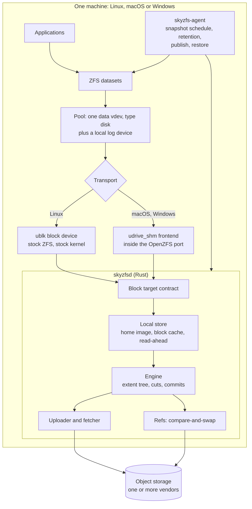
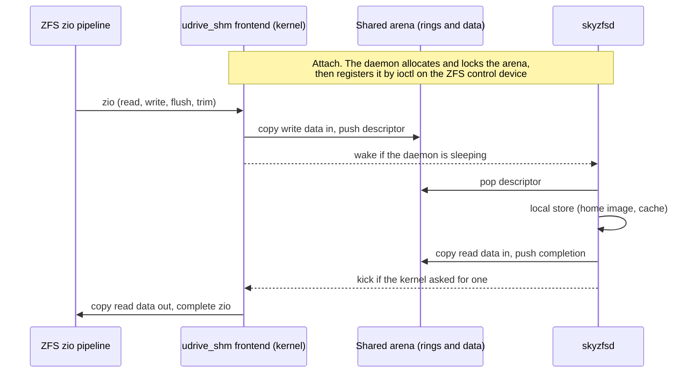
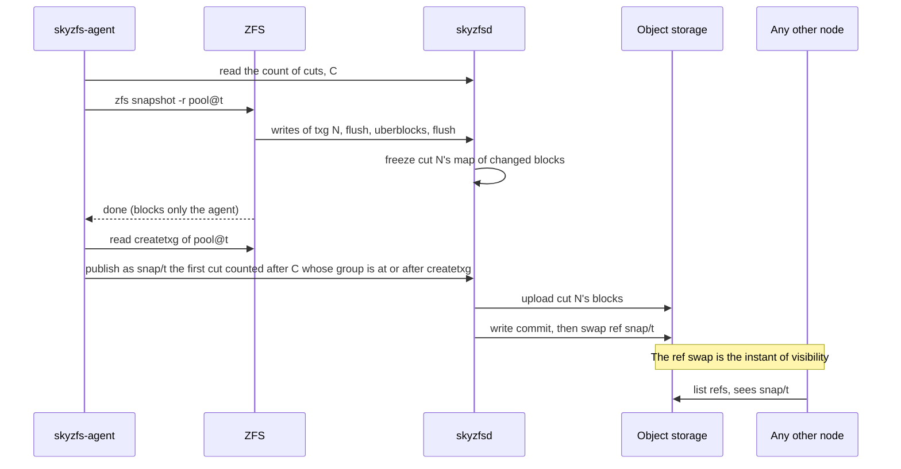
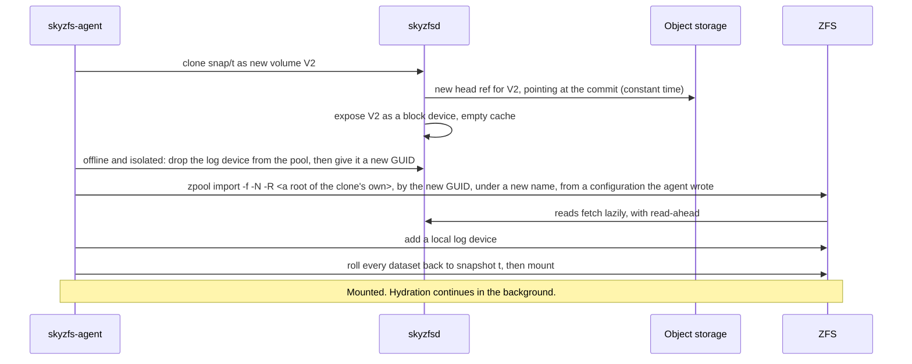
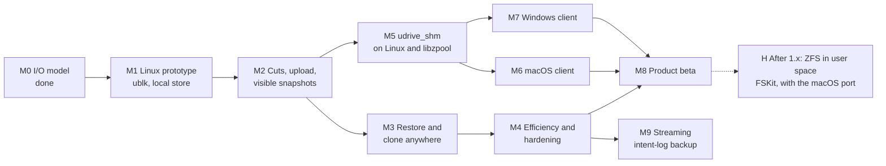

# SkyZFS: Architecture and Roadmap

| | |
|---|---|
| Status | Draft. Decisions are recorded in §10.1. M0 is done. M1 is in progress: the contract and its conformance suite, the local store, the ublk transport and `skyzfsd` are built and run against the kernel on Ubuntu 24.04 and 26.04. On 2026-11-13 the store's design changed: the write log is dropped and the volume is written in place (decision D5, §10.1). M1 exits on that store, and what is left is listed in §9. |
| Date | 2026-11-12. First draft 2026-11-10 |
| Supersedes | The dm-thin node stack of `skynbd_design.md` and `skynbd-origin-advance-design.md`, for this repository. The object formats, refs and commit protocol carry over. |
| Evidence | `skynbd-postgres-study.md` §10 |
| Detail | `skyzfs-impl-notes.md`: for each milestone, its work packages, the design as built, what was measured, and the review record |

This document is the architecture and the roadmap. How each part was built, what the kernel and the benchmark showed, and every review are in `skyzfs-impl-notes.md`, by milestone and work package. "Notes" below means that document.

## 1. Context

SkyNBD keeps a volume in object storage and gives each node a local copy-on-write stack built from dm-thin and dm-cache. That stack works, but it is Linux-only, it amplifies PostgreSQL's writes, and every snapshot costs the workload throughput for as long as chunks are being copied.

The product goal has also widened. The target is easy, consistent data protection for individuals and small businesses, across clouds and vendors, with **native clients on Linux, macOS and Windows**. The core promise is unchanged: cheap snapshots every minute, keep the last *n*, and restore any of them instantly on any machine.

This document proposes replacing the node stack with OpenZFS on a block device served by a node-local Rust daemon, and lays out the path from a Linux prototype to clients on all three systems.

### 1.1 What the I/O study established

The topology benchmark modelled ZFS on a userspace block backend and compared it with the dm-thin two-volume split (`twovol`) on one machine, on equal backing and equal memory[^study].

| Question | Result |
|---|---|
| Throughput with the working set on local flash, no snapshots | Level. zfs-slog ran at 0.85 to 1.14 of twovol at 8 clients (median 1.04), and was ahead on five of six machines at 1 and at 32 clients. |
| Throughput with a snapshot every minute | zfs-slog ran 1.26 to 1.60 times twovol. A thin snapshot cost twovol 16 to 24% of its throughput. `zfs snapshot` cost nothing. |
| Latency with a snapshot every minute | p99 6.8 to 9.2 ms against 10.5 to 13.7 ms. Slowest transaction under 0.2 s against 1.5 to 4.1 s. |
| Flash writes | 37 to 75% of twovol's. |
| Cold origin at 10 ms | ZFS is bound by page reads. It needs a backend read cache with read-ahead, which the model did not have. |

The study also produced three rules that this design adopts: the log device must be allocated storage, dirty data must be capped to fit the pool's free space and the ARC, and the uploader must know what ZFS has freed.

## 2. Goals and non-goals

### 2.1 Goals

1. **One engine, three operating systems.** The Rust daemon and the object formats are identical on Linux, macOS and Windows. Only the last hop into the kernel differs.
2. **Snapshots that cost the workload nothing**, taken every minute, with no filesystem freeze.
3. **A snapshot is visible everywhere at one instant**: when its data is in object storage and one ref has been swapped.
4. **Instant restore and clone on any node and any supported OS**, reading lazily from object storage.
5. **Pools portable between operating systems.** A snapshot taken on a Mac restores on Linux and on Windows.
6. **Vendor independence.** Any S3-compatible store first, then other object APIs, then more than one target at once.
7. **Stock ZFS on Linux.** No patched kernel module where the distribution already ships one.
8. **Two architectures.** amd64 and arm64 (aarch64) are both supported, and a milestone's exit criteria hold on both (added 2026-11-13, at the owner's request).

### 2.2 Non-goals for this document

- Multi-writer access to one volume.
- Application-consistent snapshots (VSS writers, database quiesce hooks). ZFS snapshots are atomic across the pool, which is crash consistency for every dataset at once.
- zvols carrying NTFS or APFS. Clients expose ZFS datasets (decision D1, §10.1).
- Kubernetes integration. `skynbd-csi-design.md` will need its own revision once M3 lands.
- Client user interface design.

## 3. Architecture

The design has four layers.

| Layer | Role | Portability |
|---|---|---|
| ZFS | Filesystem, snapshots, compression, checksums, encryption | OpenZFS on Linux upstream. macOS and Windows from their ports. |
| Transport | Carries block I/O from the kernel to the daemon | Per OS. ublk on Linux, `udrive_shm` elsewhere. |
| Block target contract | The semantics every transport must provide | One definition, one conformance suite. |
| Engine and local store | Write log, cache, cuts, upload, refs, garbage collection | One Rust codebase. |

The frontend is called `udrive_shm`: a userspace-served drive over shared memory. Two earlier names were dropped because each sat too close to an unrelated part of Linux: `udev_shm` (the device manager `udev`) and `udisk_shm` (the disk-management daemon `udisks`). The name says drive where the kernels say disk; it means the same object, a whole block device.

### 3.1 What carries over from SkyNBD

| Existing crate | Fate |
|---|---|
| `skynbd-types`, `-format`, `-tree`, `-store`, `-refs` | Kept. Extents, COW shard trees, commits, object keys and ref CAS are unchanged. |
| `skynbd-engine` | Kept and extended with the local store. Today a flush acknowledges only after upload and a ref swap[^d1]. ZFS flushes many times a second, so a flush must become local. |
| `skynbd-nbd` | Kept as a third transport: a fallback for Linux kernels without ublk, and a remote read-only export. |
| `skynbd-agent` | The dm-thin orchestration is replaced by ZFS orchestration. The capture state machine, watchdog and crash matrix tests are the model for the new agent. |
| `skynbd-api`, `skynbdctl` | Kept, with snapshot publish reshaped around cuts (§5.2). |

New code: `skyzfs-blk` (contract and conformance suite), `skyzfs-ublk`, `skyzfs-shm` (user side of the shared-memory transport), `skyzfs-local` (the local store and its cache), the `skyzfsd` binary, and `kmod/udrive_shm` (the C frontend and its per-OS glue, kept as patches against the two ports).

## 4. The block target

### 4.1 Contract

Every transport delivers the same operations to the daemon and must honour the same rules. The rules are written from what the daemon can observe, so that one reference model can express them and one suite can test them. This section was tightened after an independent review of the first draft (§10.2).

**Parameters.** A target reports these when it is opened, and they do not change while it is open:

| Parameter | Value |
|---|---|
| Size | Fixed, a multiple of 1 MiB |
| Logical and physical block size | 4096 bytes. Every offset and length is a multiple of it |
| Largest read or write | 1 MiB. A transport splits anything larger |
| Requests in flight | A stated bound. The transport holds the rest |
| Discard and write_zeroes | Any aligned range inside the device |
| Volatile write cache | Yes: flushes are meaningful and must be delivered |
| Forced-unit-access writes | Not advertised. ZFS does not send them. A transport that delivers one treats it as a write followed by a flush |
| Read-only | Set for an export that must never change, such as a remote read-only export over NBD (§3.1). Browsing a snapshot does not use it (§5.4) |

**Content.** A volume has a base: empty, which reads as zeros, or a commit, for a clone or a restore. The content of a 4 KiB block is what the last operation covering it in the daemon's order left there, or else the base.

| Operation | Rule |
|---|---|
| `read` | Returns the content of each block. |
| `write` | Replaces the content. |
| `write_zeroes` | A write of zeros, with a write's ordering and durability. It need not store data, but on a clone it must hide the base: it is a recorded zero extent, not an absence. |
| `discard` | The content of each block becomes unspecified until the next write to it: the content just before the discard, zeros or the base, possibly differing between reads, never bytes from another offset or volume. A crash may forget a discard. A discard is never applied to data written after it. |
| `flush` | Completes only when every operation acknowledged on the volume before the daemon received the flush is durable against power loss. That includes operations an earlier instance of the daemon acknowledged. It need not cover or wait for operations still in flight. It never waits for upload. |

**Order.** The daemon applies writes, write_zeroes and discards in one total order, and each of them whole to what a read sees. An operation submitted after another was acknowledged follows it in that order. Two overlapping operations that are both in flight may be ordered either way round. The later one then wins on every block they share, and it is the same one for every later read and in every cut. A read is not part of that order. A read submitted after an operation was acknowledged sees it on every block. A read in flight together with an overlapping write may see each block either before or after that write, block by block, but never a block that is itself partly written: that is what a disk gives, and ZFS does not read a block it is writing. A server that hands requests to its store as they arrive has to do the ordering itself: direct I/O to a file does not order two overlapping writes, and a stand-in server that relied on it returned blocks from both[^tear].

**Two kinds of failure.** They promise different things, and treating them as one corrupts a pool. The store does not need to know which one it is recovering from: recovery is one procedure: every start makes durable whatever an earlier instance left in the volume's file before it serves the first request. A second crash then cannot take back what the first recovery exposed, and a flush received by the new instance covers what the old one acknowledged. The daemon does know whether the machine has restarted, by the kernel's boot id (§4.2), and the cuts depend on that (§5.2).

- **The daemon is lost and the kernel carries on.** ZFS never restarted, so nothing it was told is done may be undone. An operation is therefore acknowledged only once it would survive the daemon process: written to the volume's file through the kernel, though not necessarily synced to the device. The next instance then finds every acknowledged operation. Requests that were not acknowledged are issued again. They may arrive in any order, and may include ones the lost daemon had already applied, in whole or in part, so all five operations are idempotent, and a reissued write makes whole what the lost daemon had half applied. A reissued request carries nothing that ties it to its first delivery, so it is a new operation in the order, and one the lost daemon had applied is in the order twice. This shows only where two overlapping operations were in flight at the loss, which ZFS does not do.
- **Power is lost.** The volume is then what a disk with a volatile write cache leaves, which is the disk ZFS is built for. This rule is called **the volatile-cache disk**:
  - every block that a completed flush covered holds what it held at that flush, or something written to it since;
  - of a block written since the last flush that covered it, each 512-byte sector holds that durable content or one of the versions written since, independently of every other sector and of every other block. A later write can survive where an earlier one is lost, and a write can be torn at a sector;
  - a block that nothing wrote since its last flush is unchanged.

  A "version written since" is whatever an operation since that flush could have left: a write's bytes, a write_zeroes' zeros, any content the discard rule allows, and what an operation that was in flight or that failed left, in whole or in part. What a start finds it makes durable before it serves (above), so a second power cut cannot change what the first one left.

  The volume is **not** promised to be a prefix of the daemon's order. The first version of this contract promised that, and a write log delivered it. It was dropped on 2026-11-13 (decision D5): ZFS does not need it, and the log cost every block a second write (§9). What keeps a pool consistent on such a disk is ZFS's own: the order of its writes and flushes, its checksums, and its ring of uberblocks.

**Errors.**

- A request that is misaligned, empty or beyond the end is rejected and has no effect.
- A flush or a discard is never answered "not supported". ZFS would stop issuing it for good[^zfserr].
- A flush is never failed for a condition that can recover. It is held.
- The store has failed for good once a write or a sync of the volume's file has failed. A failed sync is never tried again: the kernel may have dropped the pages and the error with them. From then on the volume has **failed**: no flush the daemon receives succeeds, and from the first failure the daemon reports, **every later request fails**, reads included. Every flush that completed stays a promise: when the volume is next opened for a new client, it is as after a power cut, by the rule above. A failed sync can leave pages in the kernel's cache that read as written and never reach the disk, and an instance can die between such a failure and its marker. So every start, after its sync, drops the kernel's cache of the volume's file and checks that it is gone, and serves only what the disk holds; a start that cannot do that refuses the volume. Nothing else about a failed volume's content is promised. ZFS ignores the result of the flushes on either side of its uberblocks[^zfserr], and of the intent log's flush where log blocks or their data are on this device, so an `fsync` can return on a volume that has just failed. It is therefore the next write that has to fail, and a read has to fail too, since the block it would return may be one the failure tore. The corner cases (requests in flight at the failure, a flush with nothing new to cover, a restart in between) are in the notes.
- A failed volume stays failed across a daemon restart for as long as its client stays attached: a new instance must never serve less to a ZFS that was told more. The store leaves a marker (§5.1) and the transport gives up the attachment (§4.2). Within one boot a new instance finds everything the old one acknowledged, since the kernel that took it is still running (§4.2); the store keeps no record to check that against. A failed volume fails every request, including the reads and writes with which ZFS probes a device that has just returned an error. That is what makes ZFS suspend the pool instead of passing a read failure to an application[^readerr]. A transport must not answer with an error that means something else to ZFS, above all "not supported".
- A read that needs object storage that cannot be reached is **held until the storage answers**. It is not failed after a timeout. ZFS hands an ordinary read error straight to the application and counts it against the pool, and suspends the pool only when the device itself is gone[^readerr]. A network outage must not become application errors, so the daemon waits and reports the stall through its own status and alerts. ZFS reports it too, as a slow I/O. A held read of pool metadata can stall the open transaction group until storage returns, which is the same wait. Giving up is the administrator's decision: detaching the volume fails every request as a device that is gone, and `failmode=wait` then suspends the pool.
- On a read-only target, writes, write_zeroes and discards fail and a flush succeeds.

**Clients.** A kernel transport is one kind of client. The agent's own tools are another: reading labels to build an import, and rewriting a clone's GUID (§5.4). They use the same contract through a library interface in the daemon, exclusive with a kernel attachment to the same volume. No device node is needed for them, which matters on macOS and Windows, where there is none.

A conformance suite in `skyzfs-blk` exercises these rules against any implementation with a reference model. It distinguishes the two failures: after daemon loss every acknowledged operation is readable, and after power loss only flushed ones are guaranteed. Passing it is the entry condition for every transport and for the local store.
The suite drives an implementation through a harness, and a harness states what it cannot do: cut the power, start from a base that is not empty, serve a read-only volume, fail the store on demand, issue an invalid request, reopen a failed volume. A case that needs a missing capability is reported as not exercised, or runs in a weaker form and says so. Nothing is left out silently. That lets one suite run both in process and through a kernel block device, where a rig can do few of these things. So "the suite passes through `/dev/ublkbN`" is a much weaker statement than "the suite passes in process", and the durability of the whole stack rests on the store's own tests and on the replay rig (§9), not on that run. The counts are in the notes.

Two deployment rules are outside the suite and are covered by a stress test in the kernel rig: the daemon locks its memory, and it keeps its own files off any pool it serves. A daemon that page-faults onto its own pool deadlocks the machine. `skyzfsd serve` checks both before it touches a device.

### 4.2 Linux: ublk

ublk is the in-kernel userspace block driver, driven by io_uring passthrough commands[^ublk]. The daemon fetches requests per queue, copies data to or from its own buffers, and commits results. The kernel presents an ordinary block device, so ZFS uses its normal disk vdev and nothing in ZFS is patched.

- **Recovery.** ublk's user-recovery mode lets a restarted daemon take the device over[^ublk]. The contract needs the variant that reissues in-flight requests, not the one that fails them. With the failing variant ZFS sees I/O errors on its only vdev and has to retry them.
- **Flushes must reach the daemon.** The device advertises a volatile write cache and a 4096-byte logical block. Without the first the block layer completes flushes itself, and there would be no durability and no cuts.
- **One zio is not one request.** The kernel splits and merges to the advertised limits.
- **Held requests.** A read may be held for as long as object storage is unreachable (§4.1). The kernel lets a ublk device do that for minutes: on a stand-in server one read held for 300 s completed without an error, and the kernel logged nothing in that time, in one run on each of two images[^failrig]. Longer holds, many at once, and the daemon itself are for the rig in M3.
- **One instance per volume.** The store takes an exclusive lock on the volume's directory when it is opened and holds it until the process ends. Opening a store is a recovery that writes, so a second daemon is stopped before it opens one.
- **Attachment across restarts.** Before it adds a device the daemon records durably, in the volume's directory, the device's number, a fresh random nonce, the kernel's boot id and the parameters it will ask for, and it leaves a note under `/run`, which lives exactly as long as the boot. A restarted daemon takes a device over only when the note and the record agree. After a reboot no client can still be attached, and the daemon adds a new device.
- **A device waits for its server.** The driver reports three states: dead, live, and waiting for a server. When the daemon ends, by a kill or by an orderly stop, its device waits, with no limit in time, and the next daemon takes it over; requests that were in flight are issued again. The daemon sends no command that stops a device without deleting it.
- **A failed volume gives up its attachment.** When the store fails, the daemon writes a failure note under `/run`, answers every request it holds with an error, deletes its device and exits, so that no later instance can serve less to the same import. The pool is suspended as soon as a read or a flush fails. A pool that only writes does not notice (§10). Deleting the device is final for that import: nothing short of a reboot was found that brings the pool back.
- **What was acknowledged outlives the daemon, and with direct I/O it never sits in a cache that can be dropped unwritten.** When the daemon dies the kernel lives on, so a new instance in the same boot finds what the old one acknowledged, with buffered I/O as with direct I/O: the page cache belongs to the file and not to the process. What direct I/O (decision D6) adds is elsewhere. A write that has returned was taken by the device, into its volatile cache, so there are no pages that a failed sync could leave marked clean and never written, which is the case the start's cache drop exists for (§4.1). One limit: over a hole or an unwritten extent of the image, the device has the bytes but the file shows them only once the file system has committed the change of its extent tree, so a power cut before that commit loses such a write although the device took it. §4.1 allows that, because the block's durable content was zeros and a flush had not covered the write; a flush, which is an `fdatasync`, commits the change. Daemon loss is not affected. That limit goes when the image is written through at create (§10, the image's allocation), which is not decided. The store keeps no position to compare with, so nothing at a start can show that the file holds less than the kernel was told. The first store did check: it recorded the log position behind each acknowledgement. That check went with the log (decision D5).
- **Detaching.** `skyzfsd detach` deletes the device of a volume whose daemon has stopped. It never stops a daemon, and it refuses a device with a live server.
- **Library.** The transport is built on the `libublk` crate[^libublk], pinned to one version and confined to one module, for the queue. The daemon sends the control commands itself, through a binding of its own (`skyzfs-ublk-sys`), and takes the driver's own answers: add, lookup, the asynchronous delete, and the begin and the end of a recovery. The binding has kernel tests of its own.
- **One copy per request**, into buffers that are the daemon's own and locked in memory: two per request slot, 128 MiB for a volume at one queue, a depth of 64 and 1 MiB requests. The zero-copy modes are not adopted (gate G1, §9).
- **Labels at byte 0.** `zpool create` partitions only what it recognises as a whole disk, and its device table does not list ublk[^wholedisk], so the pool's labels sit at the start of the device, as they do through `udrive_shm`. CI pins this (§6.2).
- **Kernels.** The daemon needs **Linux 6.11 or later**. ublk was merged in 6.0; the daemon needs user recovery with reissue (6.1), ioctl-encoded control commands (6.4), the command that reports the driver's features (6.5) and the asynchronous delete, which the header names from 6.9 and the driver executes from 6.11. Ubuntu 24.04 needs its HWE kernel (the one it was released with is 6.8); long-term kernels from 6.12 on qualify. At its start the daemon asks the driver for its features and reads the kernel's release, and on a kernel that lacks something it refuses, naming what is missing and the oldest kernel that has it. An operator whose older kernel carries the driver backported says so with an option; there is no fallback to another way of deleting. The flags were read in the kernel's header and driver at the release tags, not taken from memory (M1.3q; the table is in the notes, M1, "The ublk features the daemon needs").
- **Architectures.** amd64 and arm64. Every throughput figure so far is from amd64. On arm64 (M1.T21, GitHub's `ubuntu-24.04-arm` and `ubuntu-26.04-arm` images: kernel 7.0, the ublk driver, a ZFS 2.4.1 module, 4 KiB pages) the unit tests and lints run on every pull request, and the kernel rigs run under the same expected tables as on amd64, so that a line that differs between the two is a finding. In their first runs, one per image, none differed: the control rig, the daemon rig on the in-place store, and the power-cut replay through the daemon at the pull-request budget. The implementation notes have the runs. Not shown: the full-budget replay and the throughput rule on arm64, which M1's exit needs, and what the daemon does on an arm64 kernel with 16 KiB or 64 KiB pages, which no hosted runner has (§10).
- **Evidence.** Four rigs run in GitHub Actions on Ubuntu 24.04 and 26.04 (kernel 7.0, ZFS 2.4.1): a kernel probe, a power-cut replay rig, a control rig for the binding, and a daemon rig that takes `skyzfsd` through kills, an orderly stop, a held request, a failed volume, the conformance suite and its checkpoints. What each has shown is in the notes.
- **Fallback.** Where ublk is missing, the existing NBD server on a local socket is the transport.

Detail: notes, M1, "The ublk transport".

### 4.3 macOS and Windows: `udrive_shm`

Neither system has an equivalent of ublk. Both have an OpenZFS port that the user must install in any case, and both ports are active and close to upstream: on 2026-11-10 the macOS port was at 2.4.3-rc3 and the Windows port at 2.4.4-rc3[^ports]. The proposal is a small frontend inside each port that hands zios to the daemon through shared memory.

**It is feasible. The frontend must not be a new vdev type.** Two facts from the port sources decide this:

1. The vdev type table is a static array in common code[^vdevtable]. A new type means patching it in every port.
2. The leaf's type string is stored in the labels and in the pool's own configuration. A ZFS that does not know the type rejects the configuration, and a file vdev refuses anything that is not a regular file[^vdevfile].

A pool created on a Mac must import on stock Linux, where the leaf is a disk at `/dev/ublkbN`. So the leaf must be of type `disk` on every system, and the frontend must sit **below** the disk vdev, selected by the device path.

| Port | Hook | Why it fits |
|---|---|---|
| macOS | A third provider in the port's layered-driver interface, next to its IOKit and vnode providers[^ldi]. | The disk vdev already opens by name and calls `ldi_strategy` and `ldi_ioctl`. The provider is tried first in `ldi_open_by_name`, for paths under `/dev/udrive_shm/`, and the vdev itself is not changed. |
| Windows | A dispatch on the path prefix at the top of the disk vdev's open, start and close. | The Windows disk vdev opens an NT path and builds IRPs[^winvdev]. A path under `/dev/udrive_shm/` takes the shared-memory route in its place, before the port chooses between the stored physical path and the path. |

**The path is absolute and names no node.** On both systems the data leaf's path is `/dev/udrive_shm/<name>`. Both ports' disk vdevs refuse a path that is not absolute before any provider sees it[^abspath], so a form such as `user:<name>`, which an earlier draft used, would never reach the frontend. Nothing exists at that path in the file system and nothing needs to: the frontend matches the prefix before the port looks anything up. Tools that stat or scan device nodes cannot be used on such a path. The agent therefore creates and imports these pools by handing ZFS a configuration it wrote itself (§5.4), with this path on the data leaf and neither a physical path nor a device id, since the Windows port opens a stored physical path in preference to the path[^abspath]. The path the labels hold is whatever the last system to import the pool wrote. It is never relied on.

The I/O path, common to both:

Design points:

- **The daemon owns the memory.** It allocates a page-aligned arena, locks it, and passes its address in the attach ioctl. The kernel wires and maps it. Each OS needs only two primitives: wire user pages, and sleep and wake. No Mach ports, section objects or new device nodes.
- **The control path is the port's existing control device.** `/dev/zfs` on macOS and the ZFS device on Windows already take ioctls from an administrator. Attach, wait and kick are three more.
- **Two single-producer rings and a data area.** Descriptors are fixed-size: request id, operation, offset, length, data offset in the arena, priority, and the transaction group as a hint. Completions carry an id and a status.
- **One copy each way**, in and out of the arena. The vdev queue above the frontend still bounds concurrency and aggregates adjacent I/O, so a ring depth of a few hundred is enough.
- **No daemon code in the frontend.** The frontend module contains nothing from the daemon, and the daemon nothing from the frontend. They share only the protocol's definition, one header under a permissive licence. This keeps the CDDL code of the ports and the FSL daemon apart (§10).
- **The kernel never trusts the arena.** Every descriptor field is copied out and validated before use. The daemon is privileged, but a corrupt daemon must not corrupt the kernel.
- **Daemon loss.** When the daemon's handle closes, the provider holds new and in-flight zios. A daemon that re-attaches under the same name within a timeout gets the in-flight requests again. Request ids carry an attach generation, so a completion from before the loss cannot complete a reissued request. Past the timeout every request fails, as a device that is gone, and keeps failing until the daemon is back, so that a flush error ZFS ignores cannot be followed by an uberblock write that succeeds (§4.1). ZFS's `failmode=wait` then suspends the pool until it is cleared. This reuses ZFS's own handling of a vanished disk.
- **A full data area makes the frontend wait**, holding nothing that memory reclaim needs. The area is sized for the largest request times the ring depth.
- **The frontend splits a zio larger than the largest request.** ZFS aggregates up to a tunable limit of 16 MiB, and a pool created elsewhere may hold records larger than 1 MiB.
- **The transaction group in the descriptor is a hint for diagnostics only.** Cuts are detected the same way on every transport (§5.2), so that one tested rule covers them all.
- **Bring-up shortcut.** Before the shared arena exists, the same descriptors can travel inside the wait and kick ioctls with the data copied by the kernel. That is slower and proves everything else.

**Size.** The common C code is a ring, an allocator for the data area, the lifecycle state machine and the vdev-facing calls. Per-OS glue is page wiring, the ioctl entries and the hook above. The estimate is 1,500 to 2,500 lines across both ports, plus tests. It is small in lines. It is not small in responsibility: it runs in the kernel, it must never deadlock against memory reclaim, and it must be rebased as the ports follow upstream.

**Why develop it on Linux first.** The common code can be compiled into userspace `libzpool`, where `ztest` can hammer it against the real daemon with no kernel in the loop, and into a patched Linux module in CI. The protocol is then proven before the first macOS or Windows build (M5).

## 5. Engine and local store

### 5.1 Local store

The daemon keeps the volume on local flash in one file, the **home image**, and writes it in place. There is no write log (decision D5, §10.1).

- **A write goes to its offset** in the home image by direct I/O, with no copy in the kernel's page cache, and is acknowledged when the device has taken it (decision D6; the store as merged today still writes through the page cache, and M1.3y changes it). The start asks the file system for its direct-I/O unit (`statx` with `STATX_DIOALIGN`) and refuses one that offers none or whose unit is above 4 KiB. It cannot catch a file system that accepts direct I/O and quietly does buffered I/O, as ext4 does with `data=journal`; the start's sync and cache drop still cover that case. A write_zeroes zeroes the range. A discard changes nothing locally and is noted for the next cut (§5.3).
- **A flush is one sync of the home image**, and completes only when everything acknowledged before the flush was received is on the device: `fdatasync` on Linux, `F_FULLFSYNC` on macOS, `FlushFileBuffers` on Windows. Its cost is paid at every commit where the intent log is on the device, and must be measured on real flash (§10). macOS's cheaper `F_BARRIERFSYNC` cannot implement the contract's flush: it orders writes but promises nothing about what is persistent when it returns[^barrier]. A mode built on it would keep the pool consistent after a power cut and could lose flushes that had completed. That is a different durability class, offered by name if at all, and never a faster implementation of the same contract.
- **What it promises is the volatile-cache disk of §4.1**, and no more.
- **A start** syncs the home image and then drops the kernel's cache of it before it serves (§4.1), and has nothing to replay. With direct I/O the sync is what commits the extent-tree changes of the previous instance's writes into holes and flushes the device's cache, so it carries more than it did; the cache drop then covers only pages left by a create, a restore or a file system that buffered behind the store's back, and is kept for those. The first reads after a take-over therefore come from the disk. The starts measured so far followed a replayed power cut, where nothing is unsynced, and took 24 to 58 ms. After a lost daemon the start's sync writes whatever that instance left unsynced; no run has measured that yet.
- **Threads.** The transport's thread takes requests in the order it received them and hands each read and write to one of a small pool of I/O threads, eight by default, each of which does one request at the disk at a time; the store itself serialises requests that overlap, since a file system does not order them, and a flush waits for every write in flight. A sync runs on a helper thread. With one thread the disk sees one request at a time, and on machines whose syncs are slow eight threads measured above one in every job that ran both (§9). Eight as the default rests on those machines only: the one row with eight threads on a fast-sync machine was the lowest of its job (0.950, against 0.958 with one thread and 0.972 buffered). The default is to be settled by the round on the merged daemon.
- **Failure.** A failed write or sync fails the volume for good (§4.1) and leaves a marker beside the image, which a later start honours. A failed read fails that request alone, as on a disk: the store has lost nothing it was given, and one block that cannot be read is not a reason to take the whole pool down until a reboot. ZFS then reads another copy where it has one and otherwise returns the error to the caller[^readerr]. So on local flash that is failing, an application can see a read error before the first failed write or sync fails the volume; the promise that no error reaches an application is about a volume that has failed, not about a block the flash cannot read.
- **The home image is allocated when the volume is created**, in the `complete` policy below: a file system that fills must not be found on the write path, and on some file systems a block that is allocated during a write can show other bytes after a power cut. A write_zeroes then has to keep the blocks allocated, where today it deallocates them. Not built yet (§10).
- **The daemon says what it did.** `skyzfsd status` shows where a request's time goes, by thread and by activity. The benchmark reads it.
- **Block cache.** Everything written and everything fetched, with read-ahead around a miss. The study's cold-origin result is entirely a statement about this cache. Not built in M1, and M1 needs none: the store holds the whole volume locally and ZFS keeps its own cache above the device, so a second cache under it only duplicates that one. With buffered I/O the host's page cache was such a duplicate, which a memory limit on the daemon made the kernel evict and read back at a cost; with direct I/O (D6) the store keeps no cache. A cache of the store's own comes with eviction and lazy fetch (M3), for blocks that are not on local flash.
- **As built today.** The integration branch still holds the log store of the first design, with the in-place store beside it behind an option, until the rigs drive the in-place store and the log store is removed (M1.3s, M1.3t). The log store, what it cost and what it taught are in the notes.

Detail: notes, M1, "The local store" and "Without the write log".

Two policies cover the two kinds of machine.

| Policy | Local flash holds | For |
|---|---|---|
| `complete` | The whole volume. Nothing is evicted. | Desktops and laptops. The machine works offline and object storage is the protected copy. |
| `cache` | The working set. Clean, uploaded blocks may be evicted. | Servers, and any node that has just restored a volume. |

A restore always starts in `cache` and can be promoted to `complete` by hydrating in the background.

### 5.2 Cuts and snapshot visibility

ZFS writes a transaction group, flushes, writes the uberblocks, and flushes again[^txgorder]. The daemon recognises the uberblock writes by their position in the labels and reads the transaction group *N* from them.

A **cut** is an instant in the daemon's order: the moment the daemon receives the first flush after it has acknowledged an uberblock write for *N*. The volume as it reads at that instant is a complete pool at *N*, whatever else was in flight, for two reasons[^cutproof]:

- Every block of *N* was acknowledged before ZFS submitted the first uberblock write, and the daemon applies an operation before it acknowledges it (§4.1), so every block of *N* is in the volume before that instant. The argument does not use ZFS's flush before the uberblocks, so it holds even where that flush is skipped or its error ignored.
- Nothing that uberblock *N* can reach is overwritten or discarded before the cut. Blocks freed in *N* become allocatable, and are trimmed, only after ZFS has finished writing *N*'s uberblocks and the flush that follows them. On a nearly full pool that protection covers *N* alone and not *N*−1, which is all a cut needs.

Other writes do land before a cut: blocks of the next transaction group, intent-log blocks that fell back to the main device, repairs. Within a group ZFS also rewrites, in place, blocks it allocated earlier in the same group, as its sync passes converge. Those rewrites all precede the uberblock. They add blocks that *N* does not reference, with one exception that changes nothing: a repair rewrites a block *N* may reach with the content its checksum demands, so whole it leaves the block as it should be and half applied it leaves it as bad as before. A write that a lost daemon had half applied can be half in a cut for the same reason without harm: ZFS was never told it was done. They can also make the first flush after the uberblock write a stray one, which the definition allows: one copy of the uberblock is enough to import at *N*.

Three details make the rule exact:

- **What counts as an uberblock write.** A write to an uberblock slot that carries the uberblock magic and a transaction group above zero. ZFS fills every slot with transaction group 0 when it creates a pool.
- **What counts as a repeat.** An uberblock whose transaction group and root block pointer both equal the previous one's makes no new cut. *N* alone does not identify a pool state: after a rewind import some versions write a different pool state under a number already used. A cut is identified by its number in the daemon's count of cuts, with *N* recorded beside it.
- **When a cut may leave the machine.** Only once the flush that marks the cut has completed without error, so that the cut is on the local device as well. That governs the upload of every cut, not only the publishing of a snapshot: a cut committed in object storage before its flush completed could be ahead of the local pool after a power cut. ZFS also ignores the result of the flush after the uberblocks[^zfserr], so it can believe *N* is safe on a volume that has just failed.

**What a cut needs from the store.** With a write log a cut existed by itself, as a prefix of the log. Now it exists only as what the store records about it, so the rules below are part of the design. All of it is to be built in M2. A review looked for a loss after which a later cut would hold a wrong block or lack one (a lost daemon, a power cut, each after the other, a failed sync) and found none given these rules; it showed a wrong cut where the record of copies, the handing on of an abandoned map, the rule for clearing an intent bit or the rule on trusting the state is left out.

- **Requests are applied one at a time, in the order received.** The instant of a cut is well defined only then. A second queue or a pool of writers would need a rule of its own.
- **A map of changed blocks.** The store notes every block written, zeroed or discarded since the cut before. At a cut's instant the map is frozen as that cut's, and a new one begins.
- **A copy before overwriting.** A block that belongs to a cut not yet uploaded is copied aside before a later write changes it, and the upload reads the copy.
- **The cut state outlives the daemon, all of it:** the open map, the frozen maps, the list of cuts not yet uploaded, the count of cuts, and the record of which blocks were copied aside. A new instance that had a frozen map but not the record of a copy would upload the overwritten block, and the cut would hold a block from after its instant. The state is kept in a file mapped into the daemon, which the kernel keeps when the process dies.
- **The mapped state is trusted only in the boot that wrote it, and only if no sync of it has failed.** After a power cut the file on disk can be a well-formed state from seconds earlier. The daemon knows the boot from the kernel's boot id (§4.2).
- **An intent map for the other case.** One bit for a region of the volume is made durable before the first write into a region that was clean. After a restart of the machine, the regions it names, and no others, are compared with the newest uploaded cut. A bit is cleared only after the cut that carries the region's changes is committed in object storage, and only if nothing in the region changed since that cut's instant.
- **An abandoned cut's map goes to the next cut.** A cut is abandoned when its flush fails or when the bound on local space is reached (§10). If its map were dropped, the next cut would lack every block that interval wrote.

How much is copied aside depends on how soon ZFS reuses what a cut holds. ZFS normally defers the reuse of a freed block by two transaction groups[^cutproof], and a group overwrites the uberblock slot written 32 groups earlier. So while the upload keeps pace the copies are few: the other copies of the uberblock after a cut marked by a stray flush, and labels when the pool's configuration changes. The deferral does not hold when free space is at or under ZFS's reserve (1/32 of the pool, at least 128 MiB, so a small test pool loses it early), during device removal or raidz expansion, and probably in the first groups after an import that follows a crash. The copies grow with the upload's lag (§5.3). The sizes, and what the intent map's sync costs on the write path, are M2's to measure.

- **No freeze, no pause.** Applications keep writing throughout. The study measured no cost.
- **A snapshot is published by a cut of the pool's present history.** A transaction group's number does not identify a pool state: after a rewind import the pool counts again from an earlier group, and cuts of the abandoned history, still held or pending, carry higher numbers (§5.2, "What counts as a repeat"). A threshold on `createtxg` alone could be met by one of those, and `snap/t` would then name a cut without the snapshot. So the agent reads the daemon's count of cuts before it takes the snapshot, and the daemon publishes the first cut counted after that whose group is at or after `createtxg`: such a cut was taken after the snapshot was asked for, on the history that holds it. A publish does not outlive the attachment it began on: if the pool was exported or the device given up in between, the agent starts again. M2 tests a publish after a rewind import with cuts of the abandoned history still held.
- **Atomic visibility.** A snapshot does not exist for other nodes until one compare-and-swap on the ref. A crash before it leaves no trace, and the existing commit protocol and its crash matrix apply unchanged.
- **Retention** is ref deletion plus `zfs destroy` locally. Garbage collection reclaims what no ref reaches.
- **Recovery point.** Between published snapshots the newest cut in object storage is the recovery point. With a local log device, a cut holds the last synced transaction group and not the fsynced tail (§6.1). That is accepted through M4 (decision D2). §5.5 sketches how the tail is recovered later.

### 5.3 What is uploaded

Most of what ZFS writes is dead within a minute: in the study 2 to 6 MB per thousand transactions was still live at the end of a window, against 12 to 19 MB written[^study]. A cut therefore uploads only blocks that are live **at the cut's instant**:

- a block overwritten before the cut is in the map once and is uploaded with its last content,
- blocks ZFS freed before the cut arrive as discards, with `autotrim=on`, and go into the cut as holes with no content; a free extent under 32 KiB never arrives, because autotrim skips it[^trimmin],
- intent-log blocks normally do not reach the device, because the intent log is on a local log device. ZFS falls back to the main device when the log device is full or has failed, and `logbias=throughput` and direct I/O log their data there by design.

Nothing after the cut may leak into it. Upload can lag the cut by minutes on a slow uplink, and in that time ZFS reuses uberblock slots and trims blocks that were live at the cut. The local store therefore keeps the cut-time version of every block until the cut is uploaded or abandoned: that is the copy made before a block of a pending cut is overwritten (§5.2). In object storage the engine's copy-on-write extent tree gives each cut its own root. What bounds the space of those copies while the uplink is slow or absent, and what the daemon does at the bound, is not decided (§10).

### 5.4 Restore and clone

- **A new GUID before import.** ZFS refuses a pool whose GUID is already imported[^guid], and a clone must be importable on the node that still holds the original. `zpool reguid` only works on an imported pool, so the agent changes the GUID offline with `libzpool`. Which `libzpool` that is on Linux before M5, the distribution's shared library or one built from the pinned source, is open and is decided in M3; either way the tool that links it is a program of its own (§10, licensing). Only the pool's GUID changes: a clone keeps the original's vdev GUIDs[^reguidleaf], and nothing was found in ZFS that minds two imported pools whose leaves share one. M3's test on one host covers it. That is a real transaction: it writes labels and uberblocks, which the daemon sees as a cut on the new volume.
- **The log device goes first.** ZFS changes a pool's GUID only while the pool is healthy, and a pool whose log device cannot be opened is degraded[^reguid]. The cut does not contain the log device (§6.1). So the same offline session first removes the log device from the pool, and any cache or spare device the pool names, and only then changes the GUID. An earlier draft changed the GUID first and removed the log after the import, which ZFS would have refused. Removing a log device that is missing is the documented recovery after an import with `-m`. That it works in this session is for M3 to prove.
- **The offline session can open the clone and nothing else.** The copied labels and the pool's own configuration still name the source pool's log device, and may name cache and spare devices. On the node that holds the original, those paths lead to live devices that belong to the original pool and carry its GUID. Allowing a missing log does not protect them: ZFS counts a log device as missing only when it cannot be opened, and in `libzpool` a disk leaf is opened as a file by its path[^reguid]. A session that could open them would claim log blocks and write labels on the original's devices. Two things prevent it, and both are required. First, ZFS is never given a configuration the agent did not write: the agent reads the clone's labels through the daemon and replaces the path, physical path and device id of every leaf but the clone's data device with ones that cannot resolve. Second, the session runs where only the clone can be opened at all. With the frontend built into `libzpool` (M5) that is the frontend's own resolver, which knows the clone's name and fails every other path without touching the file system. Until then, on Linux, it is a private mount namespace in which the clone's device node is the only one. M3 tests this on one host with the original pool imported and writing to its log device, and checks that no device of the original was opened or written.
- **Labels are read through the daemon.** `zpool import` normally scans device nodes from user space. The agent builds the import configuration from labels it reads through the daemon's client interface (§4.1), which also works where there is no device node.
- **`-f`, and no `-m`.** The cut is of a pool that was imported elsewhere. Its log device was removed in the offline session, so the kernel import has nothing to miss and nothing of the original's to find.
- **The import mounts nothing, and the clone's datasets never mount at the original's paths.** A clone keeps the original's dataset properties, and a dataset whose `mountpoint` is an absolute path such as `/data` would mount there: on the node that holds the original, over the original's dataset. A new pool name and GUID do not change that, and the isolation of devices above does not cover mounts. So the import is made with `-N`, which mounts no file system, and with an alternate root (`-R`) that belongs to this clone, so that every mount point resolves under it. The alternate root is a property of one import and is not stored in the pool: the agent gives it at every import of a clone, until whoever takes the clone into use sets its mount points on purpose. M3 tests a source dataset with an absolute mount point, cloned on the node that holds the original with the original mounted, and checks that nothing was mounted over it.
- **The datasets are put at snapshot *t* before anything is mounted.** A cut holds the pool at the transaction group that carried the cut, and that can be later than the group in which `pool@t` was created: an abandoned cut's content goes into the next one (§5.2), and a snapshot is published with the first cut at or after its `createtxg`. The live datasets of the clone can then hold changes made after *t*. Restoring `snap/t` means the state of the snapshot and not of the cut, so after the import and before any mount the agent rolls each dataset the snapshot covers back to `@t` (`zfs rollback -r`, which also destroys snapshots later than *t* that the cut happened to hold). A dataset created after *t* and before the cut has no `@t`, and a rollback does not remove it: `-r` destroys later snapshots and bookmarks, not datasets. So in the same step the agent destroys, in the clone, every dataset under the snapshot's root that has no `@t`; what is mounted is the membership of the recursive snapshot and nothing else. The other direction cannot be repaired and is said to whoever restores: a dataset destroyed with its snapshots between *t* and the cut is not in the cut, and the restore lists the datasets it found `@t` on. A read-only import cannot roll back or destroy. Browsing therefore exposes the snapshots themselves, each dataset's `@t` mounted read-only, and never the live datasets. M3 tests a restore and a browse of `snap/t` from a cut that was deliberately published one or more transaction groups after *t*, with files changed and a child dataset created in between, and checks that the content is that of *t* and that the child is not there.
- **Read-only browsing.** On the node that holds the pool, a snapshot is browsed through ZFS's own `.zfs/snapshot` directory, with no import at all. Anywhere else, browsing is a throwaway clone: the daemon serves the commit under a local overlay that is never uploaded, the agent gives the pool a new GUID as above, and the pool is imported with `readonly=on`, which skips log replay. The new GUID is needed even though nothing will be written. ZFS refuses any kernel import whose pool GUID is already open, read-only or not[^guid]. Without it a node could not browse a snapshot of a pool it has imported, or two snapshots of one pool at once.

### 5.5 Later: streaming the intent log

Through M4 a node loss costs everything since the newest uploaded cut. A reboot or a daemon crash costs nothing, because the log device is local and survives both. A later milestone (M9) closes the gap for tiers that need it, by shipping the intent log off the node continuously.

**The sketch below needs rework.** It was written when the store kept one ordered log of every write, and it restores both devices to one flush boundary of that log. The in-place store (decision D5) has the data device at cuts only. M9's design has to start from there: the log device, which is small, would get an ordered journal of its own, and a restore point between two cuts would be the older cut together with the log device as that journal gives it at a later flush. Whether ZFS's replay accepts that pairing is the open question, for the reason in the last paragraph of this section; a freed log block is reusable after the deferral, so it holds for about three groups past the cut. The rework also has to keep the log device's label area as the cut had it, since a later image can hold a newer uberblock and import takes the newest across all devices; and it has to accept that replay ends at the first record whose data block is on the data device and newer than the cut.

The sketch as first written, to be designed in its own document before M9 starts:

- **The log device moves onto the daemon** as a second block target. Its writes go to the same local write log as the data vdev's, in one order.
- **The daemon uploads that ordered log as it is written**, as short-lived tail objects, in addition to the cuts.
- **A restore point is then any flush boundary in the stream.** Both devices as of one flush are exactly what a power cut would have left. ZFS imports that image and replays the intent log, which recovers every transaction fsynced before that point.
- **Tail objects are garbage once a later cut is published**, so they cost upload bandwidth but little storage.

Why both devices must come from the same point: the pool at a cut points at the start of a log chain, and ZFS frees and reuses log blocks once their transaction group has synced. A log device image taken much later than the cut no longer holds that chain, and replay would stop at the first block that does not belong. Pairing a cut with an arbitrary later log image is therefore not safe. Restoring both to one flush boundary is.

Open for that design: how much the stream adds to upload volume (intent-log blocks were three quarters of device writes without a separate log[^study]), whether a flush may wait for the stream to bound the loss to zero, and how the stream is throttled on a slow uplink.

## 6. The ZFS layer

### 6.1 Pool layout

One pool per protected volume: one data vdev on the transport, and one log device on local flash.

- **The log device is allocated storage.** A partition, or a file written through once. On a sparse file a lone commit took 1.3 to 2.4 times as long as the dm-thin stack's, against between the same and 1.3 times once the file had been written through[^study].
- **The log device is local on purpose.** It keeps the intent log out of the upload stream. The price is that a node loss drops what was fsynced since the newest uploaded cut. That fits a product whose promise is minute-level snapshots, it is accepted through M4 (decision D2), and it must be stated to users. M9 removes it for the tiers that need more (§5.5).

### 6.2 Portability rules

A pool must import on all three systems, so pools are created the same way everywhere.

| Rule | Reason |
|---|---|
| `compatibility=` pinned to one published feature set, the oldest of the three ports' | The ports track upstream at different speeds. |
| Leaf vdev of type `disk` | §4.3. |
| No partition table: the pool's first label is at byte 0 of the device | Cut detection finds the labels by position, and the layout must be the same on every system. |
| `ashift=12` | One block size for every transport. |
| `multihost=off` | It rewrites uberblocks outside a sync. |
| `failmode=wait`, which is the default | With `continue`, a read on a pool whose device has failed returns an error to the application, which §4.1 promises does not happen. |
| `xattr`, `normalization`, `casesensitivity` and `acltype` set explicitly at creation, to one set of values for all three systems | Most cannot change later, and the defaults differ between the systems. |
| ZFS native encryption on by default | The object store, and the vendor, see ciphertext for file contents and for most metadata. ZFS does not encrypt the pool's structure: dataset and snapshot names, the hierarchy, properties, file sizes and holes stay in clear[^encclear]. Keys stay with the user. |
| No pool checkpoint (`zpool checkpoint`) | While one exists ZFS refuses the GUID change and the removal of the log device that a clone needs (§5.4)[^ckptrefuse]. The agent takes none and reports a pool that has one: a cut taken meanwhile cannot be cloned or browsed. Whether the offline session should discard the checkpoint instead is open (M3). |
| `zfs_nocacheflush=0`, checked by the agent | With it set, the Linux disk vdev completes a flush without sending it[^nocacheflush]: no durability point and no cut. The parameter is one value for the whole module, so the agent refuses to serve any pool while it is set. |

File semantics do not port perfectly. ACL models, extended attributes and case rules differ between the three systems. The promise for a cross-OS restore is "your files and their contents", not every attribute. Same-OS restore is exact.

### 6.3 Sizing dirty data

ZFS's defaults assume a large pool and an uncapped ARC. A pool per volume is often small, and the study found two cliffs where writers wait out a whole sync[^study]:

- dirty data times 24 (`spa_asize_inflation`) must fit in the pool's free space,
- dirty data must stay under half the ARC.

`zfs_dirty_data_max` defaults to 10% of RAM regardless of either, and is one value for the whole module. The agent therefore sets it from the smallest pool and the ARC cap on the machine. Smaller transaction groups cost flash writes, 27% more in the one configuration measured, so the value is a trade to tune in M4 and not a constant.

## 7. Platform matrix

| | Linux | macOS | Windows |
|---|---|---|---|
| ZFS | Distribution packages, unpatched | OpenZFS on OS X port, patched with the frontend | OpenZFS on Windows port, patched with the frontend |
| Transport | ublk, on Linux 6.11 or later (§4.2). NBD as fallback | `udrive_shm` under the LDI | `udrive_shm` under the disk vdev |
| Kernel code we ship | None | The ZFS kext with our patch | The ZFS driver with our patch |
| Install barrier | A package | Apple silicon: the user must lower the security policy to Reduced Security in Recovery and approve the extension[^applekext] | A signed driver. Microsoft requires an EV certificate and attestation signing through the Hardware Dev Center[^winsign] |
| Daemon | systemd service, io_uring | launchd daemon | Windows service |
| Architectures | amd64 and arm64, both tested in CI (§4.2) | arm64 (Apple silicon). Intel Macs are not planned | amd64 first. arm64 is to be decided in M7, with its own driver signing |

**The macOS barrier is the largest risk in this design.** Apple discourages kernel extensions and is moving filesystems to user space with FSKit[^applekext][^fskit]. A ZFS kext needs the reduced-security step whatever we add to it, so the frontend adds no new barrier, but the barrier is real for a wide audience. The first releases accept it (decision D4): 1.x on macOS is for developers and enthusiasts, who can take that step. A client without kernel code follows in 2.x, on FSKit (§8).

## 8. Alternatives considered

| Alternative | Verdict |
|---|---|
| **A new vdev type** talking to the daemon | Rejected. Breaks import on stock ZFS (§4.3). |
| **A generic userspace block device per OS**, with the ports unpatched: DriverKit on macOS, WNBD or WinSpd on Windows[^wnbd] | Kept as the fallback for M6 and M7. It avoids carrying patches, and the device would serve other filesystems too. It adds a second kernel component to install and sign, puts a SCSI or block layer between ZFS and the daemon, and on macOS depends on an Apple entitlement that has not been investigated yet. |
| **A Linux VM on the Mac or PC** running the Linux stack, with files shared to the host | Rejected as the product, kept as a test vehicle. One kernel codebase and no extensions, but the files are not native to the host. |
| **ZFS in user space** behind FSKit on macOS and WinFsp on Windows, with the vdev in the daemon's own process | Later, for 2.x (decision D4). No kernel code at all, and the block target contract already allows an in-process transport. It needs the ZFS POSIX layer outside the kernel, which upstream does not provide, so the plan is to follow the macOS port of OpenZFS when it moves to FSKit and not to build that layer here. The daemon, the contract and the frontend's common code as built into `libzpool` (M5) carry over. |
| **Stay on dm-thin** | Rejected for this product. Linux only, and the snapshot cost is structural. |
| **An object-store vdev inside ZFS**, as Delphix presented in 2021[^delphix] | Not available upstream. Worth reading for its agent protocol and restart handling before M5. It ties the pool format to the object store, where this design keeps ZFS unmodified above a block contract. |

## 9. Roadmap

Sizes are relative: S is weeks, M is one to two months, L is a quarter, for a small team. They are estimates to be replaced after M1.

| Milestone | Size | Deliverables | Exit criteria |
|---|---|---|---|
| **M0** I/O model | Done | Topology benchmark, study §10 | Throughput level with twovol. Snapshots free. |
| **M1** Linux prototype | M | `skyzfs-blk` with the conformance suite. ublk transport. Local store: the home image, written in place (the whole volume; no cache and no eviction yet), no upload. `skyzfsd` serving one volume. | Pool creates, scrubs clean, and survives `kill -9` of the daemon under load with no error counted on the vdev (ZFS retries a lost request, so a server that loses them shows nowhere else). Power-cut replay: the pool imports at every prefix of the rig's record of the disk's writes, not only at flush boundaries; at the first and the last prefix of every transaction group every block the newest uberblock reaches is present in every copy with the checksum its pointer records; and where the intent log is on the device under test, every file whose `fsync` had returned is intact at the record where it returned. An import alone does not show that: ZFS keeps two or three copies of pool metadata and reads a good one. tpcb within 10% of the benchmark model on the same machine. |
| **M2** Cuts and visibility | M | Uberblock detection, cuts, background upload, commit and ref swap, publish handshake in the agent. | A snapshot on node A is listed on node B once its ref is swapped, and imports read-only there with snapshot *t* present and holding the source's content, and with every block the pool reaches verified (`zdb -cc` on the read-only import, or a scrub of a throwaway clone: ZFS refuses a scrub on a read-only pool[^scrubro]). A clean pool alone would also pass a cut published one transaction group early, which lacks the snapshot. The same verification passes for a cut taken after `kill -9` of the daemon with a cut pending, after a power cut in the middle of an interval, and after an abandoned cut: those are the losses that could cost a cut a block (§5.2). A snapshot published after a rewind import, with cuts of the abandoned history still held, is published by a cut that contains it. A snapshot every minute changes p99.9 by no more than run-to-run noise. The crash matrix passes at every step of publish. |
| **M3** Restore and clone | M | Lazy fetch with read-ahead, clone from a ref, offline GUID rewrite, import flow, throwaway clones for browsing, background hydration, both cache policies. | A restored volume mounts in under 30 s whatever its size. At a 10 ms origin tpcb reaches half its hydrated throughput within 5 minutes. A clone imports on the node that holds the original while the original is imported and writing to its log device, and no device of the original is opened or written by the clone operation and nothing is mounted over a dataset of the original. A restore and a browse of a snapshot from a cut published later than the snapshot show the snapshot's content (§5.4). Ten minutes without object storage, under load with the `cache` policy, produce no application error and no pool error, and work resumes when storage returns. |
| **M4** Efficiency and hardening | L | Discard tracking, live-only upload, garbage collection and retention, encryption by default, dirty-data sizing in the agent, second object API, many pools on one node, metrics. | Bytes uploaded per cut within 1.5 times the live bytes ZFS reports. Seven-day soak with a snapshot every minute and no leak in the store. Twenty pools on one node without a stalled second. |
| **M5** `udrive_shm` | M | Protocol specification. `skyzfs-shm`. Common C frontend built into `libzpool` and into a patched Linux module. | The conformance suite passes on ublk and on `udrive_shm`. `ztest` runs 24 h against the daemon. Daemon restart recovery works. tpcb within 10% of ublk. |
| **M6** macOS client, alpha | L | LDI provider in the port. Daemon on launchd. Local store and cache on APFS. Installer with the extension approval flow. Keychain for keys. | Mac snapshot restores on Linux and Linux snapshot restores on the Mac, verified by checksum. Survives sleep and wake, network loss and daemon restart. Commit latency measured with `F_FULLFSYNC`, and with `F_BARRIERFSYNC` only to price the weaker class of §5.1. |
| **M7** Windows client, alpha | L | Path dispatch in the port's disk vdev. Daemon as a service. Signed driver. | The same cross-OS restore pairs with Windows. Loads with memory integrity enabled. |
| **M8** Product beta | L | Client UI, snapshot browser, policies, two object-store targets at once, fleet view for small businesses, security review. | External beta users restore without help. |
| **M9** Streaming intent-log backup | M | Design document. Log device served by the daemon. Ordered tail upload. Restore to any flush boundary with log replay. | A node killed at a random moment under pgbench restores with every transaction that was acknowledged more than a stated lag before the kill, checked against the client's own record. The lag bound is a number in the design document. |
| **H** ZFS in user space on macOS, after 1.x | Not sized | Deferred by decision D4, and no longer a hedge for M6. A macOS client on FSKit, built on the macOS port once that supports FSKit, with the daemon and the `udrive_shm` code of M5 reused. | Planned once 1.x has shipped and the port's FSKit work exists to build on. |

**Where M1 stands (2026-11-13).** The store changed under M1 on 2026-11-13 (decision D5), and M1 exits on the new one.

**What was shown on the first store, the one with a write log.**

- **The power-cut replay criterion**, on both images: one full run each checked every record prefix of a disk recorded below the daemon's files, 669 and 671 of them, with no failure (M1.T14).
- **The throughput criterion on fast-sync machines**: a median of 0.970 unbounded and 0.942 bounded to 1 GiB, each over four rows from two jobs (M1.T17). On slow-sync machines it was not met: 0.876 and 0.839 before the last optimisation, and at the line after it with too few rows to count. A profile put the gap in what the log added: every block written twice, and requests handed between threads (M1.T15).
- **The rule the throughput is judged by**, fixed before the data: a daemon row's ratio is its tps over the mean of the two model rows that enclose it in one job, on one machine. The criterion is met when, for each kind of machine and for each row (unbounded, and bounded to 1 GiB), the median ratio is at least 0.90 over at least four rows from at least two jobs on the merged daemon. A row counts only if its two model rows differ by at most 10% of their mean.

**Why the store changed.** The owner asked whether the log was needed for what the product claims. It was needed only for a rule of the contract that ZFS does not need (§4.1). A store without it was built as an experiment and measured beside the log store (M1.3r, M1.T18):

- it ran at the model's speed: a median of 0.996 on fast-sync machines over six rows from three jobs, 0.965 bounded to 1 GiB over three, and 0.986 and 0.933 on the one slow-sync machine;
- in the same bracket it was faster than the log store in all four jobs, by 3 to 12%, with less than half the daemon's CPU. In the replay rig's workload it wrote 181 MiB to the disk where the log store wrote 430;
- it passed the full power-cut replay on both images, 594 and 596 prefixes, in the kernel's order of writeback and not the daemon's.

**What is left for M1 to exit.**

- The in-place store becomes the only store: the contract's suite judges the volatile-cache disk, the daemon's failure path covers a start that meets a failed disk, the rigs drive it, and the log store is removed (M1.3s, M1.T20, M1.3t).
- The exit criteria hold on arm64 as well as on amd64 (goal 8): the rigs pass there, and the throughput rule is judged there by the same rule, arm64 runners being one more kind of machine (M1.T21).
- The power-cut replay is shown again on the merged daemon. So far it was shown once per image from the experiment's branch.
- The throughput rule is met on the merged daemon for each kind of machine. On the experiment's builds the in-place store meets it in three of the four cells (medians of 1.000 and 0.967 on fast-sync machines, 0.986 unbounded on slow-sync ones, four to seven rows from four jobs each) and misses it in one: bounded to 1 GiB on slow-sync machines, 0.873 over four rows from four jobs, where the log store was lower still (M1.T18, M1.T19). The limit bounds the page cache of the volume's file, which ZFS's own cache duplicates: under it the kernel evicts the image's pages and the daemon reads them back from the disk, about one page for every two transactions (M1.T22). Serving the reads from other threads did not help (M1.T22b). Direct I/O did, on an experiment build: on slow-sync machines, with eight I/O threads, 0.935 and 0.936 under the limit in a job where the buffered store ran at 0.834, and 0.997 and 1.004 without it against 0.948 and 0.983; with one thread it was above the buffered store in four of five comparisons. That is four counting jobs, one row a figure. On fast-sync machines one thread ran 1.4 to 6.2 points under the buffered store, still at 0.94 or above, in three jobs and four rows. Direct I/O is decided (D6) and is built as M1.3y; the rule is then shown on that daemon, both kinds of machine and both architectures.

**What no run on the CI runners shows.** Their work disk is mounted without barriers, so no sync there costs a device flush. With barriers on, a flush took 0.1 ms on a runner with an nvme work disk and never reached the device on one whose disk declares no write cache (M1.T16). "Fast-sync" and "slow-sync" name how fast a runner writes back, not how fast a device makes data durable. What a flush costs on real flash is still to be measured (§10).

The measurements, job by job, and the decisions taken from them are in the notes, M1, "The throughput criterion".

Decision gates:

| Gate | After | Question |
|---|---|---|
| G1 | M1 | Does ublk with one copy meet the model's numbers? If not, adopt the zero-copy modes before M2. **Measured 2026-11-12: the criterion is not met on slow-sync machines (above), and the copy is not the cause (notes, M1); the zero-copy modes are not adopted for it.** |
| G2 | M3 | Is cold restore good enough for the server case? If not, the read cache gets a milestone of its own before M4. |
| G3 | M5 | Carry patches on the two ports, or switch M6 and M7 to a generic block device? Decided by the measured size and rebase cost of the frontend. |
| G5 | M6 and M7 in alpha | Is the frontend stable enough to offer to the port maintainers (decision D3)? |
| G4 | Closed by decision D4 | Was: is a kernel extension still acceptable on current macOS for this audience? Yes for 1.x, whose macOS audience is developers and enthusiasts. Asked again when 2.x is planned. |

## 10. Risks and open questions

| Risk | Consequence | Mitigation |
|---|---|---|
| Apple removes or further restricts kernel extensions | No native macOS client until the FSKit client of 2.x | Accepted for 1.x (decision D4). The engine and the contract do not depend on the transport, and most of `udrive_shm` carries over to a client on FSKit. If Apple closes the door before 2.x exists, the macOS client waits for it. |
| Rebase cost of patches on two ports that follow upstream | Ongoing maintenance, carried alone until gate G5 | Keep the hook minimal and below the disk vdev. Rebase in CI against both ports' development branches from M5 on, so drift shows early. Gates G3 and G5. |
| Driver signing and distribution on Windows | Delay, and a dependency on Microsoft's process | Start the EV certificate and Hardware Dev Center account during M5. |
| A store that fails under an imported pool leaves the pool suspended, and nothing short of a reboot was found that removes it (§4.2, measured on a stand-in) | The node must be rebooted before that volume's pool can be imported again. Its other pools keep running until then | The store is on local storage that the node already depends on. The failure is announced, the volume is refused until the reboot, and nothing else on the node waits on the suspended pool. Unmounting first, `zpool export -f` and `zpool destroy -f` were tried and do not remove it. |
| Daemon and kernel deadlock under memory pressure | Hung machine | Locked memory, daemon files off its own pools, a stress test in the kernel rig. The aim of an I/O path that allocates nothing is not met today: the store as merged writes through the page cache (§5.1), which allocates in the kernel on every write, and the daemon does not set `PR_SET_IO_FLUSHER`. Direct I/O (D6) takes the page cache out of the path. One benchmark row under a 1 GiB bound on the daemon's memory group did hang, once in 14 rows of one build, with nothing captured; 90 repetitions of the step it hung in did not show it again, and every row now runs under a limit that leaves evidence (M1.T24). Its cause is open. To be settled in M4's hardening: the flag, and an audit of the daemon's own allocations. |
| A call into the local store hangs and neither returns nor fails, as a write or a sync on a sick disk can | The requests behind it are held without bound, the volume is never declared failed, and an orderly stop waits with them | Open. Two places for a bound are known, each with a cost: an orderly stop leaves what the store holds to the next instance after a stated time, or the store declares the volume failed when a call has not returned in a stated time, which fails a volume for a disk that was only slow. Decided when a disk that hangs has been produced on the rig (notes, M1, "Risks in detail") |
| A pool that only writes does not notice that its device is gone: ZFS retries failed writes without end and suspends only at a failed read (§4.2) | The pool stays ONLINE for minutes over a deleted device and, with its log device, goes on acknowledging synchronous writes that no transaction group can carry. A node lost in that state loses all of it, beyond the bound D2 states | The daemon says it in every message of a failure or a refusal and in `skyzfsd status`. The agent makes the pool read, which suspends it within a second or two, and reports it lost for this boot (M2); until then that is the operator's step |
| arm64 is supported (goal 8). The hosted arm64 runners have what the rigs need and 4 KiB pages; kernels with 16 KiB or 64 KiB pages exist (and a Mac has 16 KiB) and cannot be tested on them | A defect that shows only with larger pages is not found by a rig | The arm64 matrix (M1.T21) and an audit of the code (M1.3v), whose tests run the store on a simulated disk with 16 KiB and 64 KiB pages. |
| With buffered I/O on a kernel whose page is larger than 4 KiB, a write in place makes the kernel write back the whole page, so it rewrites neighbouring blocks. On a disk that leaves a sector neither old nor new at a power cut, that can damage a block a completed flush covered: in the store's test with such a disk, 0 of 200 seeds at 4 KiB, 120 at 16 KiB and 113 at 64 KiB (review of M1.3v) | On such a disk and such a kernel a power cut can cost a flushed block, which ZFS reports as a checksum error where it has no second copy. §4.1 promises nothing for a disk that garbles, and at 4 KiB only a block being written is exposed | Direct I/O writes exactly the blocks it is given, whatever the page, and is decided for the store (D6). On the simulated disk the same test then loses a block in 0 of 200 seeds at 16 KiB and at 64 KiB, with one I/O thread and with four; it rests on the simulated direct write touching only its own sectors, and nothing has run on a real kernel with larger pages. Until M1.3y is merged the limit stands for the store as built. Read and not shown: a direct write into a hole or an unwritten extent of a file-system block larger than the write has the rest of that block zeroed, which cannot be read back as garbage; the start refuses a file system whose direct-I/O unit is above 4 KiB in any case. |
| The home image is not allocated when the volume is created, and a file system that fills fails the volume | A full disk is found on the write path, and a condition that could recover ends the volume, against §4.1. On some file systems a block allocated during a write can show other bytes after a power cut | Allocate the image up front and hold on a full file system, before a pool outside the test rigs is served from it. Until then both are stated limits of `skyzfs-local`. With direct I/O (D6) the choice matters more: `fallocate` alone leaves unwritten extents, over which a write needs the file system's commit to be readable after a power cut (§4.2), while writing the image through at create removes that and took 83 s for the benchmark's image; the one row measured on such an image (0.963 against 0.950) decides nothing. M1.3u settles it, with a power-cut case in the replay rig for a write into a hole. |
| The contract promises the volatile-cache disk (D5), and the replay rig cuts at prefixes of the recorded writes: it does not reorder writes that were never flushed, or tear a sector | A defect that shows only under such a loss passes the rig | ZFS on real disks is the precedent, and the store's own tests cut the power on a simulated disk that does both. A replay that reorders within a flush interval is owed before M4 exits. |
| A cut without a log rests on a map of changed blocks that outlives the daemon, an intent map for power cuts, and a copy before overwriting (§5.2). None is built | A lost or wrong map is a cut that silently lacks blocks: a corrupt snapshot in object storage | M2 designs, builds and tests them first, by the rules of §5.2. M2's exit criterion verifies every block the restored pool reaches after each loss that could cost a cut a block (§9); without those cases the verification would catch nothing. |
| Bounded to 1 GiB on slow-sync machines the in-place store runs at 0.873 of the model (four rows from four jobs, §9) | The throughput criterion is not met for that row and kind of machine | The limit bounds the page cache of the volume's file, and the cost is the eviction and re-reading of its pages. Direct I/O keeps no such cache and is decided (D6); on the experiment build the bounded row on slow-sync machines was 0.913 to 0.971 with one thread and 0.935 with eight, three rows and two rows (§9). To be shown again on the merged daemon. |
| Flush cost on real flash, above all `F_FULLFSYNC` on macOS. Nothing measured so far includes one: the CI runners' work disk is mounted without barriers (§9) | Slow commits, and a daemon-to-model ratio that differs from the runners' | Measure on Linux on a machine with a local flash device before M4 exits (the hosted runners cannot show it), and in M6. The log device is the only place that pays it per commit. Whether to offer an ordering-only class is a product decision taken on those numbers (§5.1). |
| Many small pools on one machine sharing one ARC and one dirty-data limit | Stalls from a noisy neighbour | Measured in M4. |
| One workload behind the evidence: pgbench, 1.5 GiB, very compressible, fresh pool | Results may not hold for large or aged pools | Add a database larger than RAM and an aged pool to the benchmark before M4 exits. |
| Licensing | The frontend lives in CDDL code. The daemon is FSL. One dependency of the ublk transport is MPL-2.0 (`bitmaps`, through `libublk`) | Publish the frontend under CDDL and the protocol header under a permissive licence, and link no daemon code into the frontend module (§4.3). A preliminary check found the split sound on that condition. It is not a lawyer's opinion, and one is due before the frontend is distributed; the owner deferred it until then (2026-11-12) after a search found no case or precedent against this arrangement[^licprec]. The one live dispute around ZFS licensing is about distributing a ZFS module for the Linux kernel, which is GPL; the project distributes no kernel code for Linux (§7), and would meet that dispute only if it ever did. Every binary of the daemon that leaves the project carries a NOTICES file for the MPL-2.0 crate, and a check of the dependencies' licences belongs in CI before the first one does (notes, M1, "Risks in detail"). The agent's offline tool that links `libzpool` (§5.4) is code linked with CDDL code as well; it falls under the same rule and the same review. |
| ZFS trims late and not everything: freed blocks reach the device as discards at least two transaction groups after the free, batched over 32, and a free extent under 32 KiB is never trimmed[^trimmin] | A cut carries blocks ZFS already considers free, so uploads exceed the live bytes | Measure in M4 against its upload criterion of 1.5 times the live bytes. Options: a smaller `zfs_trim_txg_batch` and `zfs_trim_extent_bytes_min`, or a second source of liveness. |
| Upload lags or the uplink is absent: the store keeps the cut-time version of every block of every cut not yet uploaded (§5.3) | Local flash fills beyond the volume's size, and nothing states a bound | Open, to be decided in M2's design before its first package: a bound on what is retained, and what happens at the bound. Either the oldest unpublished cut is abandoned, so the recovery point moves and the user is told, or writes are held. |
| twovol's 2 s stalls in the benchmark are unexplained | The far-tail comparison may flatter ZFS without snapshots | Does not affect the snapshot result. Listed in the study as open. |

### 10.1 Decisions

D1 to D3 were recorded on 2026-11-10, D4 on 2026-11-11, D5 and D6 on 2026-11-13.

| # | Question | Decision |
|---|---|---|
| D1 | What does a Mac or Windows user see: a ZFS dataset, or a zvol formatted natively? | **Datasets.** Snapshots stay freeze-free and atomic across the pool. zvols remain a non-goal. |
| D2 | Is losing the fsynced tail on node loss acceptable? | **Yes for M1, and through M4.** The log device stays local. Streaming backup of the intent log comes later as M9 (§5.5). |
| D3 | Offer the frontend to the port maintainers from the start? | **No.** They are better served by a stable proof of concept that is likely to stick. The frontend is developed out of tree and offered at gate G5. |
| D4 | Is a kernel extension acceptable for the macOS client? | **Yes for 1.x.** The first releases on macOS are for developers and enthusiasts and ship the ZFS kernel extension with the frontend. A client on FSKit comes later, in 2.x, when the macOS port of OpenZFS supports it. Most of the code, the `udrive_shm` frontend and the daemon, is reused. This closes gate G4 and moves the userspace work (H) behind 1.x. |
| D5 | Does the local store need a write log? | **No.** The owner asked on 2026-11-12, given that the product claims the durability of its snapshots and a best-effort recovery point when the daemon dies. After a power cut the contract promises the volatile-cache disk and not a prefix of the daemon's order (§4.1); the store writes the home image in place (§5.1); a cut is an instant, held by a map of changed blocks and a copy before overwriting (§5.2). Measured before it was decided: at the model's speed, 3 to 12% above the log store beside it, and the full power-cut replay passed (§9). The log store is removed once the rigs drive the in-place store. The sketch for streaming the intent log needs rework (§5.5). |
| D6 | Does the store read and write its image through the kernel's page cache? | **No: direct I/O**, by the lead on the measurements, following from D5; the owner can overrule it. Under a memory limit the page cache of the image is evicted and read back; in the one job that ran all three on a slow-sync machine the buffered store was 8 to 10 points under direct I/O (0.834 against 0.913 and 0.935); serving reads from other threads did not help; direct I/O with eight I/O threads was above the buffered store in every job that ran both there, and with one thread it was 1.4 to 6.2 points under it on machines with fast syncs, in three jobs, within the rule (§9). It also means that no acknowledged write waits in a cache that a failed sync can drop unwritten (§4.2), though over a hole in the image a write still needs the file system's commit to survive a power cut; it writes only the sectors it is given, which removes the neighbour rewrite on kernels with larger pages (§10); and it takes the page cache's allocations out of the I/O path. What it costs: four to six seconds more system time in a two-minute window, reads that ZFS's cache misses always go to the disk, and a file system without direct I/O is refused. Built as M1.3y. |

### 10.2 Review record

Every review of this design and of each work package, with its outcome, is in the notes under "Review record".

## References

[^study]: `docs/skynbd-postgres-study.md` §10, in particular §10.7 for the same-machine comparison, the dirty-data limits and the snapshot runs, and §10.3 for what reaches the vdev.
[^d1]: `docs/skynbd_design.md` §2, decision D1: flush-bounded durability with no local write-ahead log.
[^ublk]: Linux kernel documentation, "Userspace block device driver (ublk driver)", <https://docs.kernel.org/block/ublk.html>. Feature flags are defined in `include/uapi/linux/ublk_cmd.h`.
[^ports]: `openzfsonosx/openzfs-fork` and `openzfsonwindows/openzfs`, branch `development`, `META` files as cloned on 2026-11-10. Upstream `openzfs/zfs` carries `module/os/linux` and `module/os/freebsd` only.
[^vdevtable]: `module/zfs/vdev.c`, `vdev_ops_table`, identical in upstream and in both ports.
[^vdevfile]: `module/zfs/vdev.c`, `vdev_alloc`: an unknown type returns `EINVAL`. `module/zfs/vdev_file.c`, `vdev_file_open`: "Make sure it's a regular file".
[^ldi]: `openzfsonosx/openzfs-fork`, `module/os/macos/zfs/vdev_disk.c` and `include/os/macos/zfs/sys/ldi_impl_osx.h` (`LDI_TYPE_IOKIT`, `LDI_TYPE_VNODE`).
[^winvdev]: `openzfsonwindows/openzfs`, `module/os/windows/zfs/vdev_disk.c` (`ZwCreateFile`, `IoBuildAsynchronousFsdRequest`).
[^zfserr]: `module/zfs/zio.c`: a flush that returns `ENOTSUP` sets `vdev_nowritecache`, and `zio_flush` is issued with `ZIO_FLAG_DONT_PROPAGATE`. `module/zfs/vdev_label.c`: `vdev_config_sync` discards the result of the flush before the labels, and `vdev_uberblock_sync_list` that of the flush after the uberblocks. Read in upstream master on 2026-11-10. Observed once on ZFS 2.4.1 as packaged for Ubuntu 26.04: with a fault injected into every flush, `zpool sync` returned success, the pool stayed online with no errors counted, and ZFS went on issuing flushes[^probe].
[^libublk]: `libublk`, <https://github.com/ublk-org/libublk-rs>, version 0.4.8 as published on crates.io, MIT or Apache-2.0. Read on 2026-11-11: `src/ctrl.rs` (recovery, quiesce; `ublk_ctrl_need_retry` and `ublk_ctrl_cmd`, which return the result of a retry with the legacy opcode; `Drop for UblkCtrlInner`, which deletes the device of an object made for an add and not disowned), `src/io.rs` (queue handling, completion from another context, the buffer's address given at the fetch and at each completion), and the build script of `libublk-rs-sys`.
[^probe]: Workflow `skyzfs-kernel-probe`, runs of 2026-11-10: <https://github.com/skyzfs/skyzfs/actions/runs/42923293696> and, for the repeated kills, <https://github.com/skyzfs/skyzfs/actions/runs/42925564790>. The probe is `tests/kernel/ublk-probe.sh` on the `zfs-topology` branch, and the benchmark rows are `zfs-ublk` and `zfs-loop` in `tests/bench/topology-bench.sh` (runs 42919169910, 42919174435 and 42924784572).
[^failrig]: `tests/kernel/daemon-rig.sh` and `failed-volume-obs.sh`, workflows `skyzfs-daemon-rig` and `skyzfs-failed-volume`, work package M1.T4 (skyzfs/skyzfs#11), whose description has every figure with its run. Runs of 2026-11-11 on GitHub's Ubuntu 24.04 (kernel 7.0.0-1017-azure) and 26.04 (7.0.0-1019-azure) images, ZFS 2.4.1, each image on its own runner, one run per image: the daemon rig, <https://github.com/skyzfs/skyzfs/actions/runs/42972177917> and <https://github.com/skyzfs/skyzfs/actions/runs/42980469527>; a device deleted under an imported pool, <https://github.com/skyzfs/skyzfs/actions/runs/42971643028>; syncing beside a suspended pool, and `zpool export -f` and `zpool destroy -f` on one, <https://github.com/skyzfs/skyzfs/actions/runs/42975781582> (26.04 only), <https://github.com/skyzfs/skyzfs/actions/runs/42979323211>, <https://github.com/skyzfs/skyzfs/actions/runs/42985731155> (zed, `sync()` of everything) and <https://github.com/skyzfs/skyzfs/actions/runs/42986104286> (unmounting first); the green runs of the whole daemon rig, with the older-content observation, <https://github.com/skyzfs/skyzfs/actions/runs/42988261841> and <https://github.com/skyzfs/skyzfs/actions/runs/42992148479>. On the 24.04 image the ZFS commands are 2.2.2 beside the 2.4.1 kernel module. The server is a stand-in for `skyzfsd` built around the ublk project's reference server. Several of these runs ended red for faults of the rig that were then fixed, and one was cancelled part way; the figures quoted are from the checks that ran. The review of the rig checked the figures of the kill test, the held read, the kept device and the refusals against one image's logs, and corrected one: the rig's first figure for how long a killed server's device stays live was the length of one look, not that time.
[^tear]: The daemon rig's stand-in server, the ublk project's reference server over a file opened for direct I/O, in the first run of work package M1.T6: <https://github.com/skyzfs/skyzfs/actions/runs/43010288006>, Ubuntu 26.04. Two writes of blocks 12 to 15 and a write-zeroes of 13 to 14 were submitted in the same millisecond; after all three had returned, block 12 held one write's data and block 15 the other's. Seen once, in one of two image-runs with a commit delay and in none of about thirty without. The conformance suite's case for it is `overlapping_operations_in_flight_apply_whole`; its model lets a read in flight with a write mix per block (`model.rs`, rule R3).
[^readerr]: `module/zfs/zio.c`, `zio_done`: a failed read is marked for suspension only when its error is `ENXIO`. Any other error on a zio issued with `ZIO_FLAG_CANFAIL`, which demand reads are (`module/zfs/dbuf.c`), is returned to the caller. `zio_vdev_io_assess` turns a leaf error into `ENXIO` only once the vdev is no longer accessible. Slow I/O is reported after `zfs_deadman_ziotime_ms` (`module/zfs/spa_misc.c`), and with the default `zfs_deadman_failmode=wait` it is only reported. Read in upstream master on 2026-11-10.
[^wholedisk]: `lib/libzutil/os/linux/zutil_device_path_os.c`, `zfs_dev_is_whole_disk`, and `lib/libefi/rdwr_efi.c`, `efi_get_info`: device names are matched against a fixed list.
[^cutproof]: `module/zfs/spa.c`, `spa_sync`; `module/zfs/vdev_label.c`, `vdev_config_sync` and `vdev_uberblock_sync_list`; `module/zfs/metaslab.c`, `metaslab_sync_done` (deferred frees and the trim tree); `module/zfs/zio.c`, `zio_alloc_zil` (the fallback of intent-log blocks to the main device). Read in upstream master on 2026-11-10. The macOS and Windows port branches are still to be checked for the same order; that is due before M6 and M7 start.
[^txgorder]: `module/zfs/vdev_label.c`, `vdev_config_sync`: flush every written vdev, sync the even labels, write the uberblocks, flush, then sync the odd labels and flush.
[^abspath]: `openzfsonosx/openzfs-fork`, `module/os/macos/zfs/vdev_disk.c`, `vdev_disk_open`: "We must have a pathname, and it must be absolute", checked before `ldi_open_by_name`; `module/os/macos/zfs/ldi_osx.c`, `ldi_open_by_name`: IOKit media by path, then a device number from a vnode lookup, then a vnode. `openzfsonwindows/openzfs`, `module/os/windows/zfs/vdev_disk.c`, `vdev_disk_open`: the path must begin with `/`, `#` or `\`, and `vdev_physpath` is opened in preference to `vdev_path` when it is set. Branch `development` of both, read on 2026-11-11.
[^reguid]: `module/zfs/spa.c`, `spa_change_guid_check`: `ENXIO` unless the root vdev is healthy. `module/zfs/vdev.c`, `vdev_propagate_state`: a top-level log device that cannot be opened makes the root degraded. `module/zfs/spa.c`, `spa_check_for_missing_logs`: with `ZFS_IMPORT_MISSING_LOG`, a log device is missing only in the state `CANT_OPEN`. `module/zfs/vdev_file.c`: in a userland build `vdev_disk_ops` is the file vdev's, so a disk leaf is opened as a file by its path. Read in the macOS port's tree at 2.4.3-rc3 on 2026-11-11; this is common code.
[^guid]: `module/zfs/spa.c`, `spa_ld_parse_config`: an import fails with `EEXIST` when `spa_guid_exists` finds the pool GUID already open. In the kernel there is no exception for a read-only import. The only exception, for a read-only import of a checkpoint, is compiled for userland tools.
[^barrier]: Apple, `fcntl(2)`, `F_BARRIERFSYNC`: "no assumption should be made on what has been persisted or not when this call returns", and "typically useful to guarantee valid state on disk when ordering is a concern but durability is not". <https://github.com/apple-oss-distributions/xnu/blob/main/bsd/man/man2/fcntl.2>, read 2026-11-10.
[^applekext]: Apple Platform Security, "Securely extending the kernel in macOS", <https://support.apple.com/guide/security/sec8e454101b>, and "Change security settings on the startup disk of a Mac with Apple silicon", <https://support.apple.com/guide/mac-help/mchl768f7291>.
[^fskit]: Howard Oakley, "How macOS is moving away from kernel extensions", 2024, <https://eclecticlight.co/2024/07/24/how-macos-is-moving-away-from-kernel-extensions/>.
[^winsign]: Microsoft, "Driver code signing requirements", <https://learn.microsoft.com/windows-hardware/drivers/dashboard/code-signing-reqs>. To be re-read against the current page before M7.
[^wnbd]: WNBD, <https://github.com/ceph/wnbd>, and WinSpd, <https://github.com/winfsp/winspd>. Both present a userspace-served disk through a Storport virtual miniport.
[^delphix]: "ZFS on Object Storage", Wilson, Ahrens, Dagnelie and Joseph, OpenZFS Developer Summit 2021, <https://openzfs.org/wiki/OpenZFS_Developer_Summit_2021>.
[^scrubro]: `module/zfs/zfs_ioctl.c`: the scrub ioctl is registered with `POOL_CHECK_READONLY`, and the older scan ioctl as one that modifies the pool, so both are refused on a pool imported read-only.
[^trimmin]: `module/zfs/vdev_trim.c`, `zfs_trim_extent_bytes_min`, 32 KiB by default: smaller free extents "are considered too small to efficiently process" and are skipped by automatic and manual trim.
[^encclear]: `man/man8/zfs-load-key.8`, "Encryption": "ZFS will not encrypt metadata related to the pool structure, including dataset and snapshot names, dataset hierarchy, properties, file size, file holes, and deduplication tables".
[^ckptrefuse]: `module/zfs/spa.c`, `spa_change_guid_check`, and `module/zfs/vdev_removal.c`, the check before a removal: both return `ZFS_ERR_CHECKPOINT_EXISTS` or `ZFS_ERR_DISCARDING_CHECKPOINT` while the pool has a checkpoint.
[^reguidleaf]: `module/zfs/spa.c`, `spa_change_guid_sync`: it sets the root vdev's GUID, which is the pool's, and adjusts the GUID sum. No leaf's GUID changes.
[^nocacheflush]: `module/os/linux/zfs/vdev_disk.c`, `vdev_disk_io_start`, the flush case: "Flushing disabled by operator, declare success".
[^licprec]: Searched on 2026-11-12; not a legal opinion. No court case enforcing the CDDL was found. The CDDL's copyleft is per file, and its section 3.6 allows covered files to be combined with code under other terms in a larger work; how far that reaches has been argued on mailing lists and never ruled on. On Linux, the Software Freedom Conservancy holds that distributing ZFS binaries with the kernel violates the GPL (<https://sfconservancy.org/blog/2016/feb/25/zfs-and-linux/>), Canonical and the Software Freedom Law Center hold that it does not, and no suit has followed since 2016. For the MPL-2.0 dependency: Mozilla's MPL 2.0 FAQ, <https://www.mozilla.org/en-US/MPL/2.0/FAQ/>.
